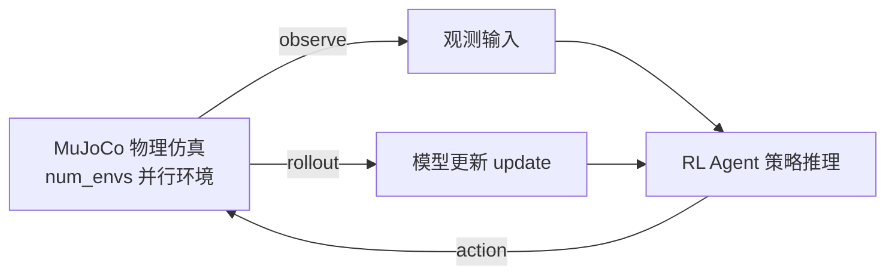

# LQC（Learning-based Quadruped Controller · 昇腾 A2 训推）

**LQC**（Learning-based Quadruped Robot Controller）是适用于足式 / 人形机器人的**强化学习运动控制**算法，支持宇树 G1、GO2 等多款本体的模型导入、一键式训练与推理验证。`cann-recipes-embodied-ai` 在**昇腾 Atlas A2** 服务器上完成优化与迁移，推动昇腾在足式机器人领域的场景化落地。

> 基于 IROS 2025 工作 *Learning Symmetric Legged Locomotion via State Distribution Symmetrization*（Chengrui Zhu 等）。运行依赖 **MuJoCo**（物理仿真引擎）、**FastNoise2**（噪声生成）、`EigenRand` / `exprtk`（C++ 子模块），用 conda（环境名 `lltk`）管理。

### 对称化机制（State Distribution Symmetrization）

IROS 工作的核心算法贡献是**状态分布对称化**——利用四足 / 人形机器人左右腿的镜像对称性，让策略学到对称步态。工程实现见 `lltk/utils/velocity_tracking/symmetry.py` 的 `SymmetryDef`：按对称索引对观测与动作向量做镜像重排。它以 `ex_pair`（偶对称，镜像后不变号）/ `nx_pair`（奇对称，镜像后取负，如左右横向速度）/ `cm_idx`（公共自对称分量）/ `ng_idx`（自对称取负分量）构造 `dst`（目标重排索引）与 `neg`（需取负索引）两个索引张量；对 `torch.Tensor` 即 `x[..., dst]` 取镜像再对 `neg` 维乘 `-1`。`symmetry_wrapper` 据此把策略包成 `SymmetricActor`（对称网络架构）或 `MirroredActor`（镜像世界），启用入口是 `--symmetry`：player 根据 args.symmetry 调用 symmetry_wrapper。`ppo.yml` 的 distribution 仅配置动作分布（如 init_std），不控制对称包装的启用。这是 LQC 能学到对称步态的承重机制。

## 整体形态

LQC 是 RL「环境仿真 ↔ 策略训练」闭环，工具链跨 C++ 仿真与 Python 训练算法（`lltk` 包桥接底层 C++ 与上层 Python）：

- 编译：`python build.py --backend mujoco`；校验 `from lltk import registry; print(registry.list_envs())` 列出支持的机器人类型。
- 三维资产（宇树 G1、GO2 物理模型）放在 `./resources`，供 MuJoCo 读取。

预置三种宇树 G1 训练配置：
- **g1**：腿部 12 自由度，平地。
- **g1_15dof**：15 自由度（腿部 12 + 腰部 3），平地。
- **g1_15dof.rough**：15 自由度 + 启用高程图，适用于崎岖地形 / 楼梯。

## 环境与部署

仓内提供预构建 ARM Docker 镜像（OBS `lqc-image.tar`），内置 MuJoCo / FastNoise2 / `EigenRand` / `exprtk` / conda(`lltk`)，免手工编译；按 README 挂载 8×`davinci` + 昇腾 driver/dcmi 即可。部署命令见源。

## 训练

- **单卡**：`python scripts/train.py -r <ROBOT> -n <RUN_NAME>`，默认 `Headless` 模式，权重存于 `logs/<TASK_NAME>/<RUN_NAME>`。
- **多卡 DDP**：`torchrun --nproc_per_node=8 scripts/train.py -r g1_15dof.rough`；需先 `./auto_patch_config.sh` 使能多卡并行训练性能优化代码。关键环境变量：`ASCEND_RT_VISIBLE_DEVICES`（可见 NPU 卡号，需与 `nproc_per_node` 一致）、`MASTER_PORT`（DDP 进程通信端口）、`WANDB_MODE=disabled`（无外网时禁用联网日志）。
- `num_envs`（所有卡 MuJoCo 仿真环境总数）在 `configs/<ROBOT>/env.yml` 定义；A2（32G 显存）单卡建议最大 `12288`，过大会显存不足。

### 多卡训练时间性能（A2 32G，G1 强化学习）

| 卡数 | num_envs | env step_time(s) | observe_time(s) | infer_time(s) | update_time(s) | 单回合平均总时间(s) | 相比单卡提速 |
|:---:|---|---|---|---|---|---|:---:|
| 1 | 12288 | 5.14 | 1.08 | 0.67 | 11.02 | 17.93 | 1.0× |
| 2 | 12288 | 4.70 | 1.21 | 0.49 | 5.26 | 11.67 | 1.5× |
| 4 | 12288 | 4.45 | 1.45 | 0.41 | 3.49 | 9.82 | 1.8× |
| 8 | 12288 | 4.26 | 1.55 | 0.37 | 2.80 | 9.00 | 2.0× |

提速主要来自 `update_time`（模型更新）随卡数显著下降（11.02→2.80 s）；`observe_time` 因跨卡观测聚合略升。多卡形态属 PyTorch DDP，参考同域 DDP 静态图优化 [ddp-static-graph](../techniques/ddp_static_graph.md)。

## 推理与渲染

`scripts/play.py <RUN_DIR/WEIGHT_PATH>` 加载权重做仿真验证，两种渲染：
- **离线渲染（推荐）**：`--command random --offline-render --record-video`，在 `/results` 下生成机器人运动仿真 MP4；推荐装 `PyOpenGL-accelerate`。
- **在线渲染**：经 X11 在本地屏幕实时渲染 MuJoCo viewer（`set_render.sh` 一键搭建 + 输入本地 IP，`export DISPLAY=<ip>:0.0`），建议用 MobaXterm 连接。

仓内提供训练好的 G1 15DOF Rough 权重供快速验证（解压到 `/logs/g1_15dof.rough`）。

  

宇树 G1 在 MuJoCo 中的运动仿真演示（含机器人运动、感知、地形环境）。来源：<a href="https://gitcode.com/cann/cann-recipes-embodied-ai/blob/21a5ed789ceb2a4b72277573f5ec5ec531b92ee1/locomotion/LQC/doc/images/MuJoCo_G1_demo.png">locomotion/LQC/doc/images/MuJoCo_G1_demo.png</a>

## Links

- 同域运动控制模型：[nmr](nmr.md)（人形 G1 动作重定向）
- 同域 DDP 优化：[ddp-static-graph](../techniques/ddp_static_graph.md)
- 同域智驾 VLA：[alpamayo-r1](../navigation/alpamayo_r1.md)
- 源：[cann-recipes-embodied-ai](https://gitcode.com/cann/cann-recipes-embodied-ai/tree/21a5ed789ceb2a4b72277573f5ec5ec531b92ee1)

## 当前样例资产位置

README 的预构建 ARM 镜像路径为 `cann-recipes-embodied-ai/lqc-image/lqc-image.tar`，物理模型资源路径为 `cann-recipes-embodied-ai/resources/resources.tar`（同一 OBS 下载根）。下载后分别按导入镜像与解压到 resources 的流程准备，不能继续沿用旧目录拼接地址。
