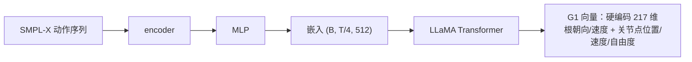

# NMR（Neural Motion Retargeting · SMPL-X→G1）

**NMR**（Neural Motion Retargeting）是将**人类 SMPL-X 动作重定向到宇树 G1 人形机器人**的神经网络方法，面向**昇腾引擎（Atlas A3 系列）**训练与部署。`cann-recipes-embodied-ai` 完成其在昇腾上的训练与推理迁移。

> 论文：Make Tracking Easy: Neural Motion Retargeting for Humanoid Whole-body Control（arXiv:2603.22201，Zhao 等，2026）。依赖上游 `GMR`（General Motion Retargeting，https://github.com/YanjieZe/GMR）作为子模块。

## 许可边界（重要）

`locomotion/NMR` 整体**非 Apache-2.0-only**：自研代码与 NMR 修改部分按 Apache-2.0 发布，但包含非商业 / 受限许可的第三方代码、模型与资产。特别地 `smplx` 及运行所需的 **SMPL-X 模型文件**受 SMPL-X / SMPLify-X 官方许可约束（通常仅限非商业科研用途），**不作为默认依赖自动安装**，需用户自行从 [SMPL-X 官方下载页](https://smpl-x.is.tue.mpg.de/download.php) 获取 `SMPLX_NEUTRAL.npz` 并遵守其许可；`cann-recipes-embodied-ai` 不分发该文件，商业用途需另行授权。

## 架构概述

模型 `RetargetTransformerPredMotionNoSMPLVQ` 是一个 **LLaMA 风格 Transformer 前馈式**（主配置用 `LlamaHfFwd`，整序列单次前向 + upsample，**非逐 token 自回归**；其 `sample` 显式 `raise NotImplementedError`）：



- **条件输入**：SMPL-X → encoder → MLP → 嵌入 `(B, T/4, 512)`。
- **输出**：预测 G1 向量。输出投影头 `self.projector = nn.Linear(n_embd, 217)` 为**硬编码 217 维**运动特征（30 关节），布局 `[0:2]` root XZ 速度 / `[2:8]` 6D 朝向 / `[8:8+30*3]` 关节点位置 + 后续速度 / `[-29:]` 29 维 DOF。代码注释明确「217 是宇树g1机器人运动特征维度…因此此处使用硬编码…如需适配其他机器人请修改此处」——本模型仅适配 Unitree G1，换机器人须改 `projector` 输出维。
- **损失**：Smooth L1。
- **模型规模**（`configs/retarget_fwd.py` `MODEL_SIZE` + `llama_configs`）：默认 `70M`（`n_layer=8 / n_head=8 / n_embd=512`，嵌入 512 维即来自此档），另预置 `111M`（12/12/768）、`343M`（24/16/1024）、`775M`（36/20/1280）四档；`vocab_size` 取 `n_embd`（直接出 feature、不预测 token——亦佐证「非自回归」），`block_size=1024` 为最大序列长度。

> 仅使用运动 Tokenizer 中的**运动编码器**部分（`src/models/tokenizers/`），主重定向模型在 `src/models/transformers/`。

## 依赖与资产准备（复现硬前置）

依赖以固定 README 及实际读取代码共同核对；其中碰撞评估资产按 humanoid_metric.py 的构造入口定位，不能将文档列出的其他 URDF 代作该指标的硬前置：

1. **GMR 子模块**（`tools/` 下）：
   ```bash
   cd tools && git clone https://github.com/YanjieZe/GMR.git   # → tools/GMR/
   ```
2. **5 个统计/辅助文件**（项目方预训练的统计量，[Google Drive](https://drive.google.com/drive/folders/1rcGPIPyPsklFnQF40l0vIWJjZQFtY_wF) 下载，非 SMPL-X 官方参数）：

   | 文件 | 目标路径 |
   | --- | --- |
   | `betas.npy` | `checkpoints/humanoid_model/g1/betas.npy` |
   | `gmr_mean.npy` / `gmr_std.npy` | `data/gmr_data/` |
   | `smplx_mean.npy` / `smplx_std.npy` | `data/smplx_data/` |
3. **SMPL-X 模型**：SMPL-X 官方下载页选 **"SMPL-X 2020: neutral model with FLAME 2020 expression blendshapes"**，下载得 `SMPLX_NEUTRAL_2020.npz` 后**重命名为** `SMPLX_NEUTRAL.npz` → `checkpoints/human_model/`（`cann-recipes-embodied-ai` 不分发，遵其非商业许可，见上「许可边界」）。`humanoid_model` 的 G1 文件按 [PHUMA asset](https://github.com/DAVIAN-Robotics/PHUMA/tree/f0306c1687c75aaa6623f5ed16c54f9480bb4f17/asset/) 说明自备。
4. **碰撞评估 URDF**：固定 HumanoidReconsMetric 实际读取项目根下 `tools/GMR/assets/unitree_g1/g1_custom_collision_29dof.urdf`，缺失会抛 FileNotFoundError。应准备对应 GMR 资产；将其他名称的 URDF 放到 src/metrics/assets/g1 不满足这条读取路径。

## 运行环境（昇腾 A3）

- 产品型号：**Atlas A3 系列**；框架 PyTorch 2.7.1、CANN 8.3.rc1、Python 3.11、aarch64。
- 推荐环境标识：`pytorch_2.7.1-cann_8.3.rc1-py_3.11-euler_2.10.11-aarch64-snt9b`。
- 基础依赖 `pip install -e .`；`smplx` 需手动 `pip install smplx`（同意 SMPL-X 许可后）。
- 训练入口 `tools/dist_train.py`，主配置 `configs/retarget_fwd.py`（`lr` 在第 144 行、`train_cfg` 在第 152 行；数据路径见 `TRAIN_SPLIT_FILE`/`TEST_SPLIT_FILE`）。

## 训练

脚本会自动识别可见卡数：外部分布式启动器已注入 `RANK`/`LOCAL_RANK`/`WORLD_SIZE` 时复用外部环境，否则自动拉起多卡训练。

```bash
# 昇腾引擎分布式训练（自动识别可见卡）
bash tools/dist_train.sh
# 单卡调试
PYTHONPATH=. python tools/train.py configs/retarget_fwd.py --work-dir work_dirs/debug
# 恢复 / 覆盖参数
PYTHONPATH=. python tools/train.py configs/retarget_fwd.py --work-dir work_dirs/xxx --resume auto
PYTHONPATH=. python tools/train.py configs/retarget_fwd.py --cfg-options train_cfg.max_epochs=500
```

默认训练参数（`configs/retarget_fwd.py`）：batch size **24**（train；val/test 32）、`max_epochs` **50**、优化器 AdamW（lr=**2e-5**）、调度 LinearLR（warmup 至 step 200）+ CosineAnnealingLR（T_max=50）；多卡可经 `MASTER_ADDR`/`PORT`/`ASCEND_RT_VISIBLE_DEVICES` 调整。
> ⚠️ 固定版本的 README step4 给出 batch 64 / epochs 1000 / lr 2e-4 / MultiStep，与同版本配置文件（24/50/2e-5/Cosine）不一致。

**数据长度约束**：`RetargetDataset` 在 `window_size > 0` 时固定采样长度为 `window_size`；样本 `T < window_size` 会在数据加载阶段直接抛 `ValueError`（不自动补齐）；初始化阶段按 `min_motion_length` 过滤、仅保留 `T >= min_motion_length` 的序列。

## 评估与推理

评估（`tools/nmr_inference.py`）指标：

指标表（`src/metrics/humanoid_metric.py` `compute_metrics` 返回）：

| 指标 | 说明 |
|---|---|
| MPJPE (`mpjpe`) | 平均关节位置误差（mm） |
| PA-MPJPE (`pampjpe`) | Procrustes 对齐后 MPJPE |
| W-MPJPE (`w_mpjpe`) | 加权 MPJPE |
| ACCEL (`accel`) | 平均关节加速度误差 |
| DOF 抖动比 (`dof_accel_ratio` / `dof_jerk_ratio`) | DOF 加速度 / jerk 比值，衡量关节抖动 |

> ⚠️ README 评估表列出 `DOF_ERR`「DOF 角度误差」，但 `compute_metrics` 未实现该指标；DOF 抖动以 `dof_accel_ratio`/`dof_jerk_ratio` 衡量，且 `compute_metrics` 额外返回 README 未列出的 `w_mpjpe`。

推理 `tools/inference.py` 把 SMPL-X 动作文件转为 G1 控制指令，支持单文件 / 目录批量 / `--no-filter`（禁用低通滤波）：

- **输入**：NPZ（`global_orient`(T,3) + `body_pose`(T,63) + `transl`(T,3)）或 PKL（`fullpose`(T,72) + `trans`(T,3)，SMPL 格式自动从 120→30 FPS 降采样）。
- **输出**（PKL）：`dof`(T,29) 关节角度、`root_trans`(T,3) 根节点位置、`root_rot_quat`(T,4) 根节点旋转（wxyz 四元数）。
- 长序列**自动按 4 秒分段推理并线性混合拼接**。

## Links

- 同域运动控制模型：[lqc](lqc.md)（RL 足式控制）
- 同域智驾 VLA：[alpamayo-r1](../navigation/alpamayo_r1.md)
- 源：[cann-recipes-embodied-ai](https://gitcode.com/cann/cann-recipes-embodied-ai/tree/21a5ed789ceb2a4b72277573f5ec5ec531b92ee1)
