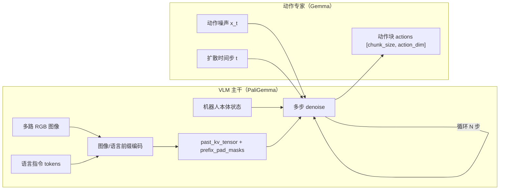

# Flow-Matching Action Expert（流匹配动作专家）

Pi0 / Pi0.5 系 VLA（Vision-Language-Action）模型的核心架构模块：**VLM 主干 + flow-matching 动作专家**双流结构。这是 `cann-recipes-embodied-ai` 操作类模型 [pi0](../manipulation/pi0.md) 与 [pi05](../manipulation/pi05.md) 共享的网络范式。

> 论文：π0: A Vision-Language-Action Flow Model for General Robot Control（arXiv:2410.24164）；π0.5: a Vision-Language-Action Model with Open-World Generalization（arXiv:2504.16054）。`cann-recipes-embodied-ai` 的适配基于 HuggingFace LeRobot 的 Pi0/Pi0.5 迁移实现。

## 双流结构

Pi0 把机器人策略表示为一个**条件去噪扩散 / 流匹配过程**，整体拆成「慢系统」VLM 主干 + 「快系统」动作专家两段：



- **VLM 主干（慢系统）**：基于 PaliGemma 的视觉语言模型，在这里展示的 Pi0 实现中处理多路 RGB 图像和语言指令，提取多模态前缀特征，输出可复用的 KV cache（`past_kv_tensor`）与前缀 padding 掩码（`prefix_pad_masks`）。一次推理只需执行一次。
- **动作专家（快系统）**：Pi0 的 state 在 embed_suffix 中经 state_proj 接入动作专家，不进入 embed_prefix；不能把这一状态接入方式直接推及 Pi0.5 的不同预处理。动作专家基于 Gemma 的 Transformer，复用 VLM 的 KV cache，从高斯噪声出发**多步去噪**（Pi0/Pi0.5 默认 `num_steps = 10`）生成连续动作块。该段需循环调用 10 次。

两段在推理流上**解耦**：VLM 计算 image/language prefix KV cache，action expert 在其上多步 denoise。这一边界既是模型原生结构，也被 OM 离线部署沿用为两段 OM 的切分点（见 [om-atc-offline](../techniques/om_atc_offline.md)）。

## 输入 / 输出契约

Pi0 单摄像头示例与 Pi0.5 双摄像头示例的 OM 输入输出契约：

| 项 | Pi0 示例 | Pi0.5 示例 |
| --- | --- | --- |
| 图像 `observation.images.*` | `[1, N_c, 3, H, W]`（如 480×640） | `[1, 3, 256, 256]` ×2 路 |
| 状态 `observation.state` | `[1, N_k]`（自由度） | `[1, 8]` |
| 语言 token | — | `[1, 200]`（int64） |
| 拼接序列长度 | 由摄像头数决定 | `968 = 3×256 + 200` |
| 注意力掩码 | （bool）| `prefix_att_masks` `[1,968]` bool + `prefix_att_2d_masks_4d` `[1,1,968,968]` float32（Pi0.5 显式 4D mask，Part1/Part2 接口关键张量） |
| `chunk_size` | 50 | 50 |
| `max_action_dim` | 6（koch torch 示例）/ 14（aloha OM 示例） | 32（输出后按实际自由度截断，如 7/14） |

`chunk_size` 是一次预测的机器人执行步数（动作块），动作以 action-chunking 方式整段输出而非逐步预测——这一点与 [action-chunking](action_chunking.md) 同源。

## 昇腾亲和的算子重构

VLM 主干与动作专家都是标准 Transformer 堆叠，原生开箱在 NPU 上存在严重 **host-bound**（device 等待逐算子下发）且 AI_CORE 大算子占比低。在 `paligemma_with_expert.py` 上做的几项昇腾亲和改造（在 Pi0 torch 推理优化版生效）：

- **Rotary（RoPE）融合**：用 `torch_npu.npu_rotary_mul` 替换手写旋转编码；把 Q/K 拼接后一次旋转再 split，并将 sin/cos 计算提到 for 循环外统一计算、减少重复。
- **Flash-Attention 融合**：FA 段替换为 `torch_npu.npu_prompt_flash_attention`（`input_layout="BSND"`，`pre/next_tokens=65535`）。注意 attention mask 数学语义差异：原 bool `True` 位置需转换为负无穷，`paligemma_with_expert.py` 统一 `logical_not → int8` 再喂入。这复用了昇腾的注意力融合能力，对照 [fused-infer-attention-score](../../../inference/concepts/kernels/fused_infer_attention_score.md)（FIA 在 NPU 上的注意力融合）。
- **RMSNorm + 残差融合**：first residual 的 layernorm+add 替换为 `torch_npu.npu_add_rms_norm`，`input_layernorm` 用 `torch_npu.npu_rms_norm`；注意乘积系数差异（权重需 `.add(ones_add)` 偏置）。
- **QKV 融合**：把 q/k/v 三个独立投影 concat 成单个 `qkv` 线性层一次大矩阵乘，再 split，提升 Cube 利用率、减少缓存换入换出。
- **图模式整图编译**：用 torchair 把慢系统与快系统尽可能整图编译，消除 host-bound（见下）。

Pi0 koch 推理样例在 Atlas A2、CANN 8.3.RC1、torch-npu 2.1.0.post12 下的优化后 profiling 观测（不代表 Pi0.5 或其他硬件）：昇腾计算时间总占比提升至 94%，AI_CORE 融合算子占比提升至 50%，单次推理总耗时 71.6 ms（空闲 4.58 ms）；端到端约 80 ms。

> 训练侧也有同源融合：Pi0.5 训练默认开启 `PI05_FUSE_PALIGEMMA_QKV`、`PI05_USE_NPU_FUSION_ATTENTION`（`npu_fusion_attention`，约 +5%）、Gemma MLP grouped GEMM（`gate_proj`/`up_proj` 合并，约 +1%）。详见 [gradient-checkpoint-refine](../techniques/gradient_checkpoint_refine.md)。

## 图模式应用

慢/快两系统通过 torchair 整图编译消除 host-bound（`modeling_pi0.py`）：

```python
config = CompilerConfig()
config.experimental_config.frozen_parameter = True
config.experimental_config.tiling_schedule_optimize = True
npu_backend = tng.get_npu_backend(compiler_config=config)
self.compiled_embed_and_model_forward = torch.compile(
    self.embed_and_model_forward, dynamic=False, fullgraph=True, backend=npu_backend)
self.denoise_step_all_compile = torch.compile(
    self.denoise_step_all, dynamic=False, fullgraph=True, backend=npu_backend)
```

图模式机制详见 [npu-graph-mode](../../../inference/concepts/techniques/npu_graph_mode.md)；torchair 编译入口见 [torchair](../../../inference/concepts/frameworks/torchair.md)。该固定 Pi0 实现为 prefix 编码编译一张图、单步 denoise 编译一张图；sample_actions 的 Python for 循环重复调用 denoise_step_all_compile，默认 10 次。没有把整个 10 步循环编译成单图；Pi0.5 的编译行为须另查对应实现。

## OM 离线版的算子退化

OM 离线部署（310P）目标不同于 torch 推理优化版：优先保证 ONNX 导出 / ATC 编译 / OM Runtime 稳定，因此把上述融合算子**改回基础算子组合**——`npu_rotary_mul`→手写 RoPE（`sin(x+π/2)` 表达 cos）、`npu_prompt_flash_attention`→基础 matmul+softmax attention、融合 RMSNorm→普通 module 调用 + 显式残差，并把嵌套 `past_key_values` 展平为单个 `Tensor(L,2,B,S,H,D)`。细节见 [om-atc-offline](../techniques/om_atc_offline.md)。

## Links

- 应用模型：[pi0](../manipulation/pi0.md)、[pi05](../manipulation/pi05.md)
- 同源动作块结构：[action-chunking](action_chunking.md)
- 离线部署：[om-atc-offline](../techniques/om_atc_offline.md)、[ascend-310p](../platforms/ascend_310p.md)
- 训练优化：[gradient-checkpoint-refine](../techniques/gradient_checkpoint_refine.md)、[ddp-static-graph](../techniques/ddp_static_graph.md)
- 注意力融合与图编译：[fused-infer-attention-score](../../../inference/concepts/kernels/fused_infer_attention_score.md)、[npu-graph-mode](../../../inference/concepts/techniques/npu_graph_mode.md)、[torchair](../../../inference/concepts/frameworks/torchair.md)
- 源：[cann-recipes-embodied-ai](https://gitcode.com/cann/cann-recipes-embodied-ai/tree/21a5ed789ceb2a4b72277573f5ec5ec531b92ee1)
- 应用于：[smolvla](../manipulation/smolvla.md)（SmolVLA 同样采用 VLM 主干 + flow-matching 动作专家）

## Pi0.5 在线 mask 的当前实现

Pi0.5 的 torch 适配补丁使用 `_inference_dtype()` 决定 `torch.finfo(dtype).min`，将 4D bool mask 转成 0/该有限最小值的加性 mask。这是该在线补丁的数值契约，不能把 Pi0 融合算子的 bool mask 约定或 OM 静态接口直接套到它上面。
