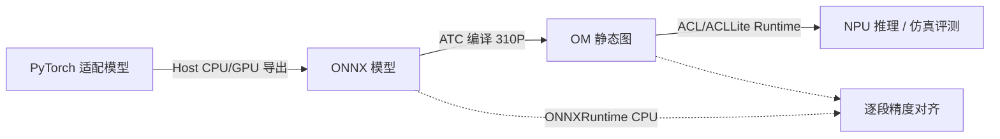

# OM/ATC 离线静态图推理（310P 部署范式）

`cann-recipes-embodied-ai` 操作类 VLA 模型在 **Ascend 310P**（OrangePi AI Station 等边缘形态）上的离线推理部署范式：**PyTorch → ONNX → ATC → OM**，固定 shape、静态图、ACL Runtime 执行。Pi0、Pi0.5、ACT、Diffusion-Policy 的 `infer_with_om/` 样例共享这条链路。

> 这是离线静态图模式，与在线 torch 推理的 torchair 整图编译（[npu-graph-mode](../../../inference/concepts/techniques/npu_graph_mode.md)）是两种「静态图」路线：前者把图固化为 OM 文件离线执行，后者在 torch 运行时 JIT 编译入图。两者目标都是消除逐算子下发开销，但 OM 路线更适合 310P 边缘推理且与训练/在线推理代码解耦。

## 四阶段链路

来自 `docs/manipulation/pi0/infer_with_om/README.md` 与 `docs/deployment_troubleshooting.md`：



1. **导出 ONNX**（在 310P 宿主机 Host CPU/GPU 上）：用适配脚本把 PyTorch 模型导出为 ONNX，默认用 ONNXRuntime CPU 对比 PyTorch 输出，打印 max/mean abs diff。
2. **ATC 转 OM**（在 310P 上，需先 `source set_env.sh`）：
   ```bash
   atc --model=outputs/onnx/pi0-vlm.onnx \
       --framework=5 \
       --output=outputs/om/pi0_vlm \
       --soc_version=Ascend310P1 \
       --precision_mode_v2=origin
   ```
   `--soc_version` 须与 `npu-smi info` 显示的芯片型号一致（310P1 → `Ascend310P1`）。
3. **OM 精度验证**：`verify_om_onnx_*.py` 按 ONNX input order 构造确定性 dummy 输入，对比 ONNXRuntime(CPU) vs OM(NPU) 的余弦相似度 / max-abs-error。
4. **端到端推理 / 仿真评测**：`run_om_e2e.py` 串联各段 OM；`eval_*_ascend.py` 接入 LeRobot eval / MuJoCo 仿真（仿真在 CPU、推理在 NPU）。

## 多段 OM 切分（Pi0 / Pi0.5）

Pi0/Pi0.5 不一次性导出完整图，而是拆成 **VLM（part1）** 与 **action expert（part2）** 两段 OM（`docs/manipulation/pi0/infer_with_om/README.md` §2）：

- 降低 ATC 转换内存开销——完整图含视觉编码器 + 前缀处理 + KV cache + 多步去噪，整体大，一次性转换易触发内存压力或编译失败。
- 固定 VLM 输出的中间张量边界：VLM 段输出 `past_kv_tensor`、`prefix_pad_masks`，action expert 段把它们作为显式输入，利于单独验证两段精度。
- part2（动作专家）需多次调用（Pi0 中 10 次去噪），单独成段避免把循环展开进一张大图。
- VLM 导出阶段会落盘 `runtime_save/past_kv_tensor.pth`、`runtime_save/prefix_pad_masks.pth`，action expert 导出阶段读取它们复用一致的中间特征——两步须用相同 `--runtime-save-dir`。

ACT 模型推理路径短（无多步去噪），整模型导出为单个 `act.om`。模型结构边界见 [flow-matching-action-expert](../modules/flow_matching_action_expert.md) 与 [action-chunking](../modules/action_chunking.md)。

## 为 ONNX/ATC 导出而做的算子退化

OM 版本与在线 torch 推理优化版**目标不同**：torch 版优先用 `torch_npu` 融合算子提性能；OM 版优先保证 ONNX 导出、ATC 编译、OM Runtime 稳定，因此把融合算子改回**更易导出/编译的基础算子组合**（`docs/manipulation/pi0/infer_with_om/README.md` §3）：

| 项 | torch 推理优化版 | OM 离线版 |
| --- | --- | --- |
| KV cache | Python list/dict 嵌套 | 展平为 `Tensor(L,2,B,S,H,D)`（`flatten_kv`/`unflatten_kv`） |
| RoPE | `torch_npu.npu_rotary_mul` | 手写 `sin/cos`，用 `sin(x+π/2)` 表达 cos |
| Attention | `npu_prompt_flash_attention` | 基础 `matmul + softmax + where(mask)` |
| RMSNorm + 残差 | `npu_rms_norm` / `npu_add_rms_norm` | 普通 module 调用 + 显式残差 |

退化的好处是逐段可对齐精度、便于定位 mask/shape/dtype 问题。dtype 约束很关键：图像与 state 在 VLM 用 `float32`，action expert 的 state/KV/time/noise 多用 `float16`，`lang_tokens` 用 `int64`，mask 用 bool；`cumsum` 前 mask 须转整型再转回 bool。

退化算子的关键写法（`docs/manipulation/pi0/infer_with_om/README.md` §3.2–3.4 原文）：

- **RoPE**：用 `sin(x+π/2)` 表达 cos，规避部分环境 cos 导出精度/差异不一致：
  ```python
  sin = torch.sin(radians)
  cos = torch.sin(radians + math.pi / 2)
  res[..., :d_half] = x1 * cos - x2 * sin
  res[..., d_half:] = x2 * cos + x1 * sin
  ```
- **Attention**：bool mask 经 `torch.where(..., big_neg)` 而非加性负无穷：
  ```python
  att_weights = torch.matmul(query_states, key_states.transpose(2, 3))
  att_weights *= head_dim**-0.5
  masked_att_weights = torch.where(attention_mask[:, None, :, :], att_weights, big_neg)
  probs = nn.functional.softmax(masked_att_weights, dim=-1)
  att_output = torch.matmul(probs, value_states.permute(0, 2, 1, 3))
  ```
- **RMSNorm + 显式残差**（`after_first_residual = out_emb.clone()` 切断重算依赖）：
  ```python
  hidden_states = layer.input_layernorm(hidden_states)
  out_emb = layer.self_attn.o_proj(att_output[:, start:end]); out_emb += hidden_states
  after_first_residual = out_emb.clone()
  out_emb = layer.post_attention_layernorm(out_emb); out_emb = layer.mlp(out_emb)
  out_emb += after_first_residual
  ```

> **复现要点（版本钉死 + 文件清单，Pi0 OM）**：`pip install numpy==1.26.0`（ATC 兼容）、`transformers==4.55.4`（随样例模型训练版本，否则 Gemma 补丁 `git apply --check` 失败）；需 cp 三个适配文件到 lerobot `policies/pi0/`：`modeling_pi0_vlm.py` / `modeling_pi0_action_expert.py` / `paligemma_with_expert_fp16.py`（fp16 适配版）；`normalize.py`（归一化修复）单独 cp 到上一级 `policies/`（非 `policies/pi0/` 子目录，否则归一化修复落不到位），再 `git apply -p1 lib/modeling_gemma.patch`（§4）。Pi0.5 OM 另需 `apply_symbolic_opset14_patch.sh` 对 `torch/onnx/symbolic_opset14.py` 打补丁（**针对 `torch==2.7.1`**，版本不同需自改 patch；`manipulation/pi05/infer_with_om/README.md`）。

## 已验证 OM 性能（Pi0.5，310P）

`manipulation/pi05/infer_with_om/README.md`：

推理速度（表 1）只有耗时列，无相似度列：

| 模块 | 平均耗时 (ms) |
| --- | ---: |
| PaliGemma（Part1，每次 1 调用） | 223.08 |
| Gemma（Part2，每次 10 调用） | 15.58 |
| End-to-End（Part1 + 10×Part2 + KV 拷贝） | 410.2 |

动作正确性（表 2，整体 OM vs PyTorch，非 Part1 专属）：对最终动作张量 `[1,50,7]` 比较，平均余弦相似度 0.999984、最小 0.999850、最大 1.000000、标准差 0.000029。

## 常见部署阻塞（跨样例共性）

来自 `docs/deployment_troubleshooting.md`（仅收录 2+ 样例共现问题）：

- **ATC 失败 / `acl.mdl.execute error 507011`**：未 `source set_env.sh`，或 `--soc_version` 与芯片不符，或复用旧 OM。换模型/分辨率/动作维度后必须重导 ONNX 重转 OM。
- **`ModuleNotFoundError: acllite_*` / `import acl` 失败**：ACLLite 路径未入 `PYTHONPATH`，`export PYTHONPATH=/path/to/Ascend/ascend-toolkit/latest/thirdpart/python/:$PYTHONPATH`。
- **输入 shape/dtype/顺序不匹配**：OM 输入顺序须与 ONNX `input order` 一致，各输入 dtype 与导出时一致（NPU/ATC 对 dtype 组合敏感）。
- **归一化处理器丢失 / 动作维度截断**：OM 输出 action 落不回动作空间。ACT、Diffusion-Policy 走 `policy_preprocessor`/`policy_postprocessor`，缺失则用 `migrate_policy_normalization.py` 生成 `<dir>_migrated/`；Pi0/Pi0.5 走 `run_om_e2e.py --mean-path/--std-path`，并由 `_to_action_14` 把 32 维动作截断到目标自由度——**换机器人/动作维度时不应只依赖默认 `_to_action_14` 截断**，否则维度映射错位（§10）。
- **无头渲染缺 `libOSMesa.so.0`**：`MUJOCO_GL=osmesa` + 安装 `libosmesa6` / `mesa-libOSMesa`。
- **HuggingFace gated model（paligemma）**：`HF_ENDPOINT=https://hf-mirror.com`，离线改本地路径。

## 分段导出 / 验证 / 推荐排查顺序

Pi0/Pi0.5 OM 是**两段图**（VLM Part1 + action expert Part2）：VLM 导出产出 `runtime_save/{past_kv_tensor,prefix_pad_masks}.pth` 供 action expert 复用——分步运行须先 `convert_verify_onnx_vlm.py` 再 `convert_verify_onnx_action_expert.py`，**两步用同一 `--runtime-save-dir`**（§6）：

```bash
./run_pi0_export.sh --pretrained-policy-path /path/to/pi0_model --runtime-save-dir runtime_save
ls runtime_save/past_kv_tensor.pth runtime_save/prefix_pad_masks.pth   # 确认 VLM 段产出
```

**分段验证**（先各自 ONNX↔OM 对齐，OM 输入顺序须与 ONNX input order 一致；§9）：

```bash
python3 verify_om_onnx_vlm.py --onnx-model-path outputs/onnx/pi0-vlm.onnx --om-model-path outputs/om/pi0_vlm.om
python3 verify_om_onnx_action_expert.py \
  --onnx-model-path outputs/onnx/pi0-action_expert.onnx --om-model-path outputs/om/pi0_action_expert.om \
  --past-kv-path runtime_save/past_kv_tensor.pth --prefix-mask-path runtime_save/prefix_pad_masks.pth
```

> VLM 精度正常而 action expert 异常时，重点查 `runtime_save` 是否来自同一次 VLM 导出、AE 的 `--lang-len`/`--noise-shape` 是否与导出时一致（§9）。

**推荐排查顺序（§12，避免端到端仿真里混合排查）**：① LeRobot commit / transformers 补丁 / Pi0 适配文件 → ② 本地路径 `PI0Policy.from_pretrained` → ③ VLM ONNX 导出（确认 runtime_save）→ ④ action expert ONNX 导出（ONNXRuntime 对比通过）→ ⑤ ATC 分别生成两段 OM → ⑥ 分别跑 ONNX vs OM 验证 → ⑦ `run_om_e2e.py` 端到端动作检查 → ⑧ 最后接 `eval_pi0_ascend.py` 仿真。

**Pi0.5 OM 命令链**（脚本名与 Pi0 不同；`manipulation/pi05/infer_with_om/README.md`）：`convert_pi05_part1.py` / `convert_pi05_part2.py`（PyTorch→ONNX，自动验精度）→ `pi05_onnx_e2e.py`（CPU 跑通整去噪 pipeline，得 `onnx_baseline_action.pt`）→ `pi05_om_e2e.py`（NPU，得 `om_baseline_action.pt`）→ `compare_action.py --file1 om_baseline_action.pt --file2 onnx_baseline_action.pt`（验精度）→ `lerobot_eval_om.py`（LIBERO 仿真评测）。

## 与 npu-graph-mode 的关系

OM/ATC 离线静态图是「图固化离线执行」路线，torchair 整图编译（[npu-graph-mode](../../../inference/concepts/techniques/npu_graph_mode.md)、[torchair](../../../inference/concepts/frameworks/torchair.md)）是「torch 运行时入图」路线。Pi0 同时存在两套：torch 推理优化版走 torchair 图模式，OM 版走 ATC 离线静态图。

## Links

- 目标平台：[ascend-310p](../platforms/ascend_310p.md)
- 模型结构：[flow-matching-action-expert](../modules/flow_matching_action_expert.md)、[action-chunking](../modules/action_chunking.md)
- 应用模型：[pi0](../manipulation/pi0.md)、[pi05](../manipulation/pi05.md)、[act](../manipulation/act.md)
- 跨域对照：[npu-graph-mode](../../../inference/concepts/techniques/npu_graph_mode.md)、[torchair](../../../inference/concepts/frameworks/torchair.md)、[fused-infer-attention-score](../../../inference/concepts/kernels/fused_infer_attention_score.md)
- 源：[cann-recipes-embodied-ai](https://gitcode.com/cann/cann-recipes-embodied-ai/tree/aed7a4788dfe94f6b90084f16ce493f9969471b1)

<!-- cannbot:related:start -->
## 相关

- [Ascend 310P（OM 离线推理目标平台）](../platforms/ascend_310p.md)（`related`）：Ascend 310P 执行 VLA 模型经 PyTorch → ONNX → ATC 转换得到的固定 shape OM 静态图，运行时依赖 ACL Runtime。
- [NPU 图模式（ge_graph / npugraph_ex）](../../../inference/concepts/techniques/npu_graph_mode.md)（`related`）：“前者把图固化为 OM 文件离线执行，后者在 torch 运行时 JIT 编译入图”与“图模式通过 `torch.compile` 把前向逻辑捕获成图、交给 NPU 后端编译执行”给出了部署时在 OM 离线固化和 torch 运行时入图之间选路的直接对照。
- [Pi0.5（π0.5 · 开放世界泛化 VLA · 昇腾训练/在线推理/OM 离线三链路）](../manipulation/pi05.md)（`related`）：Pi0.5 在 310P 上按 PyTorch → ONNX → ATC → OM 链路部署，并分别验证 VLM 与动作专家两段的精度。
- [Pi0（π0 · VLA 流匹配模型 · 昇腾训练/在线推理/OM 离线三链路）](../manipulation/pi0.md)（`related`）：Pi0 的 310P 离线部署将 VLM 与动作专家分别导出为 OM，通过 `past_kv_tensor` 和 `prefix_pad_masks` 衔接，并由 `run_om_e2e.py` 串联执行。
<!-- cannbot:related:end -->
