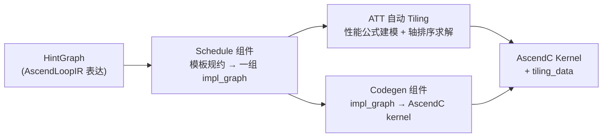

# AutoFuse（Inductor NPU 自动融合编译组件）

## Summary

**AutoFuse** 是 CANN 框架继承自 PyTorch Inductor 的**面向 NPU 的即时编译（JIT）算子自动融合组件**。其定位是：把模型中动态、细粒度的小算子组合（如 [mhc](../modules/mhc.md) 的 `hc_pre` / `hc_post`、归一化、Elementwise/Reduce 片段）**自动**融合成高效的 [ascendc](ascendc.md) kernel，免去传统手写融合算子的开发成本。

设计上，AutoFuse **扩展了 Inductor 在 NPU 上的 Codegen 后端**：通过将 InductorLoopIR 转换为 AscendLoopIR，调用 AutoFuse 模块做 Schedule 模板选择、UB 复用与 Tiling 调优，最终生成 AscendC Kernel 实现。它与 [npu-graph-mode](../techniques/npu_graph_mode.md) 的 `torch.compile` 图捕获是上下游关系：图模式负责把前向逻辑捕获成图，AutoFuse 负责把图中的 vector 子图编译成 NPU 亲和的融合 kernel。

> AutoFuse 模块源码位于 `cann/ge` 的 `compiler/graph/optimize/autofuse`；对接参考实现为 [`inductor_npu_ext`](https://gitcode.com/Ascend/torchair/blob/41af5b5871232805a670bd62527e4d0a7b7ab446/experimental/_inductor_npu_ext/)（位于 `Ascend/torchair` 仓）。

## 使能方式

后端扩展负责接入 Inductor 编译链；具体导入、编译范围选择和验收由[部分编译规则](../../optimizations/rules/inductor_autofuse_partial_compile_scope.md)维护。固定模型中仅含装饰器不等于它自带后端注册。

## JIT 算子生成的三阶段

算子的核心交付件为 kernel 源码与 tiling 源码。AutoFuse 把生成过程抽象为：



1. **AscendLoopIR** 是抽象算子计算过程的表达 IR，描述计算过程、切分轴、UB 内存等信息。
2. **Schedule** 处理 HintGraph：依据实际硬件能力，产出能应对所有 shape 场景的**全量轴切分策略**。每个具体切分策略由一张 impl_graph（AscendLoopIR）承载，组合成一组 impl_graphs 喂给 ATT 与 Codegen。
3. **ATT（Auto Tiling）** 为每个 impl_graph 生成 tiling 代码；执行时按具体 shape 评估每个 impl_graph 对应 kernel 模板的性能，选最优模板、算切分参数，通过 `tiling_data` 传给 kernel。
4. **Codegen** 为每个 impl_graph 生成 kernel 代码，每个 impl_graph 对应一份模板实现；执行时按 `tiling_data` 决定实际执行的模板与循环搬入参数。

### Schedule：模板规约（AutoSchedule）

NPU 上硬件单元一次运行可完成批数据向量运算，需准确选择**向量运算轴、分核切分轴、UB 切分轴**——这三种轴选择错误就会出现 UB 超载（功能问题）或性能严重劣化。不同 shape 通常亲和不同切分策略（特定策略的算子实现称为**模板**）。AutoFuse 作为 JIT 融合技术选择折中：提供**多模板但对适用场景做抽象规约**，用有限模板数覆盖绝大多数 shape。

AutoSchedule 把融合图各计算节点抽象为几类 **ComputeType**，按每类在 NPU 上的最优切分方式，用 **AxisGroup** 对轴做语义分组，经 **Merge 规则**生成适用于所有节点的公共 AxisGroup，最终生成多种切分候选方案（**TilingCase**）。

| ComputeType | 典型算子 | NPU 切分特点 | 轴分组特征 |
| --- | --- | --- | --- |
| Elementwise | Add, Mul, Relu | 可任意维度切分，支持向量化 | 全部归入 Y 组 |
| Broadcast | 广播算子 | 处理不同 shape 对齐 | 计算轴归入 Y 组 |
| Reduce | Sum, Max, Min | 归约轴需特殊处理 | 归约轴 R 组，非归约轴 Y 组 |
| Concat | 拼接 | 拼接维度不能切分 | 非拼接轴归入 Y 组 |

AxisGroup：**X 组**=需完整数据的轴（如 Concat 拼接轴）、**Y 组**=元算子计算轴（可灵活 UB 切分）、**R 组**=Reduce 归约轴（专用多核归约策略）。Merge 规则（节选）：`Y+Y→Y`、`Y+R→升级为 R`（Reduce 优先级高）、`Y+YR→扩展为 YR`。Schedule 对每个 TilingCase 执行 TileSplit（UB 级）/ BlockSplit（多核）/ ReduceBlockTiling（Reduce 专用）/ 向量化等调度变换。

以 Reduce 多模板为例：**全载模板**（Reduce 后节点≤4 且 AR/ARA 模式，不切 Reduce 轴，适合小数据简单图）、**通用模板**（默认，UB+Block 切分）、**R 轴分核模板**（数据规模大且可切，Reduce 轴作多核切分轴）——只用通用模板会在大 R 轴下 UB 超载，在小数据下因核启动开销影响性能。

### ATT：基于硬件建模、动态求解的自动 Tiling（高价值机制）

Schedule 给出应对不同 shape 的模板集合后，执行时需配套技术正确选模板、输出核切分/UB 切分——算错会直接导致 UB 越界或性能急剧劣化。此工作由 **ATT（Auto Tiling）** 完成：通过预置性能建模 + 多样求解策略，保证泛化场景的功能正确与普适性能，并平衡求解准度与速度。两大挑战是**性能评估困难**（不同模板在 GM/UB 非连续性、向量化对齐、循环次数、计算/搬运瓶颈上差异大）与**分核/分块权衡**（增分核带来核启动开销，减分核致单核过载）。

ATT 从 IR 提取关键信息并做**符号化表达**：

- **约束符号化**：LocalBuffer 占用约束（每级 TQue/TBuf+临时 Buf 之和不超 UB 大小，IR 表达 Tensor 的 location 与复用关系）、核数占用约束、切分约束（子轴≤父轴、切分轴 32B 对齐等）。
- **各流水耗时符号化**：对每个 API 做性能建模，按 IR 循环轴确定调用次数，推导各流水线总耗时。基于**瓶颈流水线简化理论**——假设瓶颈流水的执行可较好掩盖非瓶颈流水，总耗时主要体现在瓶颈流水时间上。

ATT 据此生成 Tiling 求解器代码，默认生成 **轴排序 Tiling 求解器**：以"存储占用不超 NPU 各级物理存储"为约束保证基础解性能，以"最小化瓶颈执行单元耗时"为优化目标提升性能上限；另提供可选的**启发式迭代求解器**（从初始解沿性能公式梯度下降方向在可行域内搜索直到公式值最小）。

**性能公式建模**决定模板选择/轴排序核数调整/启发式求解的准确性。搬运类 API 建模流程：识别主要因素（数据量、GM/UB 非连续性、向量化宽度对齐、分核数、Pipe/API 头开销、调用次数）→设计性能公式→实验验证→符号化表达。例如 MTE2 开销公式（h=API 头开销、DataSize=数据量、Count=调用次数、H=Pipe 头开销、T=带宽）：

```
Cost(MTE2) = ((DataSize / T + h) * Count) + H
```

其中 `带宽 T` 是与向量化宽度对齐、分核数、GM/UB 非连续性相关的因变量。计算类 API 对**稳定基础 API** 采集性能数据建模，对**易变 API** 基于调用逻辑计算入参/调用次数生成完整模型。

**轴排序求解器**按策略确定轴优先级；这里的优先级表示优先不切该轴。固定来源以适合 API 头开销较大场景的 **UB 优先贪心算法**为例：父轴优先于子轴是功能性约束，规约化轴、广播轴、非最内轴等排序属于该策略的启发式。该示例的核内 Tiling 逆序遍历变量，在硬件约束内调大取值，不满足时二分调整；分核 Tiling 再遍历多核变量，优先选择核数较大的可行记录。这不是所有轴排序算法的共同流程；来源另列 UB/核数权衡和对称切分策略。

### Codegen：impl_graph → AscendC kernel

Codegen 解析 Schedule 生成的 impl_graph，生成融合算子的 host_code（tiling_func / infer_shape / get_kernel）与 kernel_code（kernel + tiling_data），并完成编译。impl_graph 上承载 shape 信息、节点信息（如 Abs 节点的 `.axis` / `.loop_axis` / `.api.compute_type=elewise` / `.api.unit=Vector` / 输出 tensor 的 `.mem.alloc_type=Queue` / `.hardware=UB` / `.position=TPosition::VECOUT` / `.que.depth/.buf_num/.reuse_id` 等）、轴信息（ORIGINAL / TILE_OUT/TILE_IN / BLOCK_OUT/BLOCK_IN 各级切分轴及其 align 属性）。

Codegen 生成的 kernel 代码以 AscendC API 为基础。针对不同切分策略，Schedule 生成多个模板（对应不同 impl_graph），Codegen 依次解析生成模板函数，在核函数入口按 `tiling_key` 调用不同模板函数（如 `if (TILING_KEY_IS(0)) {...} else if (TILING_KEY_IS(1)) {... _unaligned}`）。不同模板的 for 循环与每次处理的向量化轴不同（如 tiling_key=0 切 z1 轴、tiling_key=1 切 z0 轴）。

### AscendLoopIR 简介

AscendLoopIR 是一套基于 Loop 定义的 IR，其 type 映射到明确的 vector 计算（如 Add、Mul）。多个 AscendLoopIR 组成的 DAG 称 **AscGraph**，表达算子多层循环中的多步计算：每步计算对应图中一个节点（由 AscendLoopIR 实例化），有向边表示数据传递，节点属性指定该计算所处的循环层级。节点通常嵌套在多层循环中被循环多次执行——通过 `sched.axis` 与 `output.axis` 的灵活组合（配合 repeats/stride），可表达广播、规约、非连续搬运等复杂计算形式；把最内轴向量化、循环上提即得到向量计算。

## 与图模式/图后端的边界

- AutoFuse 是**编译组件**（继承 Inductor、生成融合 kernel），归入 framework；[npu-graph-mode](../techniques/npu_graph_mode.md) 是**图捕获/执行技术**（`torch.compile` 把前向捕获成图并交后端）；[torchair](torchair.md) 是昇腾**图后端**（`ge_graph` / `npugraph_ex`，FX→Ascend IR→GE 引擎，或 npugraph capture & replay）。
- 三者协作链路：`torch.compile`（图捕获）→ Inductor Codegen 后端（AutoFuse 扩展，vector 子图 JIT 融合成 AscendC kernel）。AutoFuse 与 TorchAir 的 GE/npugraph_ex 后端是 Inductor 路径与 GE 图路径两条不同的 NPU 后端选择。

## 典型片段收益

[A3 部分编译和 hc_post 来源观测](../../optimizations/benchmark_observations/autofuse_a3_source_benchmark.md)维护输入、baseline、计时和限制。

## Evidence

- [cann-recipes-infer](https://gitcode.com/cann/cann-recipes-infer/tree/2c45117d781ab9ab88dcb89a28ae30f5d2450399) — [`docs/models/deepseek-v4/deepseek_v4_autofuse_guide.md`](https://gitcode.com/cann/cann-recipes-infer/blob/2c45117d781ab9ab88dcb89a28ae30f5d2450399/docs/models/deepseek-v4/deepseek_v4_autofuse_guide.md)（406 行主源：Inductor 对接、Schedule 模板规约/AutoSchedule、ATT 自动 Tiling 性能建模+轴排序求解器、Codegen、AscendLoopIR）
- [cann-recipes-infer](https://gitcode.com/cann/cann-recipes-infer/tree/2c45117d781ab9ab88dcb89a28ae30f5d2450399) — [`models/deepseek-v4-flash-tilelang-and-inductorAF/README.md`](https://gitcode.com/cann/cann-recipes-infer/blob/2c45117d781ab9ab88dcb89a28ae30f5d2450399/models/deepseek-v4-flash-tilelang-and-inductorAF/README.md) / [`model.py`](https://gitcode.com/cann/cann-recipes-infer/blob/2c45117d781ab9ab88dcb89a28ae30f5d2450399/models/deepseek-v4-flash-tilelang-and-inductorAF/model.py)（实现：`@torch.compile` 装饰 `RMSNorm.forward`/`Expert.forward`/`hc_pre`/`hc_post`/`hc_head`（model.py:345/802/925/936/1010）；`hc_post` 计算式与 guide 一致；`hc_split_sinkhorn` 经 `torch.library.Library("tl","FRAGMENT")` 封装、暴露为 `torch.ops.tl.hc_split_sinkhorn` 自定义算子（model.py:34-53）。`import inductor_npu_ext` 仅见于 guide/README 文档片段，参考模型的 .py 文件未包含该 import）
- AutoFuse 模块源码（cann/ge）：[`cann/ge compiler/graph/optimize/autofuse`](https://gitcode.com/cann/ge/tree/e69d5b4a4945238a595bb56a5fba7941ef8c8316/compiler/graph/optimize/autofuse)；对接参考实现 [`inductor_npu_ext`](https://gitcode.com/Ascend/torchair/blob/41af5b5871232805a670bd62527e4d0a7b7ab446/experimental/_inductor_npu_ext/)（`Ascend/torchair` 仓）
- 溯源（diff `2f82d10..2c45117`）：`377f20f` Add DeepSeek-V4-Flash Model and Tilelang SFA&MHC Kernel/InductorAF and Document（autofuse guide + InductorAF 参考模型引入）；`5df82b1` support deepseek v4（!366）；`13b8e6a` dsv4 add platform guide（!396）；`272df2f` [docs]deepseek v4 update（!449）；`d9f2926` README.md 自定义融合算子编译入参字段修改。

## Links

- [npu-graph-mode](../techniques/npu_graph_mode.md)（`torch.compile` 图捕获，AutoFuse 的上游；边界辨析见上）
- [torchair](torchair.md)（昇腾图后端 GE / npugraph_ex，与 Inductor+AutoFuse 路径并列）
- [ascendc](ascendc.md)（AutoFuse Codegen 的目标算子代码形态）
- [mhc-hcpre-hcpost](../kernels/mhc_hcpre_hcpost.md)（AutoFuse 自动融合 `hc_post`；与手写 AscendC HcPost 并列）
- [deepseek-v4](../models/deepseek_v4.md)（AutoFuse 在 V4 上的应用模型）
- [torchtitan](../../../training/concepts/frameworks/torchtitan.md)（跨域·训练：TorchTitan 训练入图 Future 对接 AutoFuse）
- [deepseek-v32-pretrain](../../../training/guides/recipes/deepseek_v32_pretrain.md)（跨域·训练：DeepSeek-V3.2 预训练（Bypass Triton → 未来 AutoFuse））
- [autofuse-train](../../../training/concepts/techniques/autofuse_train.md)（跨域·训练：同一 CANN AutoFuse 组件在训练侧（DeepSeek-V4）的入图应用与收益）
