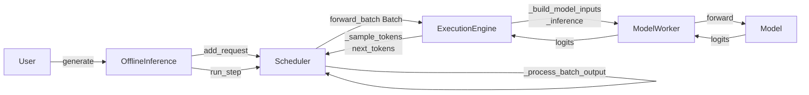
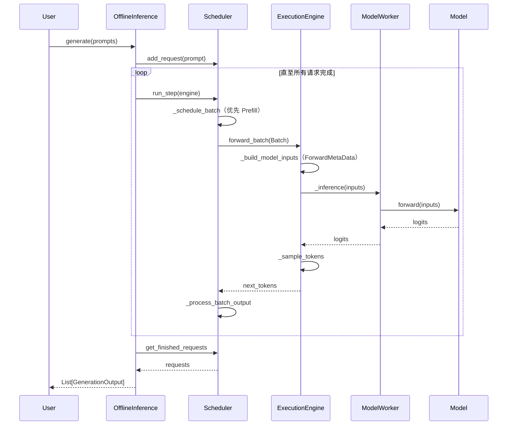

# CANN Executor（cann-recipes-infer 自研 executor）

## Summary

cann-recipes-infer 仓库自带一套轻量级推理执行框架（以下简称 "CANN Executor"），是该仓多数 LLM 模型在 NPU 上的自研落地载体，不依赖 vLLM / SGLang。代码位于 `executor/`。但**这些 LLM 模型并非都走同一套部署路径**——`executor/scripts/function.sh:288-290` 在离线模式下先取 `models/${MODEL_DIR}/infer.py`，仅当该文件不存在才 fallback 到 `executor/offline/infer.py`。由此区分**三类部署模式**（详见下文「部署模式分类」）。

**新执行器路径**（`executor/offline/infer.py` + `OfflineInference` / `ExecutionEngine` / `InferenceConfig`），它提供 **offline / online 两种执行方式**：离线入口 `OfflineInference`（批处理，关注单步执行时间、吞吐与资源利用率，**推荐在验证性能上限、问题定位时使用**）；在线入口 `OnlineInference`（Client-Server 服务模式，以 PD 分离部署，主要用于 benchmark / 精度评测，见 [online-pd-inference](online_pd_inference.md)）。`models/<name>/infer.py` legacy 路径与独立 HSTU 路径不使用 `OfflineInference` / `InferenceConfig`。

核心设计要点：

- **五组件分层**：`OfflineInference` / `OnlineInference`（API）→ `Scheduler`（请求调度）→ `ExecutionEngine`（引擎）→ `ModelWorker`（单模型）→ `Model`（神经网络）。`OnlineInference(OfflineInference)` 继承离线推理循环并追加 PD 协调。
- **统一配置入口 `InferenceConfig`**：`dataclass` 结构化替代 `runner_settings` 字典，YAML 驱动，聚合 `DataConfig` / `ModelConfig` / `ParallelConfig` / `SchedulerConfig` 四子配置，PD 分离另由启动入口注入 `DisaggConfig`。字段语义详见 [inference-config](../techniques/inference_config.md)。
- **`exe_mode` 三模式**：`eager` / `ge_graph` / `npugraph_ex`，图模式开关**只对 decode 生效**，prefill 统一走 eager。
- **Packed Sequence 唯一输入布局**：`Batch.input_ids` 始终为一维 `[TotalTokens]`，prefill 各 prompt 串接、decode 每请求 1 token。
- **`ForwardMetaData` 元数据层**：把 `is_prefill` / `kv_len` / `actual_seq_lengths_*` / `attention_mask` / `block_table` / `slot_mapping` 等动态信息以显式输入传给模型，保证图模式 guard 稳定。

## Architecture

### 部署模式分类

`executor/scripts/function.sh:288-290` 决定 cann-recipes-infer 的 LLM 离线部署分流：先尝试 `models/${MODEL_DIR}/infer.py`，**仅当不存在**才 fallback 到 `executor/offline/infer.py`。由此分为三类：

| 部署模式 | 入口 | 配置载体 | 在用模型 |
|----------|------|----------|----------|
| **新执行器路径** | fallback 到 `executor/offline/infer.py` | `OfflineInference` / `ExecutionEngine` / `InferenceConfig`（dataclass + YAML） | deepseek_r1、qwen3_moe、qwen3_5（Qwen3.5-MoE）、gpt_oss、gemma4_26b_a4b 等（无自带 `infer.py`） |
| **legacy ModelRunner 路径** | 各模型自带 `models/<name>/infer.py` | `executor/model_runner.py:ModelRunner` 子类 + `runner_settings` dict（字段名 `input_max_len`(默认 1024)、`kvp_size` 等） | deepseek-v3.2-exp（`runner_deepseek.py:DeepSeekRunner`）、kimi-k2-thinking（同 `DeepSeekRunner`）、longcat-flash（`runner_longcat_flash.py:LongcatFlashRunner`） |
| **独立路径** | `models/hstu/inference/inference_gr_ranking.py` | `gin` 配置 + 原生 `torch.distributed`，**零 executor 依赖** | hstu |

- 新执行器路径用结构化 `InferenceConfig`（字段语义见 [inference-config](../techniques/inference_config.md)）。
- legacy 路径的 `DeepSeekRunner` / `LongcatFlashRunner` 均继承 `executor.model_runner.ModelRunner`，仍用 `runner_settings` 字典（`runner_settings.get("data_config").get("input_max_len", 1024)`），**与新 `InferenceConfig` 体系并存**；longcat 的 `modeling_longcat_flash.py` 仍引用 `kvp_size`（详见 [kvp](../parallelism/kvp.md) 与 [inference-config](../techniques/inference_config.md) 演进注记）。
- HSTU 自带 `inference_gr_ranking.py`（`import gin` + `torch.distributed`），完全不经 executor。

> 下文「五组件协作」「目录结构」「§6 接口契约」等均**仅描述新执行器路径**。

### 目录结构

```
executor/
├── core/                  # 核心引擎组件
│   ├── config/            # 配置类（InferenceConfig、CommManager）
│   ├── engine/            # 执行引擎（ExecutionEngine）
│   ├── forward_data_info/ # 公共类型（Request、Batch 等）
│   ├── kv_cache/          # Paged KV cache 管理（KVCacheManager / BlockPool）
│   ├── model_worker/      # 模型 Worker（ModelWorker、MTPWorker）
│   ├── scheduler/         # 调度器基类（Scheduler）
│   └── support_models.py  # name → (ForCausalLM[, ModelMTP], Config) 延迟注册表（_specs + load_model_classes 按需 importlib）
├── offline/               # 离线推理入口（OfflineInference、infer.py）
├── online/                # 在线推理入口（server / dp_dispatcher / router / bootstrap / kv_transfer / scheduler）
├── model_loader/          # 权重加载（DefaultModelLoader / DummyModelLoader）
└── utils/                 # forward_metadata、graph_utils、hccl_utils、logging_config、profiler 等
```

### 五组件协作



| 组件 | 职责 |
|------|------| | **OfflineInference**（`executor/offline/`） | 用户 API 层，协调生命周期；`generate(prompts)` 驱动 `while scheduler.has_work` 循环；收集 & 解码结果。在线侧 `OnlineInference`（`executor/online/`）继承之并追加 PD 协调（`init_cpu_groups` 等） |
| **Scheduler**（`executor/core/scheduler/`） | 请求队列（waiting/running/finished）管理；批处理组装（**Prefill 全部处理完再处理 Decode**）；默认**固定形状模式**对 Batch 做 padding 以保 Tensor 形状一致（性能压测友好）；请求状态 prefill→decode 转换 |
| **ExecutionEngine**（`executor/core/engine/execution_engine.py`） | 环境初始化（NPU 设备 + 分布式 CommManager）；`warm_up` 跑一轮 prefill + 一轮 decode，decode 阶段触发图编译；`forward_batch` 接收 Batch 执行 + 采样；`exe_mode` 分派 |
| **ModelWorker**（`executor/core/model_worker/model_worker.py`） | 单模型生命周期：`load_model` + `_process_weights_after_loading`（仅委托：`if hasattr(self.model, "process_weights_after_loading"): self.model.process_weights_after_loading()`，转置/NZ 由模型侧实现，见下） + `_init_kvcache`；`compile_model` 调用 `executor/utils/graph_utils.py:compile_model_forward`；`inference` 仅在 `not is_prefill` 且 `exe_mode in ["ge_graph", "npugraph_ex"]` 时走 `self.model_compiled(**model_inputs)` |
| **Model**（各模型 `modeling_*.py`） | 接受 `InferenceConfig` + `CommManager` 初始化；通过 `ForwardMetaData` 取动态信息；必须能先在 eager 下稳定运行 |

### InferenceConfig 子配置

`InferenceConfig.from_dict(yaml_dict, global_rank, local_rank)` 以 `dataclass` 聚合 `DataConfig` / `ModelConfig` / `ParallelConfig` / `SchedulerConfig` 四个 YAML 子配置（PD 分离另由启动入口注入 `DisaggConfig`，YAML 不含）。其中 `attn_dp_size` / `moe_ep_size` / `embed_dp_size` / `batch_size_per_dp_rank` 等为框架推导值，不接受 YAML。各字段语义、默认值、推导规则与演进注记集中在 [inference-config](../techniques/inference_config.md)。

### 推理执行流程



## Usage Scenarios

- **新执行器路径模型的离线推理载体**：DeepSeek-R1 / Qwen3-MoE / Qwen3.5-MoE / GPT-OSS / Gemma4 等（无自带 `infer.py`）的 benchmark YAML 经 `executor/offline/infer.py` + `OfflineInference` 运行。legacy 路径模型（DeepSeek-V3.2-Exp / Kimi-K2-Thinking / LongCat-Flash）走各自 `models/<name>/infer.py` + `ModelRunner`，HSTU 走独立 `inference_gr_ranking.py`（见「部署模式分类」）。
- **性能上限验证与问题定位**：固定形状模式 + 预热 decode 编译，方便压测与比对。
- **vLLM/SGLang 替代场景**：当模型特性（如 MLA、Sparse Flash Attention、AFD、大 EP DoubleRouting）尚未接入上游开源推理框架时，本 executor 作为自研落地载体。

## 框架对模型的接口契约

（新执行器路径，源 `executor_design.md §6`）executor/ 与 `models/<model_name>/` 通过两类接口耦合：

- **模型必须提供**：
  - `model.forward(input_ids, position_ids, forward_metadata, **kwargs)` —— `input_ids` 按 packed 布局拼为一维 `[TotalTokens]`；`forward_metadata: ForwardMetaData` 携带 attention 元数据；返回 `logits` 或 `(logits, prev_hidden_states)`（后者供 MTP draft model）。logits 形状为 `[batch_size, seq_len, vocab_size]`（`execution_engine.py:405` `forward_batch` docstring 标注），**或当模型内部已选末位则为 `[batch_size, 1, vocab_size]`**；prefill 采样时由 executor 在 `_sample_tokens` 内做 `logits = logits[:, -1:, :]`（`execution_engine.py:471`）。注：DeepSeek-R1 的 `forward_lm_head`（`modeling_deepseek.py:2415`）在 lm_head 内用 `index_select` 取每请求末位、返回 `[bs, 1, vocab_size]`，这是**模型实现选择**而非框架强制——框架对 `[batch_size, seq_len, vocab_size]` 与已选末位两种返回都兼容（prefill 切片对 `[*, 1, *]` 是 no-op）。
  - `init_cache(device)`（online 必须）—— `ModelWorker.init_kvcache` 全权委托模型构造 KV，paged 模型通常返回 paged-shape `past_key_values`。
  - `load_weights(weights_iterator)` —— 从 `DefaultModelLoader` 的 `(name, tensor)` 迭代器读权重，自定义分片/格式转换在此完成；`with_ckpt=False` 改用 `DummyModelLoader` 随机初始化。
- **框架反向提供**：通信域管理（模型在 `init_parallel_comm_group()` 中调用 `CommManager.register_group()` 声明所需 HCCL 通信域）、Paged KV cache（`KVCacheManager`）、Packed Sequence（唯一输入布局）、图编译（`exe_mode ∈ {ge_graph, npugraph_ex}`，`warm_up()` 在 dummy prefill 后 `compile_model()`）、Profiler。

## Constraints

- **图模式 decode-only**：`exe_mode` 只对 decode 生效，prefill 走 eager；模型自身需满足[npu-graph-mode](../techniques/npu_graph_mode.md) 的五条件。
- **固定形状模式**：Scheduler 默认对 Batch padding，减少重编译但会引入 padding 开销；在线服务场景需自行评估。
- **Packed Sequence 强制**：模型 forward 的唯一输入布局是一维 packed `[TotalTokens]`，模型须在 `batch_size_per_dp_rank > 1` 且序列不等长场景下功能/精度正常（新模型 checklist 验证项）。
- **依赖 CommManager**：所有模型类需接受 `CommManager` 作为入参，并在 `init_parallel_comm_group()` 中调用 `CommManager.register_group()` 显式声明所需 HCCL 通信域（与 `executor_design.md §3.2` 对齐）。
- **权重加载双阶段**：`load_weights` → `ModelWorker._process_weights_after_loading`，后者**仅为分发器**——委托调用模型侧 `model.process_weights_after_loading()` 再 `model.to(self.device)`，框架方法内无任何转置/NZ 逻辑；默认 Linear/GroupedMatmul 权重转置 + 格式 cast to nz 由模型侧实现（如 `models/deepseek_r1/models/modeling_deepseek.py:2647` `process_weights_after_loading`，docstring 明写 "weight transpose, format cast to nz"，经 `quant_method.process_weights_after_loading(module, is_nz=self.enable_weight_nz, ...)` 落到各 module），特殊模型在模型侧重写。详见 [online-weight-split](../techniques/online_weight_split.md)。
- **MTP 由框架自动调度**：`next_n > 0` 自动启用 `MTPWorker`，详见 [mtp-speculative-decoding](../techniques/mtp_speculative_decoding.md)。
- **KV Cache 两种管理路径**：模型返回 `ModelCacheInfo` 时走框架级 Paged Attention 管理（`ExecutionEngine._init_cache_manager()` 构建 `KVCacheManager`），否则由模型自管 Cache（`ModelWorker.init_kvcache()`），详见 [kv-cache-manager](kv_cache_manager.md)。
- **离线 / 在线两种执行方式**：上述五组件为离线（`OfflineInference`，`disaggregation_mode == NONE`）；在线侧 `OnlineInference` 以 PD 分离的 Client-Server 服务模式复用同一 `ExecutionEngine` / `ModelWorker` / 基类 `Scheduler`，增量集中在 HTTP 入口、`PrefillDisagg/DecodeDisagg` Scheduler 与 KV 跨实例传输，详见 [online-pd-inference](online_pd_inference.md)。

## Evidence

- [cann-recipes-infer](https://gitcode.com/cann/cann-recipes-infer/tree/2c45117d781ab9ab88dcb89a28ae30f5d2450399) — [`docs/design/executor_design.md`](https://gitcode.com/cann/cann-recipes-infer/blob/2c45117d781ab9ab88dcb89a28ae30f5d2450399/docs/design/executor_design.md)（框架总览：offline+online 两种执行方式、目录结构、五组件、CommManager 三类职责、初始化/运行时时序、§6 接口契约。MR !458 refactor）
- [cann-recipes-infer](https://gitcode.com/cann/cann-recipes-infer/tree/2c45117d781ab9ab88dcb89a28ae30f5d2450399) — [`executor/core/{config, engine, forward_data_info, kv_cache, model_worker, scheduler}` + `executor/{offline, online}`](https://gitcode.com/cann/cann-recipes-infer/blob/2c45117d781ab9ab88dcb89a28ae30f5d2450399/executor/core/config/comm_manager.py)（核心组件实现：`CommManager.register_group/init_cpu_groups/_cache_default_group`、`OnlineInference(OfflineInference)`、`support_models._specs` 延迟 importlib、`forward_data_info/` 取代旧 `types_/`、`offline/`+`online/` 取代旧 `core/entrypoints/`）
- [cann-recipes-infer](https://gitcode.com/cann/cann-recipes-infer/tree/2c45117d781ab9ab88dcb89a28ae30f5d2450399) — `docs/common/inference_config_guide.md` / `new_model_checklist.md §1`（配置字段语义与 YAML 必填项，详见 [inference-config](../techniques/inference_config.md)）
- 旧版证据（**适用于旧版本**）：[`docs/design/offline_inference_design.md`](https://gitcode.com/cann/cann-recipes-infer/blob/2f82d10467e6fe8dae81c97a2cdac78d733a6703/docs/design/offline_inference_design.md) —— 该文件已在 2c45117（MR !458）删除，由 `executor_design.md` 取代（后者把 offline 与 online 合并为框架总览）；旧链接锚定基线 2f82d10、不可达 HEAD。

## Links

- [npu-graph-mode](../techniques/npu_graph_mode.md)
- [online-weight-split](../techniques/online_weight_split.md)
- [mtp-speculative-decoding](../techniques/mtp_speculative_decoding.md)
- [kv-cache-manager](kv_cache_manager.md)
- [online-pd-inference](online_pd_inference.md)
- [inference-config](../techniques/inference_config.md)
- [torchair](torchair.md)
- [deepseek-r1](../models/deepseek_r1.md)
- [deepseek-v3.2-exp](../models/deepseek_v3_2_exp.md)
- [longcat-flash](../models/longcat_flash.md)
- [qwen3-moe](../models/qwen3_moe.md)
- [qwen3-5-moe](../models/qwen3_5_moe.md)
- [qwen-dense](../models/qwen_dense.md)
- [gpt-oss](../models/gpt_oss.md)
- [gemma4-26b-a4b](../models/gemma4_26b_a4b.md)
- [hy3-preview](../models/hy3_preview.md)
- [hstu](../models/hstu.md)
- [mm-inference-launch](mm_inference_launch.md)

## Notes

- **gap（部分消解）**：`CommManager` 内部机制已在 `executor_design.md §3.2` 与 `comm_manager.py` 披露——三类职责：① 默认 HCCL 组缓存（`__init__` → `_cache_default_group()` 按物理签名缓存 `default_pg`，供 world-size 业务组复用）；② 模型计算 HCCL 组（模型侧 `register_group()` 按结构声明 attention/ffn/moe/embedding/lm_head/MC2 等通信域，框架负责创建/缓存/物理复用，MC2 经 `allow_physical_reuse=False` 强制独立建域）；③ 调度用 Gloo 组（`init_cpu_groups()`，仅 `OnlineInference.__init__` 追加调用，建 `dp_leader_group` / `tp_cpu_group`）。剩余 gap：多并行维度物理复用的签名键细节（ranks + group_type + buffer_size + platform_version）仅在代码可见，设计文档未逐项展开。
- **gap**：源文档未给出 Scheduler 的抢占 / 优先级策略，仅描述 Prefill 优先、固定形状 padding 与 PD decode 端的 retraction（见 [online-pd-inference](online_pd_inference.md)）；离线模式是否支持动态优先级未展开。
- **ambiguity**：`npugraph_ex` 在文档中也被历史命名为 `acl_graph`，新代码统一用 `npugraph_ex`，部分老 YAML / 文档仍见 `acl_graph`。
- **字段级演进**见 [inference-config](../techniques/inference_config.md)（仅新 `InferenceConfig` 体系；legacy `model_runner.py` 路径仍用 `runner_settings` dict + `input_max_len` + `kvp_size`）。

<!-- cannbot:related:start -->
## 相关

- [InferenceConfig（统一推理配置体系）](../techniques/inference_config.md)（`related`）：`InferenceConfig` 是 ［cann-executor］(../frameworks/cann_executor.md) 的统一配置入口类，以结构化 `dataclass` 取代早期的 `runner_settings` 字典，提供类型检查、嵌套子配置与自动验证。；**统一配置入口 `InferenceConfig`**：`dataclass` 结构化替代 `runner_settings` 字典，YAML 驱动，聚合 `DataConfig` / `ModelConfig` / `ParallelConfig` / `SchedulerConfig` 四子配置，PD 分离另由启动入口注入 `DisaggConfig`。字段语义详见 ［inference-config］(../techniques/inference_config.md)。前者提供字段与推导合同，后者明确其在新执行器中的装配位置，可直接完成配置到执行框架的定位。
- [Qwen3.5-MoE](../models/qwen3_5_moe.md)（`related`）：“cann-recipes-infer 基于 transformers 的 Qwen3.5-MoE 结构完成文本侧推理适配（HF `model_type = "qwen3_5_moe_text"`，多模态外层另有 vision config），跑在 Atlas A3 上，由仓库自研 executor（［cann-executor］(../frameworks/cann_executor.md)）驱动多卡推理。”；“｜ **新执行器路径** ｜ fallback 到 `executor/offline/infer.py` ｜ `OfflineInference` / `ExecutionEngine` / `InferenceConfig`（dataclass + YAML） ｜ deepseek_r1、qwen3_moe、qwen3_5（Qwen3.5-MoE）、gpt_oss、gemma4_26b_a4b 等（无自带 `infer.py`） ｜”。模型卡声明执行载体，框架卡把 qwen3_5 明确放入新执行器分流并给出入口和配置对象。
<!-- cannbot:related:end -->
