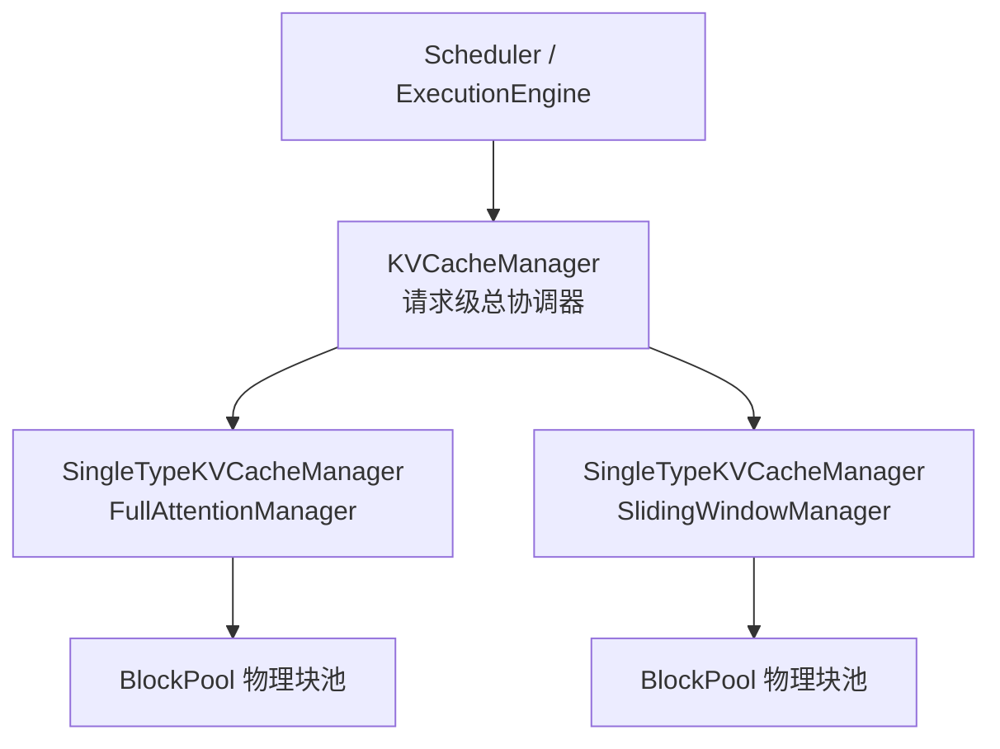
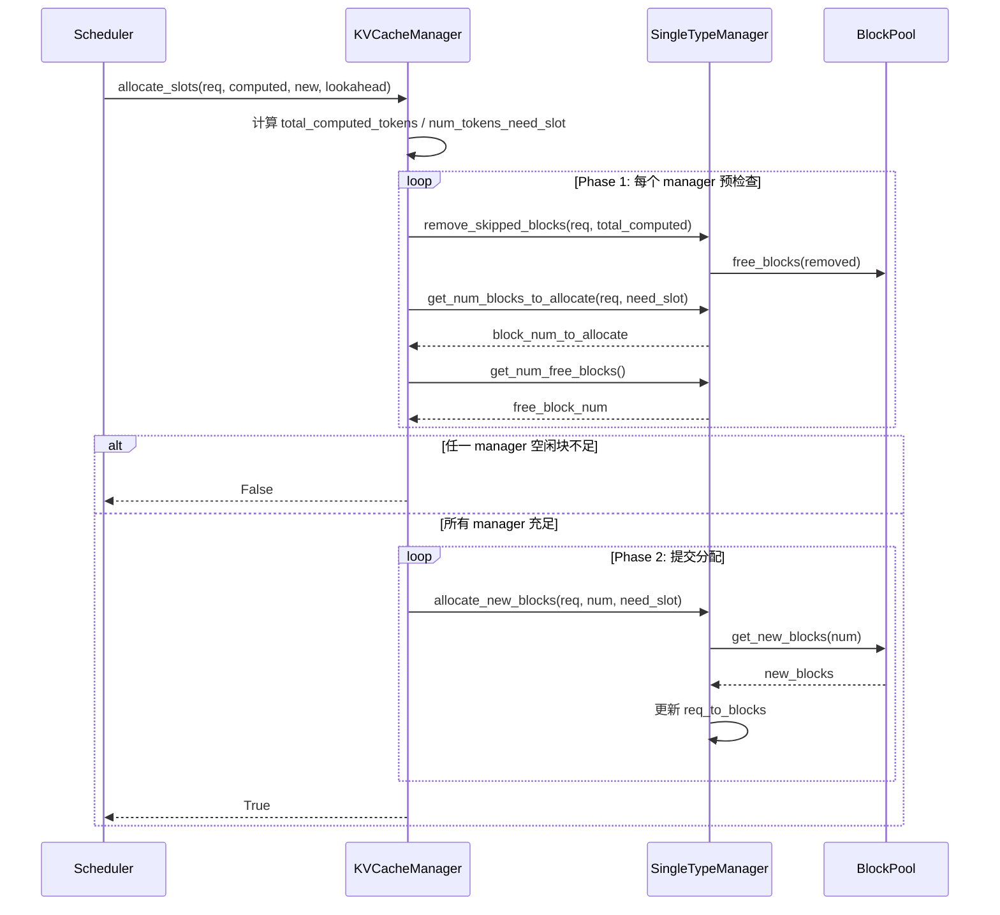

# KV Cache Manager（框架级 Paged Attention KV Cache 管理）

## Summary

KV Cache Manager 是 [cann-executor](cann_executor.md) 内置的框架级 **Paged Attention** KV Cache 管理模块（代码位于 `executor/core/kv_cache/`）。它以**块（Block）为单位**管理 KV Cache，兼容不同 attention 类型的块分配策略，实现内存复用与并发请求支持，目标有三：

- **内存效率**：分块管理避免为每个请求预分配完整序列长度的内存。
- **并发支持**：多请求共享有限的 NPU 显存资源。
- **灵活适配**：支持多种注意力机制（`FullAttention`、`SlidingWindow`），并允许单层同时包含多种 cache 类型。

框架提供两种 KV Cache 使用方式：① 通过 `KVCacheManager` 统一管理（框架负责 block 分配、回收与运行时索引）；② 模型自行创建并维护 Cache。两者由模型是否返回 `ModelCacheInfo` 元信息决定，详见下文 [模型自管 Cache 的 fallback 路径](#模型自管-cache-的-fallback-路径)。`KVCacheManager` 管理方式用于 online / offline 推理、Paged Attention 等场景；模型自管方式用于仅需 offline 推理、特殊 Cache 布局且暂不接入 Paged Attention 管理的场景。

> 说明：`FullAttention` / `SlidingWindow` 是**框架抽象的 attention type**（决定块分配策略），不等同于具体模型的注意力使用方式——模型如何映射到这两类 type 由各模型页与 `get_cache_info()` 实现决定。

## 三层结构设计

KV Cache 管理采用三层结构，自顶向下逐级收窄职责：



### 第一层：KVCacheManager（请求级总协调器）

面向调度层提供统一接口，负责**跨 attention type 的一致性分配**。核心职责：统一接收 slot 申请、把一次请求广播到所有 `single_type_managers`、在真正分配前完成一次全局可分配性检查（避免部分 type 分配成功部分失败）、提供 request 维度的查询与整体释放。

核心接口（`executor/core/kv_cache/kv_cache_manager.py`）：

| 接口 | 作用 |
|------|------|
| `allocate_slots(request_id, computed_tokens, num_new_tokens, lookahead_tokens=0)` | 两阶段块分配入口，见 [块分配核心流程](#块分配核心流程allocate_slots) |
| `get_block_ids(request_id)` | 返回该请求各 attention type 的 block id（`Dict`） |
| `free(request_id)` | 请求结束时释放该 request 在所有 type 下的全部 block |
| `format_usage() -> str` | 返回**逐 manager key** 的 `used/total` 汇总（如 `"FullAttention:16:12/100,SlidingWindow:32:8/100"`），由 `Scheduler._log_step` 在每步状态日志中暴露各分组的 KV 压力 |
| `get_contiguous_buf_infos()` | 把所有物理 cache tensor 扁平化导出（`data_ptrs` / `data_lens` / `item_lens` / `attn_types` / `block_sizes` 五个等长 list，`attn_types` 项为每条目的 `manager_key`(`group_key`)、`block_sizes` 为每项 cache 实际使用的 block size），供 PD KV 传输使用 |

`get_contiguous_buf_infos()` 的导出顺序为：按 `layer_idx` 升序、再按层内 `cache` 原始定义序遍历，仅导出 `needs_block=True` 的 cache；`item_lens` 为每块字节数（`block_size × num_head × dim × element_size`）。Prefill 与 Decode 各自独立调用，返回顺序由模型配置决定，两端必然对齐。在 [online-pd-inference](online_pd_inference.md) 的 PD KV 传输中，`KVTransferManager.register_memory()` 直接调用本接口取 `(ptrs, data_lens, item_lens, attn_types, block_sizes)` 五元组并注册到 transfer engine（KV 池为唯一真相源、不经 ModelWorker）；其中 `attn_types` 项实为每条目的 `manager_key`(`group_key`)、对端据此按 manager key 查 block id，而非纯 `attn_type`。

### 第二层：SingleTypeKVCacheManager（单类型逻辑块管理器）

抽象「某一个 cache 管理**分组**的 block 管理策略」——分组由 `manager_key` 标识（默认等于 `attn_type`），分组内所有 `CacheEntry` 必须共享同一个 `attn_type` 和同一个 `block_size`。该 manager 决定某个请求在该分组下需要多少 block、何时回收旧 block、如何组织 block table（`executor/core/kv_cache/single_type_kv_cache_manager.py`）。

内部成员：`attn_type`（所属 attention 类型）、`manager_key`（唯一分组 key，用于 `block_table` / `slot_mapping` / block id 查询与 block 数规划，默认等于 `attn_type`，也可由 `CacheEntry.manager_key` 显式指定）、`block_pool`（该分组对应物理块池）、`block_size`（每块容纳 token 数，来自分组内 `CacheEntry.block_size`）、`max_model_len`、`_null_block`（空洞占位块）、`req_to_blocks`（`request_id -> block_id 列表`）。

通用接口：`get_num_blocks_to_allocate`（计算本轮需新增多少 block）、`allocate_new_blocks`（从 BlockPool 取真实 block 写入 `req_to_blocks`）、`remove_skipped_blocks`（回收已滑出有效注意力范围的旧 block，把这些位置替换为 `_null_block` 并归还 BlockPool）、`free`。

子类必须实现的抽象方法：`get_num_skipped_tokens(num_computed_tokens)`（可跳过分配的 token 数）与 `validate_and_build_kwargs(group_entries)`（静态方法，校验并构建类型特定参数）。通过**注册表**选择策略：

```python
ATTN_TYPE_MANAGER_MAP = {
    "FullAttention": FullAttentionManager,
    "SlidingWindow": SlidingWindowManager,
}
```

| 派生类 | 块策略 | `get_num_skipped_tokens` | `validate_and_build_kwargs` |
|--------|--------|--------------------------|------------------------------|
| `FullAttentionManager` | 块随序列增长线性追加，逻辑块数 = `ceil(num_tokens / block_size)` | 始终返回 `0`（无需跳过） | 返回空字典 `{}`（无额外参数） |
| `SlidingWindowManager` | 仅为有效窗口保留真实 block，窗口外用 `_null_block` 占位 | `max(0, num_computed_tokens - sliding_window + 1)` | 从 `CacheEntry` 提取并校验 `sliding_window` |

`SlidingWindowManager` 的关键设计：由于算子约束，逻辑块表长度要求与 `ceil(kv_len / block_size)` 对齐，因此窗口左侧失效的历史 block 位置仍需保留，但不占用真实物理块（用 `_null_block` 占位）；prefill 时只为有效窗口分配真实 block 并在块表头部补齐 `_null_block`；decode 时随 `num_computed_tokens` 增长，通过 `remove_skipped_blocks` 逐步把滑窗外 block 置为 `_null_block` 并回收。由此兼顾「逻辑位置连续」与「物理存储压缩」。

### 第三层：BlockPool（物理块池）

最底层物理资源管理器，只关心 block id 的生命周期（`executor/core/kv_cache/block_pool.py`）。

成员：`num_blocks`、`block_size`、`_free_block_queue`（空闲块队列，`deque` 保证 FIFO 分配顺序）、`_free_block_set`（空闲块集合，O(1) 重复释放检测）、`_null_block`。

关键行为：初始化时创建 `0 ~ num_blocks-1` 队列 → 从队列头取出一个作为 `_null_block`（不参与正常分配、不承载实际 KV，仅满足算子占位约束）→ `get_new_blocks(n)` 依次弹出 `n` 个块 → `free_blocks(blocks)` 把释放块追加回队列末尾。释放语义有强校验：**仅 `_null_block` 的释放被静默跳过（`continue`）；其他 block 若已在 `_free_block_set`（即重复释放）会直接 `raise ValueError(f"block_id {block_id} is already free")`**，而非被静默忽略——以此尽早暴露上层 block table 维护错误。

> `_null_block` 在三层都有体现：BlockPool 持有保底占位块本体，SingleTypeKVCacheManager 在 block table 中用它表示「逻辑上不存在物理块的位置」（如滑动窗口的无效区域）。其存在是为了满足相关算子要求 block table 中必须存在合法 block 索引的约束。

## 块分配核心流程：allocate_slots

`allocate_slots` 是整个 KV Cache 管理链路的核心入口，设计重点是**逐请求**地对不同 attention type 做块分配。调度层只关心当前请求能否继续推进，`KVCacheManager` 负责把请求广播到所有 `SingleTypeKVCacheManager`，分别计算所需块数、回收可跳过块，并在真正分配前完成一次整体可分配性检查。

入参含义：`request_id`（请求标识）、`computed_tokens`（已计算完成的 token 数）、`num_new_tokens`（本轮新增需预留 slot 的 token 数）、`lookahead_tokens`（额外预留量，用于 speculative decoding 等提前占位场景）。函数内先构造两个量：

- `total_computed_tokens = min(computed_tokens, max_model_len)` — 已纳入 Cache 管理的 token 数，用于判断 skipped block。
- `num_tokens_need_slot = min(computed_tokens + num_new_tokens + lookahead_tokens, max_model_len)` — 本次分配后 block 需覆盖的总 token 范围。

随后进入**两阶段**处理：

**阶段一：预检查**（确保分配前先收敛状态）。对每个 `SingleTypeKVCacheManager` 依次：① `remove_skipped_blocks(request_id, total_computed_tokens)` 先回收无用块；② `get_num_blocks_to_allocate(request_id, num_tokens_need_slot)` 计算本轮还需新增多少 block；③ 查 `get_num_free_blocks()`。通用计算逻辑：

```text
required_block_num   = ceil(num_tokens_need_slot / block_size)
existing_block_num   = len(req_to_blocks.get(request_id, []))
block_num_to_allocate = max(0, required_block_num - existing_block_num)
```

若**任一** manager 的空闲块数少于需新增的块数，顶层立即返回 `False`，该请求本轮不发生任何新分配。

**阶段二：分配**。只有全部 manager 通过预检查才进入，`KVCacheManager` 再次遍历 managers，从 `BlockPool` 申请块并更新 block table：`allocate_new_blocks(request_id, block_num_to_allocate, num_tokens_need_slot)`，最后返回 `True`。



## 数据结构：CacheInfo 与 CacheUtils

`cache_info.py` 定义三层元数据结构（自单条到全模型）：

- `CacheEntry`：单个 cache 条目，含 `cache_name`、`attn_type`、`dim`（单 head 特征维）、`num_head`（TP 切分后实际 head 数）、`dtype`、`tensor_setter`（回调，把分配的 tensor 注册到 attention 层）、`needs_block`（是否参与 block 分配，通常 `True`）；`SlidingWindow` 场景还含 `sliding_window`。
- `LayerCacheInfo`：按 layer 聚合多个 `CacheEntry`。
- `ModelCacheInfo`：汇总全模型，含 `num_layers`、所有层的 `LayerCacheInfo`，以及 `is_mla_backend: bool` 标志。**`ModelCacheInfo` 不再保存模型级 `block_size`**——block size 改由每个 `CacheEntry` 自己声明（`CacheEntry.block_size`，`needs_block=True` 时必须为正整数），因此同一模型的不同 cache 可使用不同 block size。
  - `ModelCacheInfo.merge(other)`：把两份 cache-info 合并为一份完整模型描述（校验 `block_size` 与 `is_mla_backend` 一致 → 给 `other` 各层 `layer_idx` 加偏移后拼接 → 重算 `num_layers`）。用于 [mtp-speculative-decoding](../techniques/mtp_speculative_decoding.md) 场景下主模型 + 小模型的 cache-info 合并：`ExecutionEngine.init()` 在 MTP worker 产出 `cache_info_mtp` 且主 `cache_info` 非空时调用 `cache_info = cache_info.merge(cache_info_mtp)`，使主 + MTP 两段层共用同一套 Paged Attention 块管理。
  - `is_mla_backend`：[mla](../modules/mla.md) latent KV 在所有 TP rank 上是**复制**的，PD KV 传输据此 dispatch——选单个目标 rank 传输、其余 rank 标记为 dummy，避免重复搬运。该标志必须由模型 `get_cache_info()` 显式设置：**不能用 `num_head == 1` 推断 MLA**，因为 GQA 在 `num_kv_heads ≤ tp_size` 时每 rank 同样得到 `num_head == 1` 但并非 MLA。

`CacheEntry.attn_type` 决定该条目映射到哪一类 `SingleTypeKVCacheManager` **子类**（选哪种块分配策略）；而真正的**分组维度是 `manager_key` / `group_key`**——决定该条目归入哪个 manager **实例**。`group_key` 取值规则：**若 `CacheEntry` 显式设置了 `manager_key`，则 `group_key = manager_key`；否则 `group_key = attn_type`**（详见 [manager_key 分组维度与 per-manager block_size](#manager_key-分组维度与-per-manager-block_size)）。因此框架支持单层同时包含多个 cache 条目，也支持单层同时包含多种 cache 类型，**还支持同一 `attn_type` 按不同 `block_size` 拆分成多个 manager**。`ModelCacheInfo` 在模型侧构建：`ModelWorker._get_cache_info()` 调用模型的 `get_cache_info()`。以 [deepseek-r1](../models/deepseek_r1.md) 的 [mla](../modules/mla.md) 为例，每层从 `self_attn` 取出 `nope_cache`（`dim=kv_lora_rank`）与 `rope_cache`（`dim=qk_rope_head_dim`）两个 `CacheEntry`，`num_head=1`，二者 `attn_type` 均为 `FullAttention`；若 `group_key` 相同则归入同一 manager 统一管理，若需不同 `block_size` 则应设置不同 `manager_key` 分别对应不同 manager。

### manager_key 分组维度与 per-manager block_size

`SingleTypeKVCacheManager` 抽象的是「某一个 cache 管理**分组**的 block 管理策略」，该分组由 **`manager_key`** 标识，而非 `attn_type`：

- `attn_type`：当前 manager 所属的 attention 类型，决定用哪个 `SingleTypeKVCacheManager` 子类。
- `manager_key`：当前 manager 的**唯一分组 key**，用于 `block_table`、`slot_mapping`、block id 查询与 block 数规划。默认等于 `attn_type`，也可由模型通过 `CacheEntry.manager_key` 显式指定。
- `block_size`：该 manager 下每个 block 容纳的 token 数，来自分组内 `CacheEntry.block_size`。

由此**同一个 `attn_type` 可被拆分成多个 manager，各自使用不同 `block_size`**；反之，**共享同一 `manager_key` 的所有 `CacheEntry` 必须共享同一个 `block_size`**——该一致性由 `calculate_block_num()` 显式校验，若同一 attention type 下需要不同 `block_size`，必须使用不同 `manager_key`。`get_block_sizes()` / `get_block_table_max_lens()` / `format_usage()` 等顶层接口均**逐 manager key** 返回（如 `format_usage()` → `"FullAttention:16:12/100,SlidingWindow:32:8/100"`，含每分组的 `block_size`）。

`cache_utils.py` 提供：`validate_cache_info()`（校验元数据）、`calculate_block_num()`（计算各 manager key 的 block 数）、`allocate_cache_tensors()`（按 block 规划分配底层 cache tensor，默认物理布局 `[block_num_by_type[cache.group_key], cache.block_size, num_head, dim]`）、`prepare_block_tables()` / `prepare_slot_mapping()`（构造批次索引，**输出均为 `Dict[manager_key, Tensor]`**——键为 `manager_key` 而非 `attn_type`，运行时按 `manager_key` 取出对应张量）。这两份 per-`manager_key` 张量（`block_table[manager_key] = block_table_tensor` 给出每请求的逻辑块表、`slot_mapping[manager_key] = slot_mapping_tensor` 给出每 token 的物理写入槽位）经 `ForwardMetaData` 喂给 [fused-infer-attention-score](../kernels/fused_infer_attention_score.md)（FIA）等 paged-attention 算子，由算子据此在分块 KV Cache 上完成 gather / 写入。**`prepare_slot_mapping()` 会使用当前 manager 自己的 `block_size` 计算 slot**：

```text
block_indices    = position_ids // block_size   # 该 manager 的 block_size
position_offsets = position_ids %  block_size
```

因此不同 manager 的 slot mapping 自然对应不同 block 粒度。attention forward 中按 cache 对应的 `manager_key` 取出 tensor（`forward_metadata.block_table[self.manager_key]` / `slot_mapping[self.manager_key]`）；若该 attention type 下只有一种 block size 且未显式设置 `manager_key`，则 key 仍可继续等于 `self.attn_type`。同层多个 cache（如 `k_cache` / `v_cache`）若共享相同 `manager_key`，则共用同一份 `block_table` 与 `slot_mapping`；若一层含多种 `attn_type` 或同一 `attn_type` 下含多种 `block_size`，则需分别按对应 `manager_key` 取出。

### calculate_block_num 的固定 / 非固定 block 策略

`calculate_block_num()` 先按 `attn_type` 分两类，分别计算 `block_num`：

**1. 固定 block 类**（cache 不随请求总长度线性增长）。由 `cache_utils.py` 的 `FIXED_BLOCK_ATTN_TYPES` 标识，当前仅含 `{"SlidingWindow"}`。其 `block_num` 先为单请求估算「窗口内最多需保留多少真实 block」，再乘以最大并发数 `batch_size_per_dp_rank`：

```text
fixed_block_num = max_concurrency
                  * (ceil((sliding_window + 2 * next_n) / block_size) + 1)
                  + 1
```

- `sliding_window + 2 * next_n`：每个请求一次迭代内最多使用的 cache 大小，其中 `2 * next_n` 是 [mtp-speculative-decoding](../techniques/mtp_speculative_decoding.md) 场景下主模型与小模型共同额外需要的 cache 空间；
- `+1`（括号内）：覆盖滑动窗口跨 block 边界时的额外保留需求；
- 末尾 `+1`：`null_block` 占位。

**2. 非固定 block 类**（cache 随请求总长度线性增长，如 `FullAttention`——MLA / MHA / GQA 等全注意力都属此类）。

- 离线推理：按固定最大长度直接计算，**末尾 `+1`** 外加一个 null_block（代码注释 `extra one block for null block`）
  ```text
  block_num_per_request = ceil(offline_max_len / block_size)
  block_num             = block_num_per_request * max_concurrency
  block_num_by_type[attn_type] = block_num + 1   # +1 为 null_block
  ```
- 在线推理：先统计这类 cache 的 `per_token_bytes`，用 `mem_fraction_static` 框定的显存预算换算最大 token 数再折算为 block 数。**注意在线分支不外加 `+1`**——`non_fixed_block_num` 直接作为 block 数，null_block 改为在后续 `supported_tokens = (non_fixed_block_num - 1) * block_size` 校验时**内部扣减**首块（首块保留为 null_block 占位，不承载实际 cache），而非额外多分配一块。
  ```text
  per_token_bytes     = sum(cache.dim * cache.num_head * dtype_size(cache.dtype))
  free_memory, total_memory = npu.mem_get_info()
  used_memory         = total_memory - free_memory
  mem_fraction_static = infer_config.scheduler_config.mem_fraction_static
  available_memory    = total_memory * mem_fraction_static - used_memory - fixed_block_memory_bytes
  max_tokens          = floor(available_memory / per_token_bytes)
  non_fixed_block_num = floor(max_tokens / block_size)   # 多 TP rank 下经 all_reduce(MIN) 取最保守值同步
  block_num_by_type[attn_type] = non_fixed_block_num     # 无 +1；null_block 在 supported_tokens 处扣减
  ```

整体顺序：先为固定 block 类预留内存，再用剩余内存估算非固定 block 类的 block 数，避免 SWA 这类必须预留的 cache 挤占后续计算导致的不确定性。

## 模型自管 Cache 的 fallback 路径

当模型**不返回 `ModelCacheInfo`** 时，框架不创建 `KVCacheManager`，改由模型自行维护 Cache。初始化入口是 `ModelWorker.init_kvcache()`，有两种形态：

| 形态 | 触发条件 | 说明 |
|------|---------|------|
| 模型实现 `init_cache(device)` | `hasattr(self.model, "init_cache")` 为真（推荐） | Cache tensor 完全由模型创建并挂载到对应层，适用于非标准 cache 个数、特殊 dtype、量化 cache、indexer cache 或临时 cache |
| 框架 legacy 连续分配 | 模型含 `k_cache` / `v_cache` / `cache_unit` 字段 | 框架按 `[batch_size, cache_seq_len, *cache_unit]` 为每层分配 |

此路径下 `self.kvcache_manager` 为 `None`，`_build_model_inputs()` 不调用 `prepare_block_tables()` / `prepare_slot_mapping()`，写入 `ForwardMetaData` 的 `block_table` / `slot_mapping` 均为 `None`。模型 forward 需自行定位 Cache：prefill 阶段框架额外传入 `request_offset`（来自 scheduler 的 `prefilled_request_count`，标识当前 prefill batch 第一个请求的全局 Cache slot 偏移），模型据此往后写入、避免请求间区间覆盖；decode 阶段不再传 `request_offset`，模型根据 `forward_metadata.kv_len`、`position_ids` 等定位新增 token。若模型需支持 online 推理，仍应优先接入 `KVCacheManager`。启用 MTP 时主模型与 MTP 模型各自调用 `init_kvcache()`，两侧需各自保证初始化与访问逻辑正确。

## 新模型接入要点

新模型接入 `KVCacheManager` 管理的主线（`_init_cache_manager()`）与必选动作：

1. **确定每个 cache 的 `attn_type`**：标准 MHA / MQA / GQA / MLA 等全注意力用 `FullAttention`；滑动窗口注意力用 `SlidingWindow`（需额外设 `sliding_window`）；若 `ATTN_TYPE_MANAGER_MAP` 不满足则新增 `SingleTypeKVCacheManager` 子类并注册。
2. **在模型 attention 类配置 cache**：`__init__()` 中为每个 cache 定义占位 tensor，构造 `CacheEntry` 列表存入 `self.cache_entries`，**每个 `CacheEntry` 自带 `block_size`**（`needs_block=True` 时必为正整数），同一 `attn_type` 需不同 `block_size` 时必须显式设置不同 `manager_key`；模型类实现 `get_cache_info()` 遍历各层封装为 `LayerCacheInfo` → `ModelCacheInfo`（不再向 `ModelCacheInfo` 传模型级 `block_size`，模型类自身可继续从 `scheduler_config.block_size` 保存默认值供构造 `CacheEntry` 使用）。
3. **在 attention forward 接入索引**：用 `self.manager_key` 作 key 从 `forward_metadata.block_table` / `slot_mapping` 取对应 tensor（仅一种 block size 且未显式设 `manager_key` 时可继续等于 `self.attn_type`）；同层多个 cache（如 `k_cache` / `v_cache`）若共享同一 `manager_key` 则共用同一份索引。
4. **可选扩展**：新增 attention type 时实现 Manager 子类、扩展 `calculate_block_num()`（按固定 / 非固定分类，固定类需登记进 `FIXED_BLOCK_ATTN_TYPES` 并补 `calculate_fixed_block_memory_bytes()`）、必要时在 `allocate_cache_tensors()` 新增非默认 shape 分支。

初始化链路（`get_cache_info` → `validate_cache_info` → `calculate_block_num` → `allocate_cache_tensors` → `create_single_type_managers` → `KVCacheManager`）、运行期链路（`allocate_slots` → `prepare_block_tables` / `prepare_slot_mapping` → 模型前向消费）与释放链路（`KVCacheManager.free` → `SingleTypeKVCacheManager.free` → `BlockPool.free_blocks`）均需逐级验证。

## Evidence

- [cann-recipes-infer](https://gitcode.com/cann/cann-recipes-infer/tree/2c45117d781ab9ab88dcb89a28ae30f5d2450399) — [`docs/design/kv_cache_design.md`](https://gitcode.com/cann/cann-recipes-infer/blob/2c45117d781ab9ab88dcb89a28ae30f5d2450399/docs/design/kv_cache_design.md)（三层结构、两阶段 allocate_slots、calculate_block_num 策略、CacheInfo/CacheUtils、两种接入 Checklist；主源）
- [cann-recipes-infer](https://gitcode.com/cann/cann-recipes-infer/tree/2c45117d781ab9ab88dcb89a28ae30f5d2450399) — [`docs/design/kv_cache_design.md` §4.1 CacheInfo / §2.3 / §4.2.2](https://gitcode.com/cann/cann-recipes-infer/blob/46485bef9bb6bf061e4c356942bfea395e75865a/docs/design/kv_cache_design.md)（`ModelCacheInfo` 不再保存模型级 `block_size`、`block_size` 改 per-`CacheEntry` 声明、`manager_key` / `group_key` 为真正分组维度、`block_table` / `slot_mapping` 键为 `manager_key`、per-manager `block_indices = position_ids // block_size` / `position_offsets = position_ids % block_size`；本次增量更新源）
- [cann-recipes-infer](https://gitcode.com/cann/cann-recipes-infer/tree/2c45117d781ab9ab88dcb89a28ae30f5d2450399) — [`executor/core/kv_cache/{kv_cache_manager.py, single_type_kv_cache_manager.py, block_pool.py, cache_info.py, cache_utils.py}`](https://gitcode.com/cann/cann-recipes-infer/blob/2c45117d781ab9ab88dcb89a28ae30f5d2450399/executor/core/kv_cache/kv_cache_manager.py)（接口与 `FIXED_BLOCK_ATTN_TYPES = {"SlidingWindow"}`、`ATTN_TYPE_MANAGER_MAP` 实现核对）
- [cann-recipes-infer](https://gitcode.com/cann/cann-recipes-infer/tree/2c45117d781ab9ab88dcb89a28ae30f5d2450399) — [`docs/common/new_model_checklist.md`](https://gitcode.com/cann/cann-recipes-infer/blob/2c45117d781ab9ab88dcb89a28ae30f5d2450399/docs/common/new_model_checklist.md)（§2 Cache 接入）
- 引入 / 演进：MR!386（`f0b0fde` [refactor] add page attention cache management，分支 `tnd_and_pa_backup`）、MR!388（`0296d00`【fix】fix page attention cache management and packed sequence，分支 `fix_pa`）、MR!446（`626bbca` [docs] add framework checklist，分支 `add_cl`）；diff 区间 `2f82d10..2c45117`。

## Links

- [cann-executor](cann_executor.md)
- [online-pd-inference](online_pd_inference.md)
- [inference-config](../techniques/inference_config.md)
- [fused-infer-attention-score](../kernels/fused_infer_attention_score.md)
- [qwen-dense](../models/qwen_dense.md)（Page Attention 块式 KV Cache）
- [gemma4-26b-a4b](../models/gemma4_26b_a4b.md)（对照：双模式 Attention 致 KV 维度异构，走模型自管的连续缓存而非框架块式 Paged Attention）
- [hy3-preview](../models/hy3_preview.md)（对照：KVCache 静态化为 BSH 连续缓存（`scatter_update_(axis=-2)`），非框架块式 Paged Attention）
- [mla](../modules/mla.md)
- [mtp-speculative-decoding](../techniques/mtp_speculative_decoding.md)
- [hixl](../techniques/hixl.md)（PD KV 传输 HIXL 后端：`get_contiguous_buf_infos()` 导出的 KV 池经 mooncake/HIXL 路径传输）
- [longcat-flash-lite](../models/longcat_flash_lite.md)（LongCat-Flash 减配验证模型，MLA 仅缓存 latent KV，走块式 Paged Attention `cache_mode="PA_NZ"` / `block_size=128`）

## Notes

- **gap**：源未给出 `KVCacheManager` 是否支持前缀缓存 / block 复用（prefix caching）；当前文档仅描述 `req_to_blocks` 的 per-request 映射，未提跨请求共享。
- **note**：`get_contiguous_buf_infos()` 服务的 PD KV 传输对端（memfabric / Mooncake / HIXL）链路见 [online-pd-inference](online_pd_inference.md)（数据面 KVTransferManager）；MR!452（`cffb850` mooncake + hixl）引入 mooncake 后端。
- **note**：`format_usage()` 文档示例内嵌 block_size（`"FullAttention:16:12/100,SlidingWindow:32:8/100"` 的 `:16:`），而 `f"{m.manager_key}:{used}/{total}"` 实际输出为 `manager_key:used/total`（无内嵌 block_size，如 `FullAttention:12/100`）。
- **note**：`kv_cache_design.md` 的在线显存预算伪代码用 `available_kv_memory * kv_cache_mem_ratio` 表达，而 `cache_utils.py:226-227` 走 `total_memory * mem_fraction_static - used_memory - fixed_block_memory_bytes`，`kv_cache_mem_ratio` / `available_kv_memory` 变量不在其中。
