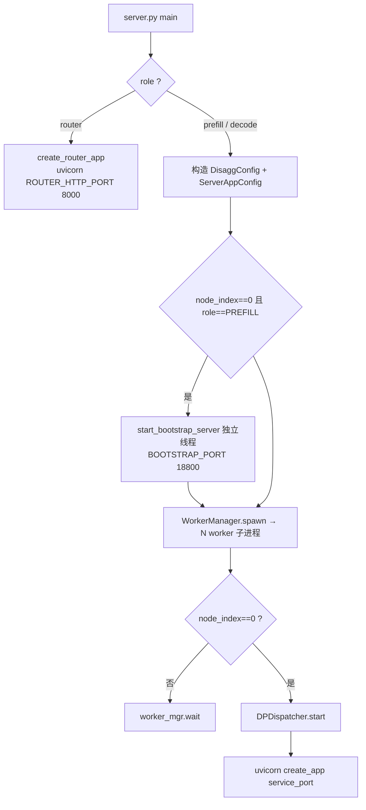

# 在线 PD 分离推理执行机制（Online PD-Disaggregated Inference）

## Summary

在线推理是 [cann-executor](cann_executor.md) 在离线五组件之上叠加的 **Client-Server 服务模式**（代码位于 `executor/online/`）。它以 **Prefill-Decode (PD) 分离**部署：prefill 与 decode 拆到独立的服务实例，各自按最优策略配置，prefill 算完 KV 经数据面直发 decode。代码层面 `disaggregation_mode ∈ {PREFILL, DECODE}` 即在线、`NONE` 即离线，**没有 prefill+decode 合并的在线模式**。在线侧主要用于 benchmark / 精度评测（evalscope 等），不以吞吐为核心目标。

online 相对离线的**增量**如下——离线共用的 `ExecutionEngine` / `ModelWorker` / 基类 `Scheduler` 见 [cann-executor](cann_executor.md)，差异维度速查见 `executor_design.md §5.4`。

### PD 分离动机

LLM 推理两阶段算力画像相反：**Prefill** 一次性对全部输入 token 并行算 KV，计算密集（NPU 算力瓶颈），最优倾向 TP；**Decode** 逐 token 自回归读 KV cache 算 1 个新 token，访存密集（HBM 带宽瓶颈），最优倾向 DP。合并部署被迫用同一拓扑兼顾两阶段、无法各自最优；分离后各按最优策略配置，prefill 端算完 KV 直发 decode 端。

## 进程拓扑

每节点由 `server.py main()` 拉起一个父进程，父进程按 rank spawn N 个 worker 子进程（一卡一 worker）。

- **服务实例（service instance）**：一组并行运行的 rank 构成一个 Prefill 或 Decode 实例，持有一份完整的 TP × CP × DP 并行拓扑；实例可跨节点。
- **实例 Leader 节点**（实例内 `node_index == 0`）：父进程额外起 FastAPI HTTP handler + `DPDispatcher`（ZMQ 把 HTTP 请求派发给对应 dp leader worker、收回结果）。非 leader 节点父进程只 `worker_mgr.wait()`，不起 HTTP / DPDispatcher。
- **Prefill 实例 leader 独有**：在 fork worker 之前先起 Bootstrap server（独立 uvicorn 线程，监听 `BOOTSTRAP_PORT`）。
- **Router 进程**：仅在 Prefill node-0 上额外起一个 `--role router` 进程，与该节点 prefill 父进程同机。



每 worker 子进程构造 `OnlineInference`（继承 `OfflineInference`），内部实例化 `KVTransferManager`（含 ZMQ PULL socket + `AscendTransferEngine`），进入 `run_continuous_loop`（约 10 行主循环，无 mode 分叉）。worker init 期间 prefill / decode 之间**无同步**——decode worker 启动不等 prefill bootstrap ready，首次需要 prefill 拓扑时（处理首个含 `bootstrap_host/port` 的请求时）再 `GET /bootstrap/route`。

## 控制面：Bootstrap Server

`bootstrap.py` 的 `BootstrapState` 是 Prefill leader 进程内的内存注册表，分两类字段：启动时从 Prefill YAML 固定的拓扑参数（`attn_tp_size`、`attn_cp_size`（读 YAML `cp_size` 键）、`attn_dp_size`、`expected_count = tp*cp*dp`），与运行时写入的注册表（`rank_table: (dp,cp,tp) → {rank_ip, rank_port}`、`room_to_dp_rank: bootstrap_room → dp_rank`；`block_size / kv_cache_dtype` 在首个 rank 注册时回填）。

`attn_dp_size` 非 YAML 直读，由 `__post_init__` 派生：`attn_dp_size = max(1, world_size // max(1, attn_tp_size * attn_cp_size))`（`bootstrap.py:61-64`）。

`is_ready` 语义：`len(rank_table) >= expected_count`——所有 `attn_tp × attn_cp × attn_dp` 个 **Prefill rank** 都已 `PUT /bootstrap/register_rank` 后变 True。Bootstrap 不持有 transfer 态，只负责拓扑发现与 dp_rank 路由。

| Method | Path | 调用方 | 作用 |
|---|---|---|---|
| `PUT` | `/bootstrap/register_rank` | Prefill rank | 启动时注册 `rank_ip / rank_port` 与拓扑参数 |
| `GET` | `/bootstrap/route` | Decode rank | 拉整份 rank_table + 集群视图 |
| `POST` | `/bootstrap/register_dp_rank` | Prefill（per-request） | 写 `bootstrap_room → dp_rank` |
| `POST` | `/bootstrap/query_dp_ranks` | Decode（per-request） | 批量查 `room → dp_rank`；跳过条件挂在字段值而非 `dp_size`：`_resolve_prefill_dp_rank`（`queues.py:93`）只要 `disagg_prefill_dp_rank is not None and >= 0` 即早返回该值、不进 `dp_size` 分支。Router 对**任意** `dp_size` 都 `setdefault 0`（`router.py:127`），故 Router 转发的请求恒跳过查询。`dp_size==1` 时 0 才是真实落点；`dp_size>1` 时 0 是占位，decode 仍据此 init 而**不**回查（详见 Router 节） |
| `GET` | `/bootstrap/health` | 运维 | 只读健康 |

首请求允入条件：**Prefill** 需本实例 `is_ready == True`；**Decode** 需能 `GET /bootstrap/route` 拿到 prefill 拓扑（请求级触发，非启动期）；**Router** 无 ready 概念，可先于 PD 启动，目标后端不在线时返回 503。

## 控制面：Router (PDDispatcher)

`router.py`。监听 `ROUTER_HTTP_PORT`，处理客户端请求时：① 注入 `bootstrap_room / bootstrap_host / bootstrap_port` 三元组（无 `bootstrap_room` 时自动生成：`uuid.uuid4().int & ((1<<63)-1)`，即 uuid4 取低 63 位，`router.py:114`）；② 按 `bootstrap_room % N` 选一个 Prefill 实例与一个 Decode 实例，`asyncio.gather` **并发双发** POST 给两端 leader；③ 透传 Decode 响应给 client。

**`disagg_prefill_dp_rank` 注入的真实语义**（`router.py:122-127`）：Router 对该字段做 `payload.setdefault("disagg_prefill_dp_rank", 0)`——**无条件硬编码 0**，并非按 `dp_size` 预计算的真实 dp_rank。Router 既已对**任意** `dp_size` 都注入 0，decode 侧 `DecodePreallocQueue._resolve_prefill_dp_rank`（`queues.py:92-100`）首判 `if disagg_prefill_dp_rank is not None and >= 0: return it`——注入的 0 直接短路、早返回，decode 即以该 0 `receiver.init(0)`，**不**进入 `query_prefill_dp_ranks`（该查询仅在 `_resolve_prefill_dp_rank` 返回 None 时由 `need_query` 触发，`queues.py:154-164`）。因此 `query_dp_ranks` 回读真实 dp_rank 的路径**对 Router 转发的请求是死路径、不执行**——仅当请求不经 Router 或显式不带 `disagg_prefill_dp_rank` 字段（None/<0）时才回退查询。`dp_size==1` 时 0 恰好是正确值，decode 据此 `init()` 即对；`dp_size>1` 时 0 仅为占位、不代表真实落点：真实落点由 leader 节点 `DPDispatcher._get_next_dp_rank()`（`dp_dispatcher.py:144-151`）round-robin 选 DP leader，sender 侧 `AscendKVSender._register_prefill_dp_rank`（`conn.py:62-78`，仅 `is_dp_leader` rank）把**真实** dp_rank 经 `POST /bootstrap/register_dp_rank` 写入 bootstrap `room_to_dp_rank`——但 decode 当前**并不回读**该注册表（被注入的 0 短路），sender 的注册对 Router 转发链路是写而不被读。> ⚠️ doc≠code：`router.py:122-127` 注释声称 `dp_size>1` 时"leave the field unset、decode falls back to querying"，但 `setdefault` 实际仍写入 0；`dp_size>1` 下 sender 虽把真实 dp_rank 注册进 bootstrap，但 decode 因 0 短路并不回查，注释描述的 fallback 路径在 Router 当前实现下不触达。

**双发语义**：prefill 的 HTTP 响应在 Router 内被丢弃，仅用于触发 prefill 处理 + 探测后端是否在线；以 decode 响应作为返回 body。错误传播：prefill HTTP 错误 → prefill rank 自身记日志、不影响 decode 主响应；decode 非 200 → 以 decode 的 status/body 返回 client；任一连接异常（`httpx.TransportError`）→ Router 抛 503 `backend unavailable`。这使请求级失败（控制面）与传输级失败（数据面）可独立观察处理。

## 数据面：KVTransferManager

`kv_transfer/transfer_manager.py:KVTransferManager`，每 worker 一个，职责：(a) ZMQ PULL 监听；(b) 控制面注册到 Bootstrap；(c) 调用 `AscendTransferEngine` 收发 KV；(d) 协调 sender / receiver 状态机。

**ZMQ socket 与 `local_ip`**：`__init__` 中 `bind PULL on 0.0.0.0:<random_port>`，对外通告 `disagg_config.local_ip`（启动配置驱动、非运行时探测；缺失抛 `ValueError`）。bind `0.0.0.0` 监听所有网卡、advertise `local_ip` 把"对端通告 IP"决策移到启动脚本侧，多网卡歧义在启动期解决；配置错网卡的故障从"socket 静默收不到包"降级为"通告不可达 IP（对端连接失败可观测）"。

**与 KV Cache Manager 的对接**：bootstrap 注册延后到 `register_memory(kv_cache_manager)`（由 `OnlineInference.__init__` 在 `KVTransferManager.__init__` 返回后调用）。该方法直接向 KV 池查询——调 [kv-cache-manager](kv_cache_manager.md) 的 `get_contiguous_buf_infos()` 取扁平化的 `(ptrs, data_lens, item_lens, attn_types)` 四元组并 `batch_register` 到 transfer engine（ModelWorker 不参与，KV 池是唯一真相源），同时取 `cache_info.block_size`；随后才 `_register_to_bootstrap()`，并把 metadata buffer / scratch 也注册进 transfer engine。

**Prefill-only 注册**：`_register_to_bootstrap` 先按 `disaggregation_mode` 分支——非 `PREFILL` 直接 return。**只有 PREFILL rank 实际发 PUT 请求**、暴露 `rank_ip / rank_port` 进 `rank_table`；DECODE rank 不注册（其 PULL socket 不对外发布）。PREFILL 的 PUT 含**最多 10 次重试**（每次 5 s 超时 + 1 s 间隔），全失败后只 `logger.error`、不抛异常，避免单 rank 启动竞态阻塞整体服务；跨节点启动竞态由 `server.py main()` 的"bootstrap 先 bind、workers 后 spawn"顺序 + 上述重试共同覆盖。

**`PrefillServerInfo` vs `TargetRankMapping`**（并列存在 `KVTransferManager` 上，语义不同）：

| 字典 | 来源 | 内容 |
|---|---|---|
| `prefill_info_table[bootstrap_addr] → PrefillServerInfo` | bootstrap `/route` 直接返回 | 原始拓扑：`attn_tp_size / attn_cp_size / dp_size / block_size / kv_cache_dtype / ranks` |
| `target_rank_map_table[bootstrap_addr] → TargetRankMapping` | decode 本地推导 | 向哪几个 prefill rank 拉 KV：`target_tp_rank / target_tp_ranks / target_cp_ranks / required_dst_info_num / required_prefill_response_num` |

`try_ensure_parallel_info(addr)` 一次 GET 同时填两表、已填则跳过。

**metadata 直写**：Decode 端 `MetadataBufferPool`（`buffer.py`）在 NPU HBM 预分配若干 64 字节槽，prefill 端经 RDMA 把 metadata 直接写入 decode buffer 槽；decode 通过轮询自己的 buffer 检测到达，避免 HTTP 长轮询 / 心跳，对齐 sglang `MetadataBufferPool` 设计（见 [sglang](sglang.md)）。控制面（HTTP bootstrap + ZMQ ready 握手）只承载拓扑与请求级关联、不流过 KV；数据面（RDMA/HCCL）只走真正的 KV / metadata 块。

## PD Scheduler

PD 模式下基类 `Scheduler` 被两个角色专一子类替换，二者继承基类、扩展队列与 KV 传输衔接。

**PrefillDisaggScheduler**（`scheduler/prefill.py`）：`add_request` 建立 `sender`（sender init 时写 bootstrap `room → dp_rank`）并把请求放入 `bootstrap_queue`。

- **bootstrap-ready 门控在 `advance_queues_consensus`（`prefill.py:113-146`），不在 `_schedule_prefill_batch`**：`_schedule_prefill_batch`（`:148-149`）仅 `return super()._schedule_prefill_batch(engine)` 透传基类、不含门控。真正门控是每轮主循环（phase 协商前、所有 rank lockstep）调用的 `advance_queues_consensus`：请求经 TP 内 Gloo `sender.poll_and_all_reduce(group=tp_cpu_group)`，仅当结果 `== KVPoll.WaitingForInput`（bootstrap 握手完成、各 TP rank 的 listener 都已收到 decode 的 transfer_info）时才 `sender.init()` 并从 `bootstrap_queue` 移入 `waiting_queue`，此后才可能被 prefill batch 选中；`KVPoll.Failed` 则标 error、`_cleanup_terminal_request`；其余状态留在 `bootstrap_queue` 下轮重试。

- **`_on_prefill_complete` 是异步两段式（send 后不同步释放 KV）**（`prefill.py:238-261`）：prefill 算完 KV 后，`_on_prefill_complete` 调 `_build_send_metadata`（`:227-236`）构造 metadata + `kv_cache_manager.get_block_ids` 取 src_block_ids，触发 `sender.send(src_block_ids, metadata)`（经 KVTransferManager RDMA 直发 decode），**随后把请求 append 进 `inflight_queue`**——此时 KV 块**仍占用 prefill HBM**，不释放。释放发生在后续 `_pop_inflight`（`:151-178`，所有 rank lockstep 的 Gloo 集合）：再次 `poll_and_all_reduce` 直到 `KVPoll.Success/Failed`（RDMA 传输 concluded）后，才由 `_cleanup_terminal_request`（`:94-111`）调 `kv_cache_manager.free(request_id)` 释放本地 paged-attention 块。强调：**传输完成确认前 prefill 的 KV 副本一直占用 HBM**，否则会在 decode 拉走前被回收。

**DecodeDisaggScheduler**（`scheduler/decode.py`）：`add_request` 把请求放入 `DecodePreallocQueue`；`run_step` 固定以 `phase="decode"` 调基类、跳过 `_schedule_prefill_batch` 分支；`_schedule_decode_batch` 在基类返回空但 `running_requests` 非空时触发 retraction。

队列（`scheduler/queues.py`）：`DecodeRequest`（dataclass：`req` + `receiver` + 状态）；`DecodePreallocQueue`（等待 KV 到达：管理 receiver 生命周期、`ensure_parallel_info`、`query_dp_ranks`、入场控制）；`DecodeTransferQueue`（持有已分配 KV 块的请求，轮询 `MetadataBufferPool` 提交 metadata，提交成功后请求进 running）。

### 入场控制、Retraction 与 HOL-blocking

**入场控制**（`DecodePreallocQueue.pop_preallocated`）：在 `allocate_slots` 前做块预算检查——pipeline 内每个在途请求（`running` + transfer-queue waiting）按 `num_reserved_decode_tokens` 预留未来 decode 增长的 KV 块（`reserved_blocks_per_req = ceil(num_reserved_decode_tokens / block_size)`），新请求仅当 `required_blocks ≤ admittable_blocks`（初值 `free_blocks − reserved_for_pipeline`）才允入场、否则 `continue` 下一 tick 重试。避免高 QPS 突发贪婪填满 KV cache 后"已 admit 的 running 请求无块可增长 → 死锁"的退化。**预算逐请求收紧**：同一调度 tick 内每 admit 一个请求即扣减 `admittable_blocks -= required_blocks`（`queues.py:289-292`），判据为 `required_blocks > admittable_blocks` 则拒绝（`:272`）——上面那条"`required_blocks ≤ free_blocks − reserved_for_pipeline`"只对该 tick 遍历到的**首个**请求成立，后续请求面对的是已扣减后的余额。

**MTP 首 decode 预分配**：`DecodePreallocQueue.pop_preallocated(next_n)`（`queues.py:41-302`）为 prompt + MTP lookahead 一次性预分配块——`allocate_slots(num_new_tokens=1+next_n, lookahead_tokens=max(next_n-1,0))`，使首 decode 步的 `allocate_slots` 成为 no-op；`DecodePreallocQueue` 只做这步预分配，**不**物化 MTPInfo。`mtp_spec_tokens` 的物化在 `DecodeTransferQueue._commit_metadata`（`queues.py:345-349`）：提交 metadata 时若读到 `mtp_spec_tokens` 字段，才置 `req.mtp_info = MTPInfo(spec_tokens=torch.tensor(...))`，衔接 [mtp-speculative-decoding](../techniques/mtp_speculative_decoding.md) 的 draft token 验证。

**Retraction**（`_retract_one`）：尾部 OOM 时按"最便宜受害者优先"驱逐——`victim = min(running_requests, key=(len(output_id_list), -prompt_tokens))`（已生成最少 → 浪费进度最小，prompt 最长 → 释放 KV 最多）；标记 `is_finished=True`、`finish_reason = "abort_oom"`（仅剩 1 个时）或 `"preempted_oom"`，释放 KV 后让其他请求继续，对齐 sglang `retract_decode`。

**HOL-blocking 规避**：入场遍历对单个不可装请求用 `continue` 跳过而非 `break` 中断遍历，使队首大请求（块预算或 `allocate_slots` 失败）不阻断其后小请求入场（规避 head-of-line blocking）。

## 配置与启动

`SchedulerConfig.num_reserved_decode_tokens` 默认 **64**（`inference_config.py`），即上文入场控制的 per-pipeline 单请求 KV 预留量；高 QPS 突发场景增大可减少 retraction 频率、但牺牲并发吞吐。

端口常量（`executor/online/constants.py`，**四个 HTTP 端口不可配**，调整需改源码）：

```python
PREFILL_HTTP_PORT = 8001
DECODE_HTTP_PORT  = 8100
ROUTER_HTTP_PORT  = 8000
BOOTSTRAP_PORT    = 18800
# 父进程 ↔ DP leader 的 ZMQ 端口
ZMQ_ROUTER_PORT   = 5555
ZMQ_PULL_PORT     = 5556   # decode 经 zmq_ports_for_role() 统一 +2 偏移，使单机 PD 共存
```

`DisaggConfig`（定义在 `executor/core/config/inference_config.py`，由 `server.py main()` 按 CLI 参数构造、**YAML 不含该字段**）关键字段：`disaggregation_mode`（`NONE/PREFILL/DECODE`）、`bootstrap_host/port`（见下）、`engine_backend`（`"memfabric"` 默认 / `"mooncake"` 可选）、`store_url`（MemFabric 控制面 URL，prefill+decode 全 rank 必须一致；mooncake 后端忽略）、`is_store_creator_node`（仅 Prefill 实例-0 leader 节点 True；mooncake 后端忽略）、`local_ip`（来自 `--ips[node_index]`，是 rank_ip 唯一来源）。

**`bootstrap_host/port` 作用域**（`server.py:620-622,645-648` + `transfer_manager.py:802-813`）：Bootstrap HTTP listener **只跑在 Prefill 实例 leader 上**（`is_leader and role==PREFILL` 才 `start_bootstrap_server`，`server.py:660-665`）；但 `bootstrap_host/port` 这对值在**每个 Prefill 进程**的 `DisaggConfig` 里都持有该 leader 地址（`bootstrap_host = leader_addr if role==PREFILL else ""`，`:622`）——因为 **所有 Prefill rank**（不止 leader）都用它向 leader 的 bootstrap 发 `PUT /bootstrap/register_rank` 注册自己的内存（`_register_to_bootstrap`，`transfer_manager.py:808-822`，非 PREFILL 直接 return）。Decode 端 `bootstrap_host=""`，按请求（Router 注入）收到目标 Prefill leader 地址，再 `GET /bootstrap/route`。即：listener 单点在 leader，但地址值在所有 Prefill rank 上有意义。

**传输后端**：`build_transfer_engine` 按 `engine_backend` 分派——默认 `"memfabric"` 走 `AscendTransferEngine`（基于 `memfabric_hybrid`）；`"mooncake"` 走 `MooncakeAscendTransferEngine`（包装 `mooncake.engine.TransferEngine`，`protocol="ascend"`、metadata mode `P2PHANDSHAKE`，HIXL 后端），`mooncake` 模块仅在该路径下 lazy import。HIXL HCCS IPC 要求注册内存基址 2 MiB 对齐：KV cache 与 metadata buffer 分配时统一 `align_memory()` over-allocate 后 `narrow` 切到对齐起点。

## Evidence

- [cann-recipes-infer](https://gitcode.com/cann/cann-recipes-infer/tree/2c45117d781ab9ab88dcb89a28ae30f5d2450399) — [`docs/design/online_inference_design.md`](https://gitcode.com/cann/cann-recipes-infer/blob/2c45117d781ab9ab88dcb89a28ae30f5d2450399/docs/design/online_inference_design.md)（动机 / 拓扑 / 控制面 / Router / 数据面 / Scheduler / 配置；主源 701 行）
- [cann-recipes-infer](https://gitcode.com/cann/cann-recipes-infer/tree/2c45117d781ab9ab88dcb89a28ae30f5d2450399) — [`docs/design/executor_design.md`](https://gitcode.com/cann/cann-recipes-infer/blob/2c45117d781ab9ab88dcb89a28ae30f5d2450399/docs/design/executor_design.md)（§5 在线流程、§5.4 离线/在线差异表）
- [cann-recipes-infer](https://gitcode.com/cann/cann-recipes-infer/tree/2c45117d781ab9ab88dcb89a28ae30f5d2450399) — [`executor/online/{server.py, bootstrap.py, router.py, dp_dispatcher.py, online_inference.py, constants.py}`](https://gitcode.com/cann/cann-recipes-infer/blob/2c45117d781ab9ab88dcb89a28ae30f5d2450399/executor/online/constants.py)（端口常量 / BootstrapState / Router 注入：端口、ZMQ +2 偏移）
- [cann-recipes-infer](https://gitcode.com/cann/cann-recipes-infer/tree/2c45117d781ab9ab88dcb89a28ae30f5d2450399) — [`executor/online/kv_transfer/{transfer_manager.py, buffer.py, transfer_engine.py}`](https://gitcode.com/cann/cann-recipes-infer/blob/2c45117d781ab9ab88dcb89a28ae30f5d2450399/executor/online/kv_transfer/transfer_manager.py)（`register_memory→get_contiguous_buf_infos`、Prefill-only 注册 10 次重试、`build_transfer_engine` 后端分派、`PrefillServerInfo`/`TargetRankMapping`）
- [cann-recipes-infer](https://gitcode.com/cann/cann-recipes-infer/tree/2c45117d781ab9ab88dcb89a28ae30f5d2450399) — [`executor/online/scheduler/{prefill.py, decode.py, queues.py}`](https://gitcode.com/cann/cann-recipes-infer/blob/2c45117d781ab9ab88dcb89a28ae30f5d2450399/executor/online/scheduler/queues.py)（入场控制块预算、`pop_preallocated(num_new_tokens=1+next_n)`、`_retract_one` victim 选择、`mtp_spec_tokens→MTPInfo`）
- [cann-recipes-infer](https://gitcode.com/cann/cann-recipes-infer/tree/2c45117d781ab9ab88dcb89a28ae30f5d2450399) — `DisaggConfig` 定义于 [`executor/core/config/inference_config.py`](https://gitcode.com/cann/cann-recipes-infer/blob/2c45117d781ab9ab88dcb89a28ae30f5d2450399/executor/core/config/inference_config.py)（`num_reserved_decode_tokens=64`、`engine_backend` 字段）
- 引入 / 演进：MR!315（`2c2336a` 支持 online 多 batch 推理）、MR!424（`1d231f1` online 依赖 CPU 通信域初始化流程）、MR!452（`cffb850` mooncake + hixl + lazy import）、MR!458（`26054e0` online docs）、MR!435（`02a2c16` 修正 online 文档）、MR!446（`626bbca` framework checklist）；diff 区间 `2f82d10..2c45117`。

## Links

- [cann-executor](cann_executor.md)
- [kv-cache-manager](kv_cache_manager.md)
- [inference-config](../techniques/inference_config.md)
- [sglang](sglang.md)
- [kvcache-offload](../techniques/kvcache_offload.md)
- [mtp-speculative-decoding](../techniques/mtp_speculative_decoding.md)
- [hixl](../techniques/hixl.md)
- [cann-shmem](../techniques/cann_shmem.md)

## Notes

- **doc≠code**：`online_inference_design.md §7.6` 的 `DisaggConfig` 代码片段未标注该类的定义文件、且漏列 `engine_backend` 字段；实际定义在 `executor/core/config/inference_config.py`（`class DisaggConfig`，含 `engine_backend: Literal["memfabric","mooncake"] = "memfabric"`），默认后端为 memfabric（`AscendTransferEngine` 基于 `memfabric_hybrid`），mooncake 为 opt-in。
- **gap**：`MooncakeAscendTransferEngine` / HIXL 的具体内存对齐、session 握手等底层细节不在本设计文档范围；此处仅述后端分派入口与 2 MiB 对齐约束，不展开。
- **gap**：源未给出 Router 的负载均衡是否超出 `bootstrap_room % N` 哈希（如按实例负载动态选择）；当前仅哈希取模。
