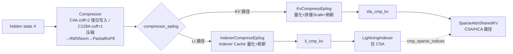

# Compressor (C4A / C128A KV 压缩融合算子)

## Summary

`Compressor` 是 DeepSeek-V4 全新发布的 **KV 压缩融合算子**：把 V4 交错 Hybrid Attention 中**较为复杂的 KV 压缩算法**（原本分散为 Linear / split / slice / softmax / Hadamard / reduce / RMSNorm / RoPE 一长串小算子）融合为单一高效算子。其核心是把每 `r` 个 token 的 KV 用一个 softmax 加权和**压缩成 1 个**压缩 KV，喂给下游 [sparse-attn-sharedkv](sparse_attn_sharedkv.md)（SAS）的 Compressed / Sparse 路径，以及 [lightning-indexer](lightning_indexer.md)（LI）的 Indexer Cache 压缩。

压缩比 `r` 有两档，对应 V4 的两类压缩层：

- **C4A**（`compress_ratio=4`，对应 [deepseek-v4](../models/deepseek_v4.md) 的 **CSA** 层）：每 4 个 token 压缩成 1 个，且需用**相邻两组 token**语义（`coff=2`，引入数据重排 / 错位写入）。
- **C128A**（`compress_ratio=128`，对应 V4 的 **HCA** 层）：每 128 个 token 压缩成 1 个，仅依赖单一 KV 序列（`coff=1`）。

代码侧实现为 `Compressor(nn.Module)`（`models/deepseek-v4/models/modules/compressor.py`），其 `compressor_prolog` 调用融合算子 `torch.ops.custom.compressor(**cmpr_input_kwargs)` 产出压缩 KV，再由 `compressor_epilog` 把压缩 KV 量化 / 拼接 Scale / 刷新到对应 Cache（见 [#CompressEpilog](#compressepilog-kvcompressepilog--indexercompressepilog)）。LI 路径与 KV 路径共用同一 `Compressor` 类（`"index" in self.prefix` 区分），算子内部结构相同（inference guide 明示"LI 部分 Compressor 结构与 KV 的 Compressor 结构相同"）。

cann-recipes-infer 同时提供 **AscendC**（Atlas-A3 / 950PR/DT）与 **PyPTO** 两路实现。

## 计算公式

`Compressor` 先把 `r` 个 KV 压缩成 1 个，再对压缩后的 KV 做 **RMSNorm + Partial RoPE** 后处理。

### C4A（compress_ratio=4，coff=2）

给定输入 $X\in\mathbb{R}^{s\times h}$（$s$ 序列长、$h$ hidden size），先算两组 KV 输入 $C^a,C^b$ 与两组压缩权重（gate）$Z^a,Z^b\in\mathbb{R}^{s\times d}$（$d$ 为 head dim）：

$$C^a=X\cdot W^{aKV},\ C^b=X\cdot W^{bKV},\quad Z^a=X\cdot W^{aGate},\ Z^b=X\cdot W^{bGate}$$

第 $i$ 行压缩 KV $C_i^{\text{Comp}}\in\mathbb{R}^{1\times d}$（每 4 个 token 压成 1 个；C4A 因 `coff=2`，加权和沿 8 项 —— 当前 4-token 与前序 4-token 经 a/b 两组投影 $W^{aKV}/W^{bKV}$ 得到的 8 个 $d$ 向量，详见下方"错位写入"小节）：

$$C_i^{\text{Comp}}=[1]_{1\times8}@\big(\text{softmax}([Z^a_{[4(i-1)+1:4i]};Z^b_{[4i+1:4(i+1)]}]+B)\odot[C^a_{[4(i-1)+1:4i]};C^b_{[4i+1:4(i+1)]}]\big)$$

其中 $B\in\mathbb{R}^{8\times d}$ 为 $C^a,C^b$ 对应的 positional biases（代码 `self.ape`，shape `(compress_ratio, coff*head_dim)`）。代码 `ape (compress_ratio, coff·head_dim)` 与文档 $B$（$8\times d$）为同一偏置等价重排（C4A `coff=2`，故 `(4, 2·d)` ≡ $B$ 的 $8\times d$）。

### C128A（compress_ratio=128，coff=1）

仅依赖单一 KV 序列 $C$ 与压缩权重 $Z$：

$$C=X\cdot W^{KV},\quad Z=X\cdot W^{Gate}$$

每 128 个 KV 压成 1 个，第 $i$ 行：

$$C_i^{\text{Comp}}=[1]_{1\times128}@\big(\text{softmax}(Z_{[128(i-1)+1:128i]}+B)\odot C_{[128(i-1)+1:128i]}\big)$$

$B\in\mathbb{R}^{128\times d}$。

### 阶段拆解

压缩阶段：① Matmul（C4A 算 `[C^a,Z^a]`/`[C^b,Z^b]`，C128A 算 `[C,Z]`，`wkv`/`wgate` 各输出 `coff*head_dim`）→ ② 分组加 positional bias `B` → ③ 分组 softmax → ④ 逐元素乘（Hadamard product，源文档记作 $S_H$，非 Hadamard 旋转变换）→ ⑤ 沿压缩轴分组求和（C4A `[1]_{1×8}@` / C128A `[1]_{1×128}@`，即 `[1]_{1×(coff·r)}@`）。
后处理阶段：① RMSNorm（`DeepseekV3RMSNorm(head_dim)`）→ ② Partial RoPE（仅尾 `rope_head_dim` 维做旋转，代码 `rotary_mode=2`，interleave）。

> **边界说明**：源 AscendC guide 的"后处理阶段"（RMSNorm + Partial RoPE）不含 Hadamard 旋转。`rotate=true` 层（仅部分层）的 Hadamard 旋转变换是融合算子之外、`compressor_prolog`（含上述压缩+后处理）与 `compressor_epilog` **之间**的独立调用 `rotate_activation(kv, self.hadamard_matrix)`（`compressor.py:L221-222`，在 `forward` 里）。它与上面 ④ 的"逐元素乘"（softmax 加权用的 Hadamard product）是两回事。

> Compressor 中存在大量非计算向量操作（split/slice 等）。若以小算子实现会引入大量无意义的数据重复搬入搬出，性能极差；融合算子把这些操作在数据搬运过程中**随路实现**，大幅降低耗时。

## AscendC 实现（Atlas-A3 / 950PR/DT）

### Tiling 设计

L1 基本块（Atlas-A3）：

| 层 | $X$ 矩阵 L1 基本块 | $W^{KV},W^{Gate}$ 一轮迭代搬入 |
| ---- | ---- | ---- |
| C128A | $(256,256)$，$2\times256\times256\times2\text{B}=256\text{ KB}$ | $W^{KV},W^{Gate}$ 各 2 个 $(256,64)$ 块 |
| C4A | $(128,256)$，$128\times256\times2\text{B}=64\text{ KB}$ | $W^{aKV},W^{bKV},W^{aGate},W^{bGate}$ 各 1 个 $(256,64)$ 块 |

- L0A / L0B 使能 Double Buffer（各 $2\times32\text{ KB}$），一次搬入矩阵块 $(128,128)$；L0C Double Buffer（$2\times64\text{ KB}$），存放 $X$ 分块与 KV+Gate 相乘的结果并在 L0C 上累加。
- 以基本块做完矩阵乘并按 reduce 轴累加后，**均分给 2 个 Vector 核**做后续向量操作（softmax / Hadamard / reduce / RMSNorm / RoPE）。
- **Decode 阶段**：为解决 $s$ 轴方向无法分核的问题，进一步切分 $d$ 轴（从 64 降到 32），提高启动核数与带宽利用率。

### 基本块 Cost Model

基本块选取依据硬件参数理论计算确定。为使一轮迭代搬运左/右矩阵的时间被对应计算时间掩盖，需满足搬运耗时不超过计算耗时：

$$\frac{(baseM+baseN)\times baseK\times 2\text{ Bytes}}{\text{Bandwidth}}\le\frac{baseM\times baseN\times baseK}{4096}$$

约去 $baseK$ 后求解：

- **Atlas-A3**：C128A 取 $(baseM,baseN,baseK)=(256,128,512)$；C4A 取 $(128,256,512)$。$baseK=512$ 主要考虑昇腾亲和 Cacheline 对齐，提高搬运效率。
- **950PR/DT**：考虑 L0A / L0B 容量限制，取 $baseM=baseN=baseK=256$ 达成条件。

### 错位写入（C4A 数据重排 / overlap_transform）

`coff` 在 C128A 层为 1、C4A 层为 2。`coff=2` 意味着 C4A 需用**相邻两组 token** 语义压缩 —— 即把每个 token 映射为两个 $d$ 大小的向量后（图示红色块与黄色块），将每 4 个 token 对应的**黄色块向量**与**前 4 个 token 对应的红色块向量**重排为连续存储（`overlap_transform`）。该重排若用小算子单独实现同样会引入大量非计算向量操作。

融合算子用**错位写入**完成这一重排：注意到 C4A 中 $Z^b,C^b$ 计算 $C_i^{\text{Comp}}$ 的下标与 $Z^a,C^a$ 计算 $C_{i+1}^{\text{Comp}}$ 的下标**有重叠**。完成前序矩阵乘后，红色部分的计算结果在写入目标地址时**额外加一个地址偏移**，保证红色部分与黄色部分计算结果对齐，将 `state_cache` 里所需数据读入 UB 即可直接做后续向量计算 —— 把数据重排"随路"嵌进 Cube 结果回写阶段，避免独立的 transform 算子。

> C4A 的 `state_cache` 在 `cache_mode=1`（连续 buffer）下为**非连续**存储；仓内 commit `13c7ad5`（!407）将相关拦截从前端移入 Tiling 处理，使 Compressor 适配该非连续 `state_cache` 布局。

## PyPTO 实现

PyPTO 在同一个算子内根据 `compress_ratio` / `rotate` 等配置分支，对每个分支各自优化。计算过程：

$$kv=X@W^{KV},\quad score=X@W^{Gate}+ape$$

用 `kv` 与 `score` 刷新 `kv_state` / `score_state`；当 `start_pos+1` 为 `compress_ratio` 倍数时生成压缩 KV：$kv=(kv\_state\cdot\text{softmax}(score\_state,\dim=1)).\text{sum}(\dim=1)$，再 $kv=\text{ROPE}(\text{RMSNorm}(kv))$（`rotate=true` 时叠加 Hadamard）。

PyPTO 侧两类关键优化（以 `compress_ratio=4, rotate=false` 场景为例）：

- **MatMul（右矩阵复用 + K 轴大包搬运）**：左右矩阵 shape `[bsz*s1, 4096] @ [4096, 1024]`，batch 动态。直接对 batch 循环展开会令 M 轴 = `s1`、右矩阵被重复搬运多次。故在动态 batch 轴用 `b=64` 切分；`set_cube_tile_shapes([128,128],[256,512],...)` 令 K 轴 L0/L1 tilesize 为 256/512，一次搬入较大数据进 L1 提升带宽利用率。
- **向量操作（按 batch 单子图）**：不同 batch 的 `start_pos` 不同、可能进入不同分支、更新的 `kv_state`/`score_state` 地址也不同。对 batch loop、设 `pg_skip_partition=True` 让一个 batch 的 vector 处理在同一子图内（避免断图导致中间数据在 GM↔UB 反复搬运劣化）；同时 vector 含 Softmax+ReduceSum（1 轴）与 RMSNorm+RoPE（尾轴），难以多核并行，大 batch 下把每个 batch 当一个子图可多核并行。
- **`scatter_update` 刷新 state**：`kv_state = scatter_update_3d(kv_state, index, kv)`、`score_state = scatter_update_3d(score_state, index, score)`。用 `scatter_update` OP 避免把 `kv_state`/`score_state` 多次搬入 UB 及 concat 导致的性能劣化。

PyPTO 后端跨代际兼容（PTO-ISA），框架语义见 [pypto](../frameworks/pypto.md)。

## CompressEpilog（KvCompressEpilog / IndexerCompressEpilog）

V4 Attention 部分的融合 Kernel 链为 `Compressor → CompressEpilog → (LI) → SAS`。压缩 KV 产出后，由 `Compressor.compressor_epilog`（`compressor.py:L89-125`）负责量化 + 刷新 Cache，按 `prefix` 与量化模式分两条 Epilog 路径：

- **KvCompressEpilog**（SFA / KV 路径，`"index" not in prefix`）：包含**对压缩后 KV 的量化、量化后压缩 KV 和其 Scale 的拼接、刷新到 KV Cache** 的操作。`kv_cache_quant_mode == "float8"` 时调融合算子 `torch.ops.custom.kv_compress_epilog(x, slot_mapping, kv_compress_cache=sfa_cmp_kv)`；非量化时用 `scatter_nd_update_asc` 直接把 `kv` 刷进 `sfa_cmp_kv`。
- **IndexerCompressEpilog**（LI 路径，`"index" in prefix`）：包含 **Indexer Cache 的量化、刷新**操作。`li_cache_quant_mode == "float8"` 时调融合算子 `torch.ops.custom.indexer_compress_epilog(x, slot_mapping, indexer_compress_cache=li_cmp_kv, indexer_compress_scale=li_key_dequant_scale)`；**非 float8 / 动态量化路径**（`else` 分支，`compressor.py:L104-112`）则先 `kv, k_scale = torch_npu.npu_dynamic_quant(kv)` 做动态量化，再两次 `scatter_nd_update_asc` 分别把 scale 刷进 scale cache（`li_key_dequant_scale`）、把量化后 `kv` 刷进 `li_cmp_kv`——并非"非量化直写"。

> CompressEpilog 内容紧贴 `Compressor` 类（同一 `compressor_epilog` 方法、共用 `cmp_slot_mapping`），故并入本页作小节而非独立成页。源 commit：`6490156`（!426）改进 `kv_compress_epilog` 的 row-local 地址计算；`e43b65a`（!433）令 `indexer_compress_epilog` 与 `kv_compress_epilog` 支持 HiFloat8（hifp8）量化。

> gap：CompressEpilog 在 FP8 / HiFloat8 路径下的 row-local 地址布局、Scale 拼接的具体存储格式，以及与 V4 整体量化矩阵（A3 W8A8C16 / 950 Hybrid FP8-MXFP4 / MXFP8-MXFP4）的对应尚未收录；量化总览见 [deepseek-v4](../models/deepseek_v4.md) Quantization Overview。

## Role In Pipeline

代码状态结构（`attention_data.py`，已核对）：`Compressor` 写出的压缩 Cache 为 `sfa_cmp_kv`（SFA/KV）与 `li_cmp_kv`（LI）。实际**创建并传入** `Compressor` 的 state cache 是 `sfa_kv_state`（SFA 路径，`attention_data.py:L117`）与 `li_kv_state`（LI 路径，`L119`）——二者由 `create_state_cache(state_block_num, compress_ratio, cache_dim)` 创建（`L80`），其 `cache_dim` 形参在 SFA 路径取 `config.head_dim`（`L117`）、在 LI 路径取 `config.index_head_dim`（`L119`）。`compressor_prolog` 据 `prefix` 把对应的 `li_kv_state` / `sfa_kv_state`（`.flatten(-3)` 后）作为 `state_cache` 入参传给融合算子（`compressor.py:L170/L174`）。`sfa_score_state` / `li_score_state` 在 `init_cache_data` 里仅作 `None` 占位（`attention_data.py:L156`），**不创建、也不传给** `Compressor`，不应列为已创建的 state cache。这些 state cache 由 `c{ratio}a_cmp_state` block_table 寻址，压缩 KV 由 `c{ratio}a_cmp_kv` slot_mapping 寻址。

## Evidence

- [cann-recipes-infer](https://gitcode.com/cann/cann-recipes-infer/tree/2c45117d781ab9ab88dcb89a28ae30f5d2450399) — [`docs/models/deepseek-v4/deepseek_v4_ascendc_operator_guide.md`](https://gitcode.com/cann/cann-recipes-infer/blob/2c45117d781ab9ab88dcb89a28ae30f5d2450399/docs/models/deepseek-v4/deepseek_v4_ascendc_operator_guide.md)（Compressor 节：C4A/C128A 计算公式、阶段拆解、Atlas-A3/Decode/950 Tiling、基本块 Cost Model、`coff`/overlap_transform、错位写入；frontmatter 主源）
- [cann-recipes-infer](https://gitcode.com/cann/cann-recipes-infer/tree/2c45117d781ab9ab88dcb89a28ae30f5d2450399) — [`docs/models/deepseek-v4/deepseek_v4_pypto_operator_guide.md`](https://gitcode.com/cann/cann-recipes-infer/blob/2c45117d781ab9ab88dcb89a28ae30f5d2450399/docs/models/deepseek-v4/deepseek_v4_pypto_operator_guide.md)（Compressor 节：PyPTO 计算过程、MatMul/向量操作优化、`scatter_update_3d` 刷 state）
- [cann-recipes-infer](https://gitcode.com/cann/cann-recipes-infer/tree/2c45117d781ab9ab88dcb89a28ae30f5d2450399) — [`docs/models/deepseek-v4/deepseek_v4_inference_guide.md`](https://gitcode.com/cann/cann-recipes-infer/blob/2c45117d781ab9ab88dcb89a28ae30f5d2450399/docs/models/deepseek-v4/deepseek_v4_inference_guide.md)（融合 Kernel 节：Compressor / KvCompressEpilog / IndexerCompressEpilog 在 `Compressor→CompressEpilog→LI→SAS` 链路中的职责，及 Attention 整体结构图）
- [cann-recipes-infer](https://gitcode.com/cann/cann-recipes-infer/tree/2c45117d781ab9ab88dcb89a28ae30f5d2450399) — [`models/deepseek-v4/models/modules/compressor.py`](https://gitcode.com/cann/cann-recipes-infer/blob/2c45117d781ab9ab88dcb89a28ae30f5d2450399/models/deepseek-v4/models/modules/compressor.py)（已代码核对：`class Compressor(nn.Module)`；`compressor_prolog` 调 `torch.ops.custom.compressor(...)`；`compressor_epilog` 按 `kv_cache_quant_mode`/`li_cache_quant_mode == "float8"` 分派 `kv_compress_epilog` / `indexer_compress_epilog`，非量化走 `npu_dynamic_quant`+`scatter_nd_update_asc`；`coff = 1 + self.overlap`、`self.overlap = compress_ratio == 4`；`ape` positional bias 为 `nn.Parameter(torch.empty(compress_ratio, coff*head_dim))`；`cmpr_input_kwargs` 含 `cmp_ratio`/`coff`/`rotary_mode=2`/`cache_mode=1`/`state_cache`/`state_block_table`/`norm_eps`；`rotate` 时 `rotate_activation(kv, hadamard_matrix)`）
- [cann-recipes-infer](https://gitcode.com/cann/cann-recipes-infer/tree/2c45117d781ab9ab88dcb89a28ae30f5d2450399) — [`models/deepseek-v4/models/modules/attention_data.py`](https://gitcode.com/cann/cann-recipes-infer/blob/2c45117d781ab9ab88dcb89a28ae30f5d2450399/models/deepseek-v4/models/modules/attention_data.py)（已代码核对：压缩 Cache `sfa_cmp_kv`/`li_cmp_kv`；创建并传入 `Compressor` 的 state cache 为 `sfa_kv_state`（L117，`cache_dim=config.head_dim`）/`li_kv_state`（L119，`cache_dim=config.index_head_dim`），签名 `create_state_cache(state_block_num, compress_ratio, cache_dim)`（L80）；`sfa_score_state`/`li_score_state` 仅 `None` 占位（L156）不传入；`c{ratio}a_cmp_state` block_table / `c{ratio}a_cmp_kv` slot_mapping）
- 溯源（diff `2f82d10..2c45117` + MR）：`5df82b1` support deepseek v4（!366）；`985b882` 更新 deepseek_v4_ascendc_operator_guide（!367）；`13c7ad5` compressor 适配 cachemode=1 下 state_cache 非连续（!407）；`761fb91` enable bsh format for compressor in decode stage（!490）；`6490156` improve kv_compress_epilog row-local address calculation（!426）；`e43b65a` indexer_compress_epilog and kv_compress_epilog support hifp8 quant（!433）。

## Links

- [deepseek-v4](../models/deepseek_v4.md)
- [sparse-attn-sharedkv](sparse_attn_sharedkv.md)
- [lightning-indexer](lightning_indexer.md)
- [indexer-prolog](indexer_prolog.md)（V4 CSA 层 IndexerProlog 前置 LI，LI 作用于 Compressor 压缩后的 cmp_KV）
- [ascendc](../frameworks/ascendc.md)
- [pypto](../frameworks/pypto.md)
- [int8-int4-hybrid](../quantization/int8_int4_hybrid.md)（V4 A3 Pod 量化矩阵：Compressor Linear 不量化）
- [hybrid-mxfp8-mxfp4](../quantization/hybrid_mxfp8_mxfp4.md)（V4 950PR/DT 量化矩阵：Compressor Linear 不量化）
