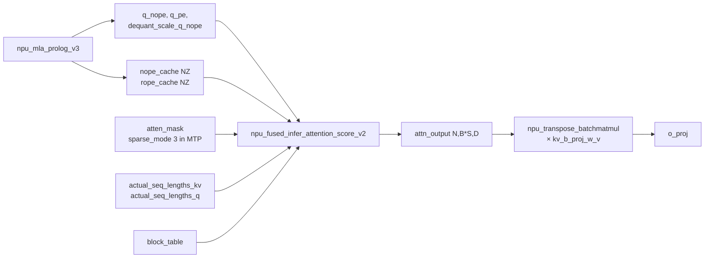

# npu_fused_infer_attention_score (v1 / v2)

## Summary

昇腾推理侧的通用 FlashAttention 融合算子（简称 **FIA**），覆盖 Softmax-Attention 的主体计算：`softmax(QKᵀ/√d)·V`，支持 Paged KVCache、Block-Table、分离的 NoPE/RoPE Query/Key 输入、以及 Query / Key / Value 三端的动态 Int8 反量化（dequant_scale_*）。在 DeepSeek-R1 decode 路径中作为 [mla-prolog](mla_prolog.md) 之后的主 FA 算子。

本卡比较固定模型实践的 v1/v2 调用，不据调用差异推定版本新增能力：R1 v1 normal 已分离 query_rope/key_rope，Kimi-K2-Thinking v1 也使用 TND_NTD 与分离 RoPE；R1 v2 吸收/Prolog 路径则采用 Paged NZ KV 与对应量化参数。

## Role In Pipeline



## Key Parameters

### v1/v2 参数名与参考模型

| 语义 | v1 | v2 |
| --- | --- | --- |
| 缩放 | scale | softmax_scale |
| Query 头数 | num_heads | num_query_heads |
| Query 长度 | actual_seq_lengths | actual_seq_qlen |
| KV 长度 | actual_seq_lengths_kv | actual_seq_kvlen |
| KV 头数 | num_key_value_heads | num_key_value_heads |
| 参考反量化入口 | antiquant_scale/offset、antiquant_mode | dequant_scale_query/key/value 及对应 quant_mode |

先确认实际调用的 namespace、schema 与后端适配层，再匹配参数；不同包装可能直接拒绝未知参数，不能承诺“错名一定静默使用默认值”。固定代码中 Qwen Dense、Qwen3-MoE、GPT-OSS 当前均使用 v2；Kimi 和 R1 normal 仍有 v1，不能沿用旧 Skill 表“Qwen3-MoE 用 v1”来判定当前实现。两个版本都存在分页与非分页、分离 RoPE 的实际路径，不按版本号推断所有能力。GPT-OSS 的 v2 用 learnable_sink；其他调用的 sink 能力需另核对 schema。

### 按调用路径选择 sparse_mode 与 mask

| 实际路径 | 配置及缓存消费者 |
| --- | --- |
| Qwen Dense 标准 TND | 两阶段先写分页缓存，再按 block_table 读取；sparse_mode=3 与 causal mask |
| Qwen3-MoE 标准 TND | Prefill 直读当前 K/V、mode=3；BF16 Decode 读分页缓存、mode=3；float8 KV Decode 为 mode=0、atten_mask=None |
| GPT-OSS 滑窗 TND | 两阶段保持 sparse_mode=4、pre_tokens=sliding_window、next_tokens=0 与 band mask；非滑窗层为3 |
| R1 absorb/prolog 单 token | sparse_mode=0、atten_mask=None；有效历史长度另传 |
| R1 absorb/prolog MTP | q_len>1 时 sparse_mode=3，保留多个验证 token 间的因果 mask |

该表是固定模型实现，不是所有 FIA 重载的参数规范。不能把“Decode 一律不用 mask”或“Decode 一律 mode=0”推广到标准 TND、滑窗及 MTP。mask 的 True/False 语义按构造器与接口核对，形容为“下三角 mask”不足以决定极性；压缩 causal/band 模式的参考模型使用 get_init_attn_mask(2048, device)，不按最大上下文长度随意扩展。完整矩阵模式、可接受 dtype 与其他维度约束继续核对目标 API。

### Paged KV 的实际存储

GQA/MHA CacheEntry 可按 [block_num, block_size, local_kv_heads, head_dim] 分配，传给 FIA 时 view 为 [block_num, block_size, local_kv_heads*head_dim]。MLA 的 nope/rope 则按 PA_NZ 写入并 view 为五维 NZ，具体见下文；两者 Query 仍可为 packed [T,N,D]。block_table 必须对应该缓存分组和已分配块，不能把 layout 字符串的后缀当成物理 KV shape。

TND 的长度语义由实际缓存消费者决定。以下表固定到 Recipes `944d2d3ece86f7df33dbb0cb155c72ca619a9c66`，路径 ID 只用于区分本表的调用分支；`paged` 表示传入 block_table，`current` 表示当前 batch 的 K/V、没有 block_table。不能把 Qwen Dense 与 Qwen3-MoE 的 Prefill 合并，也不能把 FP8 Decode 归入 BF16 分支。

| 路径 ID | K/V 来源 | actual_seq_qlen 字段 | actual_seq_kvlen 字段 | sparse_mode | atten_mask |
| --- | --- | --- | --- | --- | --- |
| qwen_dense_prefill | paged | actual_seq_lengths_cu_q | actual_seq_lengths_kv | 3 | causal |
| qwen_dense_decode | paged | actual_seq_lengths_cu_q | actual_seq_lengths_kv | 3 | causal |
| qwen_dense_decode_npugraph_ex | paged | actual_seq_lengths_cu_list_q | actual_seq_lengths_list_kv | 3 | causal |
| qwen3_moe_prefill | current | actual_seq_lengths_cu_q | actual_seq_lengths_cu_kv | 3 | causal |
| qwen3_moe_decode_bf16 | paged | actual_seq_lengths_cu_q | actual_seq_lengths_kv | 3 | causal |
| qwen3_moe_decode_float8 | paged | actual_seq_lengths_cu_q | actual_seq_lengths_kv | 0 | None |

Qwen Dense 的 Prefill **先 scatter K/V 到缓存再调用 FIA**；每请求 KV 长度为 `[3,5]` 时传 `[3,5]`，Query 边界为 `[3,8]`。Qwen3-MoE Prefill 则先直读当前 K/V，KV 和 Query 都取 `[3,8]`，FIA 返回后才更新缓存。普通 Decode 若两个请求历史长度为 `[9,13]`、各新增1个 token，Query 取 `[1,2]`，KV 仍为 `[9,13]`。MTP 按每请求 q_len 构造累计 Query 边界。

表中 Qwen3-MoE Decode 的 Tensor 字段对应非 npugraph_ex 分支；该模型的 npugraph_ex Decode 同样换成 `actual_seq_lengths_cu_list_q` / `actual_seq_lengths_list_kv` 的 host list，数值仍是累计 Q、普通 KV。FP8 分支额外设置 `dequant_scale_key/value` 及 `key_quant_mode=value_quant_mode=4`，不能仅关 mask 而漏 scale。host list 与 Tensor 不改变长度语义，见[长度类型诊断](../../runbooks/runtime/fia_actual_seq_lengths_kv_backend_type.md)。

Atlas A3 上固定 DeepSeek-R1 Decode 路径 launch（源 `models/deepseek_r1/models/modeling_deepseek.py:L1271`）：

```python
attn_output, _ = self.fa_ops.npu_fused_infer_attention_score_v2(
 q_nope, k_nope, k_nope, # Q_NoPE, K_NoPE, V (MLA 下 K 与 V 共用 nope_cache)
 query_rope=q_pe, key_rope=k_rope, # NoPE/RoPE 分离
 atten_mask=attention_mask,
 actual_seq_kvlen=actual_seq_lengths_kv,
 actual_seq_qlen=actual_seq_lengths_q,
 block_table=block_table,
 dequant_scale_query=dequant_scale_query, # 来自 mla_prolog
 dequant_scale_key=self.ckv_scale if self.kv_cache_quant_mode == "int8" else None,
 dequant_scale_value=self.ckv_scale if self.kv_cache_quant_mode == "int8" else None,
 num_query_heads=self.num_heads_per_rank,
 num_key_value_heads=self.num_key_value_heads_per_rank,
 softmax_scale=self.softmax_scale,
 input_layout="TND_NTD",
 sparse_mode=sparse_mode, # 0: 普通; 3: MTP 因果
 block_size=self.block_size,
 query_quant_mode=3 if self.kv_cache_quant_mode == "int8" else 0,
 key_quant_mode=0, value_quant_mode=0,
)
```

### Query、KV 存储与输出布局

布局字符串不能把后缀直接解释为 K/V 物理存储格式。固定 R1 normal 的 NTD_TND 路径：Query 输入 [N,T,D]，展开后的 K/V 也为 [N,T,D]，输出为 [T,N,D]。本页 R1 v2 Decode 的 TND_NTD 路径：Query 输入 [T,N,D]，输出 [N,T,D]；K/V 是五维 Paged NZ cache，由 block_table / block_size 寻址，不是三维 NTD。INT8 打包维度另见下文 NZ view。

Atlas A3 R1 Prefill 优化文档报告其 NTD 输入、TND 输出方案相对 TND 方案计算效率约提升 15%；这是特定 Prefill 实现的来源观测，不是本页 v2 Decode TND_NTD 的对比实验，也不能据此归因到 Kᵀ 访问连续性。Qwen 的支持产品范围为 A2/A3，不能把 R1 的测量外推到所有 FIA 调用。

### R1 absorb/prolog 的 sparse_mode

- `0`：该路径单 token Decode 不另做因果 mask，`attention_mask = None`，可见历史由 KV 长度控制；不能把 mode=0 本身称为因果模式；
- `3`：MTP 场景下 `q_len > 1`，使用 MTP 因果 mask，让多 draft token 之间严格因果 + 对历史全可见。

### 量化入口

- `dequant_scale_query`：来自 `npu_mla_prolog_v3` 的 `dequant_scale_q_nope`，当 W8 + C8 双启时不为 None；
- `dequant_scale_key` / `dequant_scale_value`：`ckv_scale`（KV per-tensor scale，FP32 / torch.float）；
- `query_quant_mode=3`：per-token-head，与 mla_prolog 端 `query_quant_mode=1` 对齐的 C8 路径。

## v1 6.0 的单 Query 与全遮蔽行边界

此节仅归纳官方 **PyTorch 6.0 文档中的 v1 `torch_npu.npu_fused_infer_attention_score`、Atlas A2** 约束。它不替代上面 Recipes v2 模型调用表，也不据此声明 A3、950 或 v2 有相同限制。完整接口及产品范围见 [6.0 官方 API](https://www.hiascend.com/doc_center/source/zh/Pytorch/600/apiref/apilist/ptaoplist_000837.html)。

| inner_precise | 精度选择 | 行无效修正 |
| --- | --- | --- |
| 0 | high_precision | disabled |
| 1 | high_performance | disabled |
| 2 | high_precision | enabled |
| 3 | high_performance | enabled |

自定义 mask 的 **全遮蔽行** 是行无效修正的排查场景。该版文档针对 `Q_S>1`、`sparse_mode` 为0或1且自定义 mask 的情况建议开启修正；`Q_S=1` 只允许0或1。Recipes 的 LLM 示例没有2/3的验证用例，不能把它们当作所有 NaN 或精度问题的通用开关。

对于该版 v1 的 BSH 输入，`Q_S=1` 转入 IncreFlashAttention 分支，`sparse_mode`、`pre_tokens` 和 `next_tokens` 不生效。因此只设置 band 或 pre_tokens 并不能证明单 token Decode 实现了滑窗。应核对可见 KV、实际 mask 和目标版本支持的窗口实现，并以窗口外 token 的反例与参考 attention 对比。不要把这条旧版限制覆盖到上表 TND v2 路径。

## 当前 packed 与缓存边界

R1 当前按总 token 数推导 q_len，CacheEntry 绑定 nope/rope cache 后按 block_table 参数寻址，不使用旧 self.block_table 的固定请求状态。dequant_scale_q_nope 在 C8 时展成 [T,-1]；输出经 transpose_batchmatmul 与 o_proj 还原 [T,H]。C8 的 NZ factor=2 与 BF16 rope 分开，不能把 query 输出布局当 KV 物理布局。

## Performance Signals

- 是 Decode TPOT 的主要计算组成（MLA 路径下与 mla_prolog、MoE 融合算子并列）。
- Atlas A3 R1 Prefill 的 NTD 方案有约 15% 来源观测，条件和布局见上文；没有本页 v2 Decode 对应的受控收益证据。
- Paged KVCache + block_table 支持大上下文，与 `enable_pa: True`、`pa_block_size: 128` 配合。
- 量化路径下 **Q-side dequant 被内嵌**，该融合不取消 MLAProlog 调用前对 hidden_states 的外部 npu_dynamic_quant，需区分输入激活量化与内部 Query 处理。

## Optimization Notes

- **K/V 共用 nope_cache** 是 MLA 的特性（不是 FIA 限制）：`k_nope` 既作为 K 也作为 V，RoPE 走 `key_rope` 独立通道。
- **NZ view 适配**：在 `kv_cache_quant_mode == "int8"` 时，`factor=2` 打包 int8 后需重新 view，`KV_CACHE_NZ_DIM=16` 硬编码避免高版本 torch 的 dynamic shape 问题。
- 与 `npu_transpose_batchmatmul(attn_output, kv_b_proj_w_v)` 串联实现 V-side up projection；Attention 的 `v_head_dim` 独立于 Q/K 的 `head_dim`。
- v1（`npu_fused_infer_attention_score`）在 `forward_page_attention_normal` 分支使用，布局为 NTD_TND、该调用没有启用 C8（antiquant_scale=None，无 dequant_scale_*），不据此推断 v1 API 的全部能力边界。

## Evidence

- [modeling_deepseek.py](../../../../../cann-recipes-raw/cann-recipes-infer/944d2d3ece86f7df33dbb0cb155c72ca619a9c66/models/deepseek_r1/models/modeling_deepseek.py)（primary）
- [modeling_deepseek.py](../../../../../cann-recipes-raw/cann-recipes-infer/944d2d3ece86f7df33dbb0cb155c72ca619a9c66/models/kimi_k2_thinking/models/modeling_deepseek.py)（implementation）
- [deepseek_r1_prefill_optimization.md](../../../../../cann-recipes-raw/cann-recipes-infer/944d2d3ece86f7df33dbb0cb155c72ca619a9c66/docs/models/deepseek_r1/deepseek_r1_prefill_optimization.md)（implementation）

## Links

- [deepseek-r1](../models/deepseek_r1.md)
- [qwen3-5-moe](../models/qwen3_5_moe.md)
- [qwen-dense](../models/qwen_dense.md)（Qwen2/Qwen3 Dense 用 `npu_fused_infer_attention_score_v2` 全量 + 增量）
- [gemma4-26b-a4b](../models/gemma4_26b_a4b.md)（FIA v1 BSH，`scale=1.0`；sliding 层 prefill/decode 均 `sparse_mode=4`+`pre_tokens=window`；full 层 prefill `sparse_mode=3`、decode `sparse_mode=0`（`pre_tokens=INT32_MAX`））
- [hy3-preview](../models/hy3_preview.md)（FIA v1 BSH GQA，`scale=scale_fa`；prefill `sparse_mode=3`+causal mask、decode `sparse_mode=0`+atten_mask=None）
- [mla](../modules/mla.md)
- [mla-prolog](mla_prolog.md)
- [w8a8c8](../quantization/w8a8c8.md)
- [kv-cache-manager](../frameworks/kv_cache_manager.md)
- [sparse-attn-sharedkv](sparse_attn_sharedkv.md)（并列：通用 FIA 服务 R1/Qwen 的稠密 Softmax-Attention；SAS 是 DeepSeek-V4 的 Shared-KV 统一稀疏/压缩/滑窗 Attention 算子）
- [vggt](../../../spatial/concepts/models/vggt.md) / [hunyuan3d](../../../spatial/concepts/models/hunyuan3d.md)（跨域·空间智能：VGGT global attention 与 Hunyuan3D DiT 用 FIA 替换原生 attention 以入图）
- 跨域·具身：[cosmos-transfer2.5](../../../embodied/concepts/world_models/cosmos_transfer2_5.md)、[cosmos-predict2.5](../../../embodied/concepts/world_models/cosmos_predict2_5.md)、[pi0](../../../embodied/concepts/manipulation/pi0.md)、[isaac-gr00t](../../../embodied/concepts/manipulation/isaac_gr00t.md)、[pi05](../../../embodied/concepts/manipulation/pi05.md)、[alpamayo-r1](../../../embodied/concepts/navigation/alpamayo_r1.md)、[gradient-checkpoint-refine](../../../embodied/concepts/techniques/gradient_checkpoint_refine.md)、[om-atc-offline](../../../embodied/concepts/techniques/om_atc_offline.md)、[flow-matching-action-expert](../../../embodied/concepts/modules/flow_matching_action_expert.md)（VLA / 世界模型用 FIA 替换原生 attention 入图）

- [.agents/skills/model-infer-kvcache/SKILL.md](../../../../../cann-recipes-raw/cann-recipes-infer/944d2d3ece86f7df33dbb0cb155c72ca619a9c66/.agents/skills/model-infer-kvcache/SKILL.md)（supporting）

- [.agents/skills/model-infer-kvcache/references/fa-code-examples.md](../../../../../cann-recipes-raw/cann-recipes-infer/944d2d3ece86f7df33dbb0cb155c72ca619a9c66/.agents/skills/model-infer-kvcache/references/fa-code-examples.md)（supporting）

- [models/qwen/models/modeling_qwen.py](../../../../../cann-recipes-raw/cann-recipes-infer/944d2d3ece86f7df33dbb0cb155c72ca619a9c66/models/qwen/models/modeling_qwen.py)（supporting）

- [models/qwen3_moe/models/modeling_qwen3_moe.py](../../../../../cann-recipes-raw/cann-recipes-infer/944d2d3ece86f7df33dbb0cb155c72ca619a9c66/models/qwen3_moe/models/modeling_qwen3_moe.py)（supporting）

- [models/gpt_oss/models/modeling_gpt_oss.py](../../../../../cann-recipes-raw/cann-recipes-infer/944d2d3ece86f7df33dbb0cb155c72ca619a9c66/models/gpt_oss/models/modeling_gpt_oss.py)（supporting）

- [ptaoplist_000837.html](https://www.hiascend.com/doc_center/source/zh/Pytorch/600/apiref/apilist/ptaoplist_000837.html)（supporting）

- [execution_engine.py](../../../../../cann-recipes-raw/cann-recipes-infer/944d2d3ece86f7df33dbb0cb155c72ca619a9c66/executor/core/engine/execution_engine.py)（supporting）
