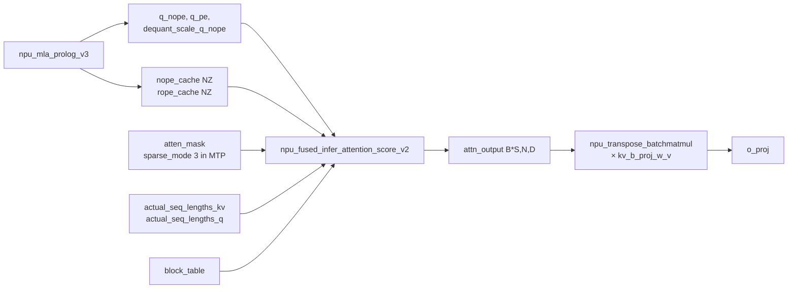

# npu_fused_infer_attention_score (v1 / v2)

## Summary

昇腾推理侧的通用 FlashAttention 融合算子（简称 **FIA**），覆盖 Softmax-Attention 的主体计算：`softmax(QKᵀ/√d)·V`，支持 Paged KVCache、Block-Table、分离的 NoPE/RoPE Query/Key 输入、以及 Query / Key / Value 三端的动态 Int8 反量化（dequant_scale_*）。在 DeepSeek-R1 decode 路径中作为 [mla-prolog](mla_prolog.md) 之后的主 FA 算子。

v2 相对 v1 增加了 TND_NTD 布局支持、更灵活的 sparse_mode、分离的 NoPE/RoPE Key 路径与 C8 量化反量化入口。

## Role In Pipeline



## Key Parameters

DeepSeek-R1 Decode 路径 launch（源 `models/deepseek_r1/models/modeling_deepseek.py:L1271`）：

```python
attn_output, _ = self.fa_ops.npu_fused_infer_attention_score_v2(
 q_nope, k_nope, k_nope, # Q_NoPE, K_NoPE, V (MLA 下 K 与 V 共用 nope_cache)
 query_rope=q_pe, key_rope=k_rope, # NoPE/RoPE 分离
 atten_mask=attention_mask,
 actual_seq_kvlen=actual_seq_lengths_kv,
 actual_seq_qlen=actual_seq_lengths_q,
 block_table=self.block_table,
 dequant_scale_query=dequant_scale_query, # 来自 mla_prolog
 dequant_scale_key=self.ckv_scale if self.kv_cache_quant_mode == "int8" else None,
 dequant_scale_value=self.ckv_scale if self.kv_cache_quant_mode == "int8" else None,
 num_query_heads=self.num_heads_per_rank,
 num_key_value_heads=self.num_key_value_heads_per_rank,
 softmax_scale=self.softmax_scale,
 input_layout="TND_NTD",
 sparse_mode=sparse_mode, # 0: 普通; 3: MTP 因果
 block_size=self.block_size,
 query_quant_mode=3 if self.kv_cache_quant_mode == "int8" else 0,
 key_quant_mode=0, value_quant_mode=0,
)
```

### Layout: TND_NTD

- **Q**: TND = `[tokens, num_heads, head_dim]`；
- **K/V**: NTD = `[num_heads, tokens, head_dim]`；
- 相比 BNSD 消除 padding 开销；相比 TND-TND 在 Q×Kᵀ 的 Kᵀ 一侧访问更连续，**计算效率提升约 15%**（Prefill 文档原文为「计算效率提升15%」；同处另提 NTD「提升带宽访问效率」但未附具体数字）。
- **同一文件三处布局并非一致**：v1/normal 路径用 `NTD_TND`（Q=NTD、K/V=TND），v2/absorb 与 v2/mla_prolog 路径用 `TND_NTD`（Q=TND、K/V=NTD）；本页 launch 示例的 decode 主路径（v2/mla_prolog）为后者，勿误以为全链路统一为 `TND_NTD`。

### sparse_mode

- `0`：普通因果（decode 单 token 时 `attention_mask = None`）；
- `3`：MTP 场景下 `q_len > 1`，使用 MTP 因果 mask，让多 draft token 之间严格因果 + 对历史全可见。

### 量化入口

- `dequant_scale_query`：来自 `npu_mla_prolog_v3` 的 `dequant_scale_q_nope`，当 W8 + C8 双启时不为 None；
- `dequant_scale_key` / `dequant_scale_value`：`ckv_scale`（KV per-tensor scale，FP32 / torch.float）；
- `query_quant_mode=3`：per-token-head，与 mla_prolog 端 `query_quant_mode=1` 对齐的 C8 路径。

## Performance Signals

- 是 Decode TPOT 的主要计算组成（MLA 路径下与 mla_prolog、MoE 融合算子并列）。
- NTD 布局是 R1 Prefill FA 相对 TND 计算效率提升 15% 的关键。
- Paged KVCache + block_table 支持大上下文，与 `enable_pa: True`、`pa_block_size: 128` 配合。
- 量化路径下 **Q-side dequant 被内嵌**，不再依赖外部 `npu_dynamic_quant`。

## Optimization Notes

- **K/V 共用 nope_cache** 是 MLA 的特性（不是 FIA 限制）：`k_nope` 既作为 K 也作为 V，RoPE 走 `key_rope` 独立通道。
- **NZ view 适配**：在 `kv_cache_quant_mode == "int8"` 时，`factor=2` 打包 int8 后需重新 view，`KV_CACHE_NZ_DIM=16` 硬编码避免高版本 torch 的 dynamic shape 问题。
- 与 `npu_transpose_batchmatmul(attn_output, kv_b_proj_w_v)` 串联实现 V-side up projection；Attention 的 `v_head_dim` 独立于 Q/K 的 `head_dim`。
- v1（`npu_fused_infer_attention_score`）在 `forward_page_attention_normal` 分支使用，布局为 NTD_TND、不带 C8 量化能力（`antiquant_scale=None`，无 `dequant_scale_*`）。

## Evidence

- [cann-recipes-infer](https://gitcode.com/cann/cann-recipes-infer/tree/2c45117d781ab9ab88dcb89a28ae30f5d2450399) — [`docs/models/deepseek-r1/deepseek_r1_decode_optimization.md`](https://gitcode.com/cann/cann-recipes-infer/blob/2f82d10467e6fe8dae81c97a2cdac78d733a6703/docs/models/deepseek-r1/deepseek_r1_decode_optimization.md) "MLA 低秩压缩优化 → Attention 性能优化"章节；[官方文档 npu_fused_infer_attention_score](https://www.hiascend.com/document/detail/zh/Pytorch/710/apiref/torchnpuCustomsapi/context/torch_npu-npu_fused_infer_attention_score.md)；`models/deepseek_r1/models/modeling_deepseek.py:L1033` (v1 路径) 与 `L1154` / `L1271` (v2 路径)。

## Links

- [deepseek-r1](../models/deepseek_r1.md)
- [qwen3-5-moe](../models/qwen3_5_moe.md)
- [qwen-dense](../models/qwen_dense.md)（Qwen2/Qwen3 Dense 用 `npu_fused_infer_attention_score_v2` 全量 + 增量）
- [gemma4-26b-a4b](../models/gemma4_26b_a4b.md)（FIA v1 BSH，`scale=1.0`；sliding 层 prefill/decode 均 `sparse_mode=4`+`pre_tokens=window`；full 层 prefill `sparse_mode=3`、decode `sparse_mode=0`（`pre_tokens=INT32_MAX`））
- [hy3-preview](../models/hy3_preview.md)（FIA v1 BSH GQA，`scale=scale_fa`；prefill `sparse_mode=3`+causal mask、decode `sparse_mode=0`+atten_mask=None）
- [mla](../modules/mla.md)
- [mla-prolog](mla_prolog.md)
- [w8a8c8](../quantization/w8a8c8.md)
- [kv-cache-manager](../frameworks/kv_cache_manager.md)
- [sparse-attn-sharedkv](sparse_attn_sharedkv.md)（并列：通用 FIA 服务 R1/Qwen 的稠密 Softmax-Attention；SAS 是 DeepSeek-V4 的 Shared-KV 统一稀疏/压缩/滑窗 Attention 算子）
- [vggt](../../../spatial/concepts/models/vggt.md) / [hunyuan3d](../../../spatial/concepts/models/hunyuan3d.md)（跨域·空间智能：VGGT global attention 与 Hunyuan3D DiT 用 FIA 替换原生 attention 以入图）
- 跨域·具身：[cosmos-transfer2.5](../../../embodied/concepts/world_models/cosmos_transfer2_5.md)、[cosmos-predict2.5](../../../embodied/concepts/world_models/cosmos_predict2_5.md)、[pi0](../../../embodied/concepts/manipulation/pi0.md)、[isaac-gr00t](../../../embodied/concepts/manipulation/isaac_gr00t.md)、[pi05](../../../embodied/concepts/manipulation/pi05.md)、[alpamayo-r1](../../../embodied/concepts/navigation/alpamayo_r1.md)、[gradient-checkpoint-refine](../../../embodied/concepts/techniques/gradient_checkpoint_refine.md)、[om-atc-offline](../../../embodied/concepts/techniques/om_atc_offline.md)、[flow-matching-action-expert](../../../embodied/concepts/modules/flow_matching_action_expert.md)（VLA / 世界模型用 FIA 替换原生 attention 入图）