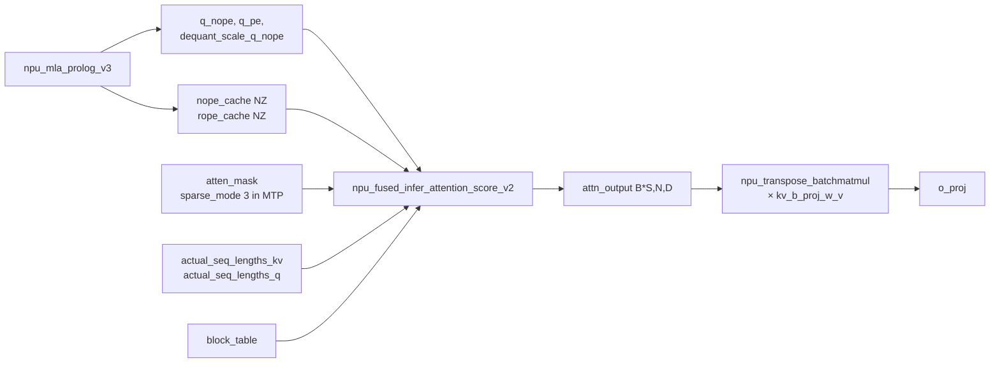

# npu_fused_infer_attention_score (v1 / v2)

## Summary

昇腾推理侧的通用 FlashAttention 融合算子（简称 **FIA**），覆盖 Softmax-Attention 的主体计算：`softmax(QKᵀ/√d)·V`，支持 Paged KVCache、Block-Table、分离的 NoPE/RoPE Query/Key 输入、以及 Query / Key / Value 三端的动态 Int8 反量化（dequant_scale_*）。在 DeepSeek-R1 decode 路径中作为 [mla-prolog](mla_prolog.md) 之后的主 FA 算子。

v2 相对 v1 增加了 TND_NTD 布局支持、更灵活的 sparse_mode、分离的 NoPE/RoPE Key 路径与 C8 量化反量化入口。

## Role In Pipeline



## Key Parameters

DeepSeek-R1 Decode 路径 launch（源 `models/deepseek_r1/models/modeling_deepseek.py:L1271`）：

```python
attn_output, _ = self.fa_ops.npu_fused_infer_attention_score_v2(
 q_nope, k_nope, k_nope, # Q_NoPE, K_NoPE, V (MLA 下 K 与 V 共用 nope_cache)
 query_rope=q_pe, key_rope=k_rope, # NoPE/RoPE 分离
 atten_mask=attention_mask,
 actual_seq_kvlen=actual_seq_lengths_kv,
 actual_seq_qlen=actual_seq_lengths_q,
 block_table=self.block_table,
 dequant_scale_query=dequant_scale_query, # 来自 mla_prolog
 dequant_scale_key=self.ckv_scale if self.kv_cache_quant_mode == "int8" else None,
 dequant_scale_value=self.ckv_scale if self.kv_cache_quant_mode == "int8" else None,
 num_query_heads=self.num_heads_per_rank,
 num_key_value_heads=self.num_key_value_heads_per_rank,
 softmax_scale=self.softmax_scale,
 input_layout="TND_NTD",
 sparse_mode=sparse_mode, # 0: 普通; 3: MTP 因果
 block_size=self.block_size,
 query_quant_mode=3 if self.kv_cache_quant_mode == "int8" else 0,
 key_quant_mode=0, value_quant_mode=0,
)
```

### Layout: TND_NTD

- **Q**: TND = `[tokens, num_heads, head_dim]`；
- **K/V**: NTD = `[num_heads, tokens, head_dim]`；
- 相比 BNSD 消除 padding 开销；相比 TND-TND 在 Q×Kᵀ 的 Kᵀ 一侧访问更连续，**计算效率提升约 15%**（Prefill 文档原文为「计算效率提升15%」；同处另提 NTD「提升带宽访问效率」但未附具体数字）。
- **同一文件三处布局并非一致**：v1/normal 路径用 `NTD_TND`（Q=NTD、K/V=TND），v2/absorb 与 v2/mla_prolog 路径用 `TND_NTD`（Q=TND、K/V=NTD）；本页 launch 示例的 decode 主路径（v2/mla_prolog）为后者，勿误以为全链路统一为 `TND_NTD`。

### sparse_mode

- `0`：普通因果（decode 单 token 时 `attention_mask = None`）；
- `3`：MTP 场景下 `q_len > 1`，使用 MTP 因果 mask，让多 draft token 之间严格因果 + 对历史全可见。

### 量化入口

- `dequant_scale_query`：来自 `npu_mla_prolog_v3` 的 `dequant_scale_q_nope`，当 W8 + C8 双启时不为 None；
- `dequant_scale_key` / `dequant_scale_value`：`ckv_scale`（KV per-tensor scale，FP32 / torch.float）；
- `query_quant_mode=3`：per-token-head，与 mla_prolog 端 `query_quant_mode=1` 对齐的 C8 路径。

## Performance Signals

- 是 Decode TPOT 的主要计算组成（MLA 路径下与 mla_prolog、MoE 融合算子并列）。
- NTD 布局是 R1 Prefill FA 相对 TND 计算效率提升 15% 的关键。
- Paged KVCache + block_table 支持大上下文，与 `enable_pa: True`、`pa_block_size: 128` 配合。
- 量化路径下 **Q-side dequant 被内嵌**，不再依赖外部 `npu_dynamic_quant`。

## Optimization Notes

- **K/V 共用 nope_cache** 是 MLA 的特性（不是 FIA 限制）：`k_nope` 既作为 K 也作为 V，RoPE 走 `key_rope` 独立通道。
- **NZ view 适配**：在 `kv_cache_quant_mode == "int8"` 时，`factor=2` 打包 int8 后需重新 view，`KV_CACHE_NZ_DIM=16` 硬编码避免高版本 torch 的 dynamic shape 问题。
- 与 `npu_transpose_batchmatmul(attn_output, kv_b_proj_w_v)` 串联实现 V-side up projection；Attention 的 `v_head_dim` 独立于 Q/K 的 `head_dim`。
- v1（`npu_fused_infer_attention_score`）在 `forward_page_attention_normal` 分支使用，布局为 NTD_TND、不带 C8 量化能力（`antiquant_scale=None`，无 `dequant_scale_*`）。

## Evidence

- [cann-recipes-infer](https://gitcode.com/cann/cann-recipes-infer/tree/2c45117d781ab9ab88dcb89a28ae30f5d2450399) — [`docs/models/deepseek-r1/deepseek_r1_decode_optimization.md`](https://gitcode.com/cann/cann-recipes-infer/blob/2f82d10467e6fe8dae81c97a2cdac78d733a6703/docs/models/deepseek-r1/deepseek_r1_decode_optimization.md) "MLA 低秩压缩优化 → Attention 性能优化"章节；[官方文档 npu_fused_infer_attention_score](https://www.hiascend.com/document/detail/zh/Pytorch/710/apiref/torchnpuCustomsapi/context/torch_npu-npu_fused_infer_attention_score.md)；`models/deepseek_r1/models/modeling_deepseek.py:L1033` (v1 路径) 与 `L1154` / `L1271` (v2 路径)。

## Links

- [deepseek-r1](../models/deepseek_r1.md)
- [qwen3-5-moe](../models/qwen3_5_moe.md)
- [qwen-dense](../models/qwen_dense.md)（Qwen2/Qwen3 Dense 用 `npu_fused_infer_attention_score_v2` 全量 + 增量）
- [gemma4-26b-a4b](../models/gemma4_26b_a4b.md)（FIA v1 BSH，`scale=1.0`；sliding 层 prefill/decode 均 `sparse_mode=4`+`pre_tokens=window`；full 层 prefill `sparse_mode=3`、decode `sparse_mode=0`（`pre_tokens=INT32_MAX`））
- [hy3-preview](../models/hy3_preview.md)（FIA v1 BSH GQA，`scale=scale_fa`；prefill `sparse_mode=3`+causal mask、decode `sparse_mode=0`+atten_mask=None）
- [mla](../modules/mla.md)
- [mla-prolog](mla_prolog.md)
- [w8a8c8](../quantization/w8a8c8.md)
- [kv-cache-manager](../frameworks/kv_cache_manager.md)
- [sparse-attn-sharedkv](sparse_attn_sharedkv.md)（并列：通用 FIA 服务 R1/Qwen 的稠密 Softmax-Attention；SAS 是 DeepSeek-V4 的 Shared-KV 统一稀疏/压缩/滑窗 Attention 算子）
- [vggt](../../../spatial/concepts/models/vggt.md) / [hunyuan3d](../../../spatial/concepts/models/hunyuan3d.md)（跨域·空间智能：VGGT global attention 与 Hunyuan3D DiT 用 FIA 替换原生 attention 以入图）
- 跨域·具身：[cosmos-transfer2.5](../../../embodied/concepts/world_models/cosmos_transfer2_5.md)、[cosmos-predict2.5](../../../embodied/concepts/world_models/cosmos_predict2_5.md)、[pi0](../../../embodied/concepts/manipulation/pi0.md)、[isaac-gr00t](../../../embodied/concepts/manipulation/isaac_gr00t.md)、[pi05](../../../embodied/concepts/manipulation/pi05.md)、[alpamayo-r1](../../../embodied/concepts/navigation/alpamayo_r1.md)、[gradient-checkpoint-refine](../../../embodied/concepts/techniques/gradient_checkpoint_refine.md)、[om-atc-offline](../../../embodied/concepts/techniques/om_atc_offline.md)、[flow-matching-action-expert](../../../embodied/concepts/modules/flow_matching_action_expert.md)（VLA / 世界模型用 FIA 替换原生 attention 入图）

<!-- cannbot:related:start -->
## 相关

- [Alpamayo-R1（智驾 VLA 推理 · 昇腾 A2）](../../../embodied/concepts/navigation/alpamayo_r1.md)（`related`）：FA 实现切换在 `src/alpamayo_r1/models/base_model.py` 模型初始化（`config.attn_implementation='flash_attention_2'`）。；昇腾推理侧的通用 FlashAttention 融合算子（简称 **FIA**），覆盖 Softmax-Attention 的主体计算；Alpamayo-R1 的注意力实现切换需要昇腾 FlashAttention 能力，FIA 卡解释融合注意力主体计算、布局与缓存入口，可辅助选择和验证该类替换。
- [CP/DCP 在线-softmax 跨卡合并只 mask lse 不 mask out 污染归并——本卡对某序列无 KV 时须对 attn_out 施同一 batch_seq_mask 置 0](../../runbooks/precision/cp_dcp_online_softmax_merge_mask_out_not_only_lse.md)（`related`）：在线-softmax 跨卡合并把每卡的 (out, lse) 两路一起喂给归并算子。；昇腾推理侧的通用 FlashAttention 融合算子（简称 **FIA**），覆盖 Softmax-Attention 的主体计算：`softmax(QKᵀ/√d)·V`，支持 Paged KVCache、Block-Table、分离的 NoPE/RoPE Query/Key 输入、以及 Query / Key / Value 三端的动态 Int8 反量化（dequant_scale_*）。。FIA 产生本地 softmax-attention 结果，运行手册说明 CP/DCP 分片后必须携带 out 与 lse 进入在线 softmax 归并，形成算子输出的跨卡正确性链。
- [CUDA 原生 vLLM 多模态模型移植 vllm-ascend NPU：三处固定后端不兼容点与修法](../../runbooks/runtime/vllm_cuda_multimodal_npu_bringup.md)（`related`）：“`VLLM_ATTENTION_BACKEND=NPU` 把 vLLM 的 paged/decode attention 切到昇腾后端（底层 ［npu_fused_infer_attention_score］(../../concepts/kernels/fused_infer_attention_score.md)），与视觉侧 flash_attn→SDPA 的回落是两处独立的 attention 后端替换。”与“昇腾推理侧的通用 FlashAttention 融合算子（简称 **FIA**），覆盖 Softmax-Attention 的主体计算：`softmax(QKᵀ/√d)·V`，支持 Paged KVCache、Block-Table、分离的 NoPE/RoPE Query/Key 输入、以及 Query / Key / Value 三端的动态 Int8 反量化（dequant_scale_*）。在 DeepSeek-R1 decode 路径中作为 ［mla-prolog］(mla_prolog.md) 之后的主 FA 算子。”分别给出两端正文事实；runbook 给出 vLLM NPU 后端实际下沉到 FIA，FIA 卡补齐 paged KVCache 与 block table 契约，可直接推进移植后的参数核验和 decode 排障。
- [FIA 的 MLA 无量化路径硬约束 group_num ∈ {2 的幂}（否则 561002 / CheckFeatureMlaNoQuantShape 失败）](../../runbooks/compilation/fia_mla_noquant_group_num_power_of_two.md)（`related`）：在昇腾上跑 ［MLA］(../../concepts/modules/mla.md) 结构模型（query/key head_dim=512），调 ［FIA］(../../concepts/kernels/fused_infer_attention_score.md) 算子 `aclnnFusedInferAttentionScoreV3` 失败，error code **561002**，算子自陈的诊断直接列出支持集与观测值：；昇腾推理侧的通用 FlashAttention 融合算子（简称 **FIA**），覆盖 Softmax-Attention 的主体计算：`softmax(QKᵀ/√d)·V`，支持 Paged KVCache、Block-Table、分离的 NoPE/RoPE Query/Key 输入、以及 Query / Key / Value 三端的动态 Int8 反量化（dequant_scale_*）。失败卡给出 FIA V3 的 tiling 约束，概念卡补齐 FIA 的输入布局与量化入口，能从报错回到实际算子合同。
- [FIA/qlens 的 block_table 首维 / num_reqs / TND seq-len 须等实际 batch：被 SP-padding 或整缓冲首维打破 → 算子 shape 校验失败](../../runbooks/runtime/fia_qlens_block_table_num_reqs_batch_contract.md)（`related`）：故障卡要求“把交给算子的 block_table / num_reqs 收敛到实际 batch”；FIA 概念页说明“Paged KVCache + block_table 支持大上下文，与 `enable_pa: True`、`pa_block_size: 128` 配合。”，前者给出后者分页块表入口的实际 batch 形状守卫与修复方法。
- [FP8 Per-Block Dynamic Quant Attention](../quantization/fp8_attention.md)（`related`）：**算子内部流程**（`npu_fused_infer_attention_score_v2`，源「量化模式说明」）：用 E8M0 缩放因子对量化值反量化 → Q×Kᵀ → Softmax → Attn×V → 返回原始精度格式输出。`npu_dynamic_mx_quant` 负责动态 MX 量化。；昇腾推理侧的通用 FlashAttention 融合算子（简称 **FIA**），覆盖 Softmax-Attention 的主体计算：`softmax(QKᵀ/√d)·V`，支持 Paged KVCache、Block-Table、分离的 NoPE/RoPE Query/Key 输入、以及 Query / Key / Value 三端的动态 Int8 反量化（dequant_scale_*）。在 DeepSeek-R1 decode 路径中作为 ［mla-prolog］(mla_prolog.md) 之后的主 FA 算子。。前者给出 MX 量化注意力内部链，后者定义实际承载主体 Attention 的 FIA 核心对象。
- [FusedInferAttentionScore A2/A3 ACLNN 算子知识](../../../../ops/ascendc/operators/aclnn/transformer/attention/fused_infer_attention_score.md)（`related`）：“｜ 计算语义 ｜ `S=QK^T*scale+pse+mask`，逐行 softmax 后计算 `O=softmax(S)V`；可选 page attention、RoPE、公共前缀、量化/反量化、后量化与 `softmaxLse` ｜”从 A2/A3 源码闭包定义 FIA V4 的完整计算与可选特征；“昇腾推理侧的通用 FlashAttention 融合算子（简称 **FIA**），覆盖 Softmax-Attention 的主体计算：`softmax(QKᵀ/√d)·V`，支持 Paged KVCache、Block-Table、分离的 NoPE/RoPE Query/Key 输入、以及 Query / Key / Value 三端的动态 Int8 反量化（dequant_scale_*）。在 DeepSeek-R1 decode 路径中作为 ［mla-prolog］(mla_prolog.md) 之后的主 FA 算子。”从模型侧描述同一 FIA 在 MLA decode 中的角色。两卡围绕同一融合算子，分别提供 ABI/route 与模型接线。
- [GPT-OSS](../models/gpt_oss.md)（`related`）：“**Softmax Attention + GQA + 可学习 attention sink**：QKV 头数通过 HuggingFace `configuration_gpt_oss.py` 配置决定，支持 MQA/GQA（`num_key_value_heads <= num_heads`）。每个 attention 头额外持有一个可学习 sink 标量 `self.sinks = nn.Parameter(empty(num_attention_heads_per_rank))`，作为 `learnable_sink` 入参传给 `npu_fused_infer_attention_score_v2`，相当于在 softmax 分母里挂一个常驻的"无 token"通道；该参数按 rank 切分（`load_weights` 里 `"sinks" in name` 分支按 `head_start / heads_per_rank` narrow）。attention sink 是 GPT-OSS 的标志性设计，并非裸 softmax attention。”与“昇腾推理侧的通用 FlashAttention 融合算子（简称 **FIA**），覆盖 Softmax-Attention 的主体计算：`softmax(QKᵀ/√d)·V`，支持 Paged KVCache、Block-Table、分离的 NoPE/RoPE Query/Key 输入、以及 Query / Key / Value 三端的动态 Int8 反量化（dequant_scale_*）。在 DeepSeek-R1 decode 路径中作为 ［mla-prolog］(mla_prolog.md) 之后的主 FA 算子。”提供双方正文证据。GPT-OSS 模型卡给出实际 `npu_fused_infer_attention_score_v2` 调用及 `learnable_sink` 特有入参，FIA 卡补齐该调用所属融合注意力算子的主体计算与缓存能力，能直接支撑该模型注意力路径的实现核对。
- [Gemma-4-26B-A4B](../models/gemma4_26b_a4b.md)（`related`）：Gemma-4 使用 BSH 布局的 FIA v1；图模式 Decode 与 Prefill 使用不同命名空间的接口。
- [Isaac GR00T N1.6（双系统 VLA · A3 推理图模式优化）](../../../embodied/concepts/manipulation/isaac_gr00t.md)（`related`）：“FA 融合算子替换”是 GR00T 视觉侧的具体优化，“昇腾推理侧的通用 FlashAttention 融合算子”给出被替换目标的计算和入参边界，能继续核对 attention 适配。
- [KVCache 静态化 + FA / FIA 融合算子替换的精度陷阱](../../runbooks/precision/precision_kvcache_fa_fusion_pitfalls.md)（`related`）：排障卡的入口是“把手写 attention 换成 ［npu_fused_infer_attention_score］(../../concepts/kernels/fused_infer_attention_score.md)(FA/FIA) 融合算子 + 静态 KVCache 后”；概念卡定义该算子“支持 Paged KVCache、Block-Table、分离的 NoPE/RoPE Query/Key 输入、以及 Query / Key / Value 三端的动态 Int8 反量化（dequant_scale_*）。”，为排查 layout、block_table 和量化参数提供接口语义。
- [KVP — 长序列 memory-bound decode 沿 S 维切 KV Cache（lse-softmax 在线归约 + 耦合配置约束）](../../guides/experience/interventions/kvp_longseq_decode.md)（`related`）：KVP decode 明确“每 rank 用完整 `num_heads_per_rank` 对本地 `1/kvp_size` KV 分片调 ［fused-infer-attention-score］(../../../concepts/kernels/fused_infer_attention_score.md)（`softmax_lse_flag = kvp_size>1`）得 `attn_partial` / `lse_partial`”；FIA 卡界定“昇腾推理侧的通用 FlashAttention 融合算子（简称 **FIA**），覆盖 Softmax-Attention 的主体计算：`softmax(QKᵀ/√d)·V`，支持 Paged KVCache、Block-Table、分离的 NoPE/RoPE Query/Key 输入、以及 Query / Key / Value 三端的动态 Int8 反量化（dequant_scale_*）。”，可据此理解局部 attention 与 LSE 合并的算子端点。
- [MLA (Multi-head Latent Attention)](../modules/mla.md)（`related`）：“DeepSeek-V3 系列（DeepSeek-R1、Kimi-K2）使用的低秩压缩注意力机制。通过将 Q 和 KV 分别投影到低维隐空间（`q_lora_rank`、`kv_lora_rank`）再上投到 full rank，实现 KVCache 体积的显著压缩；RoPE 仅作用于一个较小的 `qk_rope_head_dim` 通道，与 NoPE 通道拼接。相较标准 MHA，MLA 在同样上下文长度下 KVCache 占用显著更小，推理时通过融合算子 ［mla-prolog］(../kernels/mla_prolog.md) 将 Q/K/V Linear + LayerNorm + RoPE + KVCache 写入整体合并，进一步降低下发开销。”定义 MLA 低秩 Q/KV 与缓存语义；“昇腾推理侧的通用 FlashAttention 融合算子（简称 **FIA**），覆盖 Softmax-Attention 的主体计算：`softmax(QKᵀ/√d)·V`，支持 Paged KVCache、Block-Table、分离的 NoPE/RoPE Query/Key 输入、以及 Query / Key / Value 三端的动态 Int8 反量化（dequant_scale_*）。在 DeepSeek-R1 decode 路径中作为 ［mla-prolog］(mla_prolog.md) 之后的主 FA 算子。”说明 FIA 在 mla-prolog 之后消费分离的 NoPE/RoPE 与量化 scale。该边支撑从 MLA 前置输出接到主 attention 的参数接线。
- [VGGT 昇腾 Atlas A2 推理适配与优化](../../../spatial/concepts/models/vggt.md)（`related`）：“**Global Attention**（跨帧长序列）：切换到 `torch_npu.npu_fused_infer_attention_score`，`input_layout="BNSD"`、`pre_tokens=next_tokens=65535`、`inner_precise=0`。”；“昇腾推理侧的通用 FlashAttention 融合算子（简称 **FIA**），覆盖 Softmax-Attention 的主体计算：`softmax(QKᵀ/√d)·V`，支持 Paged KVCache、Block-Table、分离的 NoPE/RoPE Query/Key 输入、以及 Query / Key / Value 三端的动态 Int8 反量化（dequant_scale_*）。”。FIA 卡补齐 VGGT Global Attention 的算子语义与参数边界。
- [npu_mla_prolog (v2 / v3)](mla_prolog.md)（`related`）：输出：`q_nope`、`q_pe`、`dequant_scale_q_nope`（供下游 FA 做 Q-side dequant）。；昇腾推理侧的通用 FlashAttention 融合算子（简称 **FIA**），覆盖 Softmax-Attention 的主体计算：`softmax(QKᵀ/√d)·V`，支持 Paged KVCache、Block-Table、分离的 NoPE/RoPE Query/Key 输入、以及 Query / Key / Value 三端的动态 Int8 反量化（dequant_scale_*）。在 DeepSeek-R1 decode 路径中作为 ［mla-prolog］(mla_prolog.md) 之后的主 FA 算子。。MLA Prolog 生产分离的 Q 与反量化尺度，FIA 明确位于下一阶段并消费这些输入，形成直接的 decode 数据流。
- [块内双向注意力（掩码扩散 / DLLM 解码）走 FIA 非因果全注意力，勿套 causal FA 快路径](../../optimizations/experience/rules/bidirectional_attention_fia_non_causal_full.md)（`related`）：**把双向注意力改路由到 ［FIA］(../../../concepts/kernels/fused_infer_attention_score.md) 的「全（非因果）注意力」路径**：核心开关是 `atten_mask=None`（无 causal mask → 块内全连接）。；昇腾推理侧的通用 FlashAttention 融合算子（简称 **FIA**），覆盖 Softmax-Attention 的主体计算：`softmax(QKᵀ/√d)·V`，支持 Paged KVCache、Block-Table、分离的 NoPE/RoPE Query/Key 输入、以及 Query / Key / Value 三端的动态 Int8 反量化（dequant_scale_*）。；规则卡选择 FIA 的非因果调用形态，算子卡定义该调用依赖的融合注意力对象及 Paged KVCache 和 Block-Table 能力，连接语义选路与算子实现合同。
- [把注意力/compressor 算子迁到 TND packed-sequence 的调用约定（合轴 query、actual_seq_qlen、dequant_scale 同轴、按阶段切布局）](../../optimizations/experience/rules/attention_compressor_tnd_layout_migration.md)（`related`）：“只有 `npu_fused_infer_attention_score_v2` 支持 TND_NTD”规定迁移所需版本，“v2 相对 v1 增加了 TND_NTD 布局支持”从算子契约侧验证该版本门槛。
- [把注意力映射到昇腾 FIA：attention sink / 滑窗 / 全窗的 sparse_mode 选择 + 推理 FIA vs 训练 FA + GQA 头数](../../optimizations/experience/rules/attention_to_fia_sparse_mode_sink_window.md)（`related`）：在昇腾上把各类注意力（含 attention sink、滑动窗口、全窗因果）落到融合算子时，优先整段映射到 ［FIA］(../../../concepts/kernels/fused_infer_attention_score.md)（`npu_fused_infer_attention_score` / `_v2`），用 `sparse_mode` + 入参承接各种注意力变体，而不是在 softmax 前后手拼逻辑。；昇腾推理侧的通用 FlashAttention 融合算子（简称 **FIA**），覆盖 Softmax-Attention 的主体计算：`softmax(QKᵀ/√d)·V`，支持 Paged KVCache、Block-Table、分离的 NoPE/RoPE Query/Key 输入、以及 Query / Key / Value 三端的动态 Int8 反量化（dequant_scale_*）。；优化卡给出 sparse_mode、sink 与滑窗的参数映射，概念卡提供被调用 FIA 的主体计算、分页与量化能力合同。
- [视觉编码器 SAM 式分解相对位置偏置：经 pse_shift 融进 npu_prompt_flash_attention 替代 SDPA](../../optimizations/experience/rules/vision_encoder_rel_pos_bias_via_pse_shift.md)（`related`）：昇腾融合 attention 算子 `npu_prompt_flash_attention`（FIA 家族的 prefill 全量融合算子，见 ［fused-infer-attention-score］(../../../concepts/kernels/fused_infer_attention_score.md)）接收一个**逐位置的 attention bias 入参 `pse_shift`**：它在 softmax 前逐元素叠加到打分矩阵上。；昇腾推理侧的通用 FlashAttention 融合算子（简称 **FIA**），覆盖 Softmax-Attention 的主体计算：`softmax(QKᵀ/√d)·V`，支持 Paged KVCache、Block-Table、分离的 NoPE/RoPE Query/Key 输入、以及 Query / Key / Value 三端的动态 Int8 反量化（dequant_scale_*）。前者的 pse_shift 替换落在后者定义的 FIA 算子家族和 softmax 主体阶段。
<!-- cannbot:related:end -->
