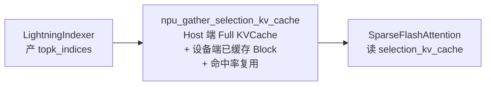

# GatherSelectionKvCache

## Summary

`npu_gather_selection_kv_cache` 是 cann-recipes-infer 为 DeepSeek-V3.2-Exp **KVCache Offload** 场景新开发的 AscendC 自定义算子。算子文档定义其功能为：**通过 topk 的稀疏索引从原始 `full_kv_cache` 中 gather，拼接成一块新的连续 `selection_kv_cache`**，支撑 DeepSeek 超大 token 场景下的 kv_cache offload。其中 `full_kv_cache` 支持 **host 侧或 device 侧内存**（offload 场景常驻 Host，但接口并不限定）。在 Decode 阶段，根据 [lightning-indexer](lightning_indexer.md) 返回的 TopK（2048）个相关 token index 选出参与计算的 KV 并搬回设备，再喂给 [sparse-flash-attention](sparse_flash_attention.md)。算子约束 `TOPK ≤ 2048`、`H 当前只支持 1`。

其核心优化是利用**前后 Token 在同一层上 TopK 命中率（相似度）特性**复用设备上已有 cache：若当前步 TopK 与前一步 TopK 有 60% 重叠，仅从 Host 读取 40% 未复用的 KV，60% 直接从设备上读，显著减少 H2D 耗时。

算子源码：`ops/ascendc/src/gather_selection_kv_cache/`。自定义算子文档 `ops/ascendc/docs/custom-npu_gather_selection_kv_cache.md`。

## Role In Pipeline

Decode + Offload 场景：



当前调用位于models/deepseek_v3_2_exp/models/modeling_deepseek.py::apply_attention_fusion。输入已为packed TND：按token_num切取selection块表/状态，将topk_indices reshape为[token_num,1,index_topk]，Q/KV实际长度转int32，调用torch_npu.npu_gather_selection_kv_cache(..., selection_topk_block_size=1)。INT8用empty_rope，非量化传真实rope；完整与选择缓存分别来自绑定的CacheEntry和OffloadWorkspace。

返回 `selection_kv_actual_seq` 表示实际有效的 selection KV 长度，随后生成 `sparse_indices = where(default_topk_indices < selection_kv_actual_seq, default_topk_indices, -1)` 交给 SFA。

`OffloadCache` 维护所需元信息（`models/deepseek-v3.2-exp/models/offload_cache.py`）：

```python
# 每层维护一份
self.selection_kv_block_table # [batchseq, s_maxblocknum]
self.selection_kv_block_status # 初始 -1，记录当前 block 在设备上的状态
self.default_topk_indices # [batchseq, index_topk]
```

`selection_kv_block_status` 是命中率复用的核心数据结构：算子文档定义其**记录 `selection_kv_cache` 和 `selection_k_rope` 中已缓存的有效 topk 对应的 id**，文档接口shape为 `[B, S, H, TOPK + 1]`（BSND 格式；TND 格式为 `[B*S, H, TOPK + 1]`）。算子据此判断当前步 TopK 哪些已在设备上、哪些需从 `full_kv_cache` gather，从而实现前后 Token 的 cache 复用。

## Performance Signals

### 复用命中率

源文档明示："GatherSelectionKvCache 算子充分利用了前后 Token 在同一层上 TopK 命中率（相似度）特性，将已经在设备上的 Cache 做了复用。也即如果当前步的 TopK=2048 个 kv token 和前一步的 TopK=2048 个 kv token 有 60% 一样，那只需要从 Host 侧读取 40% 的没有复用的 kv token，60% 可以复用的 kv token 直接从设备上读取，从而减少了 H2D 的耗时。"

### Offload 整体收益

| 场景 | 无 Offload | 有 Offload |
| ---- | ---- | ---- |
| 固定 64K 序列长度 | global batch 1024 | **2048**（翻倍） |
| 固定 global batch 128 | 序列长度 256K | **384K** |

> 基于 Atlas A3、W8A8C8、MTP3、perfect eplb 配置。详见 [kvcache-offload](../techniques/kvcache_offload.md)。

## Optimization Notes

### selection_topk_block_size 约束

调用处固定传 `selection_topk_block_size=1`（见 Role In Pipeline）。算子文档规定该参数**默认值为 64**，但有承重约束：**`topk` 大于 32 时，`selection_topk_block_size` 仅支持为 1**（另需满足 `BLOCK_SIZE` 能被 `selection_topk_block_size` 整除）。本场景 `TOPK=2048 > 32`，正是这条约束强制调用处偏离默认 64、固定传 1。

### 下一步优化方向

当前指南保留的后续方向（未证实已实现）："KVCache Offload：利用前后 Token 命中率关系或跨 layer 预取等手段，进一步降低 GatherSelectionKvCache 耗时。"

### 与量化模式的耦合

代码路径显式依据 `kv_cache_quant_mode` 区分分支：

```python
# int8：full_k_rope 指向 offload_cache.empty_rope；后续 SFA 走 npu_kv_quant_sparse_flash_attention
# 非 int8：full_k_rope 使用 k_pe；后续 k_pe = selection_k_rope.unsqueeze(2)
```

## Evidence

- [README.md](../../../../../cann-recipes-raw/cann-recipes-infer/944d2d3ece86f7df33dbb0cb155c72ca619a9c66/README.md)（primary）
- [deepseek_v3.2_exp_inference_guide.md](../../../../../cann-recipes-raw/cann-recipes-infer/944d2d3ece86f7df33dbb0cb155c72ca619a9c66/docs/models/deepseek_v3_2_exp/deepseek_v3.2_exp_inference_guide.md)（supporting）
- [offload_cache.py](../../../../../cann-recipes-raw/cann-recipes-infer/944d2d3ece86f7df33dbb0cb155c72ca619a9c66/models/deepseek_v3_2_exp/models/offload_cache.py)（implementation）
- [modeling_deepseek.py](../../../../../cann-recipes-raw/cann-recipes-infer/944d2d3ece86f7df33dbb0cb155c72ca619a9c66/models/deepseek_v3_2_exp/models/modeling_deepseek.py)（implementation）
- [custom-npu_gather_selection_kv_cache.md](../../../../../cann-recipes-raw/cann-recipes-infer/944d2d3ece86f7df33dbb0cb155c72ca619a9c66/ops/ascendc/docs/custom-npu_gather_selection_kv_cache.md)（implementation）

## Links

- [deepseek-v3.2-exp](../models/deepseek_v3_2_exp.md)
- [kvcache-offload](../techniques/kvcache_offload.md)
- [sparse-flash-attention](sparse_flash_attention.md)
- [lightning-indexer](lightning_indexer.md)
- [ascendc](../frameworks/ascendc.md)
- [cann-shmem](../techniques/cann_shmem.md)（在 SHMEM HBM&DDR 混合编址映射后的 Device tensor 上调用，无需感知 Host 侧排布）
