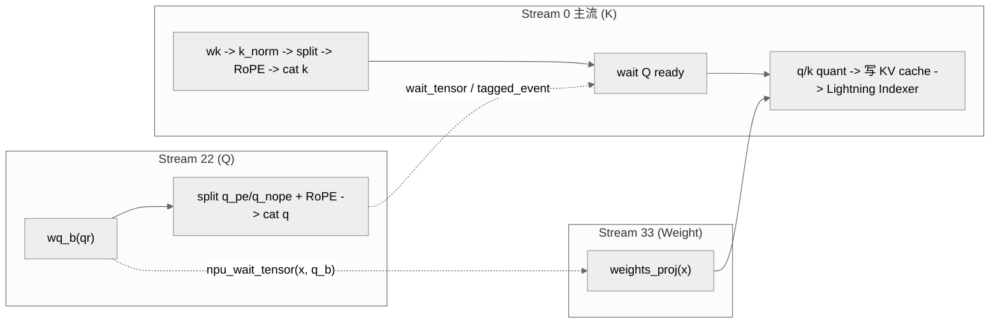

# Indexer Prolog Kernel

## Summary

`Indexer Prolog` 是 [lightning-indexer](lightning_indexer.md) 之前的准备算子，为 LI 计算提供输入 `q`、`weight`（及 `q_scale`）。它处理三条独立计算流 —— **Indexer Q**、**Indexer Cache (K)**、**Indexer Weight** —— 每条流都包含 Matmul / RoPE / LayerNorm / Hadamard / 动态 Per-Token-Head 量化 等一连串 Linear 前后处理。

- **DeepSeek-V3.2-Exp（DSA）**：cann-recipes-infer 通过 **PyPTO** 实现为单一大融合算子 `npu_lightning_indexer_prolog_pto`，典型 Shape（4 batch × MTP1 × 64K）下已**逼近理论极限性能**。PyPTO 源码：`ops/pypto/src/lightning_indexer_prolog_pto/op_kernel/`。
- **DeepSeek-V4**：IndexerProlog **仅出现在 `compress_ratio = 4` 的 CSA 层**（C128A/HCA 层无 LI 模块），Query 计算走 q_hadamard / Quant 流程（int8 或 FP8），见 [DeepSeek-V4 适配](#deepseek-v4-适配pypto)。

## Role In Pipeline


*来源：[`docs/models/deepseek-v3.2-exp/figures/IndexerPrologQuant.png`](https://gitcode.com/cann/cann-recipes-infer/blob/2f82d10467e6fe8dae81c97a2cdac78d733a6703/docs/models/deepseek-v3.2-exp/figures/IndexerPrologQuant.png)（cann-recipes-infer @ 2f82d10）*

在 `models/deepseek-v3.2-exp/models/indexer.py:L184` 处入口：

```python
res = torch.ops.custom_pypto.npu_lightning_indexer_prolog_pto(
 token_x=x.view(-1, self.dim),
 q_norm=qr.view(-1, self.q_lora_rank),
 q_norm_scale=c8_input_dict.get("pertoken_scale", None),
 wq_b=self.wq_b.weight, wq_b_scale=self.wq_b.weight_scale,
 wk=self.wk.weight,
 weights_proj=self.weights_proj.weight,
 ln_gamma_k=self.k_norm.weight, ln_beta_k=self.k_norm.bias,
 cos_idx_rope=cos.squeeze(1).squeeze(1),
 sin_idx_rope=sin.squeeze(1).squeeze(1),
 hadamard_q=self.hadamard_matrix, hadamard_k=self.hadamard_matrix,
 idx_k_cache=past_key_states,
 idx_k_scale_cache=past_key_scales,
 idx_k_cache_index=slot_mapping.view(-1),
 layernorm_epsilon_k=self.k_norm.eps,
 layout_query="TND", layout_key="PA_BSND",
)
```

输出 `(q, query_dequant_scale, weights)` 直接喂给后续 Lightning Indexer 算子。

### 三条独立流

**Indexer Q**：

$$
\bold{q}, \bold{q}_{scale} = \text{DynamicQuant}(\text{Hadamard}(\text{RoPE}(\text{DeQuant}(\bold{q} \cdot \bold{w}_{qb}))))
$$

Q 走动态 **Per-Token-Head A8**；Hadamard 变换通过矩阵右乘 `hadamard_q` 实现；$\bold{q}, \bold{w}_{qb}$ 均 Int8。

**Indexer Cache (K)**：

$$
\bold{k}, \bold{k}_{scale} = \text{DynamicQuant}(\text{Hadamard}(\text{RoPE}(\text{LayerNorm}(\bold{x} \cdot \bold{w}_k))))
$$

K 走动态 **Per-Token-Head C8**；Hadamard 通过矩阵右乘 `hadamard_k`。

**Indexer Weight**：

$$
\bold{weight} = (\bold{x} \cdot \bold{w}_{proj}) * \text{scale}
$$

Weight 不量化，最后转 FP16 喂给后续 LI。

> 量化策略约束（源文档）："Indexer Prolog 的量化策略为：Q_b_proj 使用 W8A8 量化，其他 Linear 均不量化；Indexer Q 使用 A8 量化，Indexer Cache 使用 C8 量化；反量化因子以 FP16 存储；同时，在量化前，会进行 Hadamard 变换，Hadamard 变换在业界最新的低 bit 量化方案中十分常用，可以有效消除 outlier。"

## Performance Signals

### 泳道图与性能拆解

典型 Shape（4 batch × MTP1 × KV-Cache 64K）Profiling 泳道图：


*来源：[`docs/models/deepseek-v3.2-exp/figures/IndexerPrologSwimLane.png`](https://gitcode.com/cann/cann-recipes-infer/blob/2f82d10467e6fe8dae81c97a2cdac78d733a6703/docs/models/deepseek-v3.2-exp/figures/IndexerPrologSwimLane.png)（cann-recipes-infer @ 2f82d10）*

**计算流特点**（源文档）：

- 三部分互相独立、各自串行；
- Indexer Q 耗时最长，可以掩盖 Indexer Cache 和 Indexer Weight；
- 典型 Shape 下计算量较小，不会打满所有核，**性能瓶颈在搬运上**。

**Indexer Q 四段理论性能拆解**：

| 段 | 内容 | 性质 |
| ---- | ---- | ---- |
| 1 | `(8, 1536) @ (1536, 8192)` Matmul | MTE bound，理论极限 13 μs；与 K/Weight Matmul 并行抢带宽，已近极致 |
| 2 | DeQuant + RoPE（Vector 核） | 合适 tile 切分后全在 UB 内，无 UB↔GM 冗余搬运，已达极致 |
| 3 | Hadamard 变换：`(8, 64, 128) @ (1, 128, 128)` BatchMatmul | MTE bound，已达极致 |
| 4 | Int8 量化（Vector 核） | 合适 tile 切分后全在 UB 内，已达极致 |

> 源结论："Indexer Prolog 的计算已经逼近理论极限性能。"

## Optimization Notes

### 与多流优化配合

除了融合本身，**Indexer Prolog 前的一系列 Cube 和 Vector 算子**可进一步使用 torchair 的 `npu_stream_switch` 多流并行，流水示意：


*来源：[`docs/models/deepseek-v3.2-exp/figures/indexer_prolog_multi_stream.jpg`](https://gitcode.com/cann/cann-recipes-infer/blob/2f82d10467e6fe8dae81c97a2cdac78d733a6703/docs/models/deepseek-v3.2-exp/figures/indexer_prolog_multi_stream.jpg)（cann-recipes-infer @ 2f82d10）*

见 [moe-multi-stream](../techniques/moe_multi_stream.md)（本技术页面同时记录 MoE 多流与 Indexer Prolog 多流两种 V3.2-Exp 多流场景）。

### 与 Deepseek Indexer Attention 的关系

作为独立融合算子，Indexer Prolog 已接近极致性能；但进一步可以把 MLAProlog + IndexerProlog + LightningIndexer + SFA 四者融合成 **Deepseek Indexer Attention** 大融合算子，获取更大并行度。见 [deepseek-indexer-attention](deepseek_indexer_attention.md)。

### 下一步计划

源文档明示："仿照 Indexer Prolog 的调优过程，将其他几个子算子进行独立性能调优，达到极致性能。"

## DeepSeek-V4 适配（PyPTO）

与 DeepSeek-V3.2 不同，DeepSeek-V4 的 **IndexerProlog 只出现在 `compress_ratio = 4` 的层（即 C4A / CSA 层）**——只有 CSA 层才在 Compressor 压缩后的 cmp_KV 上叠加 LI 稀疏选择，因此只有 CSA 层需要 IndexerProlog 为后续 [lightning-indexer](lightning_indexer.md) 计算提供输入 `q`、`weight` 及 `q_scale`（C128A / HCA 层不带 LI 模块）：`Indexer.__init__(..., compress_ratio=4)`、`cmp_ratio: 4  # only c4a have li module`（`models/deepseek-v4/models/modules/indexer.py`）。上文 V3.2-Exp 的三流公式、泳道图、极限性能分析继续有效（对应 V3.2-Exp 谱系）。

### Query 计算：q_hadamard / Quant 流程

PyPTO guide 给出 V4 IndexerProlog 的 Query 计算公式（`Rope` 为旋转位置编码、`Quant` 为量化）：

$$q\_tmp = qr @ idx\_wq\_b \cdot qr\_scale \cdot idx\_wq\_b\_scale$$
$$q\_hadamard = \text{Cat}(\{q\_tmp[:, :nope\_dim],\ Rope(q\_tmp[:, nope\_dim:])\}, -1) @ hadamard$$
$$q,\ q\_scale = Quant(q\_hadamard)$$

`indexer.py` forward 把 Query 计算拆为独立步骤而非单一融合调用：`wq_b(qr, dynamic_scale=qr_scale)` → `inplace_partial_rotary_mul(..., rotary_mode="interleave", partial_slice=...)`（只对后 `rope_head_dim` 做 interleave RoPE）→ `rotate_activation(q, self.hadamard_matrix)`（Hadamard 右乘，`hadamard_matrix = get_had_pow2(head_dim)`）→ 量化。量化按 `li_cache_quant_mode` 分两路：

- `"int8"`：`q, q_scale = torch_npu.npu_dynamic_quant(...)`，`q_scale` 转 FP16（Indexer Cache C8）；
- **FP8**：`q, q_scale = torch_npu.npu_dynamic_block_quant(..., dst_type=cache_data["li_cmp_kv"].dtype)`，对应 950PR/DT 上 LI FP8 全量化版的 Indexer Q 输入。

> **源/代码差异**：PyPTO guide 把 IndexerProlog 描述为单一融合算子（fused "IndexerProlog 算子"），而 V4 `indexer.py` 把上述步骤展开为 `wq_b` / `inplace_partial_rotary_mul` / `rotate_activation` / `dynamic_quant` 等独立 op（含 `enable_multi_streams` 多流切换）。V3.2-Exp 谱系的 `npu_lightning_indexer_prolog_pto` 单一大融合算子仍存在于 `ops/pypto/src/lightning_indexer_prolog_pto/`（commit `f8c6f67` 清理过其 `quant_lightning_indexer_prolog_impl.cpp` 冗余头文件）。**V4 是否在某图模式路径下回落到该单一融合 PyPTO 算子，源/代码未明示。**

### Weights 计算

$$weights = x @ weights\_proj \cdot \frac{1}{\sqrt{idx\_nq \cdot head\_dim}}$$

实现为 `weights = self.weights_proj(x_for_weights_proj) * (self.softmax_scale * self.n_heads ** -0.5)`，其中 `softmax_scale = head_dim ** -0.5`、`n_heads = config.index_n_heads`（公式 `idx_nq` 对应代码 `index_n_heads`），合并即 $1/\sqrt{head\_dim\cdot idx\_nq}$。Weight 不量化，按 `li_cache_quant_mode` 转 FP16（int8 路）或 FP32（fp8 路）后喂给 LI。

## 多流优化（case pattern）

> 方法论总纲见 [multi-stream](../techniques/multi_stream.md)（`npu_stream_switch` tagged-stream / `npu_wait_tensor` / aclgraph tagged-event 的通用机制与适用判据）。这里聚焦 Indexer Prolog **前处理子链切流**这一具体模式。[Optimization Notes](#与多流优化配合) 已记 V3.2-Exp 「Cube/Vector 前处理 + `npu_stream_switch`」泳道示意；以下是 **GLM-5 / DeepSeek-V3.2-Exp `indexer.py` forward** 中实际落地的副流编排（与上文融合算子 `npu_lightning_indexer_prolog_pto` 是两套不同实现路径，不冲突）。

### 动机

Indexer Prolog 的前处理由三条独立链组成（见 [三条独立流](#三条独立流)）：Q 路径（`wq_b` Matmul → split q_pe/q_nope → RoPE → 拼回）、K 路径（`wk` → `k_norm` → RoPE）、Weight 路径（`weights_proj`）。在 `indexer.py` 这条**非单算子融合**的实现里，三链若全堆主流则串行成一段很长的前处理；而 Q Matmul（MTE/Cube bound）与 K-norm/Weight-proj（Vector/小 Matmul）硬件性质互补，存在 overlap 窗口。该模式仅在 **decode 阶段**启用（`enable_multi_streams = self.enable_multi_streams and not is_prefill`，dsv3.2 `indexer.py:249` / glm-5 `:169`），且只 overlap 前处理子链，**不是完整模块级双网络并行**（区别于 [moe-multi-stream](../techniques/moe_multi_stream.md) 的 MoE 双流）。

### 编排

- 副流 `"22"`：Q 路径。`wq_b(qr)` → `view` → `split` 出 `q_pe/q_nope` → 对 `q_pe` 做 RoPE → `cat` 回 `q`。dsv3.2 用 `torch_npu.npu_rotary_mul`，GLM-5 用 `torch_npu.npu_interleave_rope`（两库 RoPE 算子不同，详见关键代码）。
- 副流 `"33"`：Weight 路径，仅 `weights = self.weights_proj(x.view(-1, self.dim))`。
- 主流 `"0"`：K 路径 `wk → k_norm → split → RoPE → cat`，随后 wait Q 路径就绪再做 quant / 写 KV cache / 喂 Lightning Indexer。
- 依赖保证：进 `"22"` 前 `npu_wait_tensor(qr, query_states[0])`（Q 等 q_lora 投影就绪）；进 `"33"` 前 `npu_wait_tensor(x, q_b)`（Weight 流让出，使 `"33"` 排在 `"22"` 的 `q_b` 之后）。**注意**：`npu_wait_tensor` 是 **eager（非 aclgraph）** 路径；aclgraph 路径改用 `npu_record_tagged_stream` + `npu_tagged_event_record/wait`（`indexer_npu_events[0..3]`）成对同步——二者按 `self.enable_aclgraph` 二选一。
- Q 量化（`q quant`：`apply_hadamard` + `npu_dynamic_quant`）在主流前处理完成、`tagged_event_wait(events[2])` 之后**再次进入 `"22"`** 与主流 K 量化重叠（glm-5 `:225` / dsv3.2 `:306` 区段）。



### 关键代码

副流 `"22"` 跑 Q 路径（GLM-5 `models/glm-5/models/indexer.py:177`，RoPE 用 `npu_interleave_rope`）：

```python
enable_multi_streams = self.enable_multi_streams and not is_prefill
# ...
with npu_stream_switch(enable_multi_streams, "22"):
    if enable_multi_streams:
        if self.enable_aclgraph:
            tng.ops.npu_tagged_event_wait(indexer_npu_events[0])
        else:
            tng.scope.npu_wait_tensor(qr, query_states[0])
    q_b = self.wq_b(qr, c8_input_dict.get("pertoken_scale", None))  # [b,s,1536]@[1536,64*128]
    q = q_b.view(bsz, seqlen, self.n_heads, self.head_dim)
    q_pe, q_nope = torch.split(q, [self.rope_head_dim, self.head_dim - self.rope_head_dim], dim=-1)
    q_pe = q_pe.view(-1, self.n_heads, 1, self.rope_head_dim)
    q_pe = torch_npu.npu_interleave_rope(q_pe, cos, sin).view(bsz, -1, self.n_heads, self.rope_head_dim)
    q = torch.cat([q_pe, q_nope], dim=-1)
```

副流 `"33"` 提前跑 `weights_proj`（GLM-5 `:202`，定义在 `:90`）：

```python
with npu_stream_switch(enable_multi_streams, "33"):
    if enable_multi_streams:
        if self.enable_aclgraph:
            tng.ops.npu_tagged_event_wait(indexer_npu_events[1])
        else:
            tng.scope.npu_wait_tensor(x, q_b)
    weights = self.weights_proj(x.view(-1, self.dim))
```

DeepSeek-V3.2-Exp 同构（`models/deepseek-v3.2-exp/models/indexer.py:256` 进 `"22"`、`:283` 进 `"33"`、`wq_b`/`weights_proj` 定义于 `:85`/`:95`），唯一差异：Q/K 路径 RoPE 用 `torch_npu.npu_rotary_mul`（非 `npu_interleave_rope`）。

> ⚠️ 与案例叙述的差异（@2c45117）：案例 md 把 Q 路径 RoPE 一律写作 `npu_rotary_mul`，并把 `npu_wait_tensor` 段落描述为「图模式开启」配合 tagged event。实际：(1) GLM-5 用 `npu_interleave_rope`、仅 DeepSeek-V3.2-Exp 用 `npu_rotary_mul`；(2) `npu_wait_tensor` 恰是**非 aclgraph（eager）** 分支，aclgraph 分支才走 `tagged_event_wait`，二者按 `self.enable_aclgraph` 互斥，并非「叠加」。

### 适用与风险

- 适用：decode 小 batch 前处理时延敏感、Q-Matmul 与 Weight/K 链硬件性质互补的 Prolog 类算子链；prefill 不启用（`not is_prefill`）。
- 风险：同步点（`npu_wait_tensor` 的 src/dst tensor、tagged-event 编号 `indexer_npu_events[0..3]` 与生命周期）设计不当会读到未就绪输入；eager 与 aclgraph 两条同步路径必须按 `enable_aclgraph` 严格二选一，混用会导致图编译失败或精度问题；Q 量化再入 `"22"` 依赖 `tagged_event_wait(events[2])` 的正确插桩。

代表实现 DeepSeek-V3.2-Exp（见 [deepseek-v3.2-exp](../models/deepseek_v3_2_exp.md)），相似实现 GLM-5（见 [glm-5](../models/glm_5.md)）；下游消费见 [lightning-indexer](../modules/lightning_indexer.md)。

## Evidence

- [cann-recipes-infer](https://gitcode.com/cann/cann-recipes-infer/tree/2c45117d781ab9ab88dcb89a28ae30f5d2450399) — [`docs/models/deepseek-v3.2-exp/deepseek_v3.2_exp_pypto_operator_guide.md`](https://gitcode.com/cann/cann-recipes-infer/blob/2f82d10467e6fe8dae81c97a2cdac78d733a6703/docs/models/deepseek-v3.2-exp/deepseek_v3.2_exp_pypto_operator_guide.md)（Indexer Prolog 三流公式、泳道图、极限性能分析）
- [cann-recipes-infer](https://gitcode.com/cann/cann-recipes-infer/tree/2c45117d781ab9ab88dcb89a28ae30f5d2450399) — [`docs/models/deepseek-v3.2-exp/deepseek_v3.2_exp_inference_guide.md`](https://gitcode.com/cann/cann-recipes-infer/blob/2f82d10467e6fe8dae81c97a2cdac78d733a6703/docs/models/deepseek-v3.2-exp/deepseek_v3.2_exp_inference_guide.md)（量化策略中 IndexerProlog 融合算子 A8C8 配置、多流并行）
- [cann-recipes-infer](https://gitcode.com/cann/cann-recipes-infer/tree/2c45117d781ab9ab88dcb89a28ae30f5d2450399) — [`models/deepseek-v3.2-exp/models/indexer.py:L184`](https://gitcode.com/cann/cann-recipes-infer/blob/2f82d10467e6fe8dae81c97a2cdac78d733a6703/models/deepseek-v3.2-exp/models/indexer.py#L184)（PyPTO prolog 调用）
- [cann-recipes-infer](https://gitcode.com/cann/cann-recipes-infer/tree/2c45117d781ab9ab88dcb89a28ae30f5d2450399) — [`ops/pypto/src/lightning_indexer_prolog_pto/op_kernel/`](https://gitcode.com/cann/cann-recipes-infer/blob/2f82d10467e6fe8dae81c97a2cdac78d733a6703/ops/pypto/src/lightning_indexer_prolog_pto/op_kernel/)（V3.2-Exp PyPTO 实现源码；`quant_lightning_indexer_prolog_impl.cpp` 冗余头清理见 commit `f8c6f67`）
- [cann-recipes-infer](https://gitcode.com/cann/cann-recipes-infer/tree/2c45117d781ab9ab88dcb89a28ae30f5d2450399) — [`docs/models/deepseek-v4/deepseek_v4_pypto_operator_guide.md`](https://gitcode.com/cann/cann-recipes-infer/blob/2c45117d781ab9ab88dcb89a28ae30f5d2450399/docs/models/deepseek-v4/deepseek_v4_pypto_operator_guide.md) `## IndexerProlog`（V4 仅 compress_ratio=4 层、q_hadamard / Quant 公式、Weights 公式）。
- [cann-recipes-infer](https://gitcode.com/cann/cann-recipes-infer/tree/2c45117d781ab9ab88dcb89a28ae30f5d2450399) — [`models/deepseek-v4/models/modules/indexer.py`](https://gitcode.com/cann/cann-recipes-infer/blob/2c45117d781ab9ab88dcb89a28ae30f5d2450399/models/deepseek-v4/models/modules/indexer.py)（`compress_ratio=4` / `cmp_ratio:4 # only c4a have li module`、`wq_b`→`inplace_partial_rotary_mul`(interleave)→`rotate_activation`(hadamard)→`npu_dynamic_quant`/`npu_dynamic_block_quant`、`weights = weights_proj(x)*(head_dim**-0.5 * n_heads**-0.5)`；doc 描述 fused 而 code 为展开步骤）
- [cann-recipes-infer](https://gitcode.com/cann/cann-recipes-infer/tree/2c45117d781ab9ab88dcb89a28ae30f5d2450399) — [`models/glm-5/models/indexer.py`](https://gitcode.com/cann/cann-recipes-infer/blob/2c45117d781ab9ab88dcb89a28ae30f5d2450399/models/glm-5/models/indexer.py)（多流前处理切流核对 @2c45117：`enable_multi_streams = ... and not is_prefill`:169；`npu_stream_switch(.., "22")`:177（Q 路径，`wq_b`:80）；`npu_wait_tensor(qr, query_states[0])`:183；`npu_stream_switch(.., "33")`:202（`weights_proj`:90）；`npu_wait_tensor(x, q_b)`:207；RoPE 用 `npu_interleave_rope`；Q 量化再入 `"22"`:225；aclgraph 路径用 `npu_record_tagged_stream`/`npu_tagged_event_record/wait(indexer_npu_events[0..3])`）
- [cann-recipes-infer](https://gitcode.com/cann/cann-recipes-infer/tree/2c45117d781ab9ab88dcb89a28ae30f5d2450399) — [`models/deepseek-v3.2-exp/models/indexer.py`](https://gitcode.com/cann/cann-recipes-infer/blob/2c45117d781ab9ab88dcb89a28ae30f5d2450399/models/deepseek-v3.2-exp/models/indexer.py)（多流前处理切流核对 @2c45117：`"22"`:256（`wq_b`:85）、`"33"`:283（`weights_proj`:95）、`npu_wait_tensor(qr, query_states[0])`:262、`npu_wait_tensor(x, q_b)`:288、Q 量化再入 `"22"`:306；RoPE 用 `npu_rotary_mul`——与 GLM-5 的 `npu_interleave_rope` 不同）

## Links

- [deepseek-v3.2-exp](../models/deepseek_v3_2_exp.md)
- [lightning-indexer](../modules/lightning_indexer.md)
- [lightning-indexer](lightning_indexer.md)
- [deepseek-indexer-attention](deepseek_indexer_attention.md)
- [pypto](../frameworks/pypto.md)
- [w8a8c8](../quantization/w8a8c8.md)
- [moe-multi-stream](../techniques/moe_multi_stream.md)
- [multi-stream](../techniques/multi_stream.md)（多流方法论总纲；本页 [多流优化（case pattern）](#多流优化case-pattern) 记 Indexer Prolog 前处理切流细节）
- [glm-5](../models/glm_5.md)（GLM-5 `indexer.py` 同构多流前处理，Q 路径 RoPE 用 `npu_interleave_rope`）
- [deepseek-v4](../models/deepseek_v4.md)（V4 CSA 层 IndexerProlog 前置 LI，量化路径 Indexer Cache C8）
- [compressor](compressor.md)（V4 CSA 层 IndexerProlog 的 LI 作用于 Compressor 压缩后的 cmp_KV）

<!-- cannbot:related:start -->
## 相关

- [Deepseek Indexer Attention Kernel](deepseek_indexer_attention.md)（`related`）：“`Deepseek Indexer Attention` (DIA) 是 cann-recipes-infer 用 **PyPTO** 实现的**大融合算子** —— 把 DSA 的 4 个相对独立子算子 MLAProlog + IndexerProlog + Lightning Indexer + Sparse Flash Attention 融合成单一 kernel，在整网范围内挖掘更大并行度、提升内存利用率。”与“`Indexer Prolog` 是 ［lightning-indexer］(lightning_indexer.md) 之前的准备算子，为 LI 计算提供输入 `q`、`weight`（及 `q_scale`）。”分别给出两端正文事实；DIA 把 IndexerProlog 纳入同一 kernel，IndexerProlog 卡则明确其为 LI 生产 q、weight 与 q_scale，二者闭合融合前处理到索引计算的输入合同。
- [Lightning Indexer Kernel](lightning_indexer.md)（`related`）：输出 `(q, query_dequant_scale, weights)` 直接喂给后续 Lightning Indexer 算子。；DSA 计算链路：`MLAProlog + IndexerProlog → LightningIndexer → SparseFlashAttention → MLAEpilog`。LI 的输出是 TopK index 张量，SFA 据此 Gather 稀疏 KV；在长序列场景下 LI 的 TopK 排序成为主要热点。。Indexer Prolog 明确生产 LI 的 q、反量化尺度和 weight，Lightning Indexer 卡确认它位于下一流水阶段并消费这些索引特征完成精确 TopK。
- [Lightning-Indexer / Indexer-Prolog 低比特量化的精度要点 (Hadamard 旋转 + scale fp32 契约)](../../optimizations/experience/rules/precision_lightning_indexer_low_bit_quant.md)（`related`）：“当把某 W8A8 权重的 `weight_scale` 作为独立入参喂给融合算子时（如 ［PyPTO］(../../../concepts/frameworks/pypto.md) 版 ［Indexer-Prolog］(../../../concepts/kernels/indexer_prolog.md) 融合算子入参 `wq_b_scale=self.wq_b.weight_scale`），必须把该权重登记进 runner 的 `float_scales_map`、令其 scale 以 fp32 传入。沿用默认（非 fp32）scale 会引发精度回归（对应修复提交标题即 `bugfix wq_b scale use fp32`）。”明确 `wq_b_scale` 直传 Indexer-Prolog 时必须保持 FP32；“`Indexer Prolog` 是 ［lightning-indexer］(lightning_indexer.md) 之前的准备算子，为 LI 计算提供输入 `q`、`weight`（及 `q_scale`）。它处理三条独立计算流 —— **Indexer Q**、**Indexer Cache (K)**、**Indexer Weight** —— 每条流都包含 Matmul / RoPE / LayerNorm / Hadamard / 动态 Per-Token-Head 量化 等一连串 Linear 前后处理。”定位该算子正是生成 LI 的 q/q_scale/weight 的前置链。联合阅读可在融合入口核对 scale dtype 和 Hadamard→量化顺序。
<!-- cannbot:related:end -->
