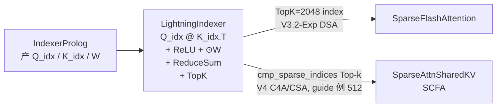

# Lightning Indexer Kernel

## Summary

`LightningIndexer` 是 DeepSeek-V3.2-Exp / DeepSeek-V4 稀疏 Attention 的前置算子 —— 完整执行 `BatchMatmul → ReLU → Broadcast × W → ReduceSum → Top-k` 五步，为每 query token **精确**（非近似）选出 TopK 个相关 KV index 喂给下游稀疏 Attention。当前实现**将 Top-k 计算融合进单一算子**，相较 Top-k 外置收益 ~20%。模块语义见 [lightning-indexer](../modules/lightning_indexer.md)。

Top-k 的 **K 随模型而异**：V3.2-Exp DSA 在完整上下文上选 **TopK=2048** 喂给 [sparse-flash-attention](sparse_flash_attention.md)；V4 仅在 C4A（compress_ratio=4，CSA）层、对 Compressor 压缩后的 cmp_KV 做 Top-k（V4 AscendC guide 以 **512** 为示例 K，运行时实际取 `config.index_topk`，仓内 `configuration_deepseek.py` 默认 **2048**，详见 [deepseek-v4](../models/deepseek_v4.md)），结果喂给 [sparse-attn-sharedkv](sparse_attn_sharedkv.md)（SAS）的 SCFA 路径（不同模型不同 K，并列保留）。

本 kernel 在 cann-recipes-infer 中同时提供 **AscendC**（手写高性能）、**PyPTO**（自研 MegaKernel）、**TileLang**（社区编译）三路实现，彼此性能/易用性各有取舍；V4 在 AscendC 侧补充了 950PR/DT 直方图 Top-k 与 FP8 量化版 LI（INT8/FP8 共用 `npu_quant_lightning_indexer`，FP8 区别在上游 q 经 `npu_dynamic_block_quant` 量化，见下文 [DeepSeek-V4 CSA 层增强](#deepseek-v4-csa-层增强)）。

## Role In Pipeline

DSA 计算链路：`MLAProlog + IndexerProlog → LightningIndexer → SparseFlashAttention → MLAEpilog`。LI 的输出是 TopK index 张量，SFA 据此 Gather 稀疏 KV；在长序列场景下 LI 的 TopK 排序成为主要热点。



## Performance Signals

### AscendC 实现

**算子 Tiling**：

- 核间基本块 `(512, 512)` —— 512 行一次迭代以减少右矩阵重复搬运（g=64 场景下合并 8 个 token），$S_k$ 方向 512 粒度以控制流水头尾开销。
- **L1 划分**：
 - $Q_{index}$ 矩阵**常驻**：`512×128×2B = 128 KB`，实际按 `(256, 128)` 两次搬入以降低搬运头开销；
 - $K_{index}$ **3-Buffer 循环**：`3×256×128×2B = 192 KB`，L1 层级基本块 `(256, 128)`。
- L0A/L0B/L0C 均 Double Buffer（`2×32 KB / 2×32 KB / 2×64 KB`），一次搬入 `(128, 128)`。

**效果**：Q_index 只搬一次；K_index 重复搬运次数从 `⌈Sq/128⌉` 降到 `⌈Sq/512⌉`；K_index 3-Buffer 消除带宽爬坡阻塞。

**Pipeline（Preload）**：

LI 只有两个阶段 —— Matmul+ReLU ($C_1$) 与向量计算 ($V_1$)。朴素串行会互相阻塞，**提前下发（Preload）一次 $C_1$** 实现流水互相掩盖。


*来源：[`docs/models/deepseek-v3.2-exp/figures/LIpipeline.png`](https://gitcode.com/cann/cann-recipes-infer/blob/2f82d10467e6fe8dae81c97a2cdac78d733a6703/docs/models/deepseek-v3.2-exp/figures/LIpipeline.png)（cann-recipes-infer @ 2f82d10）*

**ReLU 随路实现**：Cube 核 FixP 组件提供随路 ReLU —— Matmul 完成后在数据搬出 Cube 核过程中直接做 ReLU，不需要显式从 Cube 向 Vector 核搬运后再算。参考 [基础 API: FixP 相关](https://www.hiascend.com/document/detail/zh/canncommercial/82RC1/API/ascendcopapi/atlasascendc_api_07_0251.html)。

**Top-k 指令实现**：必须是**精确**TopK，不能近似。分三步：

1. **分组排序**（`VBS32`）：每 32 个 token 按 Score 稳定降序排列；

 
 *来源：[`docs/models/deepseek-v3.2-exp/figures/topkstep1.png`](https://gitcode.com/cann/cann-recipes-infer/blob/2f82d10467e6fe8dae81c97a2cdac78d733a6703/docs/models/deepseek-v3.2-exp/figures/topkstep1.png)（cann-recipes-infer @ 2f82d10）*

2. **归并**（`VMS4v2`）：至多 4 组（长度 32/128/512）已排序向量归并，重复至长度达 2048；

 
 *来源：[`docs/models/deepseek-v3.2-exp/figures/topkstep2.png`](https://gitcode.com/cann/cann-recipes-infer/blob/2f82d10467e6fe8dae81c97a2cdac78d733a6703/docs/models/deepseek-v3.2-exp/figures/topkstep2.png)（cann-recipes-infer @ 2f82d10）*

3. **规约**（`VMS4v2` 耗尽模式）：至多 4 组长度 2048 向量归并，取前 k=2048 与未参与合并排序的向量重复 Top-k，直至得到全局 TopK。

 
 *来源：[`docs/models/deepseek-v3.2-exp/figures/topkstep3.png`](https://gitcode.com/cann/cann-recipes-infer/blob/2f82d10467e6fe8dae81c97a2cdac78d733a6703/docs/models/deepseek-v3.2-exp/figures/topkstep3.png)（cann-recipes-infer @ 2f82d10）*

**TopK 总计算量**（源文档推导）：分组排序 + 归并 $= 4 S_k$；规约部分蒙特卡洛估计 $\approx 0.36 S_k + 3.32 k$；合计 $\approx 4.36 S_k + 3.32 k$。

### LI 量化支持（Mat-Duce 算法）

`LightningIndexerQuant` 输入 $Q_{index}^{INT8}, K_{index}^{INT8}$ + 反量化系数 $Scale_Q, Scale_K$（Per-Token-Head A8C8）。直接实现需要多步 Vector 操作。

Mat-Duce 利用 $Scale_Q, Scale_K \ge 0$，令 $\tilde{W} = Scale_Q \odot W$，将公式等价变换为：

$$\text{Top-}k\left\{\tilde{W}^T @ \text{ReLU}(Q_{index}^{INT8}@(K_{index}^{INT8})^T) \odot Scale_K^T\right\}.$$

计算流程（源文档）：

1. UB 上预处理 $\tilde{W} = Scale_Q \odot W$，CAST 到 FP16 写 GM；
2. Cube 核算 $S^{INT32} = Q_{index}^{INT8} @ (K_{index}^{INT8})^T$；
3. 利用 FixP 的 **DEQF16** 指令：$S^{FP16} = \text{FP16}(S^{INT32} / 1024)$，$1/1024$ 防溢出且不影响 Top-k；
4. 利用 FixP 随路 **ReLU**：$S' = \text{ReLU}(S^{FP16})$，搬到 L1；
5. Cube 核内再算 $P = \tilde{W}^T @ S'$ —— 一次矩阵乘同时完成 $Scale_Q$ 反量化 + W 行方向放缩 + 不同头结果求和；
6. Vector 核读 $P$，按 $Scale_K$ 反量化：$Score = P \odot Scale_K^T$；
7. Vector 核上做 Top-k。


*来源：[`docs/models/deepseek-v3.2-exp/figures/matduce_quant.png`](https://gitcode.com/cann/cann-recipes-infer/blob/2f82d10467e6fe8dae81c97a2cdac78d733a6703/docs/models/deepseek-v3.2-exp/figures/matduce_quant.png)（cann-recipes-infer @ 2f82d10）*

> 收益："将大部分向量操作通过数学变换以 Cube 核实现（步骤 5），同时充分利用了 FixP 随路量化激活搬运能力，将量化矩阵乘法的结果从 INT32 数据类型转化为 FP16 数据类型（步骤 3, 4），得以进行第二次半精度的矩阵乘法操作，显著提升了算子性能。"

### PyPTO 实现


*来源：[`docs/models/deepseek-v3.2-exp/figures/DeepseekLightningIndexer.png`](https://gitcode.com/cann/cann-recipes-infer/blob/2f82d10467e6fe8dae81c97a2cdac78d733a6703/docs/models/deepseek-v3.2-exp/figures/DeepseekLightningIndexer.png)（cann-recipes-infer @ 2f82d10）*

源码：`ops/pypto/src/lightning_indexer_pto/op_kernel/lightning_indexer_topk.cpp`。

**首版开箱**泳道图（4 batch × 64K）：


*来源：[`docs/models/deepseek-v3.2-exp/figures/DeepseekLightningIndexer_0.png`](https://gitcode.com/cann/cann-recipes-infer/blob/2f82d10467e6fe8dae81c97a2cdac78d733a6703/docs/models/deepseek-v3.2-exp/figures/DeepseekLightningIndexer_0.png)（cann-recipes-infer @ 2f82d10）*

开发者通过可视化环境识别三个异常点：

1. MatMul Cube 任务前序无依赖却未第一时间执行（框架在无数据搬运场景的优化缺失）；
2. Cube/Vector 第三列只有部分核工作 —— Paged Attention block_size=128，MatMul 切出 `4*64*1024/128 = 2048` 任务，L1 复用 32 → 最终 64 任务，无法平均分 24 Cube 核；
3. 最后 TopK 严重拖尾（4 batch 下单核归并）。

**改进措施**（对应 Pass 修复 / 配置调优）：

```cpp
config::SetPassOption(L1_REUSE, 32); // 动态 Shape 与特定 Shape 的泛化平衡
TileShape::Current().SetVecTile({64, 256}); // MatMul 输出到连续内存后 Vector 大颗粒度消费
```

- 针对异常点 1：通过修改相应 Pass 补齐泛化能力 → **+10%**；
- 针对异常点 2：通过 `SetVecTile({64, 256})` 改成大颗粒度 Vector 运算 → **+17%**；
- 综合性能提升 **27%**，新版泳道图：


*来源：[`docs/models/deepseek-v3.2-exp/figures/DeepseekLightningIndexer_1.png`](https://gitcode.com/cann/cann-recipes-infer/blob/2f82d10467e6fe8dae81c97a2cdac78d733a6703/docs/models/deepseek-v3.2-exp/figures/DeepseekLightningIndexer_1.png)（cann-recipes-infer @ 2f82d10）*

### TileLang 实现

源码 `ops/tilelang/lightning_indexer.py`、文档 `ops/tilelang/docs/`。


*来源：[`docs/models/deepseek-v3.2-exp/figures/tl-lightning-indexer.png`](https://gitcode.com/cann/cann-recipes-infer/blob/2f82d10467e6fe8dae81c97a2cdac78d733a6703/docs/models/deepseek-v3.2-exp/figures/tl-lightning-indexer.png)（cann-recipes-infer @ 2f82d10）*

- 输入输出：Query `(B, S1, N1, D)`、Key `(B, S2, N2, D)`、QK_RES `(B, N2, S1, G*S2)`、WEIGHTS `(B, S1, N2, G)`、OUT `(B, N2, S1, TOP_K)`；满足 `G × N2 = N1`。
- **Cube 核**：L1 存 Q 和 K（`BLOCK_M/N/K=128`）、L0C 存 C；循环 `n2 → g → m(S1) → n(S2)` 分块矩阵乘；`T.gemm_v0(transpose_B=True)` + `T.copy(enable_relu=True)` 把 ReLU 随路到 FixPipe。
- **Vector 核**：`N2*S1` 任务平均分到 2 个 Vector 核；按 `VECTOR_BASEN` 分块做 `reduce_sum` 沿分组维度求和得 Score；Top-K 用**增量式归并排序**：`merge_sort_times = TOP_K // VECTOR_BASEN`，首次 `T.merge_sort`，后续归并后再 Top-K 保持结果集大小；最终 Cube/Vector 通过 `T.set_cross_flag("FIX", 0)` 同步。

## DeepSeek-V4 CSA 层增强

DeepSeek-V4 的交错 Hybrid Attention 中，仅 **C4A 层（compress_ratio=4，即 CSA）** 会对压缩后的 cmp_KV 做进一步稀疏化，这一稀疏选择延续 DSA 设计、基于 LI 进行。LI 的计算流程与核心功能保持不变（仍是 `Matmul → ReLU → 吸收反量化 → 广播乘 W → ReduceSum → 反量化 Score → Top-k`），V4 在三处做了增强；上文 V3.2-Exp 的 A3 Tiling / TopK 指令 / Mat-Duce 量化内容继续有效（A3 上 LI Tiling 沿用 V3.2-Exp 设计）。

### 压缩比阶梯 mask 计算

V4 LI 作用于 Compressor 压缩后的 Indexer Cache（每 4 个 token 压成 1 个），因此 A3 上的 LI 在原算子基础上**适配了 compress_ratio 对应的阶梯形状 mask 计算逻辑**——使得每个 query token 在压缩后的 KV 序列上选取与其有效因果可见范围对齐的 cmp index。该路径产出 `cmp_sparse_indices`，供 [sparse-attn-sharedkv](sparse_attn_sharedkv.md)（SAS）的 SCFA（sparse compressed flash attention）离散选取压缩 KV。

> 阶梯 mask 的具体形状参数（步长/对齐粒度）源文档未给出公式，仅说明"适配了 compress ratio 对应的阶梯形状 mask"，**待验证**。

### 量化版 LI：INT8 / FP8（950PR/DT）

INT8 与 FP8 两种 `li_cache_quant_mode` 走的是**同一个** `torch.ops.custom.npu_quant_lightning_indexer`（`indexer.py` `forward_li_quant`），并非独立的 FP8 算子；FP8 的差异在于**上游 q 的量化方式**——INT8 走 `npu_dynamic_quant`、FP8 走 `npu_dynamic_block_quant`（见 [indexer-prolog](indexer_prolog.md)）。

V4 在 950PR/DT 上为 LI 适配了 **FP8（E4M3）量化版**：此模式下 $Q_{index}, K_{index}$ 为量化后的 FP8 矩阵，量化时已对每个头、每个 token 产出反量化系数 $Scale_q \in \mathbb{R}^{n\times S_q\times 1}$、$Scale_k \in \mathbb{R}^{S_k\times 1}$。计算流程：

$$\text{Top-}k\left\{[1]_{1\times n}@_n\left[(W'@_1[1]_{1\times S_k})\odot\text{ReLU}(Q_{index}@_d K_{index}^T)\right]\right\},\quad W'=Scale_q\odot W,\ Score=(Scale_k@_1[1]_{1\times S_q})^T\odot Score$$

模型侧调用走 `torch.ops.custom.npu_quant_lightning_indexer`（`models/deepseek-v4/models/modules/indexer.py:L216`，INT8/FP8 共用此算子；FP8 路径下 `li_cache_quant_mode != "int8"` 时 q 由 `npu_dynamic_block_quant` 量化为 FP8，INT8 路径则由 `npu_dynamic_quant` 量化）。此 FP8 精度与 V3.2-Exp 的 INT8 Mat-Duce 量化（上文）为不同量化精度，并列保留。

### Top-k 950PR/DT 直方图方案

LI 的核心是在数十万长度（$S_k$）序列中为每个 token **精确**选出分数最高的 $k$（V4 CSA 例如 512）个 index，**不能近似**。950PR/DT 提供 **Histograms（直方图）指令**——一个 cycle 可将 64 个 uint8 数字分到 0-127 或 128-255 桶——据此实现了一套替代 A3 `sort32`/`mrgsort` 的 Top-k 算法：

**1. 保序变换**：把 float Score 的二进制 $x$ 变换为 uint32，使其大小序与浮点序一致（载荷片段原样保留）：

```c
uint32_t mask = (x & 0x80000000) ? 0xffffffff : 0x80000000;
return (f == f) ? (x ^ mask) : 0x0;   // nan → 0；负数 → ~x；非负 → x ⊕ 2^31
```

bfloat16 Score 则同法转 uint16（只需二级直方图）。

**2. 多级直方图分桶**：将 uint32 由高到低切为 4 个 8 位（uint8）。利用"高 8 位 `a_8 < b_8` ⇒ `a < b`"逐级定位第 $k$ 大值的每个 8 位：对当前剩余元素提取该级 8 位绘制直方图（返回长度 256 的前缀和数组），与临界值 $S_k-k+1$ 比较找出第 Top-$k$ 所在桶 $a_i$，mask 掉该级小于 $a_i$ 的元素（丢弃 $C_i$ 个），逐级缩小集合。四级后得第 $k$ 大值：

$$value_k = a_1\times 2^{24} + a_2\times 2^{16} + a_3\times 2^{8} + a_4$$

**3. 向量化筛选**：以 256B 为单位将原序列与 $value_k$ 向量比较——先用 mask 取出所有 `> value_k` 的 index（不足 $k$ 个），再循环取 `= value_k` 的 index 直到补满 $k$ 个退出。

**理论开销**（源文档，uint32、$S_k=16384$、$k=512$）：分 `hist1/find1/hist2/find2/hist3/find3/hist4/findKth/findGTO/findEQ` 十段，单段如 `hist1` 约 $(S_k/256\cdot 9 + 10)$ cycle、`findGTO` 约 $S_k/64\cdot 7$ cycle，累计约 $(S_k/256\cdot 111 + 192)$ cycle，$S_k=16384$ 时 **≈ 7296 cycle**。

> ⚠️ **平台分支并列（非覆盖）**：LI Top-k 现有两套实现，按平台选择：
> - **Atlas-A3**：`sort32` + `mrgsort`，理论开销 $(1.36S_k + 3.32k + \lceil \frac{\max(\log_2(k)-5,0)}{2}S_k\rceil)/2$ cycle，$S_k=16384,k=512$ 时 **≈ 28375 cycle**（沿用 V3.2-Exp 设计，见上文 TopK 指令实现）；
> - **950PR/DT**：直方图 + 向量化筛选，**≈ 7296 cycle**（同 $S_k$）。
>
> 两者均为精确 Top-k；cycle 数差异来自硬件指令代际，**直方图方案的 cycle 前提是 950PR/DT 平台**。

## Optimization Notes

- **TilingKey 模板化**：LI/SFA 均采用 Ascend C 的 Tiling 模板编程替代传统 TilingKey 数字编码 —— 以模板参数组合管理分支，提高代码可读性。见 [Tiling 模板编程](https://www.hiascend.com/document/detail/zh/CANNCommunityEdition/83RC1alpha002/opdevg/Ascendcopdevg/atlas_ascendc_10_00025.html)。
- **分核计算下沉**：Attention 类算子的分核策略对 `actualSeqLengths` 有值依赖，传统 AICPU Tiling 有调度开销。V3.2-Exp 阶段进一步把分核计算**从 AICPU 下沉到 AICore 内部**，消除 Tiling 依赖前序算子的调度开销，简化调用链。在 DeepSeek-V4 中 LI 的值依赖分核改由独立的 **AICPU Scheduler 算子** `npu_quant_lightning_indexer_metadata` 承载（与 SAS 共用同一技术机制，与上述 AICore 内下沉为不同机制/方向，区分详见 [aicpu-scheduler](../techniques/aicpu_scheduler.md)）。
- **在 Decode 端可与 MTP 配合加速**：LI 的 KV 搬运量在 MTP1 下不变，计算访存比提升 —— 是 DSA 下 MTP 加速的主要受益者（见 [lightning-indexer](../modules/lightning_indexer.md) Performance）。

## Evidence

- [cann-recipes-infer](https://gitcode.com/cann/cann-recipes-infer/tree/2c45117d781ab9ab88dcb89a28ae30f5d2450399) — [`docs/models/deepseek-v3.2-exp/deepseek_v3.2_exp_ascendc_operator_guide.md`](https://gitcode.com/cann/cann-recipes-infer/blob/2f82d10467e6fe8dae81c97a2cdac78d733a6703/docs/models/deepseek-v3.2-exp/deepseek_v3.2_exp_ascendc_operator_guide.md)（LI 算子 Tiling、Pipeline、ReLU 随路、TopK 指令、Mat-Duce 量化、TilingKey 模板、分核下沉）
- [cann-recipes-infer](https://gitcode.com/cann/cann-recipes-infer/tree/2c45117d781ab9ab88dcb89a28ae30f5d2450399) — [`docs/models/deepseek-v3.2-exp/deepseek_v3.2_exp_pypto_operator_guide.md`](https://gitcode.com/cann/cann-recipes-infer/blob/2f82d10467e6fe8dae81c97a2cdac78d733a6703/docs/models/deepseek-v3.2-exp/deepseek_v3.2_exp_pypto_operator_guide.md)（PyPTO LI 调优 +27%，异常点分析）
- [cann-recipes-infer](https://gitcode.com/cann/cann-recipes-infer/tree/2c45117d781ab9ab88dcb89a28ae30f5d2450399) — [`docs/models/deepseek-v3.2-exp/deepseek_v3.2_exp_tilelang_operator_guide.md`](https://gitcode.com/cann/cann-recipes-infer/blob/2f82d10467e6fe8dae81c97a2cdac78d733a6703/docs/models/deepseek-v3.2-exp/deepseek_v3.2_exp_tilelang_operator_guide.md)（TileLang LI Cube/Vector 分解）
- [cann-recipes-infer](https://gitcode.com/cann/cann-recipes-infer/tree/2c45117d781ab9ab88dcb89a28ae30f5d2450399) — [`ops/ascendc/src/`](https://gitcode.com/cann/cann-recipes-infer/blob/2f82d10467e6fe8dae81c97a2cdac78d733a6703/ops/ascendc/src/)（AscendC LI kernel 源码）、`ops/pypto/src/lightning_indexer_pto/`、`ops/tilelang/lightning_indexer.py`
- [cann-recipes-infer](https://gitcode.com/cann/cann-recipes-infer/tree/2c45117d781ab9ab88dcb89a28ae30f5d2450399) — [`docs/models/deepseek-v4/deepseek_v4_ascendc_operator_guide.md`](https://gitcode.com/cann/cann-recipes-infer/blob/2c45117d781ab9ab88dcb89a28ae30f5d2450399/docs/models/deepseek-v4/deepseek_v4_ascendc_operator_guide.md)（V4 LI 增强：compress_ratio 阶梯 mask、FP8 全量化、950PR/DT 直方图 Top-k 算法与 cycle 推导；A3 LI Tiling 沿用 V3.2-Exp）。文档由 commit `985b882`/`5e9e41d` 编辑（diff 2f82d10..2c45117）
- [cann-recipes-infer](https://gitcode.com/cann/cann-recipes-infer/tree/2c45117d781ab9ab88dcb89a28ae30f5d2450399) — [`models/deepseek-v4/models/modules/indexer.py#L216`](https://gitcode.com/cann/cann-recipes-infer/blob/2c45117d781ab9ab88dcb89a28ae30f5d2450399/models/deepseek-v4/models/modules/indexer.py#L216)（代码核对：CSA 层 `torch.ops.custom.npu_quant_lightning_indexer` 调用，`cmp_ratio:4`、`metadata=lightning_indexer_quant`；FP8 路径 q 经 `npu_dynamic_block_quant` 量化）。QLI 适配 hifp8 见 commit `e1d356f`；`quant_lightning_indexer_prolog_impl.cpp` 冗余头清理见 commit `f8c6f67`

## Links

- [deepseek-v3.2-exp](../models/deepseek_v3_2_exp.md)
- [deepseek-v4](../models/deepseek_v4.md)（V4 在 CSA 层强化 LI，新增 Compress Ratio 阶梯 mask，压缩后 Cache 上做 Top-k，K 取 `config.index_topk`，guide 例 512）
- [lightning-indexer](../modules/lightning_indexer.md)
- [sparse-flash-attention](../modules/sparse_flash_attention.md)
- [sparse-flash-attention](sparse_flash_attention.md)
- [sparse-attn-sharedkv](sparse_attn_sharedkv.md)（V4 中 LI 仅用于 SAS 的 CSA（compress_ratio=4）路径，产 `cmp_sparse_indices` 供 SAS 离散选取压缩 KV）
- [compressor](compressor.md)（V4 CSA 层 LI 的 Indexer Cache 经 Compressor / IndexerCompressEpilog 做 4× 压缩与刷新）
- [indexer-prolog](indexer_prolog.md)
- [deepseek-indexer-attention](deepseek_indexer_attention.md)
- [ascendc](../frameworks/ascendc.md)
- [pypto](../frameworks/pypto.md)
- [tilelang](../frameworks/tilelang.md)
- [aicpu-scheduler](../techniques/aicpu_scheduler.md)（V4 LI 值依赖分核下沉 AICPU 的技术机制，区别于 V3.2-Exp AICore 内下沉）
- [w8a8c8](../quantization/w8a8c8.md)
- [int8-int4-hybrid](../quantization/int8_int4_hybrid.md)（V4 A3 Pod：LI `batch_matmul` Int8 计算 + A8C8 降时延）
- [hybrid-mxfp8-mxfp4](../quantization/hybrid_mxfp8_mxfp4.md)（V4 950PR/DT：LI `batch_matmul` FP8 计算 + A8C8 FP8 Cache）
- [ascend-950](../platforms/ascend_950.md)（950PR/DT Histograms 指令加速 LI 精确 Top-k：~7296 cycle vs A3 sort32/mrgsort ~28375 cycle）
- [atlas-a3](../platforms/atlas_a3.md)（A3 LI Top-k 走 sort32 + mrgsort）
- [slig](../../../training/concepts/kernels/slig.md)（跨域·训练：LI 的训练反向算子 SLIG（含 KL Loss））
- [sfag](../../../training/concepts/kernels/sfag.md)（跨域·训练：DSA 稀疏注意力反向 SFAG（与 SLIG 同批））
- [custom-cp-dsa](../../../training/concepts/parallelism/custom_cp_dsa.md)（跨域·训练：长序列 CP 下对 key-index AllGather）
- [deepseek-v32-pretrain](../../../training/guides/recipes/deepseek_v32_pretrain.md)（跨域·训练：DeepSeek-V3.2 32K 预训练）
- [sasg](../../../training/concepts/kernels/sasg.md)（跨域·训练：V4 SAS 反向 SASG 与 LI 配合）
- [deepseek-v4-continue-pretrain](../../../training/guides/recipes/deepseek_v4_continue_pretrain.md)（跨域·训练：DeepSeek-V4 续训(LI 训练侧)）
- [autofuse-train](../../../training/concepts/techniques/autofuse_train.md)（跨域·训练：V4 训练入图(inner_attention LI 跳过编译)）
- [smla](../../../training/concepts/kernels/smla.md)（跨域·训练：SMLA 的 LI-loss 融进 klloss_grad 反向）

<!-- cannbot:related:start -->
## 相关

- [C8 KVCache 与 PyPTO Lightning Indexer 互斥，不能叠加](../../optimizations/experience/anti_patterns/c8_kvcache_disables_pypto_lightning_indexer.md)（`related`）：“本 kernel 在 cann-recipes-infer 中同时提供 **AscendC**（手写高性能）、**PyPTO**（自研 MegaKernel）、**TileLang**（社区编译）三路实现，彼此性能/易用性各有取舍；V4 在 AscendC 侧补充了 950PR/DT 直方图 Top-k 与 FP8 量化版 LI（INT8/FP8 共用 `npu_quant_lightning_indexer`，FP8 区别在上游 q 经 `npu_dynamic_block_quant` 量化，见下文 ［DeepSeek-V4 CSA 层增强］(#deepseek-v4-csa-层增强)）。”；“二者当前互斥：一旦开启 C8（`kv_cache_quant_mode == "int8"`，早期实现里叫 `kv_cache_c8`），Lightning Indexer 的 decode 会被强制路由到 C8 量化算子 `npu_lightning_indexer_quant`，PyPTO 快路 `npu_lightning_indexer_pto` 永远不可达。”。多后端 LI 的一般实现清单需要该 decode 守卫补充，才能正确判断 C8 配置下 PyPTO 路线是否可达。
- [Compressor (C4A / C128A KV 压缩融合算子)](compressor.md)（`related`）：“V4 Attention 部分的融合 Kernel 链为 `Compressor → CompressEpilog → (LI) → SAS`。”把 LI 放在 Compressor epilog 之后；“V4 仅在 C4A（compress_ratio=4，CSA）层、对 Compressor 压缩后的 cmp_KV 做 Top-k（V4 AscendC guide 以 **512** 为示例 K，运行时实际取 `config.index_topk`，仓内 `configuration_deepseek.py` 默认 **2048**，详见 ［deepseek-v4］(../models/deepseek_v4.md)），结果喂给 ［sparse-attn-sharedkv］(sparse_attn_sharedkv.md)（SAS）的 SCFA 路径（不同模型不同 K，并列保留）。”明确 LI 消费压缩缓存并产出 SCFA 索引，足以推进该链路的实现与参数核验。
- [Deepseek Indexer Attention Kernel](deepseek_indexer_attention.md)（`related`）：“`Deepseek Indexer Attention` (DIA) 是 cann-recipes-infer 用 **PyPTO** 实现的**大融合算子** —— 把 DSA 的 4 个相对独立子算子 MLAProlog + IndexerProlog + Lightning Indexer + Sparse Flash Attention 融合成单一 kernel，在整网范围内挖掘更大并行度、提升内存利用率。”与“DSA 计算链路：`MLAProlog + IndexerProlog → LightningIndexer → SparseFlashAttention → MLAEpilog`。LI 的输出是 TopK index 张量，SFA 据此 Gather 稀疏 KV；在长序列场景下 LI 的 TopK 排序成为主要热点。”分别给出两端正文事实；DIA 明确融合 LightningIndexer，而 LightningIndexer 卡补齐其在融合链中产生 TopK 索引并交给 SFA 的生产消费合同，可用于拆解融合 kernel 的性能与正确性。
- [Indexer Prolog Kernel](indexer_prolog.md)（`related`）：输出 `(q, query_dequant_scale, weights)` 直接喂给后续 Lightning Indexer 算子。；DSA 计算链路：`MLAProlog + IndexerProlog → LightningIndexer → SparseFlashAttention → MLAEpilog`。LI 的输出是 TopK index 张量，SFA 据此 Gather 稀疏 KV；在长序列场景下 LI 的 TopK 排序成为主要热点。。Indexer Prolog 明确生产 LI 的 q、反量化尺度和 weight，Lightning Indexer 卡确认它位于下一流水阶段并消费这些索引特征完成精确 TopK。
- [Lightning-Indexer / Indexer-Prolog 低比特量化的精度要点 (Hadamard 旋转 + scale fp32 契约)](../../optimizations/experience/rules/precision_lightning_indexer_low_bit_quant.md)（`related`）：“`LightningIndexerQuant` 输入 $Q_{index}^{INT8}, K_{index}^{INT8}$ + 反量化系数 $Scale_Q, Scale_K$（Per-Token-Head A8C8）。直接实现需要多步 Vector 操作。”；“规则：在 rotary(rope) **之后**、量化**之前**插一次 hadamard 变换，把末维激活能量摊平、压低随后 per-block INT8/fp8 量化误差。”。量化 LI 的 A8C8 输入契约与上游 rope→Hadamard→quant 顺序相接，能用于避免直接量化的精度回归。
- [MrgSort](../../../../ops/ascendc/apis/simd_api/basic_api/memory_vector_compute/sort_and_merge/mrg_sort.md)（`related`）：将已排序的最多4条队列合并为1条队列，结果按score域由大到小排序，通常处理Sort32预处理的数据。；**Atlas-A3**：`sort32` + `mrgsort`，理论开销 $(1.36S_k + 3.32k + \lceil \frac{\max(\log_2(k)-5,0)}{2}S_k\rceil)/2$ cycle；Lightning Indexer 明确在 A3 精确 Top-k 路线中组合 sort32 与 mrgsort，MrgSort 卡可直接核对归并输入输出合同。
- [QuantLightningIndexer 950 ACLNN 算子知识](../../../../ops/ascendc/operators/aclnn/transformer/attention/quant_lightning_indexer_950.md)（`related`）：｜ 计算语义 ｜ 对量化 `query` 与 `key` 做 `Q·K^T`，乘 `query_dequant_scale × key_dequant_scale`、ReLU 后按 `weights` 沿 G 聚合，再对 S2 轴取 Top-k 索引。 ｜；`LightningIndexerQuant` 输入 $Q_{index}^{INT8}, K_{index}^{INT8}$ + 反量化系数 $Scale_Q, Scale_K$（Per-Token-Head A8C8）。直接实现需要多步 Vector 操作。。950 算子卡给出量化 Q/K、反量化 scale、权重聚合与 TopK 的完整计算语义，Kernel 概念卡给出同一 LightningIndexerQuant 的 A8C8 输入和 Mat-Duce 计算背景，可用于把接口合同映射到模型流水角色。
- [Sparse Flash Attention Kernel](sparse_flash_attention.md)（`related`）：“DSA 计算链路：`MLAProlog + IndexerProlog → LightningIndexer → SparseFlashAttention → MLAEpilog`。LI 的输出是 TopK index 张量，SFA 据此 Gather 稀疏 KV；在长序列场景下 LI 的 TopK 排序成为主要热点。”；“`SparseFlashAttention` 是 DeepSeek-V3.2-Exp **DSA** 的主 Attention 算子 —— 在 ［lightning-indexer］(lightning_indexer.md) 产出的 TopK index 基础上，`Gather` 出稀疏 KV 子集并执行 Flash Attention 计算。”。LI 产出的 TopK index 被 SFA 直接消费为 Gather 索引，形成 V3.2 稀疏注意力的生产消费边。
- [SparseAttnSharedKV (SAS) Kernel](sparse_attn_sharedkv.md)（`related`）：“其中 $\tilde{K}=\tilde{V}$（Shared-KV，详见 ［mla］(../modules/mla.md) 对比）为由入参控制的实际参与计算 KV。在 V4 中 SAS 是 ［deepseek-v4］(../models/deepseek_v4.md) attention 主体（MQA / Shared-KV）的落地算子，承接 ［mla-prolog］(mla_prolog.md) 产出的 Q、［lightning-indexer］(lightning_indexer.md) 产出的稀疏 index（仅 CSA 路径），以及 ［compressor］(compressor.md) 产出的压缩 KV（`cmp_kv`）。”；“Top-k 的 **K 随模型而异**：V3.2-Exp DSA 在完整上下文上选 **TopK=2048** 喂给 ［sparse-flash-attention］(sparse_flash_attention.md)；V4 仅在 C4A（compress_ratio=4，CSA）层、对 Compressor 压缩后的 cmp_KV 做 Top-k（V4 AscendC guide 以 **512** 为示例 K，运行时实际取 `config.index_topk`，仓内 `configuration_deepseek.py` 默认 **2048**，详见 ［deepseek-v4］(../models/deepseek_v4.md)），结果喂给 ［sparse-attn-sharedkv］(sparse_attn_sharedkv.md)（SAS）的 SCFA 路径（不同模型不同 K，并列保留）。”。LI 生产的 cmp_sparse_indices 被 SAS 的 CSA/SCFA 路径直接消费。
- [SparseFlashAttention 950 Direct Invoke 算子知识](../../../../ops/ascendc/operators/direct/transformer/attention/sparse_flash_attention_950.md)（`related`）：“｜ 计算语义 ｜ 对每个 query row/head 依 `sparseIndices` 收集 K，计算 `softmax(scaleValue·QKᵀ)K［:Dv］`；causal 以索引实值应用 right-down 边界。 ｜”与“Top-k 的 **K 随模型而异**：V3.2-Exp DSA 在完整上下文上选 **TopK=2048** 喂给 ［sparse-flash-attention］(sparse_flash_attention.md)；V4 仅在 C4A（compress_ratio=4，CSA）层、对 Compressor 压缩后的 cmp_KV 做 Top-k（V4 AscendC guide 以 **512** 为示例 K，运行时实际取 `config.index_topk`，仓内 `configuration_deepseek.py` 默认 **2048**，详见 ［deepseek-v4］(../models/deepseek_v4.md)），结果喂给 ［sparse-attn-sharedkv］(sparse_attn_sharedkv.md)（SAS）的 SCFA 路径（不同模型不同 K，并列保留）。”。Lightning Indexer 产生的 TopK 索引正是 Direct SFA 的 sparseIndices，后者据此收集 K。
- [TileLang 算子紧耦合源码编译的 tilelang-ascend 框架：版本/分支错配 → codegen / aicore 报错](../../runbooks/compilation/tilelang_op_framework_version_branch_skew.md)（`related`）：“本 kernel 在 cann-recipes-infer 中同时提供 **AscendC**（手写高性能）、**PyPTO**（自研 MegaKernel）、**TileLang**（社区编译）三路实现，彼此性能/易用性各有取舍；V4 在 AscendC 侧补充了 950PR/DT 直方图 Top-k 与 FP8 量化版 LI（INT8/FP8 共用 `npu_quant_lightning_indexer`，FP8 区别在上游 q 经 `npu_dynamic_block_quant` 量化，见下文 ［DeepSeek-V4 CSA 层增强］(#deepseek-v4-csa-层增强)）。”；“用 ［TileLang］(../../concepts/frameworks/tilelang.md) 写的算子（［SFA］(../../concepts/kernels/sparse_flash_attention.md) / ［lightning_indexer］(../../concepts/kernels/lightning_indexer.md) 等 ［DSA］(../../concepts/modules/dsa.md) 稀疏注意力链路算子）在 bringup 时报错，而**同目录别的 tilelang 算子却能跑通**。”。焦点的 TileLang LI 路线遇到局部 bringup 失败时，目标 runbook把排查起点落到 tilelang-ascend 分支、原语签名与动态参数 wrapper。
- [indexer / 块量化 AscendC kernel 的非有限值 (NaN/Inf) 污染防护](../../runbooks/precision/precision_nonfinite_nan_inf_quant_indexer_kernel.md)（`related`）：“**Top-k 指令实现**：必须是**精确**TopK，不能近似。分三步：”；“量化版 Lightning-Indexer 的 TopK 过程对 NaN 的排序是**未定义行为**（算子规格明载）——NaN 参与排序时相对次序不确定，会使 topk 选出的稀疏 block/token 索引不可预期、破坏稀疏注意力的选择正确性。”。精确 TopK 实现仍需满足非有限值前置条件，目标 runbook给出 NaN 污染的故障信号和约束检查点。
- [压 LightningIndexer 单算子时延优先切量化算子 npu_quant_lightning_indexer（INT8 存8算8）](../../optimizations/experience/rules/quant_lightning_indexer_latency.md)（`related`）：“`LightningIndexerQuant` 输入 $Q_{index}^{INT8}, K_{index}^{INT8}$ + 反量化系数 $Scale_Q, Scale_K$（Per-Token-Head A8C8）。直接实现需要多步 Vector 操作。”；“需要**降低 ［lightning-indexer］(../../../concepts/kernels/lightning_indexer.md) 的单算子时延**时：从 fp16 非量化版切到量化版算子 **`npu_quant_lightning_indexer`**——把 Q/K 量化到 INT8「存8算8」（在 int8 上完成 Q@K 相关性 + 沿 head 方向选 top-k key 索引），该量化版对 Vector 做了优化。”。目标卡把焦点的 A8C8 kernel 规格转成 A3 单算子降时延的明确选型和回退决策。
- [同一算子有 AscendC / pyPTO / TileLang 多后端实现时的选型 — 当前阶段优先 AscendC](../../optimizations/experience/rules/op_backend_selection_ascendc_pypto_tilelang.md)（`related`）：“本 kernel 在 cann-recipes-infer 中同时提供 **AscendC**（手写高性能）、**PyPTO**（自研 MegaKernel）、**TileLang**（社区编译）三路实现，彼此性能/易用性各有取舍；V4 在 AscendC 侧补充了 950PR/DT 直方图 Top-k 与 FP8 量化版 LI（INT8/FP8 共用 `npu_quant_lightning_indexer`，FP8 区别在上游 q 经 `npu_dynamic_block_quant` 量化，见下文 ［DeepSeek-V4 CSA 层增强］(#deepseek-v4-csa-层增强)）。”；“- **优先尝试**：默认采用 **Ascend C** 实现——维护者确认在当前阶段其性能最优，作为默认选型。”。焦点列出三种 LI 后端，目标规则给出当前默认首选和必须实测复核的选型顺序。
- [稀疏 attention (SFA / SFAA / Lightning-Indexer) 的变长零长度边界与 CPU 真值校验精度陷阱](../../runbooks/precision/precision_sparse_attention_kernel_boundary_golden.md)（`related`）：“DSA 计算链路：`MLAProlog + IndexerProlog → LightningIndexer → SparseFlashAttention → MLAEpilog`。LI 的输出是 TopK index 张量，SFA 据此 Gather 稀疏 KV；在长序列场景下 LI 的 TopK 排序成为主要热点。”；“变长 batch 里某条序列实际 KV 长度（`actS2Size`）为 0 时，计算掩码下 S2 base block 数量的函数若不短路，负算术（`validS2LenBase = 0 - actS1Size` 为负）会算出非零 / 错误块数，使 preload 处理并不存在的 KV 数据→精度失败。”。目标 runbook 给出 LI/SFA 变长零 KV 的 phantom block 失败链和早退修法，可验证焦点链路的边界形状。
- [Lightning Indexer (LI)](../modules/lightning_indexer.md)（`same_topic`）：“`LightningIndexer` 是 DeepSeek-V3.2-Exp / DeepSeek-V4 稀疏 Attention 的前置算子 —— 完整执行 `BatchMatmul → ReLU → Broadcast × W → ReduceSum → Top-k` 五步，为每 query token **精确**（非近似）选出 TopK 个相关 KV index 喂给下游稀疏 Attention。当前实现**将 Top-k 计算融合进单一算子**，相较 Top-k 外置收益 ~20%。模块语义见 ［lightning-indexer］(../modules/lightning_indexer.md)。”；“Lightning Indexer 是 DeepSeek-V3.2-Exp **DSA 架构**的前置稀疏选择模块 —— 对每个 query token，在长达数十万的上下文中**准确地**（非近似）选出 TopK（一般 2048）个相关 KV token 的 index，喂给后续 ［sparse-flash-attention］(sparse_flash_attention.md)。相比 MLA 它是一个轻量的类 MQA 结构，新增 `q_b_proj`、`wk_proj`、`weight_proj` 三个 Linear（综合所有层约 **+0.85B** 参数）。”。两端描述同一 Lightning Indexer 的精确 TopK 稀疏选择，模块卡给架构和参数，kernel 卡给融合步骤与实现路线。
<!-- cannbot:related:end -->
