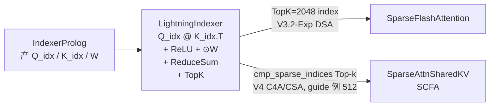

# Lightning Indexer Kernel

## Summary

`LightningIndexer` 是 DeepSeek-V3.2-Exp / DeepSeek-V4 稀疏 Attention 的前置算子 —— 完整执行 `BatchMatmul → ReLU → Broadcast × W → ReduceSum → Top-k` 五步，为每 query token **精确**（非近似）选出 TopK 个相关 KV index 喂给下游稀疏 Attention。当前实现**将 Top-k 计算融合进单一算子**，相关 AscendC 调优记录见[A3 来源观测](../../optimizations/benchmark_observations/ascendc_a3_li_hcpost_source_observations.md)。模块语义见 [lightning-indexer](../modules/lightning_indexer.md)。

Top-k 的 **K 随模型而异**：V3.2-Exp DSA 在完整上下文上选 **TopK=2048** 喂给 [sparse-flash-attention](sparse_flash_attention.md)；V4 仅在 C4A（compress_ratio=4，CSA）层、对 Compressor 压缩后的 cmp_KV 做 Top-k（V4 AscendC guide 以 **512** 为示例 K，运行时实际取 `config.index_topk`，仓内 `configuration_deepseek.py` 默认 **2048**，详见 [deepseek-v4](../models/deepseek_v4.md)），结果喂给 [sparse-attn-sharedkv](sparse_attn_sharedkv.md)（SAS）的 SCFA 路径（不同模型不同 K，并列保留）。

本 kernel 在 cann-recipes-infer 中同时提供 **AscendC**（手写高性能）、**PyPTO**（自研 MegaKernel）、**TileLang**（社区编译）三路实现，彼此性能/易用性各有取舍；V4 在 AscendC 侧补充了 950PR/DT 直方图 Top-k 与 FP8 量化版 LI（INT8/FP8 共用 `npu_quant_lightning_indexer`，FP8 区别在上游 q 经 `npu_dynamic_block_quant` 量化，见下文 [DeepSeek-V4 CSA 层增强](#deepseek-v4-csa-层增强)）。

## Role In Pipeline

DSA 计算链路：`MLAProlog + IndexerProlog → LightningIndexer → SparseFlashAttention → MLAEpilog`。LI 的输出是 TopK index 张量，SFA 据此 Gather 稀疏 KV；在长序列场景下 LI 的 TopK 排序成为主要热点。



## Performance Signals

### AscendC 实现

**算子 Tiling**：

- 核间基本块 `(512, 512)` —— 512 行一次迭代以减少右矩阵重复搬运（g=64 场景下合并 8 个 token），$S_k$ 方向 512 粒度以控制流水头尾开销。
- **L1 划分**：
 - $Q_{index}$ 矩阵**常驻**：`512×128×2B = 128 KB`，实际按 `(256, 128)` 两次搬入以降低搬运头开销；
 - $K_{index}$ **3-Buffer 循环**：`3×256×128×2B = 192 KB`，L1 层级基本块 `(256, 128)`。
- L0A/L0B/L0C 均 Double Buffer（`2×32 KB / 2×32 KB / 2×64 KB`），一次搬入 `(128, 128)`。

**效果**：Q_index 只搬一次；K_index 重复搬运次数从 `⌈Sq/128⌉` 降到 `⌈Sq/512⌉`；K_index 3-Buffer 消除带宽爬坡阻塞。

**Pipeline（Preload）**：

LI 只有两个阶段 —— Matmul+ReLU ($C_1$) 与向量计算 ($V_1$)。朴素串行会互相阻塞，**提前下发（Preload）一次 $C_1$** 实现流水互相掩盖。


*来源：[`docs/models/deepseek-v3.2-exp/figures/LIpipeline.png`](../../../../../cann-recipes-raw/cann-recipes-infer/944d2d3ece86f7df33dbb0cb155c72ca619a9c66/docs/models/deepseek_v3_2_exp/figures/LIpipeline.png)（cann-recipes-infer @ 944d2d3）*

**ReLU 随路实现**：Cube 核 FixP 组件提供随路 ReLU —— Matmul 完成后在数据搬出 Cube 核过程中直接做 ReLU，不需要显式从 Cube 向 Vector 核搬运后再算。参考 [基础 API: FixP 相关](https://www.hiascend.com/document/detail/zh/canncommercial/82RC1/API/ascendcopapi/atlasascendc_api_07_0251.html)。

**Top-k 指令实现**：必须是**精确**TopK，不能近似。分三步：

1. **分组排序**（`VBS32`）：每 32 个 token 按 Score 稳定降序排列；

 
 *来源：[`docs/models/deepseek-v3.2-exp/figures/topkstep1.png`](../../../../../cann-recipes-raw/cann-recipes-infer/944d2d3ece86f7df33dbb0cb155c72ca619a9c66/docs/models/deepseek_v3_2_exp/figures/topkstep1.png)（cann-recipes-infer @ 944d2d3）*

2. **归并**（`VMS4v2`）：至多 4 组（长度 32/128/512）已排序向量归并，重复至长度达 2048；

 
 *来源：[`docs/models/deepseek-v3.2-exp/figures/topkstep2.png`](../../../../../cann-recipes-raw/cann-recipes-infer/944d2d3ece86f7df33dbb0cb155c72ca619a9c66/docs/models/deepseek_v3_2_exp/figures/topkstep2.png)（cann-recipes-infer @ 944d2d3）*

3. **规约**（`VMS4v2` 耗尽模式）：至多 4 组长度 2048 向量归并，取前 k=2048 与未参与合并排序的向量重复 Top-k，直至得到全局 TopK。

 
 *来源：[`docs/models/deepseek-v3.2-exp/figures/topkstep3.png`](../../../../../cann-recipes-raw/cann-recipes-infer/944d2d3ece86f7df33dbb0cb155c72ca619a9c66/docs/models/deepseek_v3_2_exp/figures/topkstep3.png)（cann-recipes-infer @ 944d2d3）*

**TopK 总计算量**（源文档推导）：分组排序 + 归并 $= 4 S_k$；规约部分蒙特卡洛估计 $\approx 0.36 S_k + 3.32 k$；合计 $\approx 4.36 S_k + 3.32 k$。

### LI 量化支持（Mat-Duce 算法）

`LightningIndexerQuant` 输入 $Q_{index}^{INT8}, K_{index}^{INT8}$ + 反量化系数 $Scale_Q, Scale_K$（Per-Token-Head A8C8）。直接实现需要多步 Vector 操作。

Mat-Duce 利用 $Scale_Q, Scale_K \ge 0$，令 $\tilde{W} = Scale_Q \odot W$，将公式等价变换为：

$$\text{Top-}k\left\{\tilde{W}^T @ \text{ReLU}(Q_{index}^{INT8}@(K_{index}^{INT8})^T) \odot Scale_K^T\right\}.$$

计算流程（源文档）：

1. UB 上预处理 $\tilde{W} = Scale_Q \odot W$，CAST 到 FP16 写 GM；
2. Cube 核算 $S^{INT32} = Q_{index}^{INT8} @ (K_{index}^{INT8})^T$；
3. 利用 FixP 的 **DEQF16** 指令：$S^{FP16} = \text{FP16}(S^{INT32} / 1024)$，$1/1024$ 防溢出且不影响 Top-k；
4. 利用 FixP 随路 **ReLU**：$S' = \text{ReLU}(S^{FP16})$，搬到 L1；
5. Cube 核内再算 $P = \tilde{W}^T @ S'$ —— 一次矩阵乘同时完成 $Scale_Q$ 反量化 + W 行方向放缩 + 不同头结果求和；
6. Vector 核读 $P$，按 $Scale_K$ 反量化：$Score = P \odot Scale_K^T$；
7. Vector 核上做 Top-k。


*来源：[`docs/models/deepseek-v3.2-exp/figures/matduce_quant.png`](../../../../../cann-recipes-raw/cann-recipes-infer/944d2d3ece86f7df33dbb0cb155c72ca619a9c66/docs/models/deepseek_v3_2_exp/figures/matduce_quant.png)（cann-recipes-infer @ 944d2d3）*

> 收益："将大部分向量操作通过数学变换以 Cube 核实现（步骤 5），同时充分利用了 FixP 随路量化激活搬运能力，将量化矩阵乘法的结果从 INT32 数据类型转化为 FP16 数据类型（步骤 3, 4），得以进行第二次半精度的矩阵乘法操作，显著提升了算子性能。"

### PyPTO 实现


*来源：[`docs/models/deepseek-v3.2-exp/figures/DeepseekLightningIndexer.png`](../../../../../cann-recipes-raw/cann-recipes-infer/944d2d3ece86f7df33dbb0cb155c72ca619a9c66/docs/models/deepseek_v3_2_exp/figures/DeepseekLightningIndexer.png)（cann-recipes-infer @ 944d2d3）*

源码：`ops/pypto/src/lightning_indexer_pto/op_kernel/lightning_indexer_topk.cpp`。

**首版开箱**泳道图（4 batch × 64K）：


*来源：[`docs/models/deepseek-v3.2-exp/figures/DeepseekLightningIndexer_0.png`](../../../../../cann-recipes-raw/cann-recipes-infer/944d2d3ece86f7df33dbb0cb155c72ca619a9c66/docs/models/deepseek_v3_2_exp/figures/DeepseekLightningIndexer_0.png)（cann-recipes-infer @ 944d2d3）*

开发者通过可视化环境识别三个异常点：

1. MatMul Cube 任务前序无依赖却未第一时间执行（框架在无数据搬运场景的优化缺失）；
2. Cube/Vector 第三列只有部分核工作 —— Paged Attention block_size=128，MatMul 切出 `4*64*1024/128 = 2048` 任务，L1 复用 32 → 最终 64 任务，无法平均分 24 Cube 核；
3. 最后 TopK 严重拖尾（4 batch 下单核归并）。

**改进措施**（对应 Pass 修复 / 配置调优）：

```cpp
config::SetPassOption(L1_REUSE, 32); // 动态 Shape 与特定 Shape 的泛化平衡
TileShape::Current().SetVecTile({64, 256}); // MatMul 输出到连续内存后 Vector 大颗粒度消费
```

- 针对异常点 1：通过修改对应 Pass 补齐泛化能力。
- 针对异常点 2：通过 `SetVecTile({64, 256})` 改为大颗粒度 Vector 运算。
- 相对结果统一见[分组来源观测](../../optimizations/benchmark_observations/operator_tuning_source_observations.md)，新版泳道图仍用于解释依赖和调度：


*来源：[`docs/models/deepseek-v3.2-exp/figures/DeepseekLightningIndexer_1.png`](../../../../../cann-recipes-raw/cann-recipes-infer/944d2d3ece86f7df33dbb0cb155c72ca619a9c66/docs/models/deepseek_v3_2_exp/figures/DeepseekLightningIndexer_1.png)（cann-recipes-infer @ 944d2d3）*

### TileLang 实现

源码 `ops/tilelang/lightning_indexer.py`、文档 `ops/tilelang/docs/`。


*来源：[`docs/models/deepseek-v3.2-exp/figures/tl-lightning-indexer.png`](../../../../../cann-recipes-raw/cann-recipes-infer/944d2d3ece86f7df33dbb0cb155c72ca619a9c66/docs/models/deepseek_v3_2_exp/figures/tl-lightning-indexer.png)（cann-recipes-infer @ 944d2d3）*

- 输入输出：Query `(B, S1, N1, D)`、Key `(B, S2, N2, D)`、QK_RES `(B, N2, S1, G*S2)`、WEIGHTS `(B, S1, N2, G)`、OUT `(B, N2, S1, TOP_K)`；满足 `G × N2 = N1`。
- **Cube 核**：L1 存 Q 和 K（`BLOCK_M/N/K=128`）、L0C 存 C；循环 `n2 → g → m(S1) → n(S2)` 分块矩阵乘；`T.gemm_v0(transpose_B=True)` + `T.copy(enable_relu=True)` 把 ReLU 随路到 FixPipe。
- **Vector 核**：`N2*S1` 任务平均分到 2 个 Vector 核；按 `VECTOR_BASEN` 分块做 `reduce_sum` 沿分组维度求和得 Score；Top-K 用**增量式归并排序**：`merge_sort_times = TOP_K // VECTOR_BASEN`，首次 `T.merge_sort`，后续归并后再 Top-K 保持结果集大小；最终 Cube/Vector 通过 `T.set_cross_flag("FIX", 0)` 同步。

## DeepSeek-V4 当前接口

V4 仅 C4A/CSA 在压缩后 KV 上使用 LI，TopK 取加载权重的 config.index_topk，技术文档中的512只是示例。当前调用 cann_ops_transformer.quant_lightning_indexer，Query=TND、Key=PA_BBND，传压缩后的 seqused_k（原长度整除4）与 cmp_residual_k（余数），不能沿用原始上下文长度或旧 custom.npu_quant_lightning_indexer 参数。

量化模式 Int8=2、FP8=1、HiF8=4，必须与 quant_lightning_indexer_metadata 一致。Int8 Query 使用 dynamic_quant 和 FP16 scale；FP8 用 dynamic_block_quant 和 FP32 scale；HiF8 在 RoPE 后量化、跳过 Hadamard，并传单位 Q/Key descale。Indexer weights_proj 在 HiF8 mm 模式也量化，其他模式不量化。

离线 CP 读临时完整压缩缓存，prev/next 各执行 LI，返回每段 packed [T,1,K] 索引供 SAS；主模型的持久压缩缓存经框架绑定。详细前处理见[Indexer Prolog](indexer_prolog.md)，格式见[950混合量化](../quantization/hybrid_mxfp8_mxfp4.md)。

950 直方图 TopK 的保序变换、逐字节分桶和补齐等值元素算法仍见当前 AscendC 技术文档：S_k=16384、k=512、uint32 的7296 cycle 与 A3 排序28375 cycle 都是特定输入的理论估算，不能当新硬件实测或所有形状的固定倍率。

## Optimization Notes

- **TilingKey 模板化**：LI/SFA 均采用 Ascend C 的 Tiling 模板编程替代传统 TilingKey 数字编码 —— 以模板参数组合管理分支，提高代码可读性。见 [Tiling 模板编程](https://www.hiascend.com/document/detail/zh/CANNCommunityEdition/83RC1alpha002/opdevg/Ascendcopdevg/atlas_ascendc_10_00025.html)。
- **分核计算下沉**：Attention 类算子的分核策略对 `actualSeqLengths` 有值依赖，传统 AICPU Tiling 有调度开销。V3.2-Exp 阶段进一步把分核计算**从 AICPU 下沉到 AICore 内部**，消除 Tiling 依赖前序算子的调度开销，简化调用链。在 DeepSeek-V4 中 LI 的值依赖分核改由独立的 **AICPU Scheduler 算子** `quant_lightning_indexer_metadata` 承载（与 SAS 共用同一技术机制，与上述 AICore 内下沉为不同机制/方向，区分详见 [aicpu-scheduler](../techniques/aicpu_scheduler.md)）。
- **在 Decode 端可与 MTP 配合加速**：LI 的 KV 搬运量在 MTP1 下不变，计算访存比提升 —— 是 DSA 下 MTP 加速的主要受益者（见 [lightning-indexer](../modules/lightning_indexer.md) Performance）。

## Evidence

- [deepseek_v3.2_exp_ascendc_operator_guide.md](../../../../../cann-recipes-raw/cann-recipes-infer/944d2d3ece86f7df33dbb0cb155c72ca619a9c66/docs/models/deepseek_v3_2_exp/deepseek_v3.2_exp_ascendc_operator_guide.md)（primary）
- [deepseek_v4_ascendc_operator_guide.md](../../../../../cann-recipes-raw/cann-recipes-infer/944d2d3ece86f7df33dbb0cb155c72ca619a9c66/docs/models/deepseek_v4/deepseek_v4_ascendc_operator_guide.md)（implementation）
- [indexer.py](../../../../../cann-recipes-raw/cann-recipes-infer/944d2d3ece86f7df33dbb0cb155c72ca619a9c66/models/deepseek_v4/models/modules/indexer.py)（implementation）
- [modeling_deepseek.py](../../../../../cann-recipes-raw/cann-recipes-infer/944d2d3ece86f7df33dbb0cb155c72ca619a9c66/models/deepseek_v4/models/modeling_deepseek.py)（implementation）
- [indexer.py](../../../../../cann-recipes-raw/cann-recipes-infer/944d2d3ece86f7df33dbb0cb155c72ca619a9c66/models/deepseek_v3_2_exp/models/indexer.py)（implementation）

## Links

- [deepseek-v3.2-exp](../models/deepseek_v3_2_exp.md)
- [deepseek-v4](../models/deepseek_v4.md)（V4 在 CSA 层强化 LI，新增 Compress Ratio 阶梯 mask，压缩后 Cache 上做 Top-k，K 取 `config.index_topk`，guide 例 512）
- [lightning-indexer](../modules/lightning_indexer.md)
- [sparse-flash-attention](../modules/sparse_flash_attention.md)
- [sparse-flash-attention](sparse_flash_attention.md)
- [sparse-attn-sharedkv](sparse_attn_sharedkv.md)（V4 中 LI 仅用于 SAS 的 CSA（compress_ratio=4）路径，产 `cmp_sparse_indices` 供 SAS 离散选取压缩 KV）
- [compressor](compressor.md)（V4 CSA 层 LI 的 Indexer Cache 经 Compressor / IndexerCompressEpilog 做 4× 压缩与刷新）
- [indexer-prolog](indexer_prolog.md)
- [deepseek-indexer-attention](deepseek_indexer_attention.md)
- [ascendc](../frameworks/ascendc.md)
- [pypto](../frameworks/pypto.md)
- [tilelang](../frameworks/tilelang.md)
- [aicpu-scheduler](../techniques/aicpu_scheduler.md)（V4 LI 值依赖分核下沉 AICPU 的技术机制，区别于 V3.2-Exp AICore 内下沉）
- [w8a8c8](../quantization/w8a8c8.md)
- [int8-int4-hybrid](../quantization/int8_int4_hybrid.md)（V4 A3 Pod：LI `batch_matmul` Int8 计算 + A8C8 降时延）
- [hybrid-mxfp8-mxfp4](../quantization/hybrid_mxfp8_mxfp4.md)（V4 950PR/DT：LI `batch_matmul` FP8 计算 + A8C8 FP8 Cache）
- [ascend-950](../platforms/ascend_950.md)（950PR/DT Histograms 指令加速 LI 精确 Top-k：~7296 cycle vs A3 sort32/mrgsort ~28375 cycle）
- [atlas-a3](../platforms/atlas_a3.md)（A3 LI Top-k 走 sort32 + mrgsort）
- [slig](../../../training/concepts/kernels/slig.md)（跨域·训练：LI 的训练反向算子 SLIG（含 KL Loss））
- [sfag](../../../training/concepts/kernels/sfag.md)（跨域·训练：DSA 稀疏注意力反向 SFAG（与 SLIG 同批））
- [custom-cp-dsa](../../../training/concepts/parallelism/custom_cp_dsa.md)（跨域·训练：长序列 CP 下对 key-index AllGather）
- [deepseek-v32-pretrain](../../../training/guides/recipes/deepseek_v32_pretrain.md)（跨域·训练：DeepSeek-V3.2 32K 预训练）
- [sasg](../../../training/concepts/kernels/sasg.md)（跨域·训练：V4 SAS 反向 SASG 与 LI 配合）
- [deepseek-v4-continue-pretrain](../../../training/guides/recipes/deepseek_v4_continue_pretrain.md)（跨域·训练：DeepSeek-V4 续训(LI 训练侧)）
- [autofuse-train](../../../training/concepts/techniques/autofuse_train.md)（跨域·训练：V4 训练入图(inner_attention LI 跳过编译)）
- [smla](../../../training/concepts/kernels/smla.md)（跨域·训练：SMLA 的 LI-loss 融进 klloss_grad 反向）
