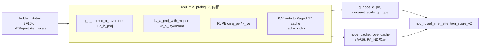

# npu_mla_prolog (v2 / v3)

## Summary

DeepSeek-V3 / R1 / Kimi-K2 **MLA 前置计算的端到端融合算子**：在一个 kernel 内完成 Q 两级投影（q_a_proj → RMSNorm → q_b_proj）、KV 两级投影（kv_a_proj_with_mqa → RMSNorm → kv_b_proj 的 K 分量）、RoPE 施加、以及按 `cache_index` 将 K/V 写入 Paged NZ KVCache。替代原生的多个 Linear + RMSNorm + rotary 子图，显著降低 Decode 阶段的 host 下发和 kernel 间 gap。

在 DeepSeek-R1 Decode 路径由 `enable_mla_prolog: True` 使能（YAML 级别），对应 `DeepseekV3Attention.forward_page_attention_mla_prolog` 分支（`models/deepseek_r1/models/modeling_deepseek.py:L1186`）。R1 使用 **v3** 版本（`torch.ops.npu.npu_mla_prolog_v3`）。DeepSeek-V4 attention 主体改为 MQA/Shared-KV，但仍调用 MLAProlog 做 Q/KV 前置投影，并把其适配为 PyPTO 算子（inplace interleaved RoPE / Unrollist 分档 / 合图，见 [DeepSeek-V4 适配](#deepseek-v4-适配pypto)）。

## Role In Pipeline



- 输入：`hidden_states`（BF16 或 INT8 + `pertoken_scale`）、三个权重 + 三组 scale（量化场景）、`rope_cos` / `rope_sin`、`cache_index`、现有 `kv_cache` / `kr_cache`。
- 输出：`q_nope`、`q_pe`、`dequant_scale_q_nope`（供下游 FA 做 Q-side dequant）。
- 副作用：按 `cache_index` 原地更新 `kv_cache`（NoPE 部分）与 `kr_cache`（RoPE 部分）。

## Key Parameters

关键 launch 签名（源 `models/deepseek_r1/models/modeling_deepseek.py:L1216`）：

```python
q_nope, q_pe, dequant_scale_q_nope, _, _ = torch.ops.npu.npu_mla_prolog_v3(
 token_x=hidden_states_int8 if enable_mm_quant_a8w8 else hidden_states,
 weight_dq=self.q_a_proj.weight,
 weight_uq_qr=self.q_b_proj.weight,
 weight_uk=self.kv_b_proj_w_k,
 weight_dkv_kr=self.kv_a_proj_with_mqa.weight,
 rmsnorm_gamma_cq=self.q_a_layernorm.weight,
 rmsnorm_gamma_ckv=self.kv_a_layernorm.weight,
 rope_sin=sin.squeeze(1), rope_cos=cos.squeeze(1),
 cache_index=slot_mapping,
 kv_cache=nope_cache, kr_cache=rope_cache,
 dequant_scale_x=pertoken_scale if enable_mm_quant_a8w8 else None,
 dequant_scale_w_dq=self.q_a_proj.weight_scale.view(1, -1) if enable_mm_quant_a8w8 else None,
 dequant_scale_w_uq_qr=self.q_b_proj.weight_scale.view(1, -1) if enable_mm_quant_a8w8 else None,
 dequant_scale_w_dkv_kr=self.kv_a_proj_with_mqa.weight_scale.view(1, -1) if enable_mm_quant_a8w8 else None,
 quant_scale_ckv=self.ckv_scale_reci if self.kv_cache_quant_mode == "int8" else None,
 quant_scale_ckr=None,
 smooth_scales_cq=None,
 rmsnorm_epsilon_cq=self.q_a_layernorm.variance_epsilon,
 rmsnorm_epsilon_ckv=self.kv_a_layernorm.variance_epsilon,
 cache_mode="PA_NZ",
 weight_quant_mode=2 if enable_mm_quant_a8w8 else 0,
 kv_cache_quant_mode=1 if self.kv_cache_quant_mode == "int8" else 0,
 query_quant_mode=1 if enable_mm_quant_a8w8 and self.kv_cache_quant_mode == "int8" else 0,
)
```

### 量化模式枚举（来自代码注释）

- **`weight_quant_mode`**：
 - 0：non-quant；
 - 1：`weight_uq_qr` int8-quant；
 - 2：`weight_dq`、`weight_uq_qr`、`weight_dkv_kr` int8-quant（即完整 W8 量化）；
 - 3：上述三项 mxfp8-quant。
- **`kv_cache_quant_mode`**：
 - 0：non-quant；
 - 1：per-tensor quant（C8 走此模式）；
 - 2：per-channel quant；
 - 3：per-tile quant。
- **`query_quant_mode`**：
 - 0：non-quant；
 - 1：per-token-head quant（仅在 W8 + C8 组合下启用）。

### cache_mode

`"PA_NZ"` — Paged Attention + NZ 亲和布局。配合 `enable_pa: True` 与 `pa_block_size: 128`，支持 `block_table` 的分页 KVCache 管理。

## Performance Signals

- **Decode TPOT**：是 W8A8C8 + MTP1 decode 42~45 ms TPOT 的核心组成。
- **Host 下发**：eager 下多算子分别下发、MLA 前置阶段 host 占用高；`mla_prolog` 单 kernel 替代后 host 压力显著下降。
- **量化耦合**：内部 Query 动态量化与权重解量化可融合；输入 hidden_states 的激活量化仍在算子外。R1 A8W8 分支先调用 npu_dynamic_quant(packed hidden_states) 生成 hidden_states_int8 与 pertoken_scale，再将后者作为 dequant_scale_x 传入 npu_mla_prolog_v3，不能省略这次调用。

## Optimization Notes

- **必须与 `npu_fused_infer_attention_score_v2` 配合**：`dequant_scale_q_nope` 要透传给 FA 作为 `dequant_scale_query`，否则 C8 量化场景下 Q-side 解量化错位。
- **KV NZ view 调整**：算子输出 `nope_cache` 是 flat 视图，之后按 `factor = 2 if kv_cache_quant_mode==int8 else 1` 的 INT8 打包 factor 重新 view 到 `[block_num, 1, kv_lora_rank/(16·factor), block_size, 16·factor]` 才能喂给 FA。
- **MTP 分支**：`if q_len > 1: sparse_mode = 3` 让下游 FA 用 MTP 因果 mask；否则 `sparse_mode = 0` 且 `attention_mask = None`。
- v2 与 v3 的差异：R1 实际使用 v3，文档提及的 `npu_mla_prolog_v2` 为早期入口，**语义差异 source 未明示，待验证**。

## DeepSeek-V4 适配（PyPTO）

DeepSeek-V4 的 attention 主体由 MLA 改为 MQA/Shared-KV，但仍调用 MLAProlog 做 Q/KV 前置投影。V4 把 MLAProlog 适配为 **PyPTO 算子**（上文 R1/Kimi 走的 `torch.ops.npu.npu_mla_prolog_v3` 端到端 AscendC 融合算子内容保留有效，对应 V3/R1/Kimi 谱系）。

### inplace interleaved RoPE

PyPTO 版 MLAProlog 的计算过程：

- **Query**：两次采样 + RmsNorm（第二次 RmsNorm 对应代码 `q_b_norm`，其 weight 恒为 1；代码符号对应、weight 恒 1 未逐权重核验），最后对 `-1` 轴的后 `rope_dim` 维度做 inplace interleaved RoPE：$c^Q = RmsNorm(x@wq\_a)$；$q = RmsNorm(c^Q@wq\_b)$；$q[\cdots,-rope\_dim:] = ROPE(q[\cdots,-rope\_dim:])$。
- **KV**：一次采样 + RmsNorm，再对后 `rope_dim` 维度做 inplace interleaved RoPE：$k = RmsNorm(x@wkv)$；$k[\cdots,-rope\_dim:] = ROPE(k[\cdots,-rope\_dim:])$。

当前非量化 V4 路径使用 cann_ops_transformer.inplace_partial_rotary_mul，仅作用于尾部 rope_head_dim；HiF8 的 partial_rotary_mul_quant 是 Python helper，先调用该 RoPE 再 npu_quantize，并非直接调用旧 custom.partial_rotary_mul_quant 融合注册符号。不能继续以早期未接入 `_quant` 算子的结论解释当前 HiF8 路径。

当前 MLAProlog 按 enable_pypto、Prefill/Decode 分派。V4 enable_pypto 只允许A3；950使用其当前投影/量化路径。Prefill CP1 的 FP8/MXFP8 激活可提前量化，在 wq_a 和 wkv 间复用；CP 下包含前序窗口交换。Decode 的 Q/KV/Compressor/LI 用 native 事件建立依赖，量化与控核必须按所选模式核对。

### Unrollist 动态转静态 + 合图

- **Unrollist 分档**：Prefill / Decode 下 token 数 `t` 差异巨大，单套 Tile 切分难兼顾。对动态 `t` 多分档、Tile 切分用静态 tTile：`unroll_list = [128, 64, 32, 16, 1]`，经 `pypto.loop_unroll(..., unroll_list=unroll_list)` 把动态循环展开为静态图，在不同场景均达较优性能。
- **合图优化**：设 `pass_options={"cube_nbuffer_mode":1, "vec_nbuffer_mode":2, "vec_nbuffer_setting":{-1:2}}` 把相同结构子图合并，避免子图数过大与重复搬运，增大核内流水调度空间。
- **MatMul 优化**：按参与 matmul 的 tensor shape 设 tile_shape 把任务均衡分到各 aic 核；K 轴过大时 `enable_split_k`，大 shape 下 `enable_multi_data_load` 开大包搬运提升带宽。
- **MPMD 流水并行**：Decode 下 `x@wq_a` 与 `x@wkv` 都用不满全部核，可并行执行；Query / KV 后续 RmsNorm 亦可并行。

## Evidence

- [modeling_deepseek.py](../../../../../cann-recipes-raw/cann-recipes-infer/944d2d3ece86f7df33dbb0cb155c72ca619a9c66/models/deepseek_r1/models/modeling_deepseek.py)（primary）
- [deepseek_r1_decode_optimization.md](../../../../../cann-recipes-raw/cann-recipes-infer/944d2d3ece86f7df33dbb0cb155c72ca619a9c66/docs/models/deepseek_r1/deepseek_r1_decode_optimization.md)（implementation）
- [modeling_deepseek.py](../../../../../cann-recipes-raw/cann-recipes-infer/944d2d3ece86f7df33dbb0cb155c72ca619a9c66/models/deepseek_v4/models/modeling_deepseek.py)（implementation）
- [common_modules.py](../../../../../cann-recipes-raw/cann-recipes-infer/944d2d3ece86f7df33dbb0cb155c72ca619a9c66/models/deepseek_v4/models/modules/common_modules.py)（implementation）
- [deepseek_v4_pypto_operator_guide.md](../../../../../cann-recipes-raw/cann-recipes-infer/944d2d3ece86f7df33dbb0cb155c72ca619a9c66/docs/models/deepseek_v4/deepseek_v4_pypto_operator_guide.md)（implementation）

## Links

- [deepseek-r1](../models/deepseek_r1.md)
- [deepseek-v4](../models/deepseek_v4.md)（V4 attention 主体为 MQA/Shared-KV，但仍调用 MLAProlog 做 Q/KV 前置投影）
- [mla](../modules/mla.md)
- [fused-infer-attention-score](fused_infer_attention_score.md)
- [w8a8c8](../quantization/w8a8c8.md)
- [ascendc](../frameworks/ascendc.md)
- [pypto](../frameworks/pypto.md)（V4 MLAProlog 走 PyPTO 算子实现）
- [sparse-attn-sharedkv](sparse_attn_sharedkv.md)（V4 SAS 的 Q 输入由 MLAProlog 前置投影产出）
- [longcat-flash-lite](../models/longcat_flash_lite.md)（LongCat-Flash 减配验证模型，Decode 用 `npu_mla_prolog_v3` 融合 Q-/KV-LoRA + RMSNorm + RoPE + cache 写入，`当前 Decode 固定使用该 Prolog 路径）
- [tilelang-rope](../../../training/concepts/kernels/tilelang_rope.md)（跨域·训练：RoPE 的 TileLang 训练实现（含反向））
