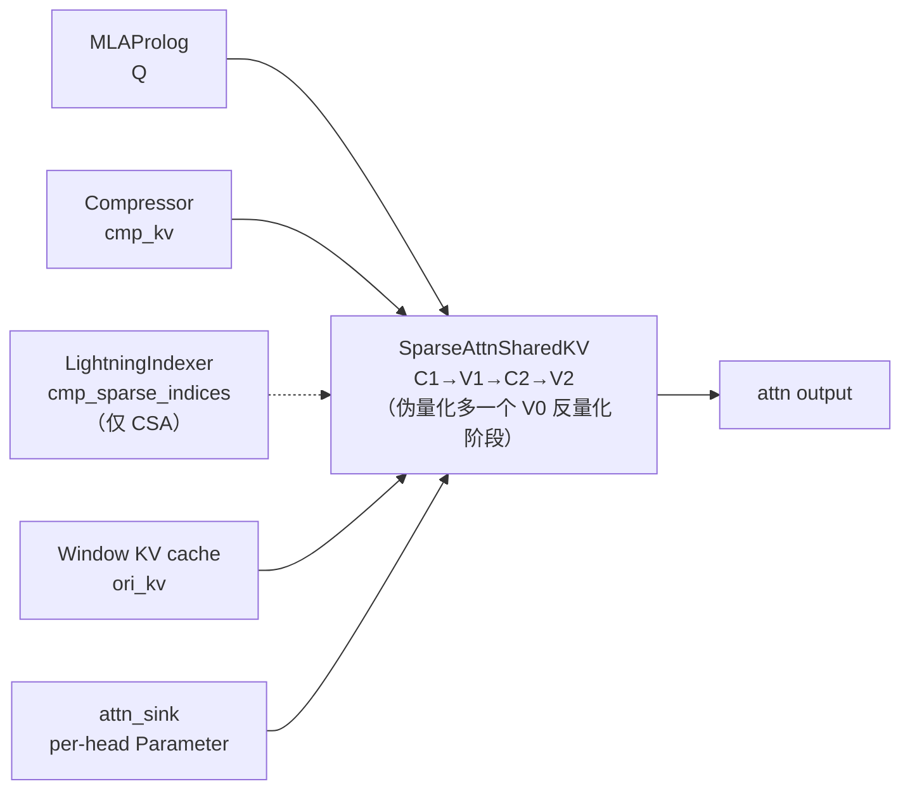

# SparseAttnSharedKV (SAS) Kernel

## Summary

`SparseAttnSharedKV`（**SAS**）是 DeepSeek-V4 全新的**统一 Attention 融合算子**：以**一套接口**覆盖 V4 交错 Hybrid Attention 的多种计算场景 —— **Sliding Window Attention（SWA）**、**Compressed Attention** 及其上的**稀疏化（Sparse）**，以及它们的组合，并原生支持 **Attention Sink**。算子完成的核心计算为

$$O = \text{softmax}(Q@\tilde{K}^T \cdot \text{softmax\_scale})@\tilde{V}, \quad \tilde{K}=\tilde{V}$$

其中 $\tilde{K}=\tilde{V}$（Shared-KV，详见 [mla](../modules/mla.md) 对比）为由入参控制的实际参与计算 KV。在 V4 中 SAS 是 [deepseek-v4](../models/deepseek_v4.md) attention 主体（MQA / Shared-KV）的落地算子，承接 [mla-prolog](mla_prolog.md) 产出的 Q、[lightning-indexer](lightning_indexer.md) 产出的稀疏 index（仅 CSA 路径），以及 [compressor](compressor.md) 产出的压缩 KV（`cmp_kv`）。

cann-recipes-infer 同步提供 **AscendC**（Atlas-A3 非量化 + 950PR/DT 伪量化）、**PyPTO**（拆为 SWA / CFA / SCFA 三个场景化算子）、**TileLang**（V4-Flash SFA 实现）三路实现。当前模型按格式选择 cann_ops_transformer.sparse_flash_mla（非量化）、mixed_quant_sparse_flash_mla（混合打包 FP8）或 quant_sparse_flash_mla（HiF8），配套同名 *_metadata 入口。

## SAS vs SFA：命名区分

> SAS（SparseAttnSharedKV）与 [sparse-flash-attention](sparse_flash_attention.md)（SFA）命名相近但是不同算子，谱系相关：

| 维度 | SparseFlashAttention（SFA） | SparseAttnSharedKV（SAS） |
| ---- | ---- | ---- |
| 所属模型 | DeepSeek-V3.2-Exp（DSA） | DeepSeek-V4 |
| 角色 | DSA 唯一的稀疏主 Attention 算子 | 统一接口覆盖 SWA / Compressed / Sparse 多场景 |
| KV 形态 | MLA 低秩 KV | Shared-KV（K=V） |
| 稀疏来源 | LI 直接选 TopK | 仅 CSA 路径叠加 LI（`cmp_sparse_indices`），SWA/HCA 无稀疏 |
| 新增能力 | — | Attention Sink、滑窗、压缩 KV 组合 |

SAS 的非量化计算流程沿用 SFA 的 `C_1 (Q@K^T) → V_1 (online softmax) → C_2 (P@V) → V_2 (rescale)` 四阶段框架，可视为 SFA 在 V4 Shared-KV 与多场景需求下的统一化后继。

## Role In Pipeline

当前 attn_kernel 直接返回 sparse_attn_ops(**prepare_fa_kwargs(...))[0]，Query 为 packed TND；CP 的 prev/next 各调用一次，不再按旧 batch/q_len unflatten。

## AscendC 实现（Atlas-A3 / 950PR/DT）

### 计算阶段

Atlas-A3 上 SAS 为**非量化版本**（$Q, KV$ 均半精度），分四个阶段：

- $C_1$：$Q@K^T$
- $V_1$：online softmax
- $C_2$：$P@V$
- $V_2$：rescaling $O$

950PR/DT 上为**伪量化版本**（$KV$ 已量化到 8bit）：在最前新增一个 $V_0$ 阶段对 $KV$ 反量化，整体为五阶段。

### Tiling 设计（Atlas-A3）

一次迭代基本块 $(256, 512)$（$Q$ 序列方向 256、$KV$ 序列方向 512）。源文档明示：C4A 层存在稀疏计算，不同 $Q$ 无法合轴，只能 Group 内统一计算，故一次迭代实际基本块可能为 $(64, 512)$，但不影响整体 Cache 划分。

- **L1 划分**：
  - $Q/P$ 矩阵**分时复用**（$P$ 为 softmax 结果）：$4\times128\times256\times2\text{B}=256\text{ KB}$ —— 一个 $C_1$ 或 $C_2$ 阶段中左矩阵分 4 次搬到 L1、一次迭代内常驻；$Q$ 每次 $(128,256)$、$P$ 每次 $(128,256)$。
  - $K/V$ 矩阵 **3-Buffer 循环复用**：$3\times128\times256\times2\text{B}=192\text{ KB}$；$K$ 每次 $(128,256)$、$V$ 每次 $(256,128)$。
- L0A / L0B / L0C 均 Double Buffer（$2\times32\text{ KB}$ / $2\times32\text{ KB}$ / $2\times64\text{ KB}$）；$C_1$ / $C_2$ 阶段一次搬入 L0A、L0B 的矩阵块各 $(128,128)$。

950PR/DT 因芯片架构不同采用不同 Tiling 策略（源文档未给该版具体 Cache 数字）。

### 多场景覆盖（统一接口入参）

SAS 通过入参组合覆盖 V4 不同 Attention 场景。源文档列出的关键入参（语义口径）：

| 入参 | 含义 |
| ---- | ---- |
| `ori_kv` | SWA 对应的原始 $KV$ cache |
| `ori_win_left` / `ori_win_right` | 滑窗参与计算 KV 的序列轴范围：query seq id $t$ 对应 $[t-\text{win\_left},\, \dots,\, t,\, \dots,\, t+\text{win\_right}]$ |
| `cmp_kv` | C4A / C128A 层压缩后 $KV$ cache |
| `cmp_ratio` | `cmp_kv` 的压缩比例（4 或 128） |

当前调用使用 layout_q=TND、layout_kv=PA_BBND、ori_mask_mode=4、ori_win_left=127、ori_win_right=0；压缩分支传 seqused_cmp_kv（原长度整除压缩比）与 cmp_residual_kv（余数），C4A 另传 LI 索引。950 的 C1A cmp_mask_mode=0，A3 为 3，C4A/C128A 均为 3。不能沿用旧 PA_ND、tile_size、kv_quant_mode 的调用字典。

float8 分支传 quant_mode=1 与 rope_head_dim，并将字节缓存转计算 view；HiF8 分支显式传 q_descale、ori_kv_descale、cmp_kv_descale。低时延 TP 按本 rank 的 Query heads 切分 sinks。具体缓存格式见[混合量化](../quantization/hybrid_mxfp8_mxfp4.md)。

Metadata 由对应 sparse_flash_mla_metadata / mixed_quant_sparse_flash_mla_metadata / quant_sparse_flash_mla_metadata 生成，按 C1A/C4A/C128A 和 CP 两段分别匹配；Decode 可独立流生成，须保留事件依赖，见[AICPU Scheduler](../techniques/aicpu_scheduler.md)。技术文档的旧 custom 符号是算法说明，不可直接复制为当前接口。

## PyPTO 实现：SWA / CFA / SCFA 三场景化算子

PyPTO 发挥开发灵活性，将 SAS 在不同压缩比层下的 attention **拆为三个场景化算子**（作为 SAS 在 PyPTO 框架下的等价实现，按 `compress_ratio` 分派）：

| 算子 | 全称 | 触发场景 |
| --- | --- | --- |
| SWA | sliding window attention | compress_ratio=1 |
| CFA | compressed flash attention | compress_ratio=128 |
| SCFA | sparse compressed flash attention | compress_ratio=4 |

Duration 与完整工作负载统一见[PyPTO V4 平台待核验观测](../../optimizations/benchmark_observations/pypto_v4_operator_source_observations.md)。

- **SWA**：通过掩码实现 Prefill 阶段与不同 MTP 配置下的高效滑窗注意力。
- **CFA**：KV cache 有两个来源 —— `ori_kv`（原始 KV，滑窗选取）与 `cmp_kv`（Compressor 压缩后 KV，需满足因果注意力）。
- **SCFA**：相比 CFA，对 `cmp_kv` 通过 `cmp_sparse_indices` **离散地选取**指定 KV，并在 UB 上把离散 token 聚合为连续，使后续 Attention 计算高效。

PyPTO 后端基于 PTO 虚拟指令集（PTO-ISA），兼容 A2/A3/950D 多代际、"兼容不降速"，算子前端无需感知代际差异（MXFP8 量化等代际能力差异除外）。框架/范式语义见 [pypto](../frameworks/pypto.md)。

## TileLang 实现（V4-Flash SFA）

DeepSeek-V4-Flash 的 TileLang 侧提供 `sparse_attn_kernel`（`models/deepseek-v4-flash-tilelang-and-inductorAF/tilelang_kernels/sparse_attn_kernel.py`），对应 CSA 稀疏路径的 Shared-KV Flash Attention：

- 入参 `q [b, m, h, d]`、`kv [b, n, d]`（Shared-KV，K=V 同一份）、`attn_sink [h]`、`topk_idxs [b, m, topk]`、`softmax_scale`。
- `block=64`、`v_block=h//2`（Vector 核按头维一分为二）；以 `T.serial(num_topk)` 沿 TopK 分块循环。
- 每块：按 `topk_idxs` 从全局 `kv` Gather 出 `kv_ub`（`idx == -1` 填零并在分数上置 $-\infty$）→ `T.gemm_v0(transpose_B=True)` 算 $Q@K^T$ → online softmax（维护 `scores_max` / `sum_exp`）→ `T.gemm_v0` 算 $P@V$ → 重缩放累加 `acc_o_ub`。
- **Attention Sink 计入分母**：循环结束后 `attn_sink_ub = exp(attn_sink - scores_max)` 并 `sum_exp += attn_sink_ub`，再 `acc_o / sum_exp` 归一 —— sink 作为一个额外的"虚拟 logit"参与 softmax 归一化。
- Cube/Vector 协同通过 pass 配置 `TL_ASCEND_AUTO_CV_COMBINE` / `TL_ASCEND_AUTO_CV_SYNC` 自动完成。

TileLang 框架语义见 [tilelang](../frameworks/tilelang.md)；同仓 DSA 的 TileLang SFA（V3.2-Exp）见 [sparse-flash-attention](sparse_flash_attention.md)。

## Quantization

A3 默认 BF16 KV，950 的 FP8 混合记录与 HiF8 全字节 KV 分别走对应算子。技术报告的四/五阶段拆解用于理解数据流；接口、scale 与容量按当前量化方法和记录格式核对，不能只看“C8”标记。

## Evidence

- [deepseek_v4_ascendc_operator_guide.md](../../../../../cann-recipes-raw/cann-recipes-infer/944d2d3ece86f7df33dbb0cb155c72ca619a9c66/docs/models/deepseek_v4/deepseek_v4_ascendc_operator_guide.md)（primary）
- [modeling_deepseek.py](../../../../../cann-recipes-raw/cann-recipes-infer/944d2d3ece86f7df33dbb0cb155c72ca619a9c66/models/deepseek_v4/models/modeling_deepseek.py)（implementation）
- [common_modules.py](../../../../../cann-recipes-raw/cann-recipes-infer/944d2d3ece86f7df33dbb0cb155c72ca619a9c66/models/deepseek_v4/models/modules/common_modules.py)（implementation）

## Links

- [deepseek-v4](../models/deepseek_v4.md)
- [sparse-flash-attention](sparse_flash_attention.md)
- [fused-infer-attention-score](fused_infer_attention_score.md)
- [lightning-indexer](lightning_indexer.md)
- [compressor](compressor.md)（SAS 的 `cmp_kv` 上游：C4A/C128A 压缩后 KV 来源）
- [mla-prolog](mla_prolog.md)
- [mla](../modules/mla.md)
- [ascendc](../frameworks/ascendc.md)
- [pypto](../frameworks/pypto.md)
- [tilelang](../frameworks/tilelang.md)
- [aicpu-scheduler](../techniques/aicpu_scheduler.md)（SAS 值依赖分核下沉 AICPU 的技术机制）
- [sasg](../../../training/concepts/kernels/sasg.md)（跨域：SASG = SAS 的训练反向算子，cann-recipes-train DeepSeek-V4 续训练实践，共用 `sparse_attn_sharedkv` Ascend C 二进制）
- [deepseek-v4-continue-pretrain](../../../training/guides/recipes/deepseek_v4_continue_pretrain.md)（跨域·训练：SAS 在 V4 续训(配反向 SASG)）
- [autofuse-train](../../../training/concepts/techniques/autofuse_train.md)（跨域·训练：SAS 正向作 inner_attention 跳过编译）
