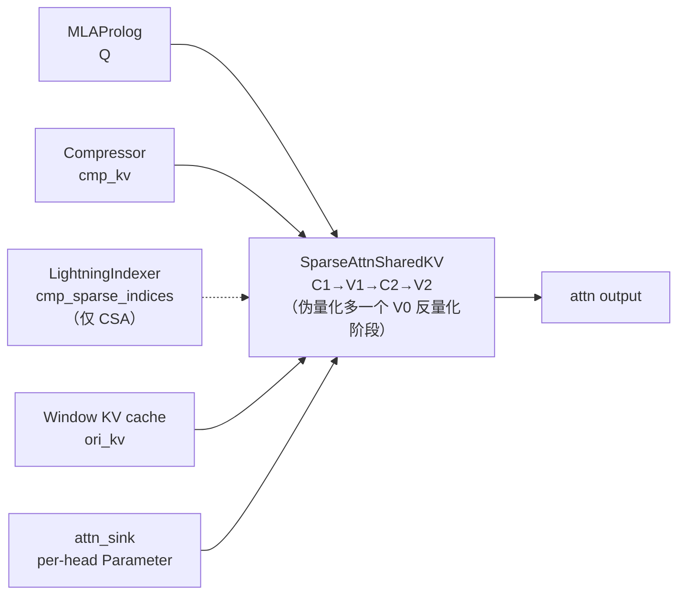

# SparseAttnSharedKV (SAS) Kernel

## Summary

`SparseAttnSharedKV`（**SAS**）是 DeepSeek-V4 全新的**统一 Attention 融合算子**：以**一套接口**覆盖 V4 交错 Hybrid Attention 的多种计算场景 —— **Sliding Window Attention（SWA）**、**Compressed Attention** 及其上的**稀疏化（Sparse）**，以及它们的组合，并原生支持 **Attention Sink**。算子完成的核心计算为

$$O = \text{softmax}(Q@\tilde{K}^T \cdot \text{softmax\_scale})@\tilde{V}, \quad \tilde{K}=\tilde{V}$$

其中 $\tilde{K}=\tilde{V}$（Shared-KV，详见 [mla](../modules/mla.md) 对比）为由入参控制的实际参与计算 KV。在 V4 中 SAS 是 [deepseek-v4](../models/deepseek_v4.md) attention 主体（MQA / Shared-KV）的落地算子，承接 [mla-prolog](mla_prolog.md) 产出的 Q、[lightning-indexer](lightning_indexer.md) 产出的稀疏 index（仅 CSA 路径），以及 [compressor](compressor.md) 产出的压缩 KV（`cmp_kv`）。

cann-recipes-infer 同步提供 **AscendC**（Atlas-A3 非量化 + 950PR/DT 伪量化）、**PyPTO**（拆为 SWA / CFA / SCFA 三个场景化算子）、**TileLang**（V4-Flash SFA 实现）三路实现。代码侧入口为 `torch.ops.custom.npu_sparse_attn_sharedkv`（伪量化版 `npu_kv_quant_sparse_attn_sharedkv`），并配套独立的 AICPU Scheduler 算子 `npu_sparse_attn_sharedkv_metadata`。

## SAS vs SFA：命名区分

> SAS（SparseAttnSharedKV）与 [sparse-flash-attention](sparse_flash_attention.md)（SFA）命名相近但是不同算子，谱系相关：

| 维度 | SparseFlashAttention（SFA） | SparseAttnSharedKV（SAS） |
| ---- | ---- | ---- |
| 所属模型 | DeepSeek-V3.2-Exp（DSA） | DeepSeek-V4 |
| 角色 | DSA 唯一的稀疏主 Attention 算子 | 统一接口覆盖 SWA / Compressed / Sparse 多场景 |
| KV 形态 | MLA 低秩 KV | Shared-KV（K=V） |
| 稀疏来源 | LI 直接选 TopK | 仅 CSA 路径叠加 LI（`cmp_sparse_indices`），SWA/HCA 无稀疏 |
| 新增能力 | — | Attention Sink、滑窗、压缩 KV 组合 |

SAS 的非量化计算流程沿用 SFA 的 `C_1 (Q@K^T) → V_1 (online softmax) → C_2 (P@V) → V_2 (rescale)` 四阶段框架，可视为 SFA 在 V4 Shared-KV 与多场景需求下的统一化后继。

## Role In Pipeline



代码调用（`models/deepseek-v4/models/modeling_deepseek.py:L1196-L1203`）：`attn_kernel` 经 `prepare_fa_kwargs` 组装入参后调用 `self.sparse_attn_ops(**fa_input_kwargs)`，输出取 `[0]` 并 `unflatten` 回 `(bsz, q_len)`。CP 长序列场景下 `attn_kernel` 对 `q`/`topk_idxs` 切前后两段（`prev`/`next`）分别调用 SAS。

## AscendC 实现（Atlas-A3 / 950PR/DT）

### 计算阶段

Atlas-A3 上 SAS 为**非量化版本**（$Q, KV$ 均半精度），分四个阶段：

- $C_1$：$Q@K^T$
- $V_1$：online softmax
- $C_2$：$P@V$
- $V_2$：rescaling $O$

950PR/DT 上为**伪量化版本**（$KV$ 已量化到 8bit）：在最前新增一个 $V_0$ 阶段对 $KV$ 反量化，整体为五阶段。

### Tiling 设计（Atlas-A3）

一次迭代基本块 $(256, 512)$（$Q$ 序列方向 256、$KV$ 序列方向 512）。源文档明示：C4A 层存在稀疏计算，不同 $Q$ 无法合轴，只能 Group 内统一计算，故一次迭代实际基本块可能为 $(64, 512)$，但不影响整体 Cache 划分。

- **L1 划分**：
  - $Q/P$ 矩阵**分时复用**（$P$ 为 softmax 结果）：$4\times128\times256\times2\text{B}=256\text{ KB}$ —— 一个 $C_1$ 或 $C_2$ 阶段中左矩阵分 4 次搬到 L1、一次迭代内常驻；$Q$ 每次 $(128,256)$、$P$ 每次 $(128,256)$。
  - $K/V$ 矩阵 **3-Buffer 循环复用**：$3\times128\times256\times2\text{B}=192\text{ KB}$；$K$ 每次 $(128,256)$、$V$ 每次 $(256,128)$。
- L0A / L0B / L0C 均 Double Buffer（$2\times32\text{ KB}$ / $2\times32\text{ KB}$ / $2\times64\text{ KB}$）；$C_1$ / $C_2$ 阶段一次搬入 L0A、L0B 的矩阵块各 $(128,128)$。

950PR/DT 因芯片架构不同采用不同 Tiling 策略（源文档未给该版具体 Cache 数字）。

### 多场景覆盖（统一接口入参）

SAS 通过入参组合覆盖 V4 不同 Attention 场景。源文档列出的关键入参（语义口径）：

| 入参 | 含义 |
| ---- | ---- |
| `ori_kv` | SWA 对应的原始 $KV$ cache |
| `ori_win_left` / `ori_win_right` | 滑窗参与计算 KV 的序列轴范围：query seq id $t$ 对应 $[t-\text{win\_left},\, \dots,\, t,\, \dots,\, t+\text{win\_right}]$ |
| `cmp_kv` | C4A / C128A 层压缩后 $KV$ cache |
| `cmp_ratio` | `cmp_kv` 的压缩比例（4 或 128） |

> **文档与实现差异**：`prepare_fa_kwargs`（`modeling_deepseek.py:L1068-L1118`）实际组装的 kwargs 与文档语义入参表略有出入 —— 代码键为 `ori_win_left=127` / `ori_win_right=0`（非通用 `win_left/win_right` 默认值；与 `sliding_window=128` 对应）、`ori_mask_mode=4`（注释 sliding window）/ `cmp_mask_mode=3`（注释 causal）、`cmp_ratio=self.compress_ratio`、`cmp_sparse_indices`（注释 only for C4A）、`sinks=self.attn_sink`、`metadata`（来自 AICPU Scheduler）、`layout_q="TND"` / `layout_kv="PA_ND"`。伪量化路径额外加 `tile_size=64` / `rope_head_dim` / `kv_quant_mode=1`。文档的 `ori_win_left/ori_win_right` 为通用语义说明，不等同于代码常量值。

`attn_sink` 为 per-head `nn.Parameter`（`torch.empty(num_heads_per_rank, dtype=torch.float32)`，`modeling_deepseek.py:L698`），以 `sinks` 入参喂入 SAS，参与 softmax 归一（见下方 TileLang 实现的 sink 计入分母）。

### AICPU Scheduler

SAS 与 LI 属"值依赖算子"：仅靠输入 shape 无法得到好的分核策略，还需运行时**实际上下文长度**。本次将值依赖的分核计算独立为 **AICPU Scheduler 算子** `npu_sparse_attn_sharedkv_metadata`（伪量化版 `npu_kv_quant_sparse_attn_sharedkv_metadata`），其输出含分核 metadata 供 NPU 算子使用。AICPU Scheduler 作为跨 SAS / LI 复用的技术机制（两段拆分、metadata 复用、与 LI AICore 内分核下沉的区分）详见 [aicpu-scheduler](../techniques/aicpu_scheduler.md)：

```python
# run in aicpu
metadata = torch_npu.npu_sparse_attn_sharedkv_metadata(......)
# run in aicore
npu_result, softmax_lse = torch.ops.custom.npu_sparse_attn_sharedkv(..., metadata=metadata, ...)
```

只需 shape 的部分（max workspace / tiling key / block dim / tiling data）由 Host 执行；值依赖的分核策略由 AICPU 执行，既保证算子入图（对 aclgraph 等图模式友好），又使该耗时被掩盖。单次推理中每种计算模式的 Scheduler 算子只需执行一次、可复用。

## PyPTO 实现：SWA / CFA / SCFA 三场景化算子

PyPTO 发挥开发灵活性，将 SAS 在不同压缩比层下的 attention **拆为三个场景化算子**（作为 SAS 在 PyPTO 框架下的等价实现，按 `compress_ratio` 分派）：

| 算子 | 全称 | 触发场景 | 实测 Duration |
| ---- | ---- | ---- | ---- |
| **SWA** | sliding window attention | `compress_ratio = 1` | 65 us |
| **CFA** | compressed flash attention | `compress_ratio = 128`（HCA） | 90 us |
| **SCFA** | sparse compressed flash attention | `compress_ratio = 4`（CSA） | 160 us |

> Duration 实测场景（源 `pypto_operator_guide.md`）：**单 die、B=64、S1=2（MTP1 Decode q_len）、S2=8192、D=512**。三行 us 数为该 Decode 场景下的实测值，非通用吞吐限定。

- **SWA**：通过掩码实现 Prefill 阶段与不同 MTP 配置下的高效滑窗注意力。
- **CFA**：KV cache 有两个来源 —— `ori_kv`（原始 KV，滑窗选取）与 `cmp_kv`（Compressor 压缩后 KV，需满足因果注意力）。
- **SCFA**：相比 CFA，对 `cmp_kv` 通过 `cmp_sparse_indices` **离散地选取**指定 KV，并在 UB 上把离散 token 聚合为连续，使后续 Attention 计算高效。

PyPTO 后端基于 PTO 虚拟指令集（PTO-ISA），兼容 A2/A3/950D 多代际、"兼容不降速"，算子前端无需感知代际差异（MXFP8 量化等代际能力差异除外）。框架/范式语义见 [pypto](../frameworks/pypto.md)。

## TileLang 实现（V4-Flash SFA）

DeepSeek-V4-Flash 的 TileLang 侧提供 `sparse_attn_kernel`（`models/deepseek-v4-flash-tilelang-and-inductorAF/tilelang_kernels/sparse_attn_kernel.py`），对应 CSA 稀疏路径的 Shared-KV Flash Attention：

- 入参 `q [b, m, h, d]`、`kv [b, n, d]`（Shared-KV，K=V 同一份）、`attn_sink [h]`、`topk_idxs [b, m, topk]`、`softmax_scale`。
- `block=64`、`v_block=h//2`（Vector 核按头维一分为二）；以 `T.serial(num_topk)` 沿 TopK 分块循环。
- 每块：按 `topk_idxs` 从全局 `kv` Gather 出 `kv_ub`（`idx == -1` 填零并在分数上置 $-\infty$）→ `T.gemm_v0(transpose_B=True)` 算 $Q@K^T$ → online softmax（维护 `scores_max` / `sum_exp`）→ `T.gemm_v0` 算 $P@V$ → 重缩放累加 `acc_o_ub`。
- **Attention Sink 计入分母**：循环结束后 `attn_sink_ub = exp(attn_sink - scores_max)` 并 `sum_exp += attn_sink_ub`，再 `acc_o / sum_exp` 归一 —— sink 作为一个额外的"虚拟 logit"参与 softmax 归一化。
- Cube/Vector 协同通过 pass 配置 `TL_ASCEND_AUTO_CV_COMBINE` / `TL_ASCEND_AUTO_CV_SYNC` 自动完成。

TileLang 框架语义见 [tilelang](../frameworks/tilelang.md)；同仓 DSA 的 TileLang SFA（V3.2-Exp）见 [sparse-flash-attention](sparse_flash_attention.md)。

## Quantization

- **Atlas-A3**：SAS 为非量化版本（$Q, KV$ 半精度）。
- **950PR/DT**：伪量化版本（`npu_kv_quant_sparse_attn_sharedkv`），$KV$ 量化到 8bit，新增 $V_0$ 反量化阶段；代码侧 `kv_cache_quant_mode == "float8"` 时启用，配 `tile_size=64` / `kv_quant_mode=1`。仓内 commit `f49e5f2` 引入 `qsas support hif8 kv quant`（HiFloat8 KV 量化）。

> gap：SAS 伪量化版（qsas / HiFloat8）的逐阶段量化细节、FP8(E4M3/HiFloat8) 反量化系数布局、与 V4 整体量化矩阵（A3 W8A8C16 / 950 Hybrid FP8-MXFP4 / MXFP8-MXFP4）的对应关系尚未收录；量化总览见 [deepseek-v4](../models/deepseek_v4.md) Quantization Overview。

## Evidence

- [cann-recipes-infer](https://gitcode.com/cann/cann-recipes-infer/tree/2c45117d781ab9ab88dcb89a28ae30f5d2450399) — [`docs/models/deepseek-v4/deepseek_v4_ascendc_operator_guide.md`](https://gitcode.com/cann/cann-recipes-infer/blob/2c45117d781ab9ab88dcb89a28ae30f5d2450399/docs/models/deepseek-v4/deepseek_v4_ascendc_operator_guide.md)（SAS 计算公式 / 四(五)阶段 / Atlas-A3 Tiling / 多场景入参表 / AICPU Scheduler；frontmatter 主源）
- [cann-recipes-infer](https://gitcode.com/cann/cann-recipes-infer/tree/2c45117d781ab9ab88dcb89a28ae30f5d2450399) — [`docs/models/deepseek-v4/deepseek_v4_pypto_operator_guide.md`](https://gitcode.com/cann/cann-recipes-infer/blob/2c45117d781ab9ab88dcb89a28ae30f5d2450399/docs/models/deepseek-v4/deepseek_v4_pypto_operator_guide.md)（SWA / CFA / SCFA 三场景化算子、实测 us、PTO-ISA 代际兼容）
- [cann-recipes-infer](https://gitcode.com/cann/cann-recipes-infer/tree/2c45117d781ab9ab88dcb89a28ae30f5d2450399) — [`docs/models/deepseek-v4/deepseek_v4_inference_guide.md`](https://gitcode.com/cann/cann-recipes-infer/blob/2c45117d781ab9ab88dcb89a28ae30f5d2450399/docs/models/deepseek-v4/deepseek_v4_inference_guide.md)（融合 Kernel 节：SAS 统一接口、Attention 整体结构图、SAS 在 CSA/SWA/HCA 中的角色）
- [cann-recipes-infer](https://gitcode.com/cann/cann-recipes-infer/tree/2c45117d781ab9ab88dcb89a28ae30f5d2450399) — [`models/deepseek-v4/models/modeling_deepseek.py`](https://gitcode.com/cann/cann-recipes-infer/blob/2c45117d781ab9ab88dcb89a28ae30f5d2450399/models/deepseek-v4/models/modeling_deepseek.py)（`sparse_attn_ops = torch.ops.custom.npu_sparse_attn_sharedkv`（L771）/ 伪量化 `npu_kv_quant_sparse_attn_sharedkv`（L773）；`sas_metadata_ops = npu_sparse_attn_sharedkv_metadata`（L1753）；`attn_sink` per-head Parameter（L698）→ `sinks` 入参；`prepare_fa_kwargs` 实际 kwargs（L1068-1118：`ori_win_left=127`/`ori_win_right=0`/`ori_mask_mode=4`/`cmp_mask_mode=3`/`cmp_ratio`/`cmp_sparse_indices` only-C4A/`metadata`/`layout_kv="PA_ND"`）；`attn_kernel` 调用 `self.sparse_attn_ops(**fa_input_kwargs)[0]`（L1203））
- [cann-recipes-infer](https://gitcode.com/cann/cann-recipes-infer/tree/2c45117d781ab9ab88dcb89a28ae30f5d2450399) — [`models/deepseek-v4/models/modules/attention_data.py`](https://gitcode.com/cann/cann-recipes-infer/blob/2c45117d781ab9ab88dcb89a28ae30f5d2450399/models/deepseek-v4/models/modules/attention_data.py)（`CacheData` / `AttnMetaData` 管理 SAS 输入的 cache 与 metadata —— `win_kv` / `sfa_cmp_kv` / `li_cmp_kv` cache、`init_cache_c1a` / `init_cache_c4a` / `init_cache_c128a` 三场景 cache 布局、`get_cmp_attn_metadata` 产 `c{ratio}a_cmp_kv` block_table）
- [cann-recipes-infer](https://gitcode.com/cann/cann-recipes-infer/tree/2c45117d781ab9ab88dcb89a28ae30f5d2450399) — [`models/deepseek-v4-flash-tilelang-and-inductorAF/tilelang_kernels/sparse_attn_kernel.py`](https://gitcode.com/cann/cann-recipes-infer/blob/2c45117d781ab9ab88dcb89a28ae30f5d2450399/models/deepseek-v4-flash-tilelang-and-inductorAF/tilelang_kernels/sparse_attn_kernel.py)（TileLang `sparse_attn_kernel` —— Shared-KV `kv [b,n,d]`、`block=64`、`v_block=h//2`、topk Gather、online softmax、`attn_sink` 计入 `sum_exp` 分母）
- 溯源（diff `2f82d10..2c45117` + MR）：`5df82b1` support deepseek v4（!366）；`985b882` 更新 deepseek_v4_ascendc_operator_guide（!367）；`5e9e41d` Edit V4 AscendC Operator Guide（!375）；`6fa7a02` update dsv4 model inference guide（!368）；`afa4019`/`5bb4eaa` update TileLang operator guide（!373/!376）；`377f20f` Add DeepSeek-V4-Flash Model and Tilelang SFA&MHC Kernel/InductorAF（!365）；`f3a7c04` 修改文件夹名称（!378）；`52fbfad` npu_sparse_attn_sharedkv support kv stride（!387）；`f49e5f2` qsas support hif8 kv quant（!417）。

## Links

- [deepseek-v4](../models/deepseek_v4.md)
- [sparse-flash-attention](sparse_flash_attention.md)
- [fused-infer-attention-score](fused_infer_attention_score.md)
- [lightning-indexer](lightning_indexer.md)
- [compressor](compressor.md)（SAS 的 `cmp_kv` 上游：C4A/C128A 压缩后 KV 来源）
- [mla-prolog](mla_prolog.md)
- [mla](../modules/mla.md)
- [ascendc](../frameworks/ascendc.md)
- [pypto](../frameworks/pypto.md)
- [tilelang](../frameworks/tilelang.md)
- [aicpu-scheduler](../techniques/aicpu_scheduler.md)（SAS 值依赖分核下沉 AICPU 的技术机制）
- [sasg](../../../training/concepts/kernels/sasg.md)（跨域：SASG = SAS 的训练反向算子，cann-recipes-train DeepSeek-V4 续训练实践，共用 `sparse_attn_sharedkv` Ascend C 二进制）
- [deepseek-v4-continue-pretrain](../../../training/guides/recipes/deepseek_v4_continue_pretrain.md)（跨域·训练：SAS 在 V4 续训(配反向 SASG)）
- [autofuse-train](../../../training/concepts/techniques/autofuse_train.md)（跨域·训练：SAS 正向作 inner_attention 跳过编译）