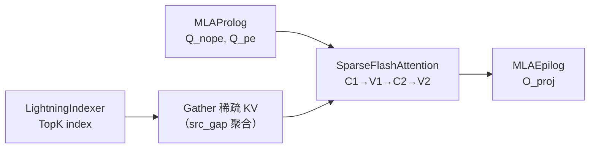

# Sparse Flash Attention Kernel

## Summary

`SparseFlashAttention` 是 DeepSeek-V3.2-Exp **DSA** 的主 Attention 算子 —— 在 [lightning-indexer](lightning_indexer.md) 产出的 TopK index 基础上，`Gather` 出稀疏 KV 子集并执行 Flash Attention 计算。沿用 [FlashAttention](https://arxiv.org/pdf/2307.08691) 的 `C_1 (Q@K^T) → V_1 (online softmax) → C_2 (P@V) → V_2 (rescale)` 四阶段流程，但面向**离散访存**进行了专门优化。模块语义见 [sparse-flash-attention](../modules/sparse_flash_attention.md)。

cann-recipes-infer 提供 AscendC + TileLang 两路实现；PyPTO 侧则作为 [deepseek-indexer-attention](deepseek_indexer_attention.md) 大融合算子内的子流程出现。

## Role In Pipeline



`models/deepseek-v3.2-exp/models/modeling_deepseek.py:L1409` —— 非量化路径入口：

```python
slc_fa_fusion, _, _ = torch_npu.npu_sparse_flash_attention(
 query=q_nope, key=k_nope, value=k_nope,
 sparse_indices=topk_indices, # 由 Lightning Indexer 产出
 scale_value=self.softmax_scale,
 actual_seq_lengths_query=actual_seq_qlen.to(torch.int32),
 actual_seq_lengths_kv=actual_seq_lengths_kv.to(torch.int32),
 block_table=block_table,
 sparse_block_size=1,
 layout_query='TND', layout_kv='PA_BSND',
 sparse_mode=3, attention_mode=2,
 query_rope=q_pe, key_rope=k_pe,
)
```

KV C8 量化路径改走 `torch_npu.npu_kv_quant_sparse_flash_attention`（`modeling_deepseek.py:L1402`），多出 `tile_size=128`、`rope_head_dim=64`、`key/value_quant_mode=2`、`quant_scale_repo_mode=1`。

## Performance Signals

### AscendC 实现

**算子 Tiling**（基本块 `(256, 512)`）：

- **L1 划分**：
 - Q / P 矩阵**分时复用**：`4×128×288×2B = 288 KB` —— $C_1$ 或 $C_2$ 阶段 Q/P 左矩阵分 4 次搬到 L1，一次迭代内常驻。Q 每次 `(128, 288)`，P 每次 `(128, 256)`。
 - K / V **3-Buffer 循环**：`3×128×288×2B = 216 KB`，K 每次 `(128, 288)`、V 每次 `(256, 128)`。
- L0A/L0B/L0C 均 Double Buffer（`2×32 KB / 2×32 KB / 2×64 KB`）；$C_1$ 搬 `(128, 96)` × `(96, 128)`，$C_2$ 搬 `(128, 128)` × `(128, 128)`。

**Pipeline 优化**：SFA 比 LI 多一个阶段（$C_1, V_1, C_2, V_2$），沿用 [AMLA](https://gitcode.com/ascend-tribe/ascend-inference-cluster/blob/d0c740d591da69d520145a57845914e7145e2137/OptimizedOps/AMLA-%E4%BB%A5%E5%8A%A0%E4%BB%A3%E4%B9%98%E7%9A%84%E9%AB%98%E6%80%A7%E8%83%BD%E6%98%87%E8%85%BEMLA%E7%AE%97%E5%AD%90.pdf) 算法除归一化外只有三个计算阶段，朴素排布会在 Cube/Vector 流上留大量空泡。**Preload 流水排布**消除依赖，除头尾外平台期 Cube 流完美掩盖 Vector 流。


*来源：[`docs/models/deepseek-v3.2-exp/figures/pipeline.png`](https://gitcode.com/cann/cann-recipes-infer/blob/2f82d10467e6fe8dae81c97a2cdac78d733a6703/docs/models/deepseek-v3.2-exp/figures/pipeline.png)（cann-recipes-infer @ 2f82d10）*

### 访存优化（离散访存专项）

**问题**：连续 Attention 的访存瓶颈是数据搬运本身；Sparse Attention 单次访存量小，**单次搬运耗时甚至低于指令下发耗时** —— 指令下发阻塞反而成为新的瓶颈。


*来源：[`docs/models/deepseek-v3.2-exp/figures/instruction_launch.png`](https://gitcode.com/cann/cann-recipes-infer/blob/2f82d10467e6fe8dae81c97a2cdac78d733a6703/docs/models/deepseek-v3.2-exp/figures/instruction_launch.png)（cann-recipes-infer @ 2f82d10）*

**两项对策**：

1. **Vector 核发射访存指令**：Attention 传统由 Cube 核发射访存，A3 Cube:Vector = 1:2 ——改由 Vector 发射**下发效率翻倍**。
2. **成对访存（srcGap）**：离散数据点两两聚合，用 [`srcGap`](https://www.hiascend.com/document/detail/zh/CANNCommunityEdition/83RC1alpha002/API/ascendcopapi/atlasascendc_api_07_0103.html#ZH-CN_TOPIC_0000002449889097__table9182515919) 参数一次搬入成对数据，提高单次访存的数据量从而提升带宽。


*来源：[`docs/models/deepseek-v3.2-exp/figures/stride.png`](https://gitcode.com/cann/cann-recipes-infer/blob/2f82d10467e6fe8dae81c97a2cdac78d733a6703/docs/models/deepseek-v3.2-exp/figures/stride.png)（cann-recipes-infer @ 2f82d10）*

### TileLang 实现

源码 `ops/tilelang/sparse_flash_attention.py`。


*来源：[`docs/models/deepseek-v3.2-exp/figures/tl-sparse-flash-attention.png`](https://gitcode.com/cann/cann-recipes-infer/blob/2f82d10467e6fe8dae81c97a2cdac78d733a6703/docs/models/deepseek-v3.2-exp/figures/tl-sparse-flash-attention.png)（cann-recipes-infer @ 2f82d10）*

示例 Shape：Q `[1, 128, 128, 576]`、K/V `[1, 32768, 1, 576]`、index `[1, 128, 1, 2048]`。**Block-Level 算法**（7 步）：

1. **查询块加载**：batch 和 seq_len_q 并行；num_heads 以 block_size=64 TP 切分。主块 `q_tile [64, 512]` + 尾部块 `q_tail_tile [64, 64]`（512 + 64 = 576，分主尾两段存储源于 head_dim 不是 2 的幂）。
2. **稀疏 KV 块收集**：对每个 q 位置按 `index` 取 TopK 中 `topk_tile=64` 个 token index，从全局 Gather 成 `kv_tile [64, 512]` + `kv_tail_tile [64, 64]`。
3. **Attention 分数计算**：`S_block = q_tile @ kv_tile.T [64, 64]`（清空 L0C）→ `S_block += q_tail_tile @ kv_tail_tile.T`（L0C 累加）。
4. **Online Softmax**：沿 `topk_tile` 维度（dim=-1）做分块稳定在线 softmax，维护最大值 `m` 和指数和 `l`。
5. **上下文向量**：`O_tile = P_block @ kv_tile [64, 512]`。
6. **循环累加与重缩放**：以 64 粒度遍历 TopK 完成主循环，循环结束后用 `(m, l)` 全局重缩放校正。
7. **写回 GM**。

Cube/Vector 协同通过 `T.set_cross_flag / T.wait_cross_flag` 实现。

## Optimization Notes

### SFA Next Feature

源文档显式列出："后续将探索 SparseFlashAttention 算子的**量化支持**以应对长上下文场景下显存占用过大的挑战"。当前 C8 量化通过 `npu_kv_quant_sparse_flash_attention` 分离算子，融合进一步优化是 roadmap。

### TilingKey 模板化与分核下沉

与 LI 一致 —— 采用 Tiling 模板编程（避免传统 TilingKey 数字编码不可读），并将**分核计算从 AICPU 下沉到 AICore 内部**消除 Tiling 依赖前序算子引入的调度开销（Attention 分核对 `actualSeqLengths` 有值依赖）。详见 [lightning-indexer](lightning_indexer.md) "Optimization Notes"。

### 相对 MTP 的表现

DSA 下 **MTP 对 SFA 难以加速** —— 每个 q token 单独选 TopK，MTP1 下 KV 搬运量翻倍。源文档在"MTP"章节给出对比表，SFA 的 KV 搬运 4.5 MB → 9 MB、Cube 计算 0.60 → 1.21 GFlops。见 [sparse-flash-attention](../modules/sparse_flash_attention.md)。

### Offload 协作

当 `enable_offload: True` 且 decode 阶段，SFA 的 `key/value` 指向由 [gather-selection-kv-cache](gather_selection_kv_cache.md) 预聚合的 `selection_kv_cache`（从 Host 搬回的 TopK KV），`block_table` 指向 `selection_kv_block_table`。具体代码见 `models/deepseek-v3.2-exp/models/modeling_deepseek.py:L1330-L1368`。

## Evidence

- [cann-recipes-infer](https://gitcode.com/cann/cann-recipes-infer/tree/2c45117d781ab9ab88dcb89a28ae30f5d2450399) — [`docs/models/deepseek-v3.2-exp/deepseek_v3.2_exp_ascendc_operator_guide.md`](https://gitcode.com/cann/cann-recipes-infer/blob/2f82d10467e6fe8dae81c97a2cdac78d733a6703/docs/models/deepseek-v3.2-exp/deepseek_v3.2_exp_ascendc_operator_guide.md)（SFA Tiling、Pipeline、访存优化、srcGap）
- [cann-recipes-infer](https://gitcode.com/cann/cann-recipes-infer/tree/2c45117d781ab9ab88dcb89a28ae30f5d2450399) — [`docs/models/deepseek-v3.2-exp/deepseek_v3.2_exp_tilelang_operator_guide.md`](https://gitcode.com/cann/cann-recipes-infer/blob/2f82d10467e6fe8dae81c97a2cdac78d733a6703/docs/models/deepseek-v3.2-exp/deepseek_v3.2_exp_tilelang_operator_guide.md)（TileLang SFA block-level 算法、内存层次）
- [cann-recipes-infer](https://gitcode.com/cann/cann-recipes-infer/tree/2c45117d781ab9ab88dcb89a28ae30f5d2450399) — [`models/deepseek-v3.2-exp/models/modeling_deepseek.py:L1340-L1412`](https://gitcode.com/cann/cann-recipes-infer/blob/2f82d10467e6fe8dae81c97a2cdac78d733a6703/models/deepseek-v3.2-exp/models/modeling_deepseek.py#L1340-L1412)（SFA / KV C8 SFA / Offload 路径入口）
- [cann-recipes-infer](https://gitcode.com/cann/cann-recipes-infer/tree/2c45117d781ab9ab88dcb89a28ae30f5d2450399) — [`docs/models/deepseek-v3.2-exp/deepseek_v3.2_exp_inference_guide.md`](https://gitcode.com/cann/cann-recipes-infer/blob/2f82d10467e6fe8dae81c97a2cdac78d733a6703/docs/models/deepseek-v3.2-exp/deepseek_v3.2_exp_inference_guide.md)（MTP 章节 SFA KV 搬运 4.5→9 MB / Cube 0.60→1.21 GFlops 对比表；KVCache C8 = 动态 Per-Token-Head-Tile-128 Int8 量化背景）

## Links

- [deepseek-v3.2-exp](../models/deepseek_v3_2_exp.md)
- [sparse-flash-attention](../modules/sparse_flash_attention.md)
- [lightning-indexer](../modules/lightning_indexer.md)
- [lightning-indexer](lightning_indexer.md)
- [gather-selection-kv-cache](gather_selection_kv_cache.md)
- [deepseek-indexer-attention](deepseek_indexer_attention.md)
- [ascendc](../frameworks/ascendc.md)
- [tilelang](../frameworks/tilelang.md)
- [kvcache-offload](../techniques/kvcache_offload.md)
- [sparse-attn-sharedkv](sparse_attn_sharedkv.md)（命名易混区分：SAS=V4 Shared-KV 统一 Attention 接口，本 SFA=V3.2-Exp DSA 稀疏主算子、为 SAS 谱系前身）
- [deepseek-v4](../models/deepseek_v4.md)
- [dsa](../modules/dsa.md)（DSA 架构模式，本 SFA 为其稀疏注意力路径的 kernel 落地）
- [sfag](../../../training/concepts/kernels/sfag.md)（跨域·训练：SFA 的训练反向算子 SFAG）
- [slig](../../../training/concepts/kernels/slig.md)（跨域·训练：Indexer 反向 SLIG（用 SFA softmax_max/sum））
- [custom-cp-dsa](../../../training/concepts/parallelism/custom_cp_dsa.md)（跨域·训练：DSA 自定义 CP）
- [deepseek-v32-pretrain](../../../training/guides/recipes/deepseek_v32_pretrain.md)（跨域·训练：DeepSeek-V3.2 32K 预训练）

<!-- cannbot:related:start -->
## 相关

- [Deepseek Indexer Attention Kernel](deepseek_indexer_attention.md)（`related`）：“`Deepseek Indexer Attention` (DIA) 是 cann-recipes-infer 用 **PyPTO** 实现的**大融合算子** —— 把 DSA 的 4 个相对独立子算子 MLAProlog + IndexerProlog + Lightning Indexer + Sparse Flash Attention 融合成单一 kernel，在整网范围内挖掘更大并行度、提升内存利用率。”与“cann-recipes-infer 提供 AscendC + TileLang 两路实现；PyPTO 侧则作为 ［deepseek-indexer-attention］(deepseek_indexer_attention.md) 大融合算子内的子流程出现。”分别给出两端正文事实；DIA 明确融合 Sparse Flash Attention，SFA 卡从另一端确认 PyPTO 实现正是 DIA 内部子流程，可据此追踪 TopK Gather 与 attention 阶段的融合边界。
- [Lightning Indexer Kernel](lightning_indexer.md)（`related`）：“DSA 计算链路：`MLAProlog + IndexerProlog → LightningIndexer → SparseFlashAttention → MLAEpilog`。LI 的输出是 TopK index 张量，SFA 据此 Gather 稀疏 KV；在长序列场景下 LI 的 TopK 排序成为主要热点。”；“`SparseFlashAttention` 是 DeepSeek-V3.2-Exp **DSA** 的主 Attention 算子 —— 在 ［lightning-indexer］(lightning_indexer.md) 产出的 TopK index 基础上，`Gather` 出稀疏 KV 子集并执行 Flash Attention 计算。”。LI 产出的 TopK index 被 SFA 直接消费为 Gather 索引，形成 V3.2 稀疏注意力的生产消费边。
- [SFA/DSA 稀疏注意力叠加 Context Parallel：跨 CP 组重建完整 KV 的 all_gather 路径](../../guides/experience/interventions/sfa_dsa_cp_cross_group_kv_allgather.md)（`related`）：- 但稀疏注意力/indexer 的取数逻辑是「按 `topk_indices` 从**全量 KV** 里 gather 若干 block」——它必须看到跨整个 CP 组的完整 KV 才能选对 block；。`SparseFlashAttention` 是 DeepSeek-V3.2-Exp **DSA** 的主 Attention 算子 —— 在 ［lightning-indexer］(lightning_indexer.md) 产出的 TopK index 基础上，`Gather` 出稀疏 KV 子集并执行 Flash Attention 计算。沿用 ［FlashAttention］(https://arxiv.org/pdf/2307.08691) 的 `C_1 (Q@K^T) → V_1 (online softmax) → C_2 (P@V) → V_2 (rescale)` 四阶段流程，但面向**离散访存**进行了专门优化。模块语义见 ［sparse-flash-attention］(../modules/sparse_flash_attention.md)。指南修复的跨 CP 全量 KV 重建正是该 SFA TopK Gather 在分片缓存上正确执行的前置条件。
- [SparseFlashAttention 950 Direct Invoke 算子知识](../../../../ops/ascendc/operators/direct/transformer/attention/sparse_flash_attention_950.md)（`related`）：“`TORCH_LIBRARY_FRAGMENT` 声明无版本后缀的 Direct schema，Meta 与 PrivateUse1 分别绑定 `sparse_flash_attention_meta` 和 `sparse_flash_attention_npu`。它不调用 `aclnnSparseFlashAttention`，而是将官方 950 arch35 `SFAMatmulService/SFAVectorService/SparseFlashAttentionKernelMla` 的当前实例转为显式 `<<<blocks,nullptr,stream>>>` launcher。固定版本是 CANN 9.1.0，目标架构是 DAV_3510/Ascend 950。”与“`SparseFlashAttention` 是 DeepSeek-V3.2-Exp **DSA** 的主 Attention 算子 —— 在 ［lightning-indexer］(lightning_indexer.md) 产出的 TopK index 基础上，`Gather` 出稀疏 KV 子集并执行 Flash Attention 计算。沿用 ［FlashAttention］(https://arxiv.org/pdf/2307.08691) 的 `C_1 (Q@K^T) → V_1 (online softmax) → C_2 (P@V) → V_2 (rescale)` 四阶段流程，但面向**离散访存**进行了专门优化。模块语义见 ［sparse-flash-attention］(../modules/sparse_flash_attention.md)。”。Direct 卡闭合 950 launcher 与 Kernel，概念卡给出该 SFA 消费 TopK KV 的模型算法角色。
- [稀疏/反量化 Attention 走非 Page-Attention 路径时 Q 与 KV 必须同布局（不一致 → host tiling GRAPH_FAILED）](../../optimizations/experience/rules/sfaa_nonpa_qkv_layout_constraint.md)（`related`）：约束落在本仓 SFAA 算子（`sparse_flash_attention_antiquant`，［sparse-flash-attention］(../../../concepts/kernels/sparse_flash_attention.md) 的 antiquant 变体，AscendC 实现）的 host 侧 tiling（`op_host/sparse_flash_attention_antiquant_tiling.cpp`，解析类 `SFAAInfoParser` / 校验类 `SFAATilingCheck`）：；`SparseFlashAttention` 是 DeepSeek-V3.2-Exp **DSA** 的主 Attention 算子 —— 在 ［lightning-indexer］(lightning_indexer.md) 产出的 TopK index 基础上，`Gather` 出稀疏 KV 子集并执行 Flash Attention 计算。。规则明确把受布局校验约束的 SFAA 标为 SparseFlashAttention 的 antiquant 变体，Kernel 卡则定义该稀疏注意力主算子的计算对象，二者共同界定变体的 host 布局入口与上层算子语义。
- [Sparse Flash Attention (SFA)](../modules/sparse_flash_attention.md)（`same_topic`）：SFA 作为架构概念是 DSA 的一部分；具体算子实现（AscendC / PyPTO / TileLang）见 ［sparse-flash-attention］(../kernels/sparse_flash_attention.md)。；`SparseFlashAttention` 是 DeepSeek-V3.2-Exp **DSA** 的主 Attention 算子 —— 在 ［lightning-indexer］(lightning_indexer.md) 产出的 TopK index 基础上，`Gather` 出稀疏 KV 子集并执行 Flash Attention 计算。。模块卡定义 SFA 架构语义，kernel 卡落实同一 SFA 的稀疏 KV 与 Flash Attention 实现。
<!-- cannbot:related:end -->
