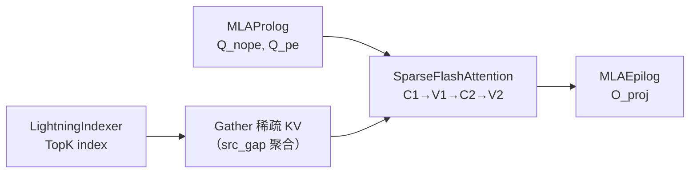

# Sparse Flash Attention Kernel

## Summary

`SparseFlashAttention` 是 DeepSeek-V3.2-Exp **DSA** 的主 Attention 算子 —— 在 [lightning-indexer](lightning_indexer.md) 产出的 TopK index 基础上，`Gather` 出稀疏 KV 子集并执行 Flash Attention 计算。沿用 [FlashAttention](https://arxiv.org/pdf/2307.08691) 的 `C_1 (Q@K^T) → V_1 (online softmax) → C_2 (P@V) → V_2 (rescale)` 四阶段流程，但面向**离散访存**进行了专门优化。模块语义见 [sparse-flash-attention](../modules/sparse_flash_attention.md)。

cann-recipes-infer 提供 AscendC + TileLang 两路实现；PyPTO 侧则作为 [deepseek-indexer-attention](deepseek_indexer_attention.md) 大融合算子内的子流程出现。

## Role In Pipeline



`models/deepseek-v3.2-exp/models/modeling_deepseek.py:L1409` —— 非量化路径入口：

```python
slc_fa_fusion, _, _ = torch_npu.npu_sparse_flash_attention(
 query=q_nope, key=k_nope, value=k_nope,
 sparse_indices=topk_indices, # 由 Lightning Indexer 产出
 scale_value=self.softmax_scale,
 actual_seq_lengths_query=actual_seq_qlen.to(torch.int32),
 actual_seq_lengths_kv=actual_seq_lengths_kv.to(torch.int32),
 block_table=block_table,
 sparse_block_size=1,
 layout_query='TND', layout_kv='PA_BSND',
 sparse_mode=3, attention_mode=2,
 query_rope=q_pe, key_rope=k_pe,
)
```

KV C8 量化路径改走 `torch_npu.npu_kv_quant_sparse_flash_attention`（`modeling_deepseek.py:L1402`），多出 `tile_size=128`、`rope_head_dim=64`、`key/value_quant_mode=2`、`quant_scale_repo_mode=1`。

## Performance Signals

### AscendC 实现（固定来源的 Atlas A3）

以下 L1/L0 划分、Tiling 与 Cube/Vector 流水均来自 A3 优化报告，不作为其他硬件的配置或收益保证。

**算子 Tiling**（基本块 `(256, 512)`）：

- **L1 划分**：
 - Q / P 矩阵**分时复用**：`4×128×288×2B = 288 KB` —— $C_1$ 或 $C_2$ 阶段 Q/P 左矩阵分 4 次搬到 L1，一次迭代内常驻。Q 每次 `(128, 288)`，P 每次 `(128, 256)`。
 - K / V **3-Buffer 循环**：`3×128×288×2B = 216 KB`，K 每次 `(128, 288)`、V 每次 `(256, 128)`。
- L0A/L0B/L0C 均 Double Buffer（`2×32 KB / 2×32 KB / 2×64 KB`）；$C_1$ 搬 `(128, 96)` × `(96, 128)`，$C_2$ 搬 `(128, 128)` × `(128, 128)`。

**Pipeline 优化**：SFA 比 LI 多一个阶段（$C_1, V_1, C_2, V_2$），沿用 [AMLA](https://gitcode.com/ascend-tribe/ascend-inference-cluster/blob/d0c740d591da69d520145a57845914e7145e2137/OptimizedOps/AMLA-%E4%BB%A5%E5%8A%A0%E4%BB%A3%E4%B9%98%E7%9A%84%E9%AB%98%E6%80%A7%E8%83%BD%E6%98%87%E8%85%BEMLA%E7%AE%97%E5%AD%90.pdf) 算法除归一化外只有三个计算阶段，朴素排布会在 Cube/Vector 流上留大量空泡。**Preload 流水排布**消除依赖，除头尾外平台期 Cube 流完美掩盖 Vector 流。


*来源：[`docs/models/deepseek-v3.2-exp/figures/pipeline.png`](../../../../../cann-recipes-raw/cann-recipes-infer/944d2d3ece86f7df33dbb0cb155c72ca619a9c66/docs/models/deepseek_v3_2_exp/figures/pipeline.png)（cann-recipes-infer @ 944d2d3）*

### 访存优化（A3 AscendC 离散访存实现）

**问题**：连续 Attention 的访存瓶颈是数据搬运本身；Sparse Attention 单次访存量小，**单次搬运耗时甚至低于指令下发耗时** —— 指令下发阻塞反而成为新的瓶颈。


*来源：[`docs/models/deepseek-v3.2-exp/figures/instruction_launch.png`](../../../../../cann-recipes-raw/cann-recipes-infer/944d2d3ece86f7df33dbb0cb155c72ca619a9c66/docs/models/deepseek_v3_2_exp/figures/instruction_launch.png)（cann-recipes-infer @ 944d2d3）*

**两项对策**：

1. **Vector 核发射访存指令**：Attention 传统由 Cube 核发射访存，A3 Cube:Vector = 1:2 ——改由 Vector 发射**下发效率翻倍**。
2. **成对访存（srcGap）**：离散数据点两两聚合，用 [`srcGap`](https://www.hiascend.com/document/detail/zh/CANNCommunityEdition/83RC1alpha002/API/ascendcopapi/atlasascendc_api_07_0103.html#ZH-CN_TOPIC_0000002449889097__table9182515919) 参数一次搬入成对数据，提高单次访存的数据量从而提升带宽。


*来源：[`docs/models/deepseek-v3.2-exp/figures/stride.png`](../../../../../cann-recipes-raw/cann-recipes-infer/944d2d3ece86f7df33dbb0cb155c72ca619a9c66/docs/models/deepseek_v3_2_exp/figures/stride.png)（cann-recipes-infer @ 944d2d3）*

### TileLang 实现

源码 `ops/tilelang/ds_v32/sparse_flash_attention.py`。


*来源：[`docs/models/deepseek-v3.2-exp/figures/tl-sparse-flash-attention.png`](../../../../../cann-recipes-raw/cann-recipes-infer/944d2d3ece86f7df33dbb0cb155c72ca619a9c66/docs/models/deepseek_v3_2_exp/figures/tl-sparse-flash-attention.png)（cann-recipes-infer @ 944d2d3）*

示例 Shape：Q `[1, 128, 128, 576]`、K/V `[1, 32768, 1, 576]`、index `[1, 128, 1, 2048]`。**Block-Level 算法**（7 步）：

1. **查询块加载**：batch 和 seq_len_q 并行；num_heads 以 block_size=64 TP 切分。主块 `q_tile [64, 512]` + 尾部块 `q_tail_tile [64, 64]`（512 + 64 = 576，分主尾两段存储源于 head_dim 不是 2 的幂）。
2. **稀疏 KV 块收集**：对每个 q 位置按 `index` 取 TopK 中 `topk_tile=64` 个 token index，从全局 Gather 成 `kv_tile [64, 512]` + `kv_tail_tile [64, 64]`。
3. **Attention 分数计算**：`S_block = q_tile @ kv_tile.T [64, 64]`（清空 L0C）→ `S_block += q_tail_tile @ kv_tail_tile.T`（L0C 累加）。
4. **Online Softmax**：沿 `topk_tile` 维度（dim=-1）做分块稳定在线 softmax，维护最大值 `m` 和指数和 `l`。
5. **上下文向量**：`O_tile = P_block @ kv_tile [64, 512]`。
6. **循环内在线重缩放**：每个 TopK 块先计算 exp(m_old−m_new)，同步缩放旧 sumexp 与 acc_o，再累加当前块的指数和与 P@V。循环结束只做 acc_o / sumexp 归一化，不能先直接累加各块输出再在末尾统一校正。这里按固定源码细化了 TileLang 指南的概述。
7. **写回 GM**。

Cube/Vector 协同通过 `T.set_cross_flag / T.wait_cross_flag` 实现。

## Optimization Notes

### 当前 C8 与 packed 路径

当前 C8 已由 npu_kv_quant_sparse_flash_attention 接入；不能把量化支持继续写作尚待实现。C8 Query 拼接 q_nope/q_pe，key/value_quant_mode=2、tile_size=128、rope_head_dim=64、quant_scale_repo_mode=1；它直接返回输出 Tensor，BF16 npu_sparse_flash_attention 返回三项。Query 为 TND，LI索引为 [T,1,K]。

Offload Decode 的 selected cache/status/table 按实际 token_num 截取，稀疏索引超过有效选择长度填-1。KV管理由 CacheEntry/OffloadWorkspaceSpec 负责，不能直接运行旧函数中的固定 batch 申请。当前数学、A3 技术报告的 Tiling/离散访存和 TileLang block循环仍成立，均不作为整网复测结果。

### TilingKey 模板化与分核下沉

与 LI 一致 —— 采用 Tiling 模板编程（避免传统 TilingKey 数字编码不可读），并将**分核计算从 AICPU 下沉到 AICore 内部**消除 Tiling 依赖前序算子引入的调度开销（Attention 分核对 `actualSeqLengths` 有值依赖）。详见 [lightning-indexer](lightning_indexer.md) "Optimization Notes"。

### 相对 MTP 的表现

搬运与计算量对照见[DSA 模块分析案例](../../optimizations/cases/mtp_benefit_sparse_attention_and_latency_metric.md)。它不是独立测量的整网收益，不能推出所有 SFA 场景均无收益。

### Offload 协作

当 `enable_offload: True` 且 decode 阶段，SFA 的 `key/value` 指向由 [gather-selection-kv-cache](gather_selection_kv_cache.md) 预聚合的 `selection_kv_cache`（从 Host 搬回的 TopK KV），`block_table` 指向 `selection_kv_block_table`。具体代码见 `models/deepseek-v3.2-exp/models/modeling_deepseek.py:L1330-L1368`。

## Evidence

- [deepseek_v3.2_exp_ascendc_operator_guide.md](../../../../../cann-recipes-raw/cann-recipes-infer/944d2d3ece86f7df33dbb0cb155c72ca619a9c66/docs/models/deepseek_v3_2_exp/deepseek_v3.2_exp_ascendc_operator_guide.md)（primary）
- [modeling_deepseek.py](../../../../../cann-recipes-raw/cann-recipes-infer/944d2d3ece86f7df33dbb0cb155c72ca619a9c66/models/deepseek_v3_2_exp/models/modeling_deepseek.py)（implementation）
- [sparse_flash_attention.py](../../../../../cann-recipes-raw/cann-recipes-infer/944d2d3ece86f7df33dbb0cb155c72ca619a9c66/ops/tilelang/ds_v32/sparse_flash_attention.py)（implementation）

## Links

- [deepseek-v3.2-exp](../models/deepseek_v3_2_exp.md)
- [sparse-flash-attention](../modules/sparse_flash_attention.md)
- [lightning-indexer](../modules/lightning_indexer.md)
- [lightning-indexer](lightning_indexer.md)
- [gather-selection-kv-cache](gather_selection_kv_cache.md)
- [deepseek-indexer-attention](deepseek_indexer_attention.md)
- [ascendc](../frameworks/ascendc.md)
- [tilelang](../frameworks/tilelang.md)
- [kvcache-offload](../techniques/kvcache_offload.md)
- [sparse-attn-sharedkv](sparse_attn_sharedkv.md)（命名易混区分：SAS=V4 Shared-KV 统一 Attention 接口，本 SFA=V3.2-Exp DSA 稀疏主算子、为 SAS 谱系前身）
- [deepseek-v4](../models/deepseek_v4.md)
- [dsa](../modules/dsa.md)（DSA 架构模式，本 SFA 为其稀疏注意力路径的 kernel 落地）
- [sfag](../../../training/concepts/kernels/sfag.md)（跨域·训练：SFA 的训练反向算子 SFAG）
- [slig](../../../training/concepts/kernels/slig.md)（跨域·训练：Indexer 反向 SLIG（用 SFA softmax_max/sum））
- [custom-cp-dsa](../../../training/concepts/parallelism/custom_cp_dsa.md)（跨域·训练：DSA 自定义 CP）
- [deepseek-v32-pretrain](../../../training/guides/recipes/deepseek_v32_pretrain.md)（跨域·训练：DeepSeek-V3.2 32K 预训练）
