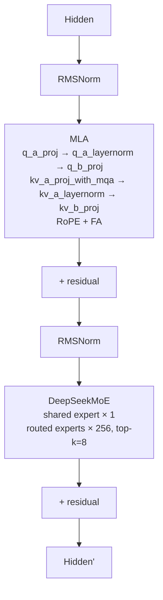
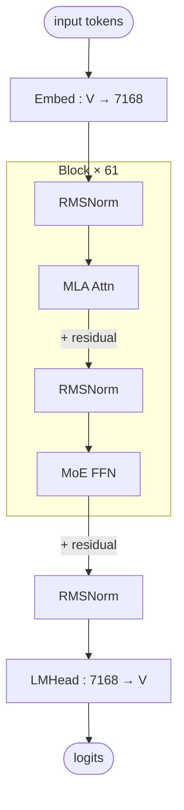

# DeepSeek-R1

## Summary

DeepSeek-R1 是 2025 年 DeepSeek 开源的大语言模型，结构沿用 DeepSeek-V3 —— MLA (Multi-head Latent Attention) + DeepSeekMoE（1 个 shared expert + 256 个 routed expert，top-k=8）。在 cann-recipes-infer 中基于 DeepSeek HuggingFace [modeling_deepseek.py](https://huggingface.co/deepseek-ai/DeepSeek-V3-Base/blob/afb92e1fa402c2be2a9eb085312bb02e0384d6c7/modeling_deepseek.py) 迁移到昇腾 Atlas A3，通过自研 `executor/` 推理框架（非 SGLang/vLLM）承载，与 Kimi-K2 / [kimi-k2-thinking](kimi_k2_thinking.md) 共享同一套 `models/deepseek_r1/models/modeling_deepseek.py` 代码路径（Kimi-K2-Thinking 的 `runner_deepseek.py` 直接复用）。

本实践覆盖 Prefill 与 Decode 两阶段的端到端优化：Prefill 采用 MLA-DP/SP-TP-SP 混合切分、MoE Double-Routing、micro-batch 双流、weightNZ、TND/NTD 布局优化；Decode 采用大 EP（128EP）部署、MLA 融合算子（`npu_mla_prolog_v3` + `npu_fused_infer_attention_score_v2`）、MoE 融合算子、torchair 图模式、SuperKernel、MTP1 投机推理。

### Highlights

- **Prefill**：MLA-DP32 + MoE-EP32 + micro-batch 在 Atlas A3 2 机 16 卡环境下，64 × 4K 输入、perfect eplb 条件下达到 **6522 tokens/卡/s**，相比无 micro-batch 提升 25%。
- **Decode**：W8A8C8 量化、128 卡、4K seq、global batch 6144、MTP1（平均 accept 0.7 token/draft）、perfect eplb 条件下 TPOT **44.9 ms**、吞吐 **2138 tokens/p/s**。
- **关键算子**：`npu_mla_prolog_v3` 融合 MLA 前置 Q/K/V Linear + RMSNorm + RoPE + KVCache 写入；`npu_fused_infer_attention_score_v2` 融合 FA 计算路径；`npu_moe_init_routing_v2` / `npu_moe_re_routing` / `npu_moe_finalize_routing` 覆盖 MoE 排序与 finalize；`npu_grouped_matmul` 覆盖 Grouped FFN。
- **量化**：支持 BF16 / W8A8C16 / **W8A8C8**（仅 R1 支持，Kimi-K2 不支持 C8）。见 [w8a8c8](../quantization/w8a8c8.md)。
- **新增性能特性**：[double-routing](../techniques/double_routing.md)、[prefill-micro-batch](../techniques/prefill_micro_batch.md)、[sp-tp-sp](../parallelism/sp_tp_sp.md)、[weight-nz](../techniques/weight_nz.md)、[superkernel](../techniques/superkernel.md)、[mtp-speculative-decoding](../techniques/mtp_speculative_decoding.md)。

## Architecture And Serving Traits

### Transformer Block 结构



### MLA (Multi-head Latent Attention)

低秩 KV 压缩，显著降低 KVCache 占用。Q 侧通过 `q_a_proj → q_a_layernorm → q_b_proj` 实现 low-rank→full-rank 的两级投影，KV 侧通过 `kv_a_proj_with_mqa → kv_a_layernorm → kv_b_proj` 压缩到 `kv_lora_rank`（通常 512）并 MQA 共享。RoPE 仅作用于 `qk_rope_head_dim` 通道。详见 [mla](../modules/mla.md)。

### MoE 结构

每层包含：

- **1 个 shared expert**：所有 token 都经过，提供稳定信号。
- **256 个 routed experts**：通过 `gate` + `topk=8` 选择，仅激活部分专家。
- **gate** 输出 `topk_idx` + `topk_weight`；在 Decode 使用 `npu_moe_gating_top_k` 融合算子。
- EP 部署下每卡分到 `256 / ep_size` 个 routed expert + 同时存放一个 shared expert 的完整副本。

### 支持的规格

根据 `config/*.yaml` 实际提供的部署方案：

| 阶段 | 配置文件 | world_size | 并行 | 量化 | 备注 |
| ---- | ------- | ---------- | ---- | ---- | ---- |
| Prefill | `prefill_r1_rank_32_32dp_32ep_a8w8.yaml` | 32 (2 机) | MLA-DP32 + MoE-EP32 | W8A8 | `micro_batch_mode: 1`（DP+EP），`moe_chunk_max_len: 65536` |
| Decode | `decode_r1_rank_16_16ep_a8w8.yaml` | 16 (1 机) | MLA-DP16 + MoE-EP16 | W8A8 | `npugraph_ex`（ACL Graph 图模式），无 MTP，小规模/调试用 |
| Decode | `decode_r1_rank_16_16tp_a8w8.yaml` | 16 (1 机) | MLA-TP16 + MoE-TP16 | W8A8 | `moe_tp_size > 1`，走 `moe_infer_tp` 路径 |
| Decode | `decode_r1_rank_128_128ep_a8w8.yaml` | 128 (16 机) | MLA-DP128 + MoE-EP128 | W8A8 | `ge_graph`，大 EP 部署 |
| Decode | `decode_r1_rank_128_128ep_a8w8c8_mtp.yaml` | 128 | DP128 + EP128 | **W8A8C8** | `next_n: 1`（MTP1）+ SuperKernel |
| Decode | `decode_r1_rank_128_128ep_a8w8c8_mtp_benchmark.yaml` | 128 | DP128 + EP128 | W8A8C8 | Benchmark 配置，`force_eplb: True`、`prefill_mini_batch: 1` |
| Decode | `decode_r1_rank_128_128ep_a8w8c8_mtp_longseq.yaml` | 128 | DP128 + EP128 | W8A8C8 | 长序列专用 |

> 注：`attn_tp_size / dense_tp_size / moe_tp_size = 1` 表示 MLA 与 MoE 均以 DP 方式部署每卡完整权重；`embed_tp_size / lmhead_tp_size` 控制 embedding / lm_head 的 TP 切分。

### 权重类型

通过 `utils/weight_convert.sh` 离线转换：

```bash
# BF16（R1/K2）
bash utils/weight_convert.sh --input_fp8_hf_path ... --output_hf_path ... --quant_mode bfloat16
# W8A8C16（R1/K2）
bash utils/weight_convert.sh ... --quant_mode w8a8c16
# W8A8C8（仅 R1）
bash utils/weight_convert.sh ... --quant_mode w8a8c8
```

## Known Optimizations

### Prefill 阶段

以下四大块优化组合使用，综合提升 prefill 吞吐。

#### MLA 部署策略

Prefill 的 MLA 部分可选两种策略，按请求分布与序列长度决定：

- **纯 DP 策略**：每卡部署完整模型权重，不做切分。KV-Cache 按请求分卡、无冗余；MLA 内无通信算子，易于用满算力。**适合**请求量大 / KV-Cache 占用高的高吞吐场景。缺点：短序列混合批次下计算负载不均；请求数 < 卡数时 TTFT 被拉长。
- **SP-TP-SP 混合切分**：把 batch 与 seq_len 合轴后按卡数 SP 切 token，FA 内切 head（TP），完成后 AllToAll 转回 SP 给 o_proj。**适合**单请求长序列或请求数少/分布不均、对 TTFT 敏感的场景。引入 AllGather/AllToAll 通信，且每卡存完整 KV-Cache。详见 [sp-tp-sp](../parallelism/sp_tp_sp.md)。

判断原则来自源文档："当请求量较大或 KVCache 内存占用较高时，可以考虑采用 DP 切分策略，以提升吞吐量；当请求数量较少、分布不均匀或单次请求序列长度较长时，可以考虑采用 SP-TP-SP 混合切分策略，以降低时延。"

#### MoE Double-Routing (EP)

MoE 阶段走 EP，路由专家均匀分布到每张卡，同时每卡同步存放 shared expert。采用 **Double-Routing**：每卡完成 2 次 init-routing + 2 次 finalize-routing，通过 `tokens_per_expert` 的 AllToAll+ReduceSum 推导 `input_splits` / `output_splits`，再执行 token AllToAll。完整 8 步流程与代码见 [double-routing](../techniques/double_routing.md)。

相对 AllGather 方案：

1. 负载均衡时峰值显存更低（无数据冗余）；
2. 通信量更低，AllToAll 耗时更优。

#### TND / NTD 布局

常规 FA 用 BNSD `[batch, num_head, seq_len, head_dim]`，但 Prefill 输入长度不定时必须 padding 导致浪费。TND `[batch*seq_len, num_head, head_dim]` 合轴消除 padding，但 FA 计算时数据访问不连续、带宽效率低，且需要 transpose 额外开销。

实际 **MLA 阶段 FA 采用 NTD 布局**（`[num_head, batch*seq_len, head_dim]` 形变等价），带宽更友好，同时配合 matmul 权重拆分 + FA 支持独立的 NoPE/RoPE 输入，可以完全消除 split/concat/transpose 开销。**实测 FA 效率相对 TND 提升 15%**。源代码在不同 FA 调用点用两种布局串表达该约定：`input_layout="NTD_TND"`（`modeling_deepseek.py:1038`，即下图所示的 Attention NTD 排布）与 `input_layout="TND_NTD"`（`:1164/:1284`），分别对应不同 FA 调用阶段的数据排布——二者并存、非矛盾（下图展示 `NTD_TND` 一例）。

Attention 阶段 NTD 排布的数据布局原貌如下：


*来源：[`docs/models/deepseek-r1/figures/image_attention_ntd_format.png`](https://gitcode.com/cann/cann-recipes-infer/blob/2f82d10467e6fe8dae81c97a2cdac78d733a6703/docs/models/deepseek-r1/figures/image_attention_ntd_format.png)（cann-recipes-infer @ 2f82d10）*

#### Micro-batch 双流

Prefill 属于 compute-bound + 30% 通信占比场景。将输入拆成 2 个 micro-batch，主/副 NPU stream 上交错排布 **atten / init_routing / dispatch / mlp / combine / finalize_routing** 6 个阶段，使 dispatch 与 combine 的 AllToAll 完全被计算掩盖。开启后 A3 2 机 16 卡 64×4K 输入性能对比：

| 切分策略 | 时延 (ms) | 总吞吐 (tokens/s) | 平均吞吐 (tokens/卡/s) |
| ---- | ---- | ---- | ---- |
| MLA-DP32 + MoE-EP32 | 3128 | 83805 | 5237 |
| + micro-batch | 2512 | 104356 | **6522** |

约束：计算和通信线性度要好；非 host-bound；通信必须走默认 SDMA 模式（`HCCL_OP_EXPANSION_MODE` 若为 AIV 会与计算争硬件资源，反而变慢）。详见 [prefill-micro-batch](../techniques/prefill_micro_batch.md)。

由 `micro_batch_mode` 控制（0: 关；1: DP+EP；2: SP+TP+EP）。

#### weightNZ 格式

所有 matmul 权重转换为昇腾亲和的 **weightNZ**（512B 对齐），显著提升带宽访问效率。例如 int8 [16384, 7168] 转为 NZ 布局 [224, 1024, 16, 32]。见 [weight-nz](../techniques/weight_nz.md)。由 YAML `enable_weight_nz: True` 使能。

### Decode 阶段

#### 通用优化

非 MoE 部分与 Llama 类似：固定 KV Cache 大小、cos/sin 优化、AddRMSNorm 融合、全量优化 LM Head 计算量等。

#### MLA 低秩压缩 + 融合算子

参考 [DeepSeek 论文](https://arxiv.org/pdf/2405.04434) 的低秩压缩方法以减少 KVCache 内存。核心是两个融合算子：

- **`npu_mla_prolog_v2` / `v3`**：替换 Attention 计算前的 Q/K/V Linear、RoPE、RmsNorm、KVCache 更新。`forward_page_attention_mla_prolog` 函数，`enable_mla_prolog: True` 使能。见 [mla-prolog](../kernels/mla_prolog.md)。
- **`npu_fused_infer_attention_score_v2`**：加速 MLA 的 FA 主体计算，`input_layout="TND_NTD"`。见 [fused-infer-attention-score](../kernels/fused_infer_attention_score.md)。

关键代码片段（`models/deepseek_r1/models/modeling_deepseek.py:L1216`）：

```python
q_nope, q_pe, dequant_scale_q_nope, _, _ = torch.ops.npu.npu_mla_prolog_v3(
 token_x=hidden_states_int8 if enable_mm_quant_a8w8 else hidden_states,
 weight_dq=self.q_a_proj.weight, weight_uq_qr=self.q_b_proj.weight,
 weight_uk=self.kv_b_proj_w_k, weight_dkv_kr=self.kv_a_proj_with_mqa.weight,
 rmsnorm_gamma_cq=self.q_a_layernorm.weight,
 rmsnorm_gamma_ckv=self.kv_a_layernorm.weight,
 rope_sin=sin.squeeze(1), rope_cos=cos.squeeze(1),
 cache_index=cache_index, kv_cache=nope_cache, kr_cache=rope_cache,
 # ...
 cache_mode="PA_NZ",
 weight_quant_mode=2 if enable_mm_quant_a8w8 else 0, # 0/1/2/3
 kv_cache_quant_mode=1 if self.kv_cache_quant_mode == "int8" else 0, # per-tensor int8
 query_quant_mode=1 if enable_mm_quant_a8w8 and self.kv_cache_quant_mode == "int8" else 0,
)
```

`weight_quant_mode` / `kv_cache_quant_mode` / `query_quant_mode` 共同覆盖 BF16、W8A8、W8A8C8 三种配置。

#### MoE EP + 融合算子

原始 for-loop 遍历 `expert_num` 个 FFN 效率低，CANN 提供一系列融合算子：

- **Router**：`torch_npu.npu_moe_gating_top_k` — 对 router 结果排序并取 top-k。
- **专家计算**：`torch_npu.npu_grouped_matmul` — 同时处理多个专家的计算，A8 路径额外传入 `pertoken_scale`。
- **多卡通信**：`torch_npu.npu_moe_distribute_dispatch_v2` / `npu_moe_distribute_combine_v2` — EP 并行下多卡间 dispatch/combine（一体化融合算子，见 [moe-dispatch-combine-v2](../techniques/moe_dispatch_combine_v2.md)）。需注意 `HCCL_BUFFSIZE` 等环境变量。

#### MLP 线性层合并

原始 `DeepseekV3MLP` 有 `gate_proj` / `up_proj` / `down_proj` 三个 matmul，**合并 `gate_up_proj` = cat(gate_proj, up_proj)** 单次 matmul 提升整体计算效率。shared expert 的 `gate_up_proj` 在多流路径上与 dispatch AllToAll 并行。

#### TorchAir 图模式

Decode 时延敏感，eager 下 host 下发常成为瓶颈。TorchAir 提供昇腾亲和的 `torch.compile` 后端：

- `exe_mode: "ge_graph"` → **max-autotune**（GE 图模式，最激进优化）；
- `exe_mode: "npugraph_ex"` → **reduce-overhead**（ACL Graph 模式，开销更低）。

YAML `exe_mode` 切换。详见 [torchair](../frameworks/torchair.md)。

#### MTP

`next_n` 参数使能 MTP。实现细节与 GDN 类模型不同——R1 的 MLA 端 MTP 主要通过 `sparse_mode` 切换 FA 的 mask 行为（`q_len > 1` 时 `sparse_mode = 3`），KV 按 `speculative_num_draft_tokens` 布局。详见 [mtp-speculative-decoding](../techniques/mtp_speculative_decoding.md)。

#### 集合通信 AIV 展开

Decode 阶段 MoE AllToAll 量小，可以借 Vector Core 加速通信：

```shell
export HCCL_OP_EXPANSION_MODE=AIV
```

> 注意：此开关与 Prefill micro-batch 策略冲突（AIV 占用计算资源会破坏计算/通信重叠），不可同开。

#### SuperKernel

在 `ge_graph` 图模式下支持按用户范围将计算子图融合为 SuperKernel，降低任务调度等待和开销。示例整个 decode layer 全部进入一个 SuperKernel scope：

```python
from executor.utils import superkernel_scope

switch = enable_superkernel
scope = f"scope_name"
options = f"scope_options"
with superkernel_scope(switch, scope, options):
 your modules
```

YAML `enable_superkernel: True`。详见 [superkernel](../techniques/superkernel.md)。

### 长序列 OOM 处理

Prefill 峰值显存主要来自 Attention softmax 中间（`batch_size * num_head * q_s * kv_s * 6 Bytes`）与 MoE 负载不均时 grouped_matmul 的临时内存。缓解手段：

1. **Paged Attention + FA**：切块计算 Attention，避免 `q_s * kv_s` 峰值，YAML `enable_pa: True` + `pa_block_size: 128`。R1 的 MLA `nope_cache` / `rope_cache` 以 `FullAttention` 类型纳入框架级 [kv-cache-manager](../frameworks/kv_cache_manager.md) 的分块管理（在线按剩余显存预算折算 block 数、`is_mla_backend=True` 用于 PD 单 rank 传输）。
2. **prefill_mini_batch 串行**：当 decode global batch 大到 prefill OOM 时，`prefill_mini_batch > 1` 多次小 batch 串行。
3. **Chunk MoE**：MoE 维度切 chunk 串行 (`moe_chunk_max_len`)，代价是 prefill 吞吐下降。源码（`modeling_deepseek.py:L755`）：

```python
if bs_qlen > self.moe_chunk_max_len: # need to chunk moe seq_len dim to avoid OOM
 num_chunks = (bs_qlen + self.moe_chunk_max_len - 1) // self.moe_chunk_max_len
 # ... chunked serial MoE
```

## Benchmark

基于 Atlas A3，`config/decode_r1_rank_128_128ep_a8w8c8_mtp_benchmark.yaml`，W8A8C8：

| Quant Mode | Global Batch Size | Seq Length | Chips | TPOT (ms) | Throughput (tokens/p/s) |
| ---- | ---- | ---- | ---- | ---- | ---- |
| W8A8C8 | 6144 | 4096 | 128 | 44.9 | 2138 |

> 注：性能数据基于 MTP1 与 perfect eplb 配置采集，平均 1 个 draft token 中 accept token 为 0.7 个。
>
> `README.md` 与 `docs/models/deepseek-r1/deepseek_r1_decode_optimization.md` 对同一 benchmark 分别标注 Chips=64 与 Chips=128，存疑。配合配置文件 `world_size: 128` 判断 128 为正确值，README 表头的 64 可能是笔误，暂以 128 为主。

Prefill benchmark（Atlas A3 2 机 16 卡，64×4K 输入，perfect eplb）：

| 切分策略 | 时延 (ms) | 总吞吐 (tokens/s) | 平均吞吐 (tokens/卡/s) |
| ---- | ---- | ---- | ---- |
| MLA-DP32 + MoE-EP32 | 3128 | 83805 | 5237 |
| + micro-batch | 2512 | 104356 | 6522 |

> 注：docs 使用 "DP32/EP32" 而 README 与 prefill YAML 为 `world_size: 32`，一致，但 prefill 环境描述为 "2 机 16 卡"——数字 16 与 32 不一致，以 DP32/EP32（32 卡）为准。源文档同段存在数字不自洽，待验证。

## 架构图（stock HF 基线）

DeepSeek-R1 的 **stock HuggingFace 模型级架构**（部署前基线，拓扑按 HF `DeepseekV3ForCausalLM` modeling 整理，与 cann-recipes-infer @2c45117 自带 `configuration_deepseek.py` 默认值逐项一致）。R1 复用 DeepSeek-V3 的架构类（同 `architectures=DeepseekV3ForCausalLM`、`model_type=deepseek_v3`），故此基线即 V3/R1 共用拓扑。该模型级架构与昇腾 Atlas A3 部署优化（MLA-Prolog 融合、Double-Routing、micro-batch、量化、TorchAir 等）互补：一者描述「模型长什么样」，另一者描述「在 NPU 上怎么跑」。溯源见 [`deepseek-ai/DeepSeek-V3/config.json`](https://huggingface.co/deepseek-ai/DeepSeek-V3/blob/e815299b0bcbac849fa540c768ef21845365c9eb/config.json)。

> 此为模型级整图（input → embed → 61 个 block → 末层 RMSNorm → LMHead）；[Transformer Block 结构](#transformer-block-结构) 给出的是单个 block 内部（RMSNorm → MLA → MoE → 残差）的细节流程，两者层级互补、不冲突。



> 说明：Layer 1–3 使用 dense FFN，Layer 4–61 使用 MoE（config `first_k_dense_replace=3`）；图中只画了 MoE 路径（常见情形），前 3 层的 dense-FFN 替换未单独绘制。

关键参数（仅保留对部署有意义的行，取自 HF config）：

| 模块 | 参数 | 值 |
| ---- | ---- | ---- |
| — | n_layers | 61 |
| — | hidden | 7168 |
| — | vocab | 129280 |
| MLA | n_heads | 128 |
| MLA | q_lora_rank | 1536 |
| MLA | kv_lora_rank | 512 |
| MLA | qk_nope_head_dim | 128 |
| MLA | qk_rope_head_dim | 64 |
| MLA | v_head_dim | 128 |
| MoE | n_routed_experts | 256 |
| MoE | n_shared_experts | 1 |
| MoE | top_k | 8 |
| MoE | moe_intermediate | 2048 |
| MoE | dense_layers | 1–3 only |

其中 `kv_lora_rank=512`、`q_lora_rank=1536` 是 MLA 低秩压缩的两级 latent 维度（KVCache 仅存 `c_KV`=512 + 单份共享 `k_rope`=64），与 [MLA 低秩压缩 + 融合算子](#mla-低秩压缩--融合算子) 一节中 `npu_mla_prolog_v3` 的 Q/K/V 投影路径对应；`n_routed_experts=256` / `n_shared_experts=1` / `top_k=8` 与 [MoE 结构](#moe-结构) 一节一致。MLA 结构细节见 [mla](../modules/mla.md)，平台见 [atlas-a3](../platforms/atlas_a3.md)。

## Evidence

- [cann-recipes-infer](https://gitcode.com/cann/cann-recipes-infer/tree/2c45117d781ab9ab88dcb89a28ae30f5d2450399) — [`docs/models/deepseek-r1/deepseek_r1_prefill_optimization.md`](https://gitcode.com/cann/cann-recipes-infer/blob/2f82d10467e6fe8dae81c97a2cdac78d733a6703/docs/models/deepseek-r1/deepseek_r1_prefill_optimization.md)（Prefill 优化主文档：MLA-DP/SP-TP-SP、Double-Routing、NTD、micro-batch、weightNZ）；`docs/models/deepseek-r1/deepseek_r1_decode_optimization.md`（Decode 优化主文档：通用优化、MLA 融合算子、MoE EP 融合算子、MLP 合并、TorchAir、MTP、AIV、SuperKernel、Benchmark）。
- [cann-recipes-infer](https://gitcode.com/cann/cann-recipes-infer/tree/2c45117d781ab9ab88dcb89a28ae30f5d2450399) — [`models/deepseek_r1/README.md`](https://gitcode.com/cann/cann-recipes-infer/blob/2f82d10467e6fe8dae81c97a2cdac78d733a6703/models/deepseek_r1/README.md)（环境部署、权重转换、Benchmark、长序列 OOM 处理）；`models/deepseek_r1/config/*.yaml`（Prefill/Decode 各规模量化部署配置）；`models/deepseek_r1/models/modeling_deepseek.py`（`DeepseekV3Attention.forward_page_attention_mla_prolog`、`DeepseekV3MoE.forward_*`、`DeepseekV3Model.forward_microbatch_v1/v2`、SuperKernel scope 入口）；`models/deepseek_r1/utils/convert_model.py`（FP8 → BF16 / W8A8C16 / W8A8C8 权重转换）。

## Links

- [atlas-a3](../platforms/atlas_a3.md)
- [torchair](../frameworks/torchair.md)
- [ascendc](../frameworks/ascendc.md)
- [kv-cache-manager](../frameworks/kv_cache_manager.md)
- [mla](../modules/mla.md)
- [mla-prolog](../kernels/mla_prolog.md)
- [fused-infer-attention-score](../kernels/fused_infer_attention_score.md)
- [tensor-parallel](../parallelism/tensor_parallel.md)
- [expert-parallel](../parallelism/expert_parallel.md)
- [data-parallel](../parallelism/data_parallel.md)
- [double-routing](../techniques/double_routing.md)
- [moe-dispatch-combine-v2](../techniques/moe_dispatch_combine_v2.md)
- [prefill-micro-batch](../techniques/prefill_micro_batch.md)
- [sp-tp-sp](../parallelism/sp_tp_sp.md)
- [weight-nz](../techniques/weight_nz.md)
- [superkernel](../techniques/superkernel.md)
- [mtp-speculative-decoding](../techniques/mtp_speculative_decoding.md)
- [moe-multi-stream](../techniques/moe_multi_stream.md)
- [multi-stream](../techniques/multi_stream.md)（多流总纲：R1 是 decode 共享/路由专家 Cube↔Vector 互补 + prefill micro-batch 双流的代表样例）
- [w8a8c8](../quantization/w8a8c8.md)
- [deepseek-r1-rl](../../../training/guides/recipes/deepseek_r1_rl.md)（跨域·训练：R1 在 A3 128 卡的 veRL+MindSpeed+vLLM-Ascend 全共卡 GRPO RL 后训练，120+ TPS/卡；本推理部署是其训练目标模型）
- [grpo-dapo](../../../training/concepts/techniques/grpo_dapo.md)（跨域·训练：R1 RL 用 GRPO 算法）
- [eplb](../../../training/concepts/techniques/eplb.md)（跨域·训练：EPLB(DeepSeek 提出的专家并行负载均衡器)）