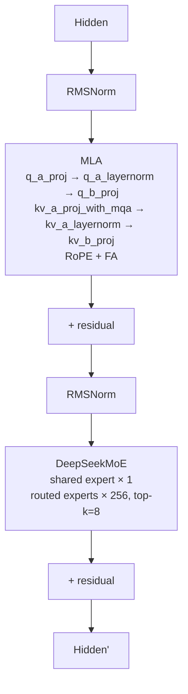

# DeepSeek-R1

## Summary

DeepSeek-R1 沿用 DeepSeek-V3 的 MLA + DeepSeekMoE 架构：低秩 KV 压缩、1个共享专家与256个路由专家、top-k=8。

本卡保留网络结构及其状态机制。R1 与 Kimi-K2-Thinking 的架构思路同源，但当前两者都接统一Executor，但模型建模仍为独立适配文件，不再表述为共用同一 modeling_deepseek.py。平台配置、开关和验收步骤见[模型部署流程](../../guides/models/deepseek_r1_deployment.md)，此处只保留模型机制。

## Architecture And Serving Traits

### Transformer Block 结构

### MLA (Multi-head Latent Attention)

低秩 KV 压缩，显著降低 KVCache 占用。Q 侧通过 `q_a_proj → q_a_layernorm → q_b_proj` 实现 low-rank→full-rank 的两级投影，KV 侧先由 kv_a_proj_with_mqa 生成 kv_lora_rank 压缩 KV 与独立 RoPE 键分量，仅对压缩 KV 做 kv_a_layernorm；kv_b_proj 再将压缩表示上投影为各头 K/V。共享的是压缩缓存与 RoPE 键分量，展开后的各头 K/V 不是 MQA 共享缓存。RoPE 仅作用于 `qk_rope_head_dim` 通道。详见 [mla](../modules/mla.md)。

### MoE 结构

每个MoE层包含（前3层为Dense FFN）：

- **1 个 shared expert**：所有 token 都经过，提供稳定信号。
- **256 个 routed experts**：通过 `gate` + `topk=8` 选择，仅激活部分专家。
- **gate** 输出 `topk_idx` + `topk_weight`；在 Decode 使用 `npu_moe_gating_top_k` 融合算子。
- EP 部署下每卡分到 `256 / ep_size` 个 routed expert + 同时存放一个 shared expert 的完整副本。

## 架构图（stock HF 基线）

DeepSeek-R1 的 **stock HuggingFace 模型级架构**（部署前基线，拓扑按 HF `DeepseekV3ForCausalLM` modeling 整理，与 cann-recipes-infer （当前来源） 自带 `configuration_deepseek.py` 默认值逐项一致）。R1 复用 DeepSeek-V3 的架构类（同 `architectures=DeepseekV3ForCausalLM`、`model_type=deepseek_v3`），故此基线即 V3/R1 共用拓扑。该模型级架构与昇腾 Atlas A3 部署优化（MLA-Prolog 融合、Double-Routing、micro-batch、量化、TorchAir 等）互补：一者描述「模型长什么样」，另一者描述「在 NPU 上怎么跑」。溯源见 [`deepseek-ai/DeepSeek-V3/config.json`](https://huggingface.co/deepseek-ai/DeepSeek-V3/blob/e815299b0bcbac849fa540c768ef21845365c9eb/config.json)。

> 此为模型级整图（input → embed → 61 个 block → 末层 RMSNorm → LMHead）；[Transformer Block 结构](#transformer-block-结构) 给出的是单个 block 内部（RMSNorm → MLA → MoE → 残差）的细节流程，两者层级互补、不冲突。

> 说明：Layer 1–3 使用 dense FFN，Layer 4–61 使用 MoE（config `first_k_dense_replace=3`）；图中只画了 MoE 路径（常见情形），前 3 层的 dense-FFN 替换未单独绘制。

关键参数（仅保留对部署有意义的行，取自 HF config）：

| 模块 | 参数 | 值 |
| ---- | ---- | ---- |
| — | n_layers | 61 |
| — | hidden | 7168 |
| — | vocab | 129280 |
| MLA | n_heads | 128 |
| MLA | q_lora_rank | 1536 |
| MLA | kv_lora_rank | 512 |
| MLA | qk_nope_head_dim | 128 |
| MLA | qk_rope_head_dim | 64 |
| MLA | v_head_dim | 128 |
| MoE | n_routed_experts | 256 |
| MoE | n_shared_experts | 1 |
| MoE | top_k | 8 |
| MoE | moe_intermediate | 2048 |
| MoE | dense_layers | 1–3 only |

其中 `kv_lora_rank=512`、`q_lora_rank=1536` 是 MLA 低秩压缩的两级 latent 维度（KVCache 仅存 `c_KV`=512 + 单份共享 `k_rope`=64），与 [MLA 部署流程](../../guides/models/deepseek_r1_deployment.md) 一节中 `npu_mla_prolog_v3` 的 Q/K/V 投影路径对应；`n_routed_experts=256` / `n_shared_experts=1` / `top_k=8` 与 [MoE 结构](#moe-结构) 一节一致。MLA 结构细节见 [mla](../modules/mla.md)，平台见 [atlas-a3](../platforms/atlas_a3.md)。

## 当前执行与状态边界

当前模型通过统一CacheEntry/ModelCacheInfo声明分页NoPE/RoPE，输入为packed token。普通Prefill以NTD_TND执行非absorb展开，Decode采用TND_NTD的FIA v2；C8的scale与布局需按R1接线，不能套V3.2-Exp打包缓存。

MTP由统一draft_worker调度，注册表解析主模型/MTP/config；普通C8样例next_n1，长序列样例next_n3，benchmark人工force_eplb只用于来源性能条件。Prefill微批按请求边界切packed输入，SP模式的MoE chunk数在EP内统一，防止变长rank集合通信轮次错位。

共享专家多流按GE与npugraph_ex分别组织张量依赖或原生NPU事件，量化Dense/共享MLP当前可用dequant_swiglu_quant融合。所有优化仍按实际模型设置和checkpoint验收。

## 部署与证据入口

- [模型部署与验收流程](../../guides/models/deepseek_r1_deployment.md)：配置、开关、失效条件与回退入口。
- [DeepSeek-R1 A3 Prefill 双流的来源性能观测](../../optimizations/benchmark_observations/deepseek_r1_a3_prefill_source_benchmark.md)：固定来源自报，未经本仓独立复测。
- [DeepSeek-R1 A3 Decode 当前来源数据](../../optimizations/benchmark_observations/deepseek_r1_a3_decode_source_benchmark.md)：固定来源自报，未经本仓独立复测。

## Evidence

- [README.md](../../../../../cann-recipes-raw/cann-recipes-infer/944d2d3ece86f7df33dbb0cb155c72ca619a9c66/README.md)（primary）
- [deepseek_r1_prefill_optimization.md](../../../../../cann-recipes-raw/cann-recipes-infer/944d2d3ece86f7df33dbb0cb155c72ca619a9c66/docs/models/deepseek_r1/deepseek_r1_prefill_optimization.md)（supporting）
- [modeling_deepseek.py](../../../../../cann-recipes-raw/cann-recipes-infer/944d2d3ece86f7df33dbb0cb155c72ca619a9c66/models/deepseek_r1/models/modeling_deepseek.py)（implementation）

## Links

- [atlas-a3](../platforms/atlas_a3.md)
- [torchair](../frameworks/torchair.md)
- [ascendc](../frameworks/ascendc.md)
- [kv-cache-manager](../frameworks/kv_cache_manager.md)
- [mla](../modules/mla.md)
- [mla-prolog](../kernels/mla_prolog.md)
- [fused-infer-attention-score](../kernels/fused_infer_attention_score.md)
- [tensor-parallel](../parallelism/tensor_parallel.md)
- [expert-parallel](../parallelism/expert_parallel.md)
- [data-parallel](../parallelism/data_parallel.md)
- [double-routing](../techniques/double_routing.md)
- [moe-dispatch-combine-v2](../techniques/moe_dispatch_combine_v2.md)
- [prefill-micro-batch](../techniques/prefill_micro_batch.md)
- [sp-tp-sp](../parallelism/sp_tp_sp.md)
- [weight-nz](../techniques/weight_nz.md)
- [superkernel](../techniques/superkernel.md)
- [mtp-speculative-decoding](../techniques/mtp_speculative_decoding.md)
- [moe-multi-stream](../techniques/moe_multi_stream.md)
- [multi-stream](../techniques/multi_stream.md)（多流总纲：R1 是 decode 共享/路由专家 Cube↔Vector 互补 + prefill micro-batch 双流的代表样例）
- [w8a8c8](../quantization/w8a8c8.md)
- [deepseek-r1-rl](../../../training/guides/recipes/deepseek_r1_rl.md)（跨域·训练：R1 在 A3 128 卡的 veRL+MindSpeed+vLLM-Ascend 全共卡 GRPO RL 后训练，120+ TPS/卡；本推理部署是其训练目标模型）
- [grpo-dapo](../../../training/concepts/techniques/grpo_dapo.md)（跨域·训练：R1 RL 用 GRPO 算法）
- [eplb](../../../training/concepts/techniques/eplb.md)（跨域·训练：EPLB(DeepSeek 提出的专家并行负载均衡器)）
