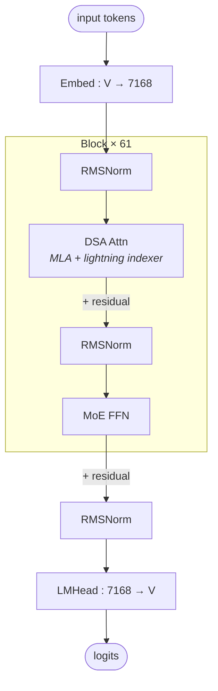

# DeepSeek-V3.2-Exp

## Summary

DeepSeek-V3.2-Exp 在V3.1谱系的MLA/MoE主干上增加Lightning Indexer，以TopK选择参与计算的历史KV。稀疏计算不等于删除完整MLA缓存：还需要Indexer Key Cache。

本卡描述结构和状态，AscendC、PyPTO、TileLang的部署实现不因同属DSA就可互换。平台配置、开关和验收步骤见[模型部署流程](../../guides/models/deepseek_v3_2_exp_deployment.md)，此处只保留模型机制。

## Architecture And Serving Traits

### DeepSeek-V3.2-Exp vs V3.1

> 源："相较 DeepSeek-V3.1，DeepSeek-V3.2-Exp 主要新增了 Lightning Indexer 稀疏模块，旨在从长序列中稀疏选择 Topk 个 Token 用于计算注意力。"

- **权重内存新增**：Lightning Indexer 是类 MQA 结构，新增 `q_b_proj`、`wk_proj`、`weight_proj` 三个 Linear，综合所有 Layer 约 **+0.85B** 参数。
- **KVCache 内存新增**：在保留完整 MLA Full KVCache 的基础上，额外缓存 **Indexer Key Cache**：
 `batch_size × kv_length × Indexer_head_dim × storage_bytes × num_layers`。每 rank 4batch × 64K、BF16 场景新增约 **4 GB**。
- **Prefill MLA计算流**：本固定实现使用Absorb与稀疏Attention；三种候选的BMM形状与访存推导见[权重吸收规则](../../optimizations/rules/mla_weight_absorption_latent_kv.md)，阶段/序列取舍见[DSA选型规则](../../optimizations/rules/dsa_sparse_prefill_mla_scheme_by_seqlen.md)。

### DSA 计算流

DSA 可分为 5 个阶段。图中的 Hadamard 与动态量化只在 kv_cache_quant_mode == "int8" 分支执行；非量化路径不经过这两步，不能把量化部署步骤当作所有 DSA 配置的必经结构：


*来源：[`docs/models/deepseek-v3.2-exp/figures/kernel_scope.jpg`](../../../../../cann-recipes-raw/cann-recipes-infer/944d2d3ece86f7df33dbb0cb155c72ca619a9c66/docs/models/deepseek_v3_2_exp/figures/kernel_scope.jpg)（cann-recipes-infer @ 944d2d3）*

```mermaid
flowchart LR
 In[Hidden] --> MLAP[MLAProlog<br/>Q/KV LoRA + RoPE + Norm<br/>MLA KVCache 写入]
 In --> IP[IndexerProlog<br/>Indexer Q/K proj<br/>仅 Int8/C8: Hadamard + 动态量化<br/>Indexer KCache 写入]
 IP --> LI[Lightning Indexer<br/>BatchMatmul Q@K^T + ReLU<br/>× W (GQA-sum) + Top-K 2048]
 LI --> SFA[Sparse Flash Attention<br/>Gather TopK KV + FA]
 MLAP --> SFA
 SFA --> Ep[MLAEpilog<br/>O_proj + V 升维]
```

见 [sparse-flash-attention](../modules/sparse_flash_attention.md)、[lightning-indexer](../modules/lightning_indexer.md) 展开每个模块的计算语义；算子层面见 [lightning-indexer](../kernels/lightning_indexer.md)、[sparse-flash-attention](../kernels/sparse_flash_attention.md)、[indexer-prolog](../kernels/indexer_prolog.md)、[deepseek-indexer-attention](../kernels/deepseek_indexer_attention.md)。

## Future Plan

固定来源的低比特/KV压缩、跨层预取与MegaKernel是来源计划，不当作已落地能力。适配与验证边界见模型Guide。

## 架构图（stock HF 基线）

当前配置类默认61层、hidden7168、128注意力头，前3层Dense、其余满足MoE条件的层用专家FFN；Indexer默认64头、head_dim128、TopK2048。实际权重config可覆盖默认值，部署须读取checkpoint。下面只画block结构，不把原始上游推理代码与当前NPU实现混为同一制品。



当前NPU路径在MLA前处理之外计算Indexer Q/K/weight，LI选择TopK，SFA读取被选KV；非量化与C8的Hadamard/scale及实际算子分派分别核对。

### 关键参数（实际部署以权重config为准）

| 模块 | 参数 | 值 |
| ---- | ---- | ---- |
| — | n_layers | 61 |
| — | hidden | 7168 |
| — | vocab | 129280 |
| MLA | n_heads | 128 |
| MLA | q_lora_rank | 1536 |
| MLA | kv_lora_rank | 512 |
| MLA | qk_nope_head_dim | 128 |
| MLA | qk_rope_head_dim | 64 |
| MLA | v_head_dim | 128 |
| Indexer | index_n_heads | 64 |
| Indexer | index_head_dim | 128 |
| Indexer | index_topk | 2048 |
| MoE | n_routed_experts | 256 |
| MoE | n_shared_experts | 1 |
| MoE | top_k | 8 |
| MoE | moe_intermediate | 2048 |
| MoE | dense_layers | 仅第 1–3 层 |
| RoPE | yarn factor | 40（`original_max_pos=4096`） |
| — | max_position_embeddings | 163840 |

## 当前 Executor 与状态

模型已迁到models/deepseek_v3_2_exp，使用统一InferenceConfig、CommManager和packed TND输入，不再走私有runner。CP按每请求ZigZag元数据切分，全局临时计算KV与按请求所有者持久KV分开；MLA latent、Indexer Key和INT8 scale均遵守此映射。缓存按CacheEntry绑定，offload设备workspace独立申报。

模型支持eager/ge_graph/npugraph_ex；eager拒绝多流、SuperKernel或持久图缓存组合，npugraph_ex拒绝SuperKernel。KV仅unquant/int8，offload仅offline。PyPTO LI只在非INT8 Decode分派，PyPTO IndexerProlog则有独立INT8 Decode门控，两者不能混称。

W8A8C8样例next_n=3，BF16样例为1，当前npugraph_ex量化样例为0；这不是模型结构定义的固定MTP宽度。接入采用统一draft_worker并核对实际预测层调用，性能来源中MTP3/perfect EPLB条件另行保留。

## 部署与证据入口

- [模型部署与验收流程](../../guides/models/deepseek_v3_2_exp_deployment.md)：配置、开关、失效条件与回退入口。
- [DeepSeek-V3.2-Exp A3 时延、吞吐与容量的来源观测](../../optimizations/benchmark_observations/deepseek_v32_a3_source_benchmark.md)：固定来源自报，未经本仓独立复测。
- [量化精度观测草稿](../../optimizations/benchmark_observations/benchmark_deepseek_v32_quant_accuracy.md)：只保留当前表及其BF16标签，评测环境仍缺失。

## Evidence

- [README.md](../../../../../cann-recipes-raw/cann-recipes-infer/944d2d3ece86f7df33dbb0cb155c72ca619a9c66/README.md)（primary）
- [deepseek_v3.2_exp_inference_guide.md](../../../../../cann-recipes-raw/cann-recipes-infer/944d2d3ece86f7df33dbb0cb155c72ca619a9c66/docs/models/deepseek_v3_2_exp/deepseek_v3.2_exp_inference_guide.md)（supporting）
- [indexer.py](../../../../../cann-recipes-raw/cann-recipes-infer/944d2d3ece86f7df33dbb0cb155c72ca619a9c66/models/deepseek_v3_2_exp/models/indexer.py)（implementation）
- [modeling_deepseek.py](../../../../../cann-recipes-raw/cann-recipes-infer/944d2d3ece86f7df33dbb0cb155c72ca619a9c66/models/deepseek_v3_2_exp/models/modeling_deepseek.py)（implementation）
- [configuration_deepseek.py](../../../../../cann-recipes-raw/cann-recipes-infer/944d2d3ece86f7df33dbb0cb155c72ca619a9c66/models/deepseek_v3_2_exp/models/configuration_deepseek.py)（implementation）

## Links

- [atlas-a3](../platforms/atlas_a3.md)
- [ascendc](../frameworks/ascendc.md)
- [pypto](../frameworks/pypto.md)
- [tilelang](../frameworks/tilelang.md)
- [torchair](../frameworks/torchair.md)
- [mla](../modules/mla.md)
- [sparse-flash-attention](../modules/sparse_flash_attention.md)
- [lightning-indexer](../modules/lightning_indexer.md)
- [dsa](../modules/dsa.md)（DSA 顶层架构模式 = MLA 子图 + indexer overlay，V3.2-Exp 是核心验证实例）
- [mla-prolog](../kernels/mla_prolog.md)
- [fused-infer-attention-score](../kernels/fused_infer_attention_score.md)
- [lightning-indexer](../kernels/lightning_indexer.md)
- [sparse-flash-attention](../kernels/sparse_flash_attention.md)
- [indexer-prolog](../kernels/indexer_prolog.md)
- [deepseek-indexer-attention](../kernels/deepseek_indexer_attention.md)
- [gather-selection-kv-cache](../kernels/gather_selection_kv_cache.md)
- [context-parallel](../parallelism/context_parallel.md)
- [expert-parallel](../parallelism/expert_parallel.md)
- [data-parallel](../parallelism/data_parallel.md)
- [tensor-parallel](../parallelism/tensor_parallel.md)
- [kvcache-offload](../techniques/kvcache_offload.md)
- [mtp-speculative-decoding](../techniques/mtp_speculative_decoding.md)
- [moe-multi-stream](../techniques/moe_multi_stream.md)
- [moe-dispatch-combine-v2](../techniques/moe_dispatch_combine_v2.md)
- [weight-nz](../techniques/weight_nz.md)
- [zigzag-cp](../parallelism/zigzag_cp.md)
- [w8a8c8](../quantization/w8a8c8.md)
- [w4a8c8](../quantization/w4a8c8.md)
- [deepseek-r1](deepseek_r1.md)
- [deepseek-v4](deepseek_v4.md)（后继 DeepSeek-V4 —— DSA/LI 谱系延续，attention 主体由 MLA 改为 MQA/Shared-KV + 滑窗/压缩交错）
- [glm-5](glm_5.md)（DSA同族，实际模型与配置分别核对）
- [hixl](../techniques/hixl.md)（长序列 KVCache 卸载 DRAM 后 NPU↔DRAM 高性能传输经 HIXL 单边零拷贝）
- [multi-stream](../techniques/multi_stream.md)（共享专家双流 / Indexer 前处理多流 / KVCache 异步流的方法论总纲）
- [deepseek-v32-pretrain](../../../training/guides/recipes/deepseek_v32_pretrain.md)（跨域：训练侧 DeepSeek-V3.2 TorchTitan 32K 长序列预训练 —— DSA 反向 SLIG/SFAG、自定义 CP for DSA、FSDP2 极致显存部署）
