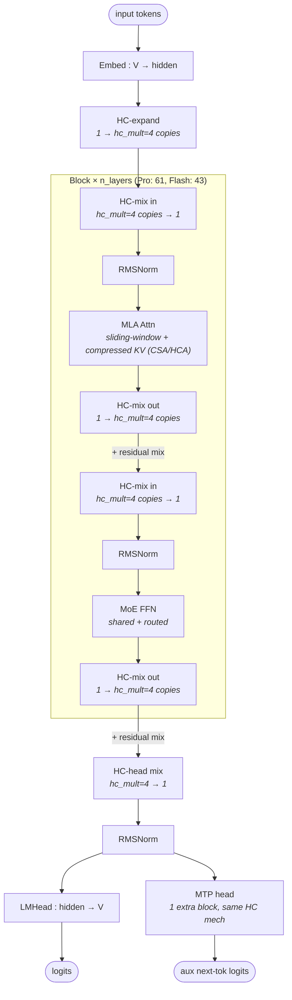

# DeepSeek-V4

## Summary

DeepSeek-V4 是 DeepSeek 发布的新一代长序列模型，包含 **DeepSeek-V4 Flash（285B）** 与 **DeepSeek-V4 Pro（1.6T）** 两种规格。在 DeepSeek-V3.2 的稀疏 Attention（DSA）基础上，V4 进一步在**层间交错**引入 **KV Cache 滑窗（Window Cache）** 与 **KV Cache 压缩（Compress）**，在保持注意力计算量/访存量低位（相对 Full Cache）的同时大幅提升长序列效率，提供长达 **1M 序列** 的高性能推理。

cann-recipes-infer 0day 适配 V4，覆盖 **Atlas A3 Pod** 与新代际 **Ascend 950PR/DT** 两类昇腾芯片，AscendC / PyPTO / TileLang 三套算子实现同步开源。Decode 沿用 DeepSeek 的 Attention DP + MoE EP 部署，Prefill 长序列走 CP + zigzag 切分；图模式默认采用 `npugraph_ex` 后端。

V4 与 [deepseek-v3.2-exp](deepseek_v3_2_exp.md) 的关键结构差异：
- **Attention 主体由 MLA 改为 MQA（Shared-KV）**，不再区分 `naive` / `absorb` 计算流，引入 `attention_sink` 参数（详见下文 Architecture）。
- **分层交错 Hybrid Attention**：滑窗 + 4x/128x 压缩 + LI 稀疏交替。
- **MoE 激活 6 路由 + 1 共享**专家（DSV3.2 为 8 路由），前几层 hash routing、后续层 soft routing。
- 新增 **mHC（Manifold-Constrained Hyper-Connections）** 多路残差结构（见 [mhc](../modules/mhc.md)）。
- A3 Pod KV Cache 采用 **C16**（DSV3.2 为 C8）。

> ⚠️ 矛盾标记（与 DSV3.2-Exp 的结构差异，非覆盖）：以下数字为 V4 专属，不可泛化到 V3.2-Exp，也不修改 V3.2-Exp 页结论。

## Architecture

每个 Layer 含 **mHC、Attention、MoE** 三种模块。

### 分层交错 Hybrid Attention

Attention 沿用 LI 稀疏机制并新增滑窗与压缩，按 `compress_ratio`（代码 `Attention.compress_ratio`；`compress_ratio = 1 if is_mtp else config.compress_ratios[layer_idx]`，逐层值由权重 config 的 `compress_ratios` 列表决定，无 `% 2` / 奇偶规则）分三类：

| 类型 | compress_ratio | 含义 | LI 稀疏 | 层位置（交替，源 guide 文字；具体逐层由 config 列表决定） |
| ---- | ---- | ---- | ---- | ---- |
| SWA（compress_ratio=1） | 1 | Sliding Window Attention，`sliding_window=128` 大小 KV Cache（代码内部 RoPE 路径 dict key 为 `c1a`，非 guide 定义的 attention type） | 无 | Flash 前两层 |
| HCA | 128 | Heavily Compressed Attention，Full Cache 压缩 128× | 无 | Pro 前两层；后续层与 CSA 交替（alternate） |
| CSA | 4 | Compressed Sparse Attention，Full Cache 压缩 4× | 有 | 后续层与 HCA 交替（alternate） |

- **CSA 层**在压缩后的 Cache 上叠加 LI（[lightning-indexer](../modules/lightning_indexer.md)）稀疏选择，选 **Top512**（**guide 示例值**）对 KV 参与 Attention 计算；运行时 CSA topk = `config.index_topk`（代码 `cmp_topk = self.config.index_topk`，仓内 `configuration_deepseek.py` 默认 **2048**，实际取权重 config）。
- Attention 计算采用 **MQA（Multi-Query Attention）而非 MLA**：代码 `modeling_deepseek.py` 中 attention 类为 `Attention`（docstring 标注 `"""Multi-Query Attention (MQA) Layer."""`），统一 **Shared-KV**，不再区分 Prefill / Decode 的 `naive` / `absorb` 流；引入 `attn_sink`（per-head `nn.Parameter`，作为 `sinks` 入参喂入 SAS 算子）。SWA / CSA / HCA 三类场景由统一融合算子 **SparseAttnSharedKV（SAS）** 落地（一套接口覆盖滑窗 / 压缩 / 稀疏及其组合 + Attention Sink），详见 [sparse-attn-sharedkv](../kernels/sparse_attn_sharedkv.md)。
- V4 仍调用 **MLAProlog** 前置（代码 `mla_prolog()` → `mla_prolog_pypto` / `mla_prolog_prefill` / `mla_prolog_decode`），即 Q/KV 投影前置仍复用该融合算子，但 attention 主体已非 [mla](../modules/mla.md) 的低秩 KV 升降维计算流——见下方对比。见 [mla-prolog](../kernels/mla_prolog.md)。

> ⚠️ 矛盾标记（V4 MQA/Shared-KV vs MLA 页）：V4 attention 主体是 MQA + Shared-KV，与 [mla](../modules/mla.md) 描述的 MLA 低秩压缩机制不同。"V4 仍调 MLAProlog" 指前置投影算子复用，不等于 attention 计算流为 MLA。不修改 mla.md 结论。

### KV Cache 组成与内存

KV Cache 由 **Window Cache + Compress Cache + remainder** 组成（压缩层的 KV/Indexer Cache 由 [compressor](../kernels/compressor.md) 融合算子产出并刷新）：

- **SWA 层**仅保留 `sliding_window=128` 大小 KV Cache。
- **压缩层**存压缩后的 KV，大小 ≈ `batch_size × (kv_length // compress_ratio) × head_dim × storage_bytes × num_compress_layers`。
- 未满足压缩长度的 `kv_state` / `score_state` 暂存 **remainder**（最大 ≈ `batch_size × (compress_ratio − 1) × compress_dim × storage_bytes × num_compress_layers`）。
- CSA 层的 LI 同样经 [compressor](../kernels/compressor.md) 做 4× 压缩，保留压缩后长度的 **Indexer Cache**（未满足压缩长度的暂存 `indexer_kv_state` / `indexer_score_state`）。

效果（源 guide）：128k 序列下 HCA（128×）仅需保留约 **1k KV**，CSA（4×）保留约 **32k KV**，相对 Full Cache 内存压力显著缓解。

### MoE 专家

| 模型规格 | 路由专家数 | 共享专家数 | 单 Token 路由专家激活参数量 |
| ---- | ---- | ---- | ---- |
| 285B（Flash） | 256 | 1 | 6G |
| 1.6T（Pro） | 384 | 1 | 22.5G |

每次激活 **6 个路由专家 + 1 个共享专家**（代码 config 默认 `num_experts_per_tok=6`、`n_shared_experts=1`）。专家选取：前几层 `hash routing`（代码 `DeepseekV3MoE.hash = layer_idx < config.num_hash_layers`），后续层可学习 `soft routing`；源 guide 给出"前 3 层 hash / 后 40 层 soft"的层划分。

> ⚠️ 矛盾标记（路由专家数 vs DSV3.2）：V4 激活 6 路由专家，[deepseek-v3.2-exp](deepseek_v3_2_exp.md) 为 8，属模型代际差异，不互相覆盖。

### mHC（Manifold-Constrained Hyper-Connections）

mHC 是对传统残差连接的扩展：把 `hidden_state` 从一路扩展到多路，在 Attention/MoE 计算前经 Pre Mapping 融合回一路（保持 Attention/MoE 计算过程不变），输出经 Post Mapping 扩展回多路，多路残差经 Res Mapping（Sinkhorn-Knopp 约束的混合矩阵）特征融合后与 Post Mapping 结果加和得到 mHC 输出。结构语义与计算公式见 [mhc](../modules/mhc.md)。本仓提供 `HcPre` / `HcPost` 融合算子（`HcPre` 含 AscendC + PyPTO，`HcPost` 含 AscendC），算子级 Tiling/流水/性能见 [mhc-hcpre-hcpost](../kernels/mhc_hcpre_hcpost.md)。`hc_post` 等小算子组合另有 `@torch.compile` + [autofuse](../frameworks/autofuse.md) 自动融合路径（A3 实测 4x），与手写 AscendC 算子并列。

## Serving Strategy

### Prefill 并行（长序列 CP + zigzag）

长序列 Prefill 内存与 TTFT 压力大，故 Attention 选 **Context Parallel（CP）** 而非 DP，多 rank 分摊计算/访存。LI 用 `causal_mask`，越靠后的 Context Chunk 访存/计算越重，故沿用 V3.2 的 `zig_zag` 切分将首尾序列块放同一 rank 做负载均衡。见 [context-parallel](../parallelism/context_parallel.md)、[zigzag-cp](../parallelism/zigzag_cp.md)。

切分需同时考虑滑窗与压缩：SWA 层每个 chunk 需前序 `win_size=128` 的 KV；HCA / CSA 层若前序 chunk 序列 **128 对齐**则无需向后传额外 token（CSA Compressor 另需前序 4 个 token 做 Overlap）。Attention 模块引入两次 CP 通信：MQA 起始用全局 `all_gather` 取各 rank 末尾 128 token（按 `receive_idx` 裁切，`chunk_0` 不取）；Compressor 后对 Compress Cache 做 CP 域 `all_gather`（zigzag 场景需顺序重排）供 LI/SAS 使用。

**进一步通信优化**（源 §并行策略 › Prefill 并行策略末段，CSA 为例，源附图 `prefill_cp_allgather_cache2`）：由于两个 Compressor 存在并行空间，且 CSA 的 Compressor 仅需 4 个 Overlap token 信息，因此可将 **Window Attention 所需数据**与 **Compressor 所需数据分别进行通信**，实现计算通信掩盖，且冗余计算的数据量也较少。Compressor 后同样需要对 Compressed Cache 做 CP 域 `all_gather` 通信。

### Decode 并行（DP + EP + LM_head TP）

Decode 参考 DeepSeek-R1 / V3.2 方案：Attention 用 **Data Parallel（DP）**、MoE 用 **Expert Parallel（EP）**、LM_head 用 **Tensor Parallel（TP）**。Output Projection 中 `o_a_proj` 权重大、访存重，低时延场景可**选择性对其做 TP 切分**，经 `all_to_all` + `reduce_scatter` 实现 DP↔TP 转换。见 [data-parallel](../parallelism/data_parallel.md)、[expert-parallel](../parallelism/expert_parallel.md)、[tensor-parallel](../parallelism/tensor_parallel.md)。

### MTP

V4 沿用原生 Multi-Token Prediction（[mtp-speculative-decoding](../techniques/mtp_speculative_decoding.md)）。Main Model 针对 Window KV 与 Compressor 的 `kv_state`/`score_state` 设计 **Ring Buffer**（`block_table` + `slot_mapping` 复用少数 Cache 块），其余 KV Cache 按压缩后最大长度申请；MTP 场景沿用 LI / SAS 内置的**梯形掩码**，确保待验证 token 的压缩 Cache 不参与主模型 token 计算。**MTP Spec Model 仅使用 Window Attention（SWA）**，`next_n` 个 Draft Token 共享一份 MTP 权重和 KV Cache。MTP 在 SWA/HCA/LI 上 Cache 搬运量与非 MTP 几乎一致，自然提升计算访存比；CSA 的 FA 极端下搬运量为非 MTP 的 `next_n+1` 倍。高吞吐用 MTP1、低时延用 MTP3。

#### Main Model 额外 Cache 定量（源 §MTP › Main Model 方案）

若某 MTP Token 校验不被接受，需在下一 Step 重新推导，故须为 Compressor 的 `kv_state`/`score_state` 额外缓存。结合 Ring Buffer，只需**提前申请更大 Buffer** 即可自然实现该额外缓存动作。需缓存的 Cache 以 `compress_ratio` 个 token 为一组统计，组数公式为：

$$
\mathrm{num\_ratio\_group} = (1 \ \mathrm{if} \ \mathrm{next\_n} == 0 \ \mathrm{else}\ 2) + \mathrm{overlap}
$$

其中 `overlap` 在 CSA 等于 1、在 HCA 等于 0。`num_ratio_group` 里预留了**余数 token** 和**可能需要重新压缩的前序 token**。每个 Batch 需要的 Cache Block 个数为：

$$
\mathrm{ceil}(\mathrm{num\_ratio\_group} \times \mathrm{ratio} \ / \ \mathrm{block\_size})
$$

## Quantization Overview

逐模块量化矩阵为独立子主题（A3 整数路径见 [int8-int4-hybrid](../quantization/int8_int4_hybrid.md)，950 浮点路径见 [hybrid-mxfp8-mxfp4](../quantization/hybrid_mxfp8_mxfp4.md)），此处为总览：

- **Atlas A3 Pod / W8A8C16（Int8，推荐 Flash）**：基于原生 Hybrid FP8-MXFP4 权重做 Int8 W8A8；仅对参数量大的部分 Linear（MLA `q_b_proj`/`o_b_proj`、Indexer `q_b_proj`）量化，KV Cache 维持 **C16（BF16 存算）**；LI 经 A8C8 降时延。见 [int8-int4-hybrid](../quantization/int8_int4_hybrid.md)。
- **Atlas A3 Pod / Hybrid INT8-INT4（推荐 Pro）**：在上策略基础上对 MoE 路由专家用 W4A8（[w4a8c8](../quantization/w4a8c8.md)）、共享专家用 W8A8，显著降低 MoE 存储/访存。见 [int8-int4-hybrid](../quantization/int8_int4_hybrid.md)。
- **Ascend 950PR/DT / Hybrid FP8-MXFP4（原生）与 Hybrid MXFP8-MXFP4（硬件亲和）**：950 平台原生 Hybrid FP8-MXFP4 可权重无损平滑迁移；可用 MXFP8 替代原生 FP8 在 Prefill/Decode 高吞吐场景提升算力利用率；KV Cache C8 动态存 8 算 16，超长序列内存优化 2×。见 [hybrid-mxfp8-mxfp4](../quantization/hybrid_mxfp8_mxfp4.md)。

> ⚠️ 矛盾标记（KV C16 vs DSV3.2 C8）：V4 A3 Pod 默认 KV Cache C16，[deepseek-v3.2-exp](deepseek_v3_2_exp.md) 与 [w8a8c8](../quantization/w8a8c8.md) 的 C8 结论针对 V3.2-Exp，不互相覆盖。（注：此 C8-vs-C16 对比针对**推荐/生产量化策略**——V3.2-Exp 现已支持 W8A8C8；V3.2-Exp 页亦记录其早期也有 "1day W8A8C16 部署"，故 C16 本身非 V4 独有。）

## 多流并行优化

V4 借助 CANN 软件栈的算子控核与多流并行能力，对跨算子无数据依赖的计算流做细粒度并行掩盖（[multi-stream](../techniques/multi_stream.md)）。

### Attention 多流并行

源 §多流并行优化 › Attention 多流并行（CSA 为例，源附图 `attn_multi_stream`）逐条列出 4 个并行点：

- **(a)** MLAProlog 模块中 Query 计算流与 KV 计算流有并行空间：`kv_proj`、`q_b_proj` 等 Matmul 用 **Cube 核**计算，与 `q_rms_norm` 等用 **Vector 核**计算的算子可并行；
- **(b)** `q_b_proj` 后的 `rms_norm` 和 `rope` 可与 LI 的 `li_q_b_proj` 并行计算；
- **(c)** CSA 时 LI 与 CSA Compressor 无数据依赖，可通过 **CV 控核**确保算子分配到合适的 Cube/Vector 核数，在多流并行时减少计算资源抢占对性能的影响，从而**完全掩盖 CSA 的 Compressor**；
- **(d)** HCA 中没有 LI，可直接用 MLAProlog 计算掩盖**部分** Compressor。

### MoE 共享路由多流并行

源 §多流并行优化 › MoE 共享路由多流并行（源附图 `moe_multi_stream`）：MoE 模块中共享专家与路由专家存在**计算与计算、计算与通信**的并行机会。本实践针对 **Int8 和 MXFP8 量化场景**实现了专家多流并行，可获得较大收益——以路由专家为关键路径，在**基本不影响路由专家**的同时掩盖共享专家的计算耗时。详见 [moe-multi-stream](../techniques/moe_multi_stream.md)。

## Platform

V4 在 Atlas A3 Pod（[atlas-a3](../platforms/atlas_a3.md)，每节点 8 卡，`world_size = 2 × chip_num`）外，新增 **Ascend 950PR / 950DT** 代际支持（`platform_version: "950"`，PR 偏 Prefill、DT 偏 Decode）。950 平台的代际特性（原生 Hybrid FP8-MXFP4、MXFP8 替代、Histograms 指令加速 LI Top-k、L0A/L0B 容下 256³ 基本块（字节容量源未给对比、据 Tiling 约束推断）、weightNZ 关闭等）详见 [ascend-950](../platforms/ascend_950.md)。最小部署单元（源 README）：950PR/DT Flash 4 chips / Pro 16 chips；A3 Flash 4 chips / Pro 32 chips。

## Benchmark

> 数据基于 Offline 推理（不含 Serving 调度/负载均衡），MTP 投机 + 强制 EPLB 采集；MTP3 平均 3 个 Draft Token 中 Accept 1.44、MTP1 平均 1 个 Accept 0.7。引用须带全限定（平台 + MTP + DataType + SeqLen）。

**950DT，16 卡，DP + EP（节选 DeepSeek-V4 Flash）**

| 平台 | 规格 | Chips | MTP | DataType | SeqLen | TPOT (ms) | Throughput (Tokens/p/s) |
| ---- | ---- | ---- | ---- | ---- | ---- | ---- | ---- |
| 950DT | Flash | 16 | 3 | Hybrid MXFP8-MXFP4 | 8192 | 9.84 | 1625.31 |
| 950DT | Flash | 16 | 1 | Hybrid MXFP8-MXFP4 | 8192 | 20.33 | 4722.22 |
| 950DT | Flash | 16 | 3 | Hybrid MXFP8-MXFP4 | 131072 | 10.69 | 1496.36 |
| 950DT | Flash | 16 | 3 | Hybrid MXFP8-MXFP4 | 1048576 | 8.22 | 121.70 |
| 950DT | Flash | 16 | 1 | Hybrid FP8-MXFP4 | 8192 | 24.28 | 3953.49 |
| 950DT | Pro | 16 | 3 | Hybrid MXFP8-MXFP4 | 8192 | 17.64 | 56.7 |
| 950DT | Pro | 16 | 3 | Hybrid MXFP8-MXFP4 | 131072 | 19.46 | 51.38 |

> 注：源 Benchmark 含 Global Batch Size 列（本表略）——Flash 8192/131072 行系 GBS=256（MTP3）/1536（MTP1）大 batch，但 **Flash 1048576（1M）行系 GBS=16** 小 batch（极长序列带宽受限，Throughput 121.70 偏低属正常，不可与同规格大 batch 行横比）；950DT **Pro** 行亦系 **GBS=16** 小 batch 采集，故 Pro 的低 Tokens/p/s（56.7/51.38）是小 batch 口径，**不可与 Flash 大 batch 行横比**。

**Atlas A3 Pod，64 卡，DP + EP，W8A8C16（DeepSeek-V4 Flash，LI Cache Int8 / KV Cache BF16）**

| 平台 | 规格 | Chips | Global Batch Size | MTP | DataType | SeqLen | TPOT (ms) | Throughput (Tokens/p/s) |
| ---- | ---- | ---- | ---- | ---- | ---- | ---- | ---- | ---- |
| A3 Pod | Flash | 64 | 7168 | 1 | W8A8C16 | 8192 | 27.82 | 4025 |
| A3 Pod | Flash | 64 | 8192 | 1 | W8A8C16 | 8192 | 29.17 | 4388 |

## Future Plan

源 guide 明示：950PR/DT 进一步支持 HiFloat8 量化；使能 SuperKernel（[superkernel](../techniques/superkernel.md)）降低算子启动/调度间隙；通过 Flash Decode 等优化长序列 LI/SAS 性能。

## 架构图（stock HF 基线）

下图为 DeepSeek-V4 的 **stock HF 架构**（部署前基线，源自 HF `config.json` + bundled `inference/model.py` 核实，覆盖 V4-Pro / V4-Flash 两规格），刻画 block 级前向拓扑（mHC 多路残差 + Attention + MoE + MTP 并行头）。它与本页其余基于 [deepseek-v3.2-exp](deepseek_v3_2_exp.md) 路线的 NPU 部署优化（融合算子 / 并行 / 量化 / Cache 策略）互补：本节描述"模型长什么样"，正文其余部分描述"在昇腾上怎么跑"。HF 配置溯源见本节末 footnote，verified 日期 **2026-05-15**（取自架构图 `source_basis`）。

> **关于上图 `MLA Attn` 标注的口径说明**：架构图沿用 **HF 模型卡的 `attention_type=mla` 粗标签**（粗粒度家族归类），而本页正文经 cann-recipes 部署代码核实，attention 主体落地为 **MQA / Shared-KV**（`Attention` 类 docstring `"""Multi-Query Attention (MQA) Layer."""`，统一 Shared-KV、`num_key_value_heads=1`）。这是**两套不同粒度的口径**——HF 卡的家族标签 vs 部署代码的实现粒度——并非错误，二者并存。详见上文 [Architecture › 分层交错 Hybrid Attention](#分层交错-hybrid-attention) 与 [mla](../modules/mla.md) 的矛盾标记。

精简关键参数表（取自 HF Pro/Flash `config.json`，见本节末溯源，仅保留对部署有意义的行）：

| Module | Param | V4-Pro | V4-Flash |
| ---- | ---- | ---- | ---- |
| — | n_layers (`num_hidden_layers`) | 61 | 43 |
| — | hidden (`hidden_size`) | 7168 | 4096 |
| — | vocab (`vocab_size`) | 129280 | 129280 |
| — | max_position_embeddings | 1048576 | 1048576 |
| — | sliding_window | 128 | 128 |
| Attn | n_heads (`num_attention_heads`) | 128 | 64 |
| Attn | num_key_value_heads | 1 | 1 |
| Attn | head_dim | 512 | 512 |
| Attn | o_groups | 16 | 8 |
| Indexer (CSA) | index_n_heads | 64 | 64 |
| Indexer (CSA) | index_topk | 1024 | 512 |
| MoE | n_routed_experts | 384 | 256 |
| MoE | n_shared_experts | 1 | 1 |
| MoE | top_k (`num_experts_per_tok`) | 6 | 6 |
| MoE | moe_intermediate_size | 3072 | 2048 |
| MoE | num_hash_layers | 3 | 3 |
| Hyper-Conn | hc_mult | 4 | 4 |
| MTP | num_nextn_predict_layers | 1 | 1 |

> **CSA `index_topk` 的来源差异**：架构图（HF config 默认）给出 **Pro `index_topk=1024` / Flash `index_topk=512`**；cann-recipes-infer 另有 **guide 示例值 Top512** 与**仓内 `configuration_deepseek.py` 默认 2048**（运行时实取权重 config）。三者分属 **HF stock config 默认 / cann-recipes guide 示例 / 仓内配置默认**三种配置来源，部署时以加载的权重 config 为准。

HF 架构参数来源：`deepseek-ai/DeepSeek-V4-Pro/config.json` + `deepseek-ai/DeepSeek-V4-Flash/config.json`（均 verified **2026-05-15**；`architectures=["DeepseekV4ForCausalLM"]`、`model_type=deepseek_v4`、`transformers_version=4.57.1`），bundled `inference/model.py`（类名 `Transformer` / `Block` / `Attention` / `Compressor` / `Indexer` / `MoE` / `Gate` / `Expert` / `MTPBlock`），架构特性名（CSA / HCA / mHC）与 Pro/Flash 参数量交叉核对自模型卡 README（verified 2026-05-15）。HF 原生架构中的 mHC 多路残差机制见 [mhc](../modules/mhc.md)。

## Evidence

- [cann-recipes-infer](https://gitcode.com/cann/cann-recipes-infer/tree/2c45117d781ab9ab88dcb89a28ae30f5d2450399) — [`docs/models/deepseek-v4/deepseek_v4_inference_guide.md`](https://gitcode.com/cann/cann-recipes-infer/blob/2c45117d781ab9ab88dcb89a28ae30f5d2450399/docs/models/deepseek-v4/deepseek_v4_inference_guide.md)（模型结构、融合 Kernel、并行、MTP、量化、多流、Benchmark、Future Plan；391 行主源）
- [cann-recipes-infer](https://gitcode.com/cann/cann-recipes-infer/tree/2c45117d781ab9ab88dcb89a28ae30f5d2450399) — [`models/deepseek-v4/README.md`](https://gitcode.com/cann/cann-recipes-infer/blob/2c45117d781ab9ab88dcb89a28ae30f5d2450399/models/deepseek-v4/README.md)（部署流程、规格、最小部署单元）、[`config/ci_a3/deepseek_v4.yaml`](https://gitcode.com/cann/cann-recipes-infer/blob/2c45117d781ab9ab88dcb89a28ae30f5d2450399/models/deepseek-v4/config/ci_a3/deepseek_v4.yaml) / [`config/ci_950/deepseek_v4.yaml`](https://gitcode.com/cann/cann-recipes-infer/blob/2c45117d781ab9ab88dcb89a28ae30f5d2450399/models/deepseek-v4/config/ci_950/deepseek_v4.yaml)（`exe_mode: npugraph_ex`、`pa_block_size: 128`、A3 `lmhead_tp_size:4`/`next_n:1`、950 `platform_version:"950"`/`next_n:3`）
- [cann-recipes-infer](https://gitcode.com/cann/cann-recipes-infer/tree/2c45117d781ab9ab88dcb89a28ae30f5d2450399) — [`models/deepseek-v4/models/modeling_deepseek.py`](https://gitcode.com/cann/cann-recipes-infer/blob/2c45117d781ab9ab88dcb89a28ae30f5d2450399/models/deepseek-v4/models/modeling_deepseek.py)（实现：attention 类为 `Attention`（docstring `"""Multi-Query Attention (MQA) Layer."""`，全仓无 `MQAttention` 符号）、`attn_sink` per-head Parameter→`sinks` 入参、`compress_ratio = 1 if is_mtp else config.compress_ratios[layer_idx]` 三分支 1/4/128（逐层由 config 列表决定，无奇偶规则）、CSA 仅在 `compress_ratio==4` 挂 Indexer、CSA `cmp_topk = self.config.index_topk`、`mla_prolog()` 调用、`DeepseekV3MoE.hash = layer_idx < num_hash_layers`）
- [cann-recipes-infer](https://gitcode.com/cann/cann-recipes-infer/tree/2c45117d781ab9ab88dcb89a28ae30f5d2450399) — [`models/deepseek-v4/models/configuration_deepseek.py`](https://gitcode.com/cann/cann-recipes-infer/blob/2c45117d781ab9ab88dcb89a28ae30f5d2450399/models/deepseek-v4/models/configuration_deepseek.py)（实现：`num_experts_per_tok=6`、`n_routed_experts=256`、`n_shared_experts=1`、`num_hidden_layers=43`；`index_topk` 配置默认 2048——运行时 CSA topk = `config.index_topk`（仓内默认 2048，实际取权重 config），guide 的 CSA Top512 为示例值口径，二者不同）
- [cann-recipes-infer](https://gitcode.com/cann/cann-recipes-infer/tree/2c45117d781ab9ab88dcb89a28ae30f5d2450399) — [`docs/models/deepseek-v4/deepseek_v4_inference_guide.md` (§多流并行优化 Attention/MoE 多流、§MTP Main Model 方案 num_ratio_group/Cache Block 公式、§并行策略 Prefill 进一步通信优化)](https://gitcode.com/cann/cann-recipes-infer/blob/46485bef9bb6bf061e4c356942bfea395e75865a/docs/models/deepseek-v4/deepseek_v4_inference_guide.md)（V4 专属多流并行、MTP 额外 Cache 定量、Prefill CP 双 Compressor 分通信掩盖）
- 溯源（diff `2f82d10..2c45117`）：`5df82b1` support deepseek v4（!366 publish→master）；`6fa7a02` update dsv4 model inference guide（!368 0425_guide→master）；`272df2f` [docs]deepseek v4 update（!449）；`13b8e6a` dsv4 add platform guide（!396 fix_readme→master）；`dbcc825` adapt dsv4-pro on A3（!395 0428_pro→master）；`c62b731` deepseek-v4 ge_graph（!412）；`377f202` V4-Flash 相关。

## Links

- [deepseek-v3.2-exp](deepseek_v3_2_exp.md)
- [mla](../modules/mla.md)
- [mhc](../modules/mhc.md)
- [lightning-indexer](../modules/lightning_indexer.md)
- [mla-prolog](../kernels/mla_prolog.md)
- [lightning-indexer](../kernels/lightning_indexer.md)
- [sparse-flash-attention](../kernels/sparse_flash_attention.md)
- [sparse-attn-sharedkv](../kernels/sparse_attn_sharedkv.md)
- [compressor](../kernels/compressor.md)
- [indexer-prolog](../kernels/indexer_prolog.md)
- [mhc-hcpre-hcpost](../kernels/mhc_hcpre_hcpost.md)
- [w4a8c8](../quantization/w4a8c8.md)
- [w8a8c8](../quantization/w8a8c8.md)
- [int8-int4-hybrid](../quantization/int8_int4_hybrid.md)（A3 Pod Int8 W8A8C16 + Hybrid INT8-INT4 逐模块矩阵）
- [hybrid-mxfp8-mxfp4](../quantization/hybrid_mxfp8_mxfp4.md)（950PR/DT 原生 Hybrid FP8-MXFP4 + 硬件亲和 Hybrid MXFP8-MXFP4 + MXFP4 算法）
- [atlas-a3](../platforms/atlas_a3.md)
- [ascend-950](../platforms/ascend_950.md)（950PR/DT 代际：原生 FP8-MXFP4 / Histograms Top-k / L0A-L0B 256³[据 Tiling 约束推断] / weightNZ 关闭）
- [mtp-speculative-decoding](../techniques/mtp_speculative_decoding.md)
- [multi-stream](../techniques/multi_stream.md)（V4 Attention 多流：MLAProlog Cube/Vector + LI↔CSA Compressor CV 控核掩盖）
- [moe-multi-stream](../techniques/moe_multi_stream.md)（V4 共享↔路由专家多流，Int8/MXFP8 场景掩盖共享专家）
- [superkernel](../techniques/superkernel.md)
- [autofuse](../frameworks/autofuse.md)
- [pypto](../frameworks/pypto.md)（V4 PyPTO：PTO-ISA 跨代际 / MPMD / Unrollist / 合图 / hc_post VF 融合 +22.7%）
- [tilelang](../frameworks/tilelang.md)（V4 TileLang Developer 模式 + 四算子样例 SFA/mHC/Int8-GEMM/Act-Quant）
- [ascendc](../frameworks/ascendc.md)（V4 AscendC：950PR/DT 直方图 Top-k / FP8 模式 / Tiling 模板 + Cost Model / AICPU Scheduler）
- [aicpu-scheduler](../techniques/aicpu_scheduler.md)
- [context-parallel](../parallelism/context_parallel.md)
- [zigzag-cp](../parallelism/zigzag_cp.md)
- [data-parallel](../parallelism/data_parallel.md)
- [expert-parallel](../parallelism/expert_parallel.md)
- [tensor-parallel](../parallelism/tensor_parallel.md)
- [cann-shmem](../techniques/cann_shmem.md)（DeepSeek 系列通用 SHMEM 通信基础）
- [hixl](../techniques/hixl.md)（基于 SHMEM 的单边零拷贝传输库）
- [shmem-dispatch-combine](../techniques/shmem_dispatch_combine.md)（DeepEP dispatch&combine 的 SHMEM 重写指南；V4 生产路径实调融合算子 distribute_dispatch_v2/combine_v2）
- [moe-dispatch-combine-v2](../techniques/moe_dispatch_combine_v2.md)（V4 Decode 生产路径实调的一体化融合算子 dispatch_v2/combine_v2）
- [dsa](../modules/dsa.md)（DSA 架构模式；V4 为其思想延续，注意力主体改 MQA/Shared-KV，见上文矛盾标记）
- [deepseek-v4-continue-pretrain](../../../training/guides/recipes/deepseek_v4_continue_pretrain.md)（跨域·训练：DeepSeek-V4 的续训(CPT)实践）

<!-- cannbot:related:start -->
## 相关

- [DeepSeek-V3.2-Exp](deepseek_v3_2_exp.md)（`related`）：“DeepSeek-V3.2-Exp 是 DeepSeek 2026 年发布的实验性长序列模型，在 DeepSeek-V3.1 基础上引入 **DeepSeek Sparse Attention (DSA)** —— 由 **Lightning Indexer (LI)** 与 **Sparse Flash Attention (SFA)** 两个核心模块组成 —— 通过"选前 TopK 个相关 token 再计算注意力"将长序列 Attention 从 O(S²) 降至 O(S·TopK)。DSA 的引入保留了完整 MLA KVCache，同时新增 Indexer Key Cache；MoE/MLA 主干继续沿用 V3.1 的结构。”与“DeepSeek-V4 是 DeepSeek 发布的新一代长序列模型，包含 **DeepSeek-V4 Flash（285B）** 与 **DeepSeek-V4 Pro（1.6T）** 两种规格。在 DeepSeek-V3.2 的稀疏 Attention（DSA）基础上，V4 进一步在**层间交错**引入 **KV Cache 滑窗（Window Cache）** 与 **KV Cache 压缩（Compress）**，在保持注意力计算量/访存量低位（相对 Full Cache）的同时大幅提升长序列效率，提供长达 **1M 序列** 的高性能推理。”提供双方正文证据。V4 明确以 V3.2 的 DSA 为演进基线并增加滑窗与压缩，结合两卡可判断模型升级时注意力主体、缓存形态和长序列能力的迁移。
<!-- cannbot:related:end -->
