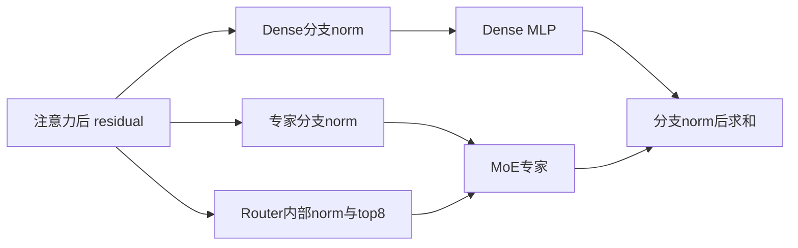

# Gemma-4 文本 MoE Decoder

## 结构

当前样例只适配Language MoE Decoder，视觉编码器未覆盖。来源26B-A4B报告为30层、词表262144并与LMHead共享权重；每层Dense MLP与MoE并联相加，Dense中间维2112、专家128个top8、中间维704，另有RMSNorm和layer_scalar。具体head数与检查点参数读取实际config，不用配置类默认值替代。

Attention按5层sliding/1层full排列，报告sliding25层head_dim256/window1024，full5层head_dim512。Full启用K=V投影共享，但V由K投影clone，K/V后续处理不同且分别缓存，不能按一份cache预算。Q/K归一化后attention scale=1.0，不再额外除sqrt(d)。

Router读取原始residual，专家读取单独norm后的输入，不能串接成同一路。

## 当前异构 Page cache

已接入统一KVCacheManager。各层CacheEntry声明BF16、head、dim、block_size和SlidingWindow/FullAttention类型，get_cache_info汇总；两类block pool分别管理长度quota与形状。旧模型自管连续cache结论已失效。

输入为packed [T,H]。Sliding用FIA v2 TND、sparse_mode4/window1024；Full Prefill转BNSD causal，Decode将PA物理cache展平为连续BSH视图并传block_table，sparse_mode0。Prefill先计算有效K/V再写cache，Decode先scatter_nd更新再读PA。当前仍拒绝同batch变长Prefill，packed不等于支持任意变长。

## 当前 RoPE 与专家实现

Sliding用4D view调用rotary_mul再还原。Full partial RoPE从head的两半分别抽取pair_dim，再TND apply_rotary后拼回未旋转部分；不是简单旋转前连续rotary_dim。频率指数分母为full head_dim，并应用factor，不能沿用旧partial维度作分母的公式。

Dense激活按ACT2FN配置。专家Prefill调用npu_geglu(activate_left=True)，图Decode用F.gelu(approximate='tanh')*up；报告仍写npu_fast_gelu，与最新代码不符，此处按代码。纯EP Decode当前只走MC2，旧moe_ep_decode_mode/local_experts分支已删除；Prefill仍double-routing。

## 部署与来源结果

[当前部署](../../guides/models/gemma4_26b_a4b_deployment.md)、[A2来源观测](../../optimizations/benchmark_observations/gemma4_a2_source_benchmark.md)、[A3来源观测](../../optimizations/benchmark_observations/gemma4_a3_source_benchmark.md)。本次未运行硬件，不将源码更新或来源报告写为verified。

## Evidence

- [README.md](../../../../../cann-recipes-raw/cann-recipes-infer/944d2d3ece86f7df33dbb0cb155c72ca619a9c66/models/gemma_4/README.md)（primary）
- [modeling_gemma4.py](../../../../../cann-recipes-raw/cann-recipes-infer/944d2d3ece86f7df33dbb0cb155c72ca619a9c66/models/gemma_4/models/modeling_gemma4.py)（implementation）
- [optimization_report.md](../../../../../cann-recipes-raw/cann-recipes-infer/944d2d3ece86f7df33dbb0cb155c72ca619a9c66/models/gemma_4/agentic/optimization_report.md)（supporting）
- [gemma4_rank_8_8ep_decode.yaml](../../../../../cann-recipes-raw/cann-recipes-infer/944d2d3ece86f7df33dbb0cb155c72ca619a9c66/models/gemma_4/config/gemma4_rank_8_8ep_decode.yaml)（example）
