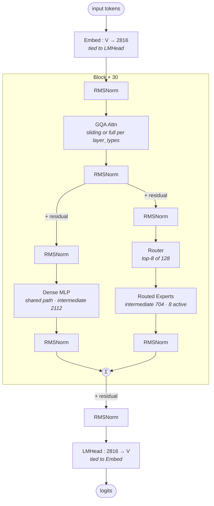

# Gemma-4-26B-A4B

## Summary

Gemma-4-26B-A4B 是 Google 2026 年开源的多模态 MoE 大语言模型，包含视觉塔（Vision Tower）与语言 MoE 解码器两部分。cann-recipes-infer 的样例**仅适配 Language MoE Decoder 路径，视觉塔不在覆盖范围内**；建模代码基于 transformers 的 `modeling_gemma4` 改写为昇腾自研 executor（[cann-executor](../frameworks/cann_executor.md)）适配（源内版本号不一致：README/`requirements.txt` pin `transformers==5.0.0`，而 `modeling_gemma4.py` 文件头标注 adapted from v5.5.0）。

规模：总参数量 **26.5B**，每 token 激活 **~3.8B**（128 experts top-8），权重 **~51.6 GB（BF16）**，建议 8 卡部署。目标平台 Atlas A2 / A3（源 README/报告双平台 benchmark；wiki 仅 [atlas-a3](../platforms/atlas_a3.md) 有页，A2 无独立平台页）。

最独特的三处结构/工程点：**双模式 Attention**、**异构连续缓存**、**MoE EP decode 双路径（mc2 / local_experts）**。

## 架构（仅 Language Decoder）

Token Embedding（vocab=262144，与 LM Head 共享权重）→ Decoder Block ×30 → LM Head。每个 Decoder Block 内 **Dense MLP 与 MoE 并联**（非交替式）：

- **Dense MLP**：`gate/up/down`，intermediate=2112，激活 GELU（代码 `Gemma4MLP.forward` 走 `npu_fast_gelu(gate) * up`，等价 `gelu(approximate='tanh')`）。
- **MoE**：128 experts，top-8，moe_intermediate=704，专家激活 **GEGLU**（`Gemma4GegluMoEGMM`）。
- 多组 LayerNorm（基础 4：input / post_attention / pre_feedforward / post_feedforward；MoE 分支再 +3）+ layer_scalar。

### 双模式 Attention（核心）

由 `layer_types` 5:1 模式划分（`sliding_window_pattern=6`，`(i+1)%6!=0` 为 sliding，最后一层强制 full）：

| 模式 | 层数 | N_h | N_kv | head_dim | 其他 |
|---|---|---|---|---|---|
| Sliding | 25 | 16 | 8 | 256 | GQA，`window=1024` |
| Full | 5 | 16 | 2 | 512 | GQA，`k_eq_v=True`（K/V 共享一组投影，无独立 v_proj）|

- `Gemma4Attention.use_k_eq_v = attention_k_eq_v and not is_sliding`：仅 full 层 K=V，省 v_proj。
- QK RMSNorm 已对 Q/K 归一化，故 FA 调用使用 **`scale=1.0`**（标准 `1/√d` 缩放会让 attention 过平坦、不匹配 reference）。
- Full 层 N_kv=2 据优化报告与部署（`num_global_key_value_heads=2`）；`configuration_gemma4.py` 默认 `num_global_key_value_heads=None` 回退 `num_key_value_heads`(=8)，full 层实际值由外部 HF config 提供、源内未直接给出，按报告/部署计 2（待验证）。

## 异构连续缓存（KVCache）

双模式 Attention 导致 KV 维度异构：sliding 层 `kv_dim = N_kv×head_dim = 8×256 = 2048`；full 层 `2×512 = 1024`（k_eq_v，K/V 共享）。Gemma-4 采用**连续缓存（非 Paged）**：

- 每层独立分配缓冲（`cache_unit = N_kv×head_dim`），sliding/full shape 不同，避免统一 Paged-Attention block 格式维护两套 block_table 的复杂度。
- `attn_tp=1` 无 KV head 切分需求，连续缓存足够。

与 [kv-cache-manager](../frameworks/kv_cache_manager.md) 的框架级块式 Paged Attention 不同——该 KVCacheManager 抽象 FullAttention/SlidingWindow 两类 block 策略；Gemma-4 走模型自管的连续缓存路径。

## FA 与 RoPE

- FA 走 **FIA v1**（[fused-infer-attention-score](../kernels/fused_infer_attention_score.md) `npu_fused_infer_attention_score`，输入布局 BSH）；图模式 Decode 用 `tng.ops` 同名算子、Prefill 用 `torch.ops.npu` 同名算子。
- Sliding 层 Prefill/Decode：`sparse_mode=4` + `pre_tokens=sliding_window(1024)`（即 sliding window）；Full 层按阶段不同：Prefill `sparse_mode=3`（标准 causal，`pre_tokens=INT32_MAX`）、Decode `sparse_mode=0`（`pre_tokens=INT32_MAX`，`modeling_gemma4.py:789-822`）。
- Sliding 全维 RoPE 用 `npu_rotary_mul`（`rotary_mode='half'`）；Full 层 **partial RoPE**（`partial_rotary_factor=0.25`，rotary_dim=128）用 slice + `npu_rotary_mul` + cat 包装实现（`npu_rotary_mul` 无原生 partial 支持，见算子 gap）。

## 图模式 + MoE EP 双路径

图模式默认 GE graph（torchair `fullgraph=True`，Decode 整图、Prefill 保持 eager），可切 `exe_mode: npugraph_ex`（torch.compile aclgraph，代码共用）。详见 [npu-graph-mode](../techniques/npu_graph_mode.md)（ge_graph / npugraph_ex 两后端对比）。ge_graph Decode 整图能成立依赖两处去 host 同步的图化改造：cos/sin 在 `init_pa_cache` 时预计算为 buffer、graph 内直接索引（避免 `kv_len.max().item()` 引入 host 同步）；`actual_seq_lengths_kv` 取 Tensor 形态（与 `tng.ops` 接口匹配，避免 list 元素变化触发重编译）——故 ge_graph 用 `torchair.ops`（接受 Tensor）、npugraph_ex 走 `torch.ops.npu`（dynamo 强制 `SymInt[]` 必须为 host list），二者在此分叉（`modeling_gemma4.py:725-739`）。

**MoE EP decode 双路径**（`Gemma4SparseMoeBlock`，开关 `model_config.custom_params.moe_ep_decode_mode`）：

- **`mc2`**：`npu_moe_distribute_dispatch_v2` + `npu_moe_distribute_combine_v2`（[moe-dispatch-combine-v2](../techniques/moe_dispatch_combine_v2.md)），与仓内其他 MoE 模型一致。
- **`local_experts`**：每 rank 计算全部 16 个本地 expert（非本 rank expert 的 routing weight 置 0），经 `npu_moe_init_routing` + `npu_moe_finalize_routing`，末次 `all_reduce`（`moe_ep_group`）汇总。完全静态 shape，对 ge_graph fullgraph 友好；Gemma-4 无零专家。

代码按 `experts_per_rank ≤ 24` 自动选默认（`default_mode = "mc2" if experts_per_rank<=24 else "local_experts"`，因 `npu_moe_distribute_dispatch_v2` 在 A2 受 ≤24 限制、A3 无）；EP=8 下 16 experts/rank 两平台都满足，故默认 `mc2`；yaml 可显式覆盖（仓内 `gemma4_rank_8_8ep_gegraph_decode.yaml` 实际写 `local_experts`，doc≠config：报告称默认 mc2，shipped yaml 覆盖为 local_experts）。

> A3 实测（8 卡 EP=8，BS=8，input_len=256）两路径输出一致、性能接近（ge_graph decode：local_experts 10.20 ms vs mc2 10.50 ms）；小 batch 下 mc2 的 2 次 AllToAll + padding 固定开销摊不开，mc2 相对优势在更大 batch / Prefill 才显现。

## 并行切分

| 模块 | 切分 | 依据 |
|---|---|---|
| Attention | `attn_tp=1`（[data-parallel](../parallelism/data_parallel.md) DP=8）| full 层 N_kv=2 致 TP 上限 2；DP=8 最大化吞吐 |
| Dense MLP | `dense_tp=1` | intermediate=2112 较小，TP 切碎后 cube 利用率低 |
| MoE | `EP=8`（[expert-parallel](../parallelism/expert_parallel.md)）| 128 experts / 8 = 16 experts/rank |
| Embedding / LM Head | `embed_tp=8` / `lmhead_tp=8` | 大词表 262144 沿 vocab 切分 |

## 性能（带平台 + 配置前提，A2 与 A3 不混比）

测试条件：BS=8、input_len=256、max_new_tokens=32、8 卡、BF16。

- **A2 累计演进**（报告 §6.1/§8 累计表）：eager 基线 decode 98.5 ms → 图模式 decode 18.21 ms（**累计 5.42×**，主要来自 ge_graph Decode 整图 + local_experts MoE）；prefill 312.5 → 302.5 ms。
- **A3 vs A2（同 ge_graph 路径，报告 §7 跨硬件表 / README）**：prefill 76.43 ms（**2.47×**）/ decode 10.20 ms（**1.45×**）。
- ⚠️ 源内 A2 ge_graph 有两套测值：累计演进表（§6.1/§8）prefill 302.5 / decode 18.21 ms，跨硬件表（§7/README）prefill 189 / decode 15 ms（测试口径不同）。上面 2.47×/1.45× 跨硬件加速比按 §7 表算（A2 基线 189/15），不与累计表 302.5/18.21 混算。

## 算子 / 量化 gap（§9 / §10）

- `npu_rotary_mul` 无 `partial_rotary_factor` 原生支持 → full 层 partial RoPE 需 slice + 融合 + cat 包装。
- `npu_geglu` 未注册图模式 dispatch（torchair 无 converter；torch.compile meta 签名问题）→ Decode 图模式走手动 `torch_npu.npu_fast_gelu(gate) * up`（等价 `gelu(approximate='tanh')`；刻意不用 `F.gelu`——其在 aclgraph capture 下走 CPU fallback，`modeling_gemma4.py:315-318`），Prefill/eager 仍用融合 `npu_geglu` 高精度。30 层 MoE 专家手写 GEGLU 致 Decode 与 eager **非 bit-exact**（语义一致，差异为 BF16 舍入累积；Prefill 首 token logit 与 eager 完全一致）。bit-exact 对齐待算子侧补齐。
- `npu_ffn`（geglu 模式）仅 FP16、`npu_gelu_mul` dim≤1024，故 BF16 模型无法走融合 GEGLU 路径。
- **W8A8 / W4A16 量化路径未接入**；Vision Tower 未适配；sliding 层环形缓存压缩未做。

## 架构图（stock HF 基线）

下图为 Gemma-4-26B-A4B-it 的 **stock HF 架构基线**（部署前先验），拓扑由 HF `config.json` + `transformers` `modeling_gemma4.py` 合成，与上述昇腾 NPU 部署优化（[npu-graph-mode](../techniques/npu_graph_mode.md) 图模式 / [expert-parallel](../parallelism/expert_parallel.md) MoE EP 双路径 / 异构连续缓存等）互补——前者是结构先验，后者是部署落地。溯源：`google/gemma-4-26B-A4B-it/config.json` + `huggingface/transformers` `src/transformers/models/gemma4/modeling_gemma4.py`。

> 视觉塔（ViT）/ Multimodal Embedder / audio_config / fusion 节点不在覆盖范围内（仅覆盖 Language MoE Decoder，参见上文「架构（仅 Language Decoder）」）；下图已裁剪至文本 MoE backbone 的 block-level 流程，去除了原图的视觉/融合分支。

精简关键参数（取自 `google/gemma-4-26B-A4B-it/config.json` · Text backbone，仅保留对部署有意义的行）：

| 模块 | 参数 | 值 |
|---|---|---|
| — | n_layers | 30 |
| — | hidden | 2816 |
| — | vocab / tie_word_embeddings | 262144 / true（Embed 与 LMHead 共享权重）|
| GQA-sliding | n_q / n_kv / head_dim / window | 16 / 8 / 256 / 1024 |
| GQA-full | n_q / num_global_key_value_heads / global_head_dim | 16 / 2 / 512 |
| GQA-full | attention_k_eq_v | true（K/V 共享投影，`v_proj=None`）|
| Dense MLP | intermediate / 激活 | 2112 / gelu_pytorch_tanh |
| MoE | num_experts / top_k / moe_intermediate | 128 / 8 / 704 |
| RoPE-full | partial_rotary_factor / rope_type | 0.25（25% dims 旋转）/ proportional |
| RoPE | rope_theta（sliding / full） | 10,000 / 1,000,000 |
| — | layer_types 周期 | cycle 6 = 5×sliding + 1×full（full 层 idx 5/11/17/23/29）|

注：图的 HF `config.json` 给出 full 层 `num_global_key_value_heads=2`，与正文报告/部署值（N_kv=2）一致——印证了上文「待验证」的取值（源默认回退 8；此处 HF config 确认为 2）。

## Evidence

- [cann-recipes-infer](https://gitcode.com/cann/cann-recipes-infer/tree/2c45117d781ab9ab88dcb89a28ae30f5d2450399) — [`models/gemma4_26b_a4b/agentic/optimization_report.md`](https://gitcode.com/cann/cann-recipes-infer/blob/2c45117d781ab9ab88dcb89a28ae30f5d2450399/models/gemma4_26b_a4b/agentic/optimization_report.md)（§1.1 架构、§3 并行、§4 KVCache/FA/RoPE、§5 融合、§6 图模式 + §6.3 mc2 vs local_experts、§7 A2↔A3、§8 累计、§9 算子需求、§10 未覆盖项）+ [`README.md`](https://gitcode.com/cann/cann-recipes-infer/blob/2c45117d781ab9ab88dcb89a28ae30f5d2450399/models/gemma4_26b_a4b/README.md)（概述 / 规模 / Agent 工作流 / 产品型号 / CANN 8.5.0）。
- [cann-recipes-infer](https://gitcode.com/cann/cann-recipes-infer/tree/2c45117d781ab9ab88dcb89a28ae30f5d2450399) — [`models/gemma4_26b_a4b/models/modeling_gemma4.py`](https://gitcode.com/cann/cann-recipes-infer/blob/2c45117d781ab9ab88dcb89a28ae30f5d2450399/models/gemma4_26b_a4b/models/modeling_gemma4.py)（`Gemma4SparseMoeBlock` `moe_ep_decode_mode`/`default_mode` L385-386、`moe_infer_local_experts` L596-645、`Gemma4Attention.use_k_eq_v` L679 / FA `sparse_mode` L789-822 / `npu_rotary_mul` L766-768、`Gemma4MLP` `npu_fast_gelu` L243、`_GegluMoEMethod` L282-318）+ [`models/configuration_gemma4.py`](https://gitcode.com/cann/cann-recipes-infer/blob/2c45117d781ab9ab88dcb89a28ae30f5d2450399/models/gemma4_26b_a4b/models/configuration_gemma4.py)（vocab=262144/layers=30/N_kv=8/head_dim=256/global_head_dim=512/sliding_window=1024/partial_rotary_factor=0.25/layer_types 5:1）+ [`config/gemma4_rank_8_8ep_gegraph_decode.yaml`](https://gitcode.com/cann/cann-recipes-infer/blob/2c45117d781ab9ab88dcb89a28ae30f5d2450399/models/gemma4_26b_a4b/config/gemma4_rank_8_8ep_gegraph_decode.yaml)（EP8/attn_tp=1/embed_tp=8/lmhead_tp=8/`moe_ep_decode_mode: local_experts`）。
- 提交 `feat: add gemma-4 model optimized by agent skills`（16e3806，基线 2f82d10 后新增；README/config 修复见 690451d）。Agent 迁移来路：`model-infer-optimize` Agent Skills 自动完成全流程优化（来路记于此，非正文性能归因）。

## Links

- [atlas-a3](../platforms/atlas_a3.md)
- [expert-parallel](../parallelism/expert_parallel.md)
- [data-parallel](../parallelism/data_parallel.md)
- [moe-dispatch-combine-v2](../techniques/moe_dispatch_combine_v2.md)
- [npu-graph-mode](../techniques/npu_graph_mode.md)
- [fused-infer-attention-score](../kernels/fused_infer_attention_score.md)
- [kv-cache-manager](../frameworks/kv_cache_manager.md)
- [cann-executor](../frameworks/cann_executor.md)
- [inference-config](../techniques/inference_config.md)