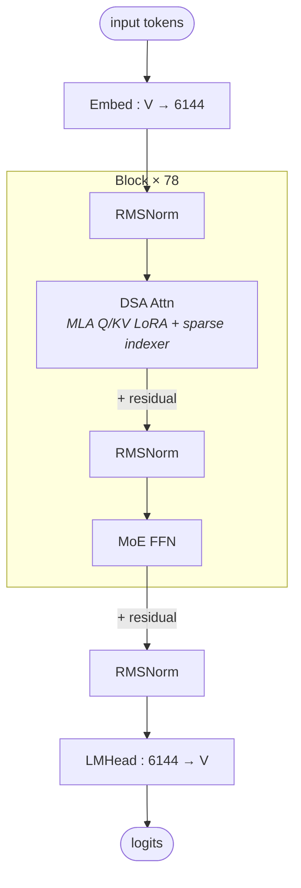

# GLM-5

## Summary

GLM-5 在本卡对应744B/激活40B的MoE检查点，采用MLA主干与Lightning Indexer组成的DSA。与DeepSeek-V3.2-Exp为机制同族，层数、维度、词表和实现参数不同，不能把“沿用方案”解释成所有配置及代码完全相同。

平台配置、开关和验收步骤见[模型部署流程](../../guides/models/glm_5_deployment.md)，此处只保留模型机制。

## 架构图（stock HF 基线）

下图为 GLM-5 的 stock HuggingFace 架构先验（部署无关），依据 `zai-org/GLM-5/config.json` 与 transformers `glm_moe_dsa` 建模代码。

精简参数表（与部署用 `configuration_glm.py` 默认值一致）：

| 参数 | 值 |
| --- | --- |
| vocab / hidden / n_layers | 154880 / 6144 / 78 |
| n_routed_experts / n_shared_experts / top_k | 256 / 1 / 8 |
| dense intermediate / moe intermediate | 12288 / 2048 |
| dense层 / MoE层（从1计数） | 1–3 / 4–78 |
| routed_scaling_factor / n_group / topk_group | 2.5 / 1 / 1 |
| scoring / balance | sigmoid / noaux_tc |
| max_position_embeddings / rms_norm_eps | 202752 / 1e-5 |
| norm_topk_prob / tie_word_embeddings | True / False |

> 配置构造器接受显式 mlp_layer_types；只有未提供时才生成前三层 dense、后续 sparse 的默认列表。stock HF 基线可按该列表描述；此固定部署的 GlmMoeDsaDecoderLayer 实际以 n_routed_experts 非空、layer_idx >= first_k_dense_replace 且 layer_idx % moe_layer_freq == 0 判断 MoE，不能把默认列表当作部署执行的硬编码。

## DSA 注意力（MLA + Indexer）

GLM-5 的注意力是 `GlmMoeDsaAttention`，即 V3.2-Exp 同款 DSA（MLA + Lightning Indexer），算子机理见 [dsa](../modules/dsa.md)、[mla](../modules/mla.md)、[lightning-indexer](../modules/lightning_indexer.md)。

- **MLA 维度**：MHA（`num_attention_heads = num_key_value_heads = 64`）。`q_lora_rank 2048`、`kv_lora_rank 512`；`qk_nope_head_dim 192 + qk_rope_head_dim 64 = qk_head_dim 256`、`v_head_dim 256`、`head_dim 64`（= rope 维）。
- **Indexer（DSA）**：`GlmMoeDsaIndexer`，`index_n_heads 32`、`index_head_dim 128`、`index_topk 2048`、`indexer_rope_interleave True`。每 q token 由 Indexer 选出 TopK=2048 个相关 kv 后再算注意力。
- **算子路径**：先按 `cp_size > 1 and is_prefill` 选择 `forward_absorb_cp`，否则选择 `forward_absorb`；两者是替代分支，各自在内部准备 Q/KV，并执行 MLAProlog、稀疏注意力和 Epilog，不串行调用。算子层面见 [mla-prolog](../kernels/mla_prolog.md)、[sparse-flash-attention](../kernels/sparse_flash_attention.md)、[lightning-indexer](../kernels/lightning_indexer.md)。

## MoE（256 路由 + 1 共享，TopK=8）

`GlmMoeDsaMoE`：256 routed + 1 shared expert，每 token 选 8 个路由专家（`top_k + shared = 9` 激活），`routed_scaling_factor 2.5`。

- **路由**：`scoring_func=sigmoid`（`logits.sigmoid()`，`:291`）+ `topk_method=noaux_tc`（无辅助损失均衡，`:258`）。`n_routed_experts ∈ [256, 384]` 时走融合算子 `npu_moe_gating_top_k`（`norm_type=1` 即 sigmoid，`:276`）。

## 当前 Executor 与量化

模型身份是models/glm_5，不能因代码相似迁到glm_5_2或glm_5_3。当前已使用统一InferenceConfig、CommManager、packed TND和CacheEntry；CP依metadata.enabled选择，临时全局计算KV与持久请求缓存分开。attn_tp_size固定为1，MoE Prefill按EP一致chunk数分块。

950已有ci_950/glm_5_w8a8mxfp8.yaml与转换w8a8-mx路径，区别于A3整数量化。update_kv_quant_settings在950浮点量化时把MLA KV和LI Cache设为float8；其他量化路径将LI Cache设int8。Indexer先Hadamard再按模式dynamic_quant或dynamic_block_quant，weights_proj保持不量化，GLM的interleave RoPE不能替换成V3.2-Exp的rotary_mul。

950权重后处理只对选定q_a/q_b/kv_a投影使用NZ，其余权重不因YAML enable_weight_nz统一转NZ；MXFP8这些投影的scale再转置、重排并view成E8M0。模型拒绝950 offload，也拒绝在线offload；仅unquant/int8缓存可进A3 offline offload。图模式、实际软件环境与其他边界见Guide。

## 部署与证据入口

- [模型部署与验收流程](../../guides/models/glm_5_deployment.md)：配置、开关、失效条件与回退入口。
- [GLM-5 A3 W8A8 Decode 的来源性能观测](../../optimizations/benchmark_observations/glm5_a3_source_benchmark.md)：固定来源自报，未经本仓独立复测。

## Evidence

- [README.md](../../../../../cann-recipes-raw/cann-recipes-infer/944d2d3ece86f7df33dbb0cb155c72ca619a9c66/models/glm_5/README.md)（primary）
- [configuration_glm.py](../../../../../cann-recipes-raw/cann-recipes-infer/944d2d3ece86f7df33dbb0cb155c72ca619a9c66/models/glm_5/models/configuration_glm.py)（implementation）
- [modeling_glm.py](../../../../../cann-recipes-raw/cann-recipes-infer/944d2d3ece86f7df33dbb0cb155c72ca619a9c66/models/glm_5/models/modeling_glm.py)（implementation）
- [indexer.py](../../../../../cann-recipes-raw/cann-recipes-infer/944d2d3ece86f7df33dbb0cb155c72ca619a9c66/models/glm_5/models/indexer.py)（implementation）
- [glm_5_w8a8mxfp8.yaml](../../../../../cann-recipes-raw/cann-recipes-infer/944d2d3ece86f7df33dbb0cb155c72ca619a9c66/models/glm_5/config/ci_950/glm_5_w8a8mxfp8.yaml)（implementation）

## Links

- [deepseek-v3.2-exp](deepseek_v3_2_exp.md)
- [dsa](../modules/dsa.md)
- [mla](../modules/mla.md)
- [lightning-indexer](../modules/lightning_indexer.md)
- [sparse-flash-attention](../kernels/sparse_flash_attention.md)
- [lightning-indexer](../kernels/lightning_indexer.md)
- [mla-prolog](../kernels/mla_prolog.md)
- [moe-dispatch-combine-v2](../techniques/moe_dispatch_combine_v2.md)
- [double-routing](../techniques/double_routing.md)
- [expert-parallel](../parallelism/expert_parallel.md)
- [context-parallel](../parallelism/context_parallel.md)
- [mtp-speculative-decoding](../techniques/mtp_speculative_decoding.md)
- [kvcache-offload](../techniques/kvcache_offload.md)
- [w8a8c8](../quantization/w8a8c8.md)
- [npu-graph-mode](../techniques/npu_graph_mode.md)
- [weight-nz](../techniques/weight_nz.md)
- [atlas-a3](../platforms/atlas_a3.md)
- [indexer-prolog](../kernels/indexer_prolog.md)（GLM-5 indexer 前处理 Q/Weight 多流切流 "22"/"33"）
