# HSTU

## Summary

HSTU（Hierarchical Sequential Transduction Unit）面向生成式推荐，将用户、物品与上下文的离散ID序列用于检索和排序。其容量侧重稀疏Embedding，序列使用jagged形态，不能照搬文本LLM的词表、KV与并行假设。

原总览引用的论文业务A/B数字没有本NPU样例的对应实验，不作为本卡部署收益。平台配置、开关和验收步骤见[模型部署流程](../../guides/models/hstu_deployment.md)，此处只保留模型机制。

## Architecture And Serving Traits

HSTU 是生成式推荐模型，与 LLM 的核心差异：

| 维度 | LLM | HSTU (GR) |
| ---- | ---- | ---- |
| 输入 | 文本 token 序列（固定词表） | 用户/物品/上下文的离散 ID 序列（千万~亿级词表） |
| 容量主体 | dense Transformer 权重 | 稀疏 **Embedding Tables** |
| 序列形态 | padded / packed token 序列 | **jagged tensor**（变长，含 `seqlen_offsets` / `num_candidates_offsets`） |
| 并行侧重 | TP + EP + DP | **Embedding TP + DP** |
| KV Cache | Paged Attention KV | Paged HSTU KV + 多级缓存（device + Host Offload） |
| 任务 | 自回归 token 生成 | 检索 + 排序（ranking）一体 |

```mermaid
flowchart TD
 In[ID 序列 + positional + timestamp] --> Emb[Embedding TP Lookup]
 Emb --> Jag[Jagged Tensor 组装]
 Jag --> HSTUBlock[HSTU Block × L]
 HSTUBlock --> Q[Q/K/V jagged]
 Q --> FA[hstu_paged 融合算子<br/>含 silu_scale + paged KV + target_group]
 FA --> MLP[in_linear_silu + 后处理]
 MLP --> Post[Ranking 输出]

 subgraph KV 管理
 Kcache[paged_k_cache / paged_v_cache<br/>layout: &#91;L,2,pages,block&#93;]
 Reshape[_npu_reshape_and_cache<br/>append_kv_cache]
 Offload[KV Offload Stream<br/>异步到 Host]
 end
 FA -.->|append| Reshape --> Kcache
 Kcache -.->|每层 Attention 完成即触发| Offload
```

## 部署与证据入口

- [模型部署与验收流程](../../guides/models/hstu_deployment.md)：配置、开关、失效条件与回退入口。

## Evidence

- [cann-recipes-infer](https://gitcode.com/cann/cann-recipes-infer/tree/2c45117d781ab9ab88dcb89a28ae30f5d2450399) — [`docs/models/hstu/hstu_optimization.md`](https://gitcode.com/cann/cann-recipes-infer/blob/2f82d10467e6fe8dae81c97a2cdac78d733a6703/docs/models/hstu/hstu_optimization.md)（NPU 模型适配 / 算子适配 / 分布式推理 / KV Offload 并行 / 其他优化方向五大章节 + 3 张源图）
- [cann-recipes-infer](https://gitcode.com/cann/cann-recipes-infer/tree/2c45117d781ab9ab88dcb89a28ae30f5d2450399) — [`models/hstu/README.md`](https://gitcode.com/cann/cann-recipes-infer/blob/2f82d10467e6fe8dae81c97a2cdac78d733a6703/models/hstu/README.md)（环境准备、RecSDK 算子依赖、`concat_nd_jagged_npu` cpp 适配代码、推理执行命令、分布式启动命令、优化点清单）
- [cann-recipes-infer](https://gitcode.com/cann/cann-recipes-infer/tree/2c45117d781ab9ab88dcb89a28ae30f5d2450399) — [`models/hstu/modules/`](https://gitcode.com/cann/cann-recipes-infer/tree/2f82d10467e6fe8dae81c97a2cdac78d733a6703/models/hstu/modules)（NPU 适配核心模块：`kv_cache_manager_impl.py`、`paged_hstu_infer_layer.py`、`inference_embedding.py`、`hstu_processor.py`、`position_encoder.py`、`gpu_kv_cache_manager.py`）
- [cann-recipes-infer](https://gitcode.com/cann/cann-recipes-infer/tree/2c45117d781ab9ab88dcb89a28ae30f5d2450399) — [`models/hstu/hstu_cann.patch`](https://gitcode.com/cann/cann-recipes-infer/blob/2f82d10467e6fe8dae81c97a2cdac78d733a6703/models/hstu/hstu_cann.patch)、[`models/hstu/build_install_ops.sh`](https://gitcode.com/cann/cann-recipes-infer/blob/2f82d10467e6fe8dae81c97a2cdac78d733a6703/models/hstu/build_install_ops.sh)（recsys-examples 适配补丁与算子编译脚本）

## Links

- [embedding-tp](../parallelism/embedding_tp.md)
- [data-parallel](../parallelism/data_parallel.md)
- [kvcache-offload](../techniques/kvcache_offload.md)（HSTU 变体）
- [ascendc](../frameworks/ascendc.md)
