```mermaid
flowchart TD
 In[ID 序列 + positional + timestamp] --> Emb[Embedding TP Lookup]
 Emb --> Jag[Jagged Tensor 组装]
 Jag --> HSTUBlock[HSTU Block × L]
 HSTUBlock --> Q[Q/K/V jagged]
 Q --> FA[hstu_paged 融合算子<br/>含 silu_scale + paged KV + target_group]
 FA --> MLP[in_linear_silu + 后处理]
 MLP --> Post[Ranking 输出]

 subgraph KV 管理
 Kcache[paged_k_cache / paged_v_cache<br/>layout: &#91;L,2,pages,block&#93;]
 Reshape[_npu_reshape_and_cache<br/>append_kv_cache]
 Offload[KV Offload Stream<br/>异步到 Host]
 end
 FA -.->|append| Reshape --> Kcache
 Kcache -.->|每层 Attention 完成即触发| Offload
```

# HSTU

## Summary

HSTU（Hierarchical Sequential Transduction Unit）是 Meta 论文《Actions Speak Louder Than Words》提出的**生成式推荐（Generative Recommendation, GR）架构**，把推荐视为生成建模问题，以应对高基数、非平稳的数据流，同时**统一支持检索与排序**。基于 HSTU 的超大模型（1.5 万亿参数）在线 A/B 指标提升 **12.4%**，已在 Meta 多平台部署。

cann-recipes-infer 基于 NVIDIA [recsys-examples](https://github.com/NVIDIA/recsys-examples) `v25.11` 仓库进行 NPU 适配，替换了 GPU 算子与 tensorrt-llm KV Cache 管理逻辑，在 Atlas A2 系列产品上实现了 HSTU 单卡与多卡推理。与 LLM 模型不同，**HSTU 是生成式推荐模型**：输入是用户行为/物品的离散 ID 序列（jagged tensor），模型容量主要在**超大 Embedding 表**上，dense 部分相对较小。

### Highlights

- **Atlas A2 系列**单卡/多卡推理，依赖 RecSDK-Torch Docker 镜像 + CANN 8.5.0 + nnal 加速库
- **KV Cache 管理 NPU 化**：`kv_cache_manager_impl` 替代 tensorrt-llm 原实现
- **三个 NPU 融合算子适配**：`hstu_paged`（HSTU 自研 attention 算子）、`in_linear_silu`、`concat_nd_jagged`（`concat_2d_jagged` 的 n 路扩展）
- **KV Cache layout 重排**：`[num_pages, num_layers, 2, block_size]` → `[num_layers, 2, num_pages, block_size]`，引入 `_npu_reshape_and_cache` 加速 append
- **分布式推理**：[embedding-tp](../parallelism/embedding_tp.md) + DP，`--embed_tp_size` 控制
- **KV Offload 与 HSTU dense 计算并行**：见 [kvcache-offload](../techniques/kvcache_offload.md)（HSTU 变体）
- **ACLGraph 使能**：单算子模式 + 图模式均支持 KV Offload 并行

## Architecture And Serving Traits

HSTU 是生成式推荐模型，与 LLM 的核心差异：

| 维度 | LLM | HSTU (GR) | | ---- | ---- | ---- | | 输入 | 文本 token 序列（固定词表） | 用户/物品/上下文的离散 ID 序列（千万~亿级词表） | | 容量主体 | dense Transformer 权重 | 稀疏 **Embedding Tables** | | 序列形态 | padded / packed token 序列 | **jagged tensor**（变长，含 `seqlen_offsets` / `num_candidates_offsets`） | | 并行侧重 | TP + EP + DP | **Embedding TP + DP** | | KV Cache | Paged Attention KV | Paged HSTU KV + 多级缓存（device + Host Offload） | | 任务 | 自回归 token 生成 | 检索 + 排序（ranking）一体 |



### 推理执行入口与规格

- 入口脚本：`models/hstu/inference/inference_gr_ranking.py`
- gin config：`models/hstu/inference/configs/kuairand_1k_inference_ranking.gin`
- 推理模式：
 - **eval 模式**：`--mode eval --enable_fused_ops all`
 - **simulate 模式**：`--mode simulate --enable_fused_ops all`
 - **profiling**：追加 `--enable_profiler`
- 数据集：`kuairand-1k`（`python3 ./preprocessor.py --dataset_name "kuairand-1k" --inference` 预处理）

单机两卡分布式推理示例：

```bash
ASCEND_RT_VISIBLE_DEVICES=0,1 \
torchrun --rdzv-backend=c10d --rdzv-endpoint=localhost:6000 \
 --nnodes=1 --nproc-per-node=2 \
 ./inference/inference_gr_ranking.py \
 --gin_config_file ./inference/configs/kuairand_1k_inference_ranking.gin \
 --embed_tp_size 2 --mode eval --enable_fused_ops all
```

### 外部依赖

- **recsys-examples v25.11**：HSTU 参考实现（GPU 路径），NPU 基于此适配
- **RecSDK**（gitcode.com/Ascend/RecSDK）：算子库（`concat_2d_jagged`、`in_linear_silu` 等）
- **nnal 加速库**：`_npu_reshape_and_cache` 依赖
- **catlass v1.3.0**：`in_linear_silu` 算子依赖 CATLASS 源码（通过 `CATLASS_HOME` 环境变量指向）
- **hstu_cann.patch**：对 recsys-examples 源码的 NPU 适配补丁
- `torchrec==1.1.0` + `fbgemm_npu`（通过 `LIB_FBGEMM_NPU_API_SO_PATH` 指向）

## Known Optimizations

来源文档见 Evidence 中的 `hstu_optimization.md`。

### NPU 模型适配

我们在 Nvidia Recsys-Examples 仓库的基础上，实现了 **GPU 算子的 Torch 小算子替换**，以及 KV Cache 的管理逻辑，实现了 NPU 的 `kv_cache_manager_impl` 类，**代替了原有的 tensorrt-llm 框架实现逻辑**。

实现了 `kv_cache_manager_impl` 的以下方法，代码在 `models/hstu/modules/kv_cache_manager_impl.py` 文件中：

- `allocate_pools`
- `get_primary_pool`
- `get_num_free_blocks`
- `add_sequence_with_eviction`
- `remove_sequence`
- `evict_all_sequences`
- `get_cached_start_position`
- `get_num_tokens_cached`
- `get_cache_block_ids`

在小算子的适配逻辑上，适配了以下 torch 算子实现：

- `jagged_2D_tensor_concat`
- `torch_split_2D_jagged`
- `torch_add_position_embeddings`
- `torch_add_timestamp_positional_embeddings`

此外，涉及到 GPU 的 **dynamic embedding** 用 `nn.Embedding` 来实现。

### NPU 算子适配

#### NPU `hstu_paged` 融合算子

在 HSTU attention 部分，Nvidia 实现了自己的 CUDA 算子，NPU 下已经有对应的融合算子，我们基于计算逻辑，实现了 `hstu_paged` 融合算子适配：

```python
# 来自 models/hstu/modules/paged_hstu_infer_layer.py
jagged_attn_output = torch.ops.mxrec.hstu_paged(
 q=query,
 k=key,
 v=value,
 kv_cache=kv_cache_table,
 mask=None,
 attn_bias=None,
 mask_type=2,
 max_seq_len=self._max_seqlen,
 max_seq_len_k=jd.seqlen_k,
 silu_scale=1.0 / self._max_seqlen,
 seq_offset=jd.seqlen_offsets,
 seq_offset_k=kv_cache_metadata.total_history_offsets,
 seq_offset_t=jd.num_candidates_offsets,
 page_offsets=kv_cache_metadata.kv_indptr,
 page_ids=kv_cache_metadata.kv_indices,
 last_page_len=kv_cache_metadata.kv_last_page_len,
 num_target=jd.num_candidates,
 target_group_size=1)
```

> HSTU attention 与 LLM 标准 Softmax Attention 的差异：含 `silu_scale`（SiLU 缩放因子，默认 `1/max_seq_len`）、支持 jagged 序列（`seqlen_offsets`）、支持候选物品分组（`num_candidates_offsets` + `target_group_size`）、paged KV 存储（`page_offsets` + `page_ids` + `last_page_len`）。

#### NPU `_npu_reshape_and_cache` 算子

在 kvcache 管理方面，**原始的 kv cache 的 layout 是 `[num_pages, num_layers, 2, block_size]`**，我们**将其修改为 `[num_layers, 2, num_pages, block_size]` 形式**，引入 `_npu_reshape_and_cache` 算子加速 `append_kv_cache` 的计算。

```python
torch_npu._npu_reshape_and_cache(src_k, src_v, paged_k_cache, paged_v_cache, slot_i32)
```

#### NPU `concat_nd_jagged` 算子

我们将 GPU 侧的 **Triton 融合算子 `triton_concat_2D_jagged`** 以及 **CUDA 融合算子 `jagged_2D_tensor_concat`** 统一替换为 NPU 侧的 `concat_nd_jagged`，实现同等功能的高效迁移。

`concat_nd_jagged` 算子在 RecSDK 团队开发的 `concat_2d_jagged` 算子基础上优化衍生，**原生算子仅支持 2 个 tensor 的 concat，不能完全满足 HSTU 模型的场景要求**；我们在 Torch 适配层完成增强改造，将能力扩展为支持 **n（n ≥ 2）个 tensor 的 jagged concat 场景**，从而覆盖更通用的融合拼接需求并降低算子分裂与维护成本。

具体增强实现（新增 `concat_nd_jagged_npu` 函数并注册到 `mxrec` 命名空间）见 `models/hstu/README.md` "相关依赖安装 - RecSDK 算子库安装"章节的 cpp 代码片段。

### 分布式推理（Embedding TP + DP）

我们在推理侧新增了分布式推理能力，主要是 **Embedding Tensor Parallel (TP) 和 Data Parallel (DP)**。生成式推荐与普通 LLM 任务的最大不同在于：

- **LLM**：参数主要集中在 dense Transformer 权重里，输入 token 来自于相对固定的文本词表；
- **生成式推荐**：往往把用户、物品、上下文等离散特征统一建模为 token，模型容量**绝大部分来自超大规模的稀疏参数（Embedding Tables）**，词表规模可达千万甚至上亿。

基于此，我们在推理侧引入 Embedding TP（如下图），对大表**按 vocab 维度切分**到不同 NPU 上，以减少单卡显存负担，支撑模型推理。同时，在 Embedding TP 外采用 DP 进行并行处理，Embedding 部分进行 **DP → TP → DP** 的操作。


*来源：[`docs/models/hstu/figures/embedding_tp.png`](https://gitcode.com/cann/cann-recipes-infer/blob/2f82d10467e6fe8dae81c97a2cdac78d733a6703/docs/models/hstu/figures/embedding_tp.png)（cann-recipes-infer @ 2f82d10）*

详见 [embedding-tp](../parallelism/embedding_tp.md)。

### KV Offload 与 HSTU dense 计算并行

将 KV offload 时机**前移**到每层 Attention 结束立即触发，放到另一条 NPU stream 异步执行，实现**计算链路（HSTU dense + MLP + 后处理）与通信链路（KV offload）的重叠**，显著降低流水线空泡。详见 [kvcache-offload](../techniques/kvcache_offload.md)（HSTU 变体）。

### 其他已使能的优化点

README "优化点介绍"章节列出的额外优化：

- TensorRT-LLM 库 KV Cache 管理 impl 方法的 NPU 适配替换（见 NPU 模型适配）
- 使用 torch 小算子替换 Triton 和 CUDA 算子（见 NPU 模型适配）
- **KVCache 多级缓存、onload 和 offload 流程适配与优化**
- **高性能融合算子接入**（`hstu_paged`、`in_linear_silu`、`concat_nd_jagged`）
- **ACLGraph 使能**
- KV Cache layout 优化，引入 `_npu_reshape_and_cache` 算子（见 NPU `_npu_reshape_and_cache` 算子）
- 分布式推理功能，在 Embedding Table 占用显存大的情况下，支持更大的 dense 参数模型推理（见 分布式推理）
- **使能单算子模式和图模式下的 KV Offload 与 dense 层计算并行，实现通算掩盖**（见 KV Offload 与 HSTU dense 计算并行）

### 其他优化方向（TODO）

源文档列出的后续方向：

- 使用融合算子对前处理部分的 `concat_2d_jagged` 进行处理
- 使能 HSTU dense 模块计算与 offload 并行
- 完成更多融合算子的开发和接入，以进一步降低推理时延
- 在 embedding 处理和 offload 流程上通过尝试使能 **shmen** 等手段进一步提升性能

## Evidence

- [cann-recipes-infer](https://gitcode.com/cann/cann-recipes-infer/tree/2c45117d781ab9ab88dcb89a28ae30f5d2450399) — [`docs/models/hstu/hstu_optimization.md`](https://gitcode.com/cann/cann-recipes-infer/blob/2f82d10467e6fe8dae81c97a2cdac78d733a6703/docs/models/hstu/hstu_optimization.md)（NPU 模型适配 / 算子适配 / 分布式推理 / KV Offload 并行 / 其他优化方向五大章节 + 3 张源图）
- [cann-recipes-infer](https://gitcode.com/cann/cann-recipes-infer/tree/2c45117d781ab9ab88dcb89a28ae30f5d2450399) — [`models/hstu/README.md`](https://gitcode.com/cann/cann-recipes-infer/blob/2f82d10467e6fe8dae81c97a2cdac78d733a6703/models/hstu/README.md)（环境准备、RecSDK 算子依赖、`concat_nd_jagged_npu` cpp 适配代码、推理执行命令、分布式启动命令、优化点清单）
- [cann-recipes-infer](https://gitcode.com/cann/cann-recipes-infer/tree/2c45117d781ab9ab88dcb89a28ae30f5d2450399) — [`models/hstu/modules/`](https://gitcode.com/cann/cann-recipes-infer/tree/2f82d10467e6fe8dae81c97a2cdac78d733a6703/models/hstu/modules)（NPU 适配核心模块：`kv_cache_manager_impl.py`、`paged_hstu_infer_layer.py`、`inference_embedding.py`、`hstu_processor.py`、`position_encoder.py`、`gpu_kv_cache_manager.py`）
- [cann-recipes-infer](https://gitcode.com/cann/cann-recipes-infer/tree/2c45117d781ab9ab88dcb89a28ae30f5d2450399) — [`models/hstu/hstu_cann.patch`](https://gitcode.com/cann/cann-recipes-infer/blob/2f82d10467e6fe8dae81c97a2cdac78d733a6703/models/hstu/hstu_cann.patch)、[`models/hstu/build_install_ops.sh`](https://gitcode.com/cann/cann-recipes-infer/blob/2f82d10467e6fe8dae81c97a2cdac78d733a6703/models/hstu/build_install_ops.sh)（recsys-examples 适配补丁与算子编译脚本）

## Links

- [embedding-tp](../parallelism/embedding_tp.md)
- [data-parallel](../parallelism/data_parallel.md)
- [kvcache-offload](../techniques/kvcache_offload.md)（HSTU 变体）
- [ascendc](../frameworks/ascendc.md)
