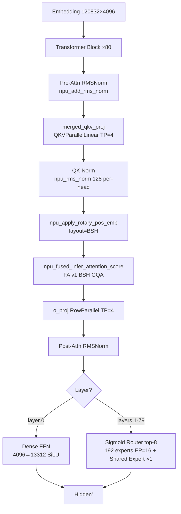

# Hy3-preview

## Summary

Hy3-preview 是腾讯混元（Tencent Hy Team）的大规模 MoE 语言模型：总参 **295B**（295,033,543,488）、激活 **~21B/token**，结构为 **Dense + Sparse MoE with Shared Expert + GQA** 的 MoE Transformer。cann-recipes-infer 在 **Atlas A3（8 卡 × 2 die = 16 die）** 上以 **BF16 + ge_graph** 图模式完成 NPU 推理适配。

仓库内最接近的参考实现是 [qwen3-moe](qwen3_moe.md)（同为 GQA + MoE + per-head QK Norm）。Hy3-preview 相对 Qwen3-MoE 的主要差异是 **shared expert**（Qwen3-MoE `shared_expert_num=0` 无）、**sigmoid router**（Qwen3-MoE 用 softmax）、e_score bias 语义与 MTP 跳过——**QK Norm 为 Qwen3 系共性（两者均 per-head `RMSNorm(head_dim)`），非差异点**。通用并行/图模式/融合算子机制见各专题页 [tensor-parallel](../parallelism/tensor_parallel.md) / [expert-parallel](../parallelism/expert_parallel.md) / [npu-graph-mode](../techniques/npu_graph_mode.md)。（注：hy3 优化报告 §1.1 参考模型括注把 qwen3-moe 标为含 Shared Expert，与 `modeling_qwen3_moe.py` 中 `shared_expert_num=0` 不符。）

### Highlights

- **QK Norm**：Q/K 在 RoPE 前各经 per-head `RMSNorm(128)`，由 `npu_rms_norm` 优化（per-head RMSNorm，与 Qwen3-MoE 同构、为 Qwen3 系共性而非独有）。
- **Sigmoid Router**：router 用 sigmoid 而非 softmax，融合为 `npu_moe_gating_top_k(norm_type=1)`，top-8 权重 × `router_scaling_factor=2.826`。
- **Shared Expert ×1**（每 MoE 层）：gate/up 4096→1536、down 1536→4096，与 192 路由专家并行。
- **MTP layer（layer 80）推理跳过**：模型含 MTP 层（~3.8B）但推理不加载（`_ignore_weights_patterns=["model.layers.80."]`）。
- **图模式 + SuperKernel**：Decode 整图，层循环外包 `superkernel_scope`；multi-stream 当前关闭。

## Architecture And Serving Traits

- **80 层**：代码 `mlp_layer_types = ["dense"] + ["sparse"] * (num_hidden_layers-1)`（`first_k_dense_replace=1`）—— **layer 0 为 Dense FFN，layers 1-79 为 Sparse MoE**。
- **GQA**：64 Q heads / 8 KV heads，head_dim=128；KVCache BSH 布局 `[B, S, N_kv·D]`，无 MLA / 无量化需求，QK Norm per-head 与 BSH 兼容。
- **MoE**：192 experts、top-8；每 rank 12 experts（192/16，EP=16）；专家计算走 `npu_grouped_matmul(split_item=2)` + `npu_swiglu`。`HYV3Experts.forward_gmm` 把权重以 `w1 = gate_up_proj.transpose(1, 2)` / `w2 = down_proj.transpose(1, 2)` 的 view 喂入（非 `.contiguous()` 副本），废弃 `_prepare_gmm_weights()` 的 `.transpose().contiguous()` 权重副本（35.8 GB），是 ge_graph 编译期避免 OOM 的关键（F-3）。
- **关键参数**：Hidden 4096、词表 120,832、Dense FFN intermediate 13312、MoE expert intermediate 1536、最大上下文 262,144（256K）、RoPE theta 11,158,840。

### 特殊设计

- **QK Norm**（`qk_norm=True`）：`HYV3Attention` 中 Q/K 在 RoPE 前各做 `npu_rms_norm(128)`（per-head）。
- **Sigmoid Router**（`moe_router_use_sigmoid=True`，`HYV3TopKRouter`）：`npu_moe_gating_top_k(router_logits, k=8, bias=e_score_correction_bias, norm_type=1, routed_scaling_factor=2.826)`。
  > ⚠️ **doc/impl 语义差异（源已标注）**：Hy3-preview 的 `e_score_correction_bias` 在 sigmoid **后**加（仅影响 top-k 选择），而 `npu_moe_gating_top_k` 的 bias 在 sigmoid **内**。报告 §5.1 称此语义差异未造成可见输出质量退化（`optimization_report.md:158`）。
- **Shared Expert**（`num_shared_experts=1`）：每 MoE 层 1 个 shared expert，与路由专家并行，intermediate=1536。

### KVCache + FA

KVCache 静态化为连续缓存（BSH，`scatter_update_(axis=-2)`），非块式 Paged Attention（对照 [kv-cache-manager](../frameworks/kv_cache_manager.md)）。Attention 走 [fused-infer-attention-score](../kernels/fused_infer_attention_score.md) **FA v1**：decode `sparse_mode=0`（atten_mask=None）、prefill `sparse_mode=3`（causal），`input_layout="BSH"`，`scale=scale_fa`。GQA 场景无 MLA / 量化需求，故不适配 `npu_kv_rmsnorm_rope_cache` / `npu_mla_prolog_v3`（MLA 专用）。

### 并行与图模式

- 16 die：`attn_tp_size=4`（N_kv=8 约束，每 rank 2 个 KV head）、`dense_tp_size=4`、`embed_tp_size=4`、`lmhead_tp_size=4`、`moe_tp_size=1`（expert intermediate=1536 太小，TP 会切碎矩阵）、`moe_ep_size=16`（全卡 EP，见 [expert-parallel](../parallelism/expert_parallel.md) / [tensor-parallel](../parallelism/tensor_parallel.md)）。Attention 走 TP、MoE 走 EP（DP 体现在 attn_tp 之外的部署面）。
- 权重在线切分 `enable_online_split_weight=True`。
- **图模式** `ge_graph`（[npu-graph-mode](../techniques/npu_graph_mode.md)）：Decode 整图、Prefill 走 eager；EP 路由在图模式下用一体化融合算子 `npu_moe_distribute_dispatch_v2` / `combine_v2`（[moe-dispatch-combine-v2](../techniques/moe_dispatch_combine_v2.md)）替代手动 all_to_all 以消除 graph break，eager 路径仍走手动 all_to_all。Prefill（`is_prefill`）走 eager 的 `_moe_ep_manual`，并由 `HYV3MoE._split_tensors` 按 `moe_chunk_max_len`（默认 65536）沿 token 维把 dispatch/combine 切成 `ceil(num_tokens/moe_chunk_max_len)` 块，以约束 `expanded_x` / `gathered_tokens` 中间张量峰值显存（默认对典型 Prefill 长度等于不分块，可下调如 4096 进一步降峰）；router 仍在全 token 上做 top-k，不分块。
- **SuperKernel**（[superkernel](../techniques/superkernel.md)，`enable_superkernel=True`）：Decode 层循环外包一个 `superkernel_scope("decode_layer", ...)`，Prefill 不进入。
- **multi-stream 关闭**（`enable_multi_streams=False`）：shared expert intermediate=1536 太小，无法有效 overlap，代码保留。

### combine_v2 + shared_expert_x 回退

`npu_moe_distribute_combine_v2` 的 `shared_expert_x` 参数与 SuperKernel 在 **CANN 8.5.0** 下不兼容：融合链过长超过 2-stream 限制（编译报 `super kernel do not support more than 2 real stream`），该融合已回退（当前 `combine_v2` 调用不传 `shared_expert_x`），待 CANN 更新后可重启（`optimization_report.md:273/305`）。关联 [moe-dispatch-combine-v2](../techniques/moe_dispatch_combine_v2.md) + [superkernel](../techniques/superkernel.md)。

### MTP

模型结构含一个 MTP layer（layer 80，~3.8B params），但**推理跳过**（config `_keys_to_ignore_on_load_unexpected = [r"model\.layers\.80.*"]`、modeling `_ignore_weights_patterns=["model.layers.80."]`），因此本部署不做 [mtp-speculative-decoding](../techniques/mtp_speculative_decoding.md)，仅在权重加载层面忽略 MTP 权重。

## Benchmark

> ⚠️ **源内数值分歧（并记，不臆断单值）**：均基于 Atlas A3 16 die / BF16 / ge_graph + SuperKernel + compile cache。
> - `optimization_report.md` §6.3/§7.1：Decode **30.8 ms/t**（SuperKernel 阶段累计表）；§7.1/§10.2：最终重编译 **28.44 ms/t**（2026-04-28 实测，range 27.4-29.4，32 tokens）；对 eager 基线 293 ms/t 分别约 9.5× / 10.3×。
> - README / 报告 §7 累计表：Decode **28.44 ms/t**（10.3×）。
> 两处口径/日期不同（30.8 为 SuperKernel 阶段值，28.44 为后续重编译值），不合并为单一数字。

- Prefill（1024 tokens）：eager 基线 **2,070 ms**（报告 §2，**batch=4**）；最终 ge_graph **1,452 ms**（README/YAML，**batch=16**）。⚠️ 两值 batch 口径不同（4 vs 16），不可直接相除算加速比；ge_graph 模式下 Prefill 仍走 eager 路径。
- Decode 显存：~54.5 GB/die（BF16，EP+TP 分布后）。
- 配置前提：`hy3_preview_rank16_4tp_16ep_gegraph_bf16.yaml`，`batch_size=16`，`input_truncated_len=400`，`max_new_tokens=112`。

## Evidence

- [cann-recipes-infer](https://gitcode.com/cann/cann-recipes-infer/tree/2c45117d781ab9ab88dcb89a28ae30f5d2450399) — [`models/hy3_preview/optimization_report.md`](https://gitcode.com/cann/cann-recipes-infer/blob/2c45117d781ab9ab88dcb89a28ae30f5d2450399/models/hy3_preview/optimization_report.md)（11 章：模型信息 / 基线 / 并行 / KVCache+FA / 融合算子 / 图模式 / 累计效果 / 功能·性能问题 / 遗留 / Skill 反馈）
- [cann-recipes-infer](https://gitcode.com/cann/cann-recipes-infer/tree/2c45117d781ab9ab88dcb89a28ae30f5d2450399) — [`models/hy3_preview/README.md`](https://gitcode.com/cann/cann-recipes-infer/blob/2c45117d781ab9ab88dcb89a28ae30f5d2450399/models/hy3_preview/README.md)（概述 / 规模 / 关键特性 / `CANN 9.0.0`）
- [cann-recipes-infer](https://gitcode.com/cann/cann-recipes-infer/tree/2c45117d781ab9ab88dcb89a28ae30f5d2450399) — [`models/hy3_preview/models/modeling_hy_v3.py`](https://gitcode.com/cann/cann-recipes-infer/blob/2c45117d781ab9ab88dcb89a28ae30f5d2450399/models/hy3_preview/models/modeling_hy_v3.py)（`HYV3Attention` / `HYV3TopKRouter` / `HYV3Experts` / `HYV3MoE` / `HYV3Model` / `HYV3ForCausalLM`）+ [`configuration_hy_v3.py`](https://gitcode.com/cann/cann-recipes-infer/blob/2c45117d781ab9ab88dcb89a28ae30f5d2450399/models/hy3_preview/models/configuration_hy_v3.py)（`first_k_dense_replace=1` / `qk_norm` / `moe_router_use_sigmoid` / `num_shared_experts=1` / `router_scaling_factor=2.826`）+ `models/hy3_preview/config/hy3_preview_rank16_4tp_16ep_gegraph_bf16.yaml`

> 版本前提分歧（并记）：README 标 `CANN 9.0.0`（`requirements.txt` 仅 torch 2.8.0 / transformers 5.0.0，未列 CANN）；优化报告 §10.1/§11 的 SuperKernel >2-stream 限制实测于 `CANN 8.5.0`——两处版本不一致，不臆断。

## Links

- [qwen3-moe](qwen3_moe.md)
- [atlas-a3](../platforms/atlas_a3.md)
- [tensor-parallel](../parallelism/tensor_parallel.md)
- [expert-parallel](../parallelism/expert_parallel.md)
- [data-parallel](../parallelism/data_parallel.md)
- [moe-dispatch-combine-v2](../techniques/moe_dispatch_combine_v2.md)
- [superkernel](../techniques/superkernel.md)
- [npu-graph-mode](../techniques/npu_graph_mode.md)
- [fused-infer-attention-score](../kernels/fused_infer_attention_score.md)
- [mtp-speculative-decoding](../techniques/mtp_speculative_decoding.md)
- [inference-config](../techniques/inference_config.md)
- [cann-executor](../frameworks/cann_executor.md)
- [kv-cache-manager](../frameworks/kv_cache_manager.md)

<!-- cannbot:related:start -->
## 相关

- [Qwen3-MoE](qwen3_moe.md)（`related`）：以“Qwen3-MoE 是经典 Attention + MoE（无 shared expert、无 linear attention），**不共享代码路径**。”固定参考实现的结构基线，再用“仓库内最接近的参考实现是 ［qwen3-moe］(qwen3_moe.md)（同为 GQA + MoE + per-head QK Norm）。”定位 Hy3-preview 的复用点，部署者可直接核对哪些模块能沿用、哪些必须改写。
<!-- cannbot:related:end -->
