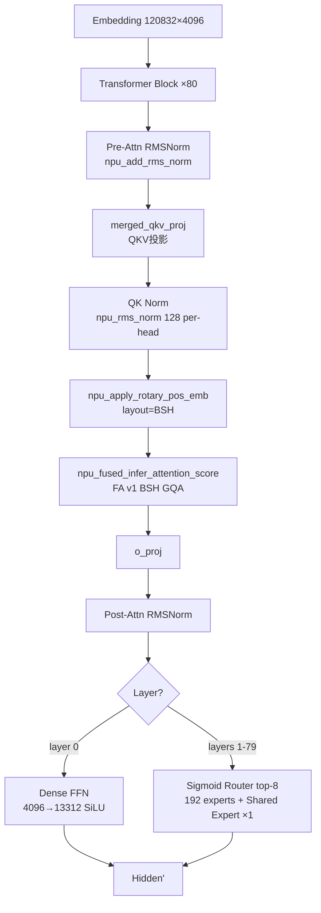

# Hy3-preview

## Summary

Hy3-preview 为GQA与Dense/Sparse MoE结合的模型，295B总参、约21B激活参数。Layer0为Dense FFN，后续为192路由专家top-8与共享专家；QK Norm为per-head，router采用sigmoid及校正bias。

Qwen3-MoE是机制参考但没有相同的shared expert与router语义；部署的量化、融合、MTP加载与回退需分别核对。平台配置、开关和验收步骤见[模型部署流程](../../guides/models/hy3_preview_deployment.md)，此处只保留模型机制。

## Architecture And Serving Traits

- **80 层**：代码 `mlp_layer_types = ["dense"] + ["sparse"] * (num_hidden_layers-1)`（`first_k_dense_replace=1`）—— **layer 0 为 Dense FFN，layers 1-79 为 Sparse MoE**。
- **GQA**：64 Q heads / 8 KV heads，head_dim=128；KVCache BSH 布局 `[B, S, N_kv·D]`，无 MLA / 无量化需求，QK Norm per-head 与 BSH 兼容。
- **MoE**：192个路由专家、top-8，另有共享专家；专家intermediate=1536。固定部署的分片和GMM内存差异见模型Guide。
- **关键参数**：Hidden 4096、词表 120,832、Dense FFN intermediate 13312、MoE expert intermediate 1536、最大上下文 262,144（256K）、RoPE theta 11,158,840。

### 特殊设计

- **QK Norm**（`qk_norm=True`）：`HYV3Attention` 中 Q/K 在 RoPE 前各做 `npu_rms_norm(128)`（per-head）。
- **Sigmoid Router**（`moe_router_use_sigmoid=True`，`HYV3TopKRouter`）：`npu_moe_gating_top_k(router_logits, k=8, bias=e_score_correction_bias, norm_type=1, routed_scaling_factor=2.826)`。
  > ⚠️ **doc/impl 语义差异（源已标注）**：Hy3-preview 的 `e_score_correction_bias` 在 sigmoid **后**加（仅影响 top-k 选择），而 `npu_moe_gating_top_k` 的 bias 在 sigmoid **内**。报告 §5.1 称此语义差异未造成可见输出质量退化（`optimization_report.md:158`）。
- **Shared Expert**（`num_shared_experts=1`）：每 MoE 层 1 个 shared expert，与路由专家并行，intermediate=1536。

### KVCache + FA

KVCache 静态化为连续缓存（BSH，`scatter_update_(axis=-2)`），非块式 Paged Attention（对照 [kv-cache-manager](../frameworks/kv_cache_manager.md)）。Attention 走 [fused-infer-attention-score](../kernels/fused_infer_attention_score.md) **FA v1**：decode `sparse_mode=0`（atten_mask=None）、prefill `sparse_mode=3`（causal），`input_layout="BSH"`，`scale=scale_fa`。GQA 场景无 MLA / 量化需求，故不适配 `npu_kv_rmsnorm_rope_cache` / `npu_mla_prolog_v3`（MLA 专用）。

## 部署与证据入口

- [模型部署与验收流程](../../guides/models/hy3_preview_deployment.md)：配置、开关、失效条件与回退入口。
- [Hy3-preview A3 分阶段性能与批次口径观测](../../optimizations/benchmark_observations/hy3_a3_source_benchmark.md)：固定来源自报，未经本仓独立复测。

## Evidence

- [cann-recipes-infer](https://gitcode.com/cann/cann-recipes-infer/tree/2c45117d781ab9ab88dcb89a28ae30f5d2450399) — [`models/hy3_preview/optimization_report.md`](https://gitcode.com/cann/cann-recipes-infer/blob/2c45117d781ab9ab88dcb89a28ae30f5d2450399/models/hy3_preview/optimization_report.md)（11 章：模型信息 / 基线 / 并行 / KVCache+FA / 融合算子 / 图模式 / 累计效果 / 功能·性能问题 / 遗留 / Skill 反馈）
- [cann-recipes-infer](https://gitcode.com/cann/cann-recipes-infer/tree/2c45117d781ab9ab88dcb89a28ae30f5d2450399) — [`models/hy3_preview/README.md`](https://gitcode.com/cann/cann-recipes-infer/blob/2c45117d781ab9ab88dcb89a28ae30f5d2450399/models/hy3_preview/README.md)（概述 / 规模 / 关键特性 / `CANN 9.0.0`）
- [cann-recipes-infer](https://gitcode.com/cann/cann-recipes-infer/tree/2c45117d781ab9ab88dcb89a28ae30f5d2450399) — [`models/hy3_preview/models/modeling_hy_v3.py`](https://gitcode.com/cann/cann-recipes-infer/blob/2c45117d781ab9ab88dcb89a28ae30f5d2450399/models/hy3_preview/models/modeling_hy_v3.py)（`HYV3Attention` / `HYV3TopKRouter` / `HYV3Experts` / `HYV3MoE` / `HYV3Model` / `HYV3ForCausalLM`）+ [`configuration_hy_v3.py`](https://gitcode.com/cann/cann-recipes-infer/blob/2c45117d781ab9ab88dcb89a28ae30f5d2450399/models/hy3_preview/models/configuration_hy_v3.py)（`first_k_dense_replace=1` / `qk_norm` / `moe_router_use_sigmoid` / `num_shared_experts=1` / `router_scaling_factor=2.826`）+ `models/hy3_preview/config/hy3_preview_rank16_4tp_16ep_gegraph_bf16.yaml`

> 版本前提分歧（并记）：README 标 `CANN 9.0.0`（`requirements.txt` 仅 torch 2.8.0 / transformers 5.0.0，未列 CANN）；优化报告 §10.1/§11 的 SuperKernel >2-stream 限制实测于 `CANN 8.5.0`——两处版本不一致，不臆断。

## Links

- [qwen3-moe](qwen3_moe.md)
- [atlas-a3](../platforms/atlas_a3.md)
- [tensor-parallel](../parallelism/tensor_parallel.md)
- [expert-parallel](../parallelism/expert_parallel.md)
- [data-parallel](../parallelism/data_parallel.md)
- [moe-dispatch-combine-v2](../techniques/moe_dispatch_combine_v2.md)
- [superkernel](../techniques/superkernel.md)
- [npu-graph-mode](../techniques/npu_graph_mode.md)
- [fused-infer-attention-score](../kernels/fused_infer_attention_score.md)
- [mtp-speculative-decoding](../techniques/mtp_speculative_decoding.md)
- [inference-config](../techniques/inference_config.md)
- [cann-executor](../frameworks/cann_executor.md)
- [kv-cache-manager](../frameworks/kv_cache_manager.md)
