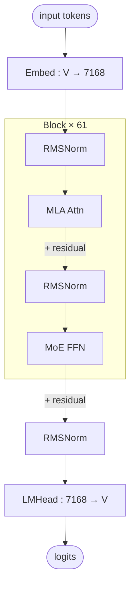

# Kimi-K2-Thinking

## Summary

Moonshot AI 于 11 月 6 日发布的最新思考模型 Kimi-K2-Thinking，擅长深度推理，打榜性能再创新高。其模型结构与 Kimi-K2 保持一致，**原生支持 MOE W4A16 + Attention BF16 混合精度模式**，兼顾推理性能与效果。

在 cann-recipes-infer 中，Kimi-K2-Thinking 结构与 Kimi-K2 基本一致，基础优化点可从 [deepseek-r1](deepseek_r1.md) 平滑继承——Kimi-K2-Thinking 与 R1 同属 DeepseekV3 架构族、优化点高度同源（故可平滑继承），但部署路径不同：R1 走自研**新执行器**（OfflineInference，无自带 runner/infer），Kimi-K2-Thinking 走 **legacy ModelRunner 路径**——`models/kimi-k2-thinking/` 自带独立的 `infer.py` + `runner_deepseek.py`（`DeepSeekRunner` 类）+ `models/{modeling_deepseek,configuration_deepseek,model_infer,modules}.py` 一整套适配副本，本页重点描述其相对 R1 的差异点：原生 **MOE W4A16** 量化模式、Attention head 从 128 精简至 **64**、双配置（Prefill CP / Decode Attn-DP + MoE-EP + 局部 TP）、MLA-Prolog（`npu_mla_prolog_v3`）在 Q/K/V proj 路径上无条件启用（无 enable/disable 开关）、CANN 0day 支持 256K 超长序列。

### Highlights

- CANN 已 **0day** 支持 Kimi-K2-Thinking 256K 序列推理部署，[模型推理代码](https://gitcode.com/cann/cann-recipes-infer/tree/2c45117d781ab9ab88dcb89a28ae30f5d2450399) 已开源，同时也适配了主流开源推理框架 [SGLang](https://github.com/sgl-project/sglang/pull/12759)。
- 本实践支持 Kimi-K2-Thinking 原生量化模式，**MOE GroupedMatmul 采用 W4A16 计算，Attention 保留 BF16 精度模式**，兼顾推理性能与效果，配套的 GroupedMatmul [算子实现](https://gitcode.com/cann/ops-transformer/tree/ca41b0b5eb9dbf6eb94a58aa20fe379681c1d751/gmm/grouped_matmul) 已全面开源。
- 针对小 batch size、长序列生产等典型推理场景，**Decode MLA 已实现 Flash Decode 加速机制**，有效降低时延并提升算力利用率，配套的 FusedInferAttentionScore [算子实现](https://gitcode.com/cann/ops-transformer/tree/ca41b0b5eb9dbf6eb94a58aa20fe379681c1d751/attention/fused_infer_attention_score) 已全面开源。
- 本实践的最小部署单元为单机，可支持 4K 序列长度的推理任务；同时支持多机大 EP 部署模式，通过多机集群协同部署，可满足 **256K 超长序列**的推理需求。

## Architecture And Serving Traits

Kimi-K2-Thinking 与 DeepSeek-V3 / DeepSeek-R1 / Kimi-K2 同属 MLA + DeepSeekMoE 架构族，Transformer Block 结构与 [deepseek-r1](deepseek_r1.md) 基本一致（MLA + shared expert + routed experts，同款 DeepseekV3 架构类；但 Kimi 的 `modeling_deepseek.py` 是独立适配副本，**非与 R1 同一文件**）。关键差异：

- **Attention Head 数量 128 → 64**：相较 DeepSeek V3.1，Kimi-K2-Thinking 的 Attention Head 数量从 128 精简至 64，Attention 计算量显著降低，**更利好 MTP 场景**。LLM 推理 Decode 阶段通常为访存瓶颈，MTP 可通过少量计算代价来缓解访存压力，而 Kimi-K2-Thinking 的 Attention 本身计算负载更轻，因此在 MTP 模式下更难触及计算瓶颈，性能更优。
- **原生 W4A16 MoE + BF16 Attention**：Kimi-K2-Thinking 原生量化模式，MoE `GroupedMatmul` 采用 W4A16 计算，Attention 保留 BF16 精度模式。**不支持 W8A8C8**（见 [w8a8c8](../quantization/w8a8c8.md)）。
- **独立代码副本（legacy 路径，非共用 R1 文件）**：Kimi 走 legacy ModelRunner 部署模式，`models/kimi-k2-thinking/` 自带整套副本——`infer.py` + `runner_deepseek.py`（`DeepSeekRunner` 类）+ `models/{modeling_deepseek,configuration_deepseek,model_infer,modules}.py`。其 `modeling_deepseek.py`（@2f82d10 实测 2381 行）与 R1 的（`models/deepseek_r1/models/modeling_deepseek.py`，@2f82d10 实测 2761 行；R1 走新执行器、无 `runner_deepseek.py`/`infer.py`）为**不同文件**——共享的是 DeepseekV3 架构与优化思路，而非源文件本身。

### 推荐部署拓扑

Atlas A3 推荐部署策略如下图所示，Prefill 使用 M 个节点部署，Decode 使用 N 个节点部署，每个节点包含 8 卡，推荐根据资源数量、SLA 等约束，**M 和 N 在 1~24 内动态调整**。Prefill 支持 8–192 卡，Decode 支持 8–192 卡（见 README）。

*来源：[`docs/models/kimi-k2-thinking/figures/k2_deployment.jpg`](https://gitcode.com/cann/cann-recipes-infer/blob/2f82d10467e6fe8dae81c97a2cdac78d733a6703/docs/models/kimi-k2-thinking/figures/k2_deployment.jpg)（cann-recipes-infer @ 2f82d10）*

### 支持的规格

| 阶段 | 配置文件 | world_size | 并行 | 量化 | 备注 |
| ---- | ------- | ---------- | ---- | ---- | ---- |
| Prefill | `kimi_k2_thinking_rank_64_64ep_prefill_benchmark.yaml` | 64 (8 机) | **CP64** + moe_ep=64 + dense_tp=1 | MoE W4A16 / Attn BF16 | `enable_multi_streams: True`，`input_max_len: 65536`，`batch_size: 64` |
| Decode | `kimi_k2_thinking_rank_128_128ep_decode_benchmark.yaml` | 128 (16 机) | **Attn-DP128** + MoE-EP128 + `oproj_tp=8` + `dense_tp=4` + `embed/lmhead_tp=16` | MoE W4A16 / Attn BF16 | `exe_mode: ge_graph`，`next_n: 0`（MTP 代码支持，benchmark 默认不开），`enable_multi_streams: True`，`input_max_len: 65536`，`batch_size: 256` |

> Prefill YAML `cp_size: 64`、`attn_tp_size: 1`、`dense_tp_size: 1`；Decode YAML `cp_size: 128` 字段在 YAML 中保留但 decode 阶段不生效（字段标注 "only active at prefill stage"，代码约定）。

## Known Optimizations

### 并行策略

#### Prefill 并行策略

考虑到长序列场景，**Prefill Attention 选用 Context Parallel (CP) 并行**，多个 rank 均摊长序列的计算，单 rank 的计算量和 activation 内存都较小，TTFT 较为可控，用户体验更好。MoE 模块则沿用 DeepSeek-V3.1 的 EP 并行，兼顾吞吐与时延。

*来源：[`docs/models/kimi-k2-thinking/figures/k2_prefill_cp.jpg`](https://gitcode.com/cann/cann-recipes-infer/blob/2f82d10467e6fe8dae81c97a2cdac78d733a6703/docs/models/kimi-k2-thinking/figures/k2_prefill_cp.jpg)（cann-recipes-infer @ 2f82d10）*

CP 负载均衡机制参见 [zigzag-cp](../parallelism/zigzag_cp.md)（R1 / Qwen3-Next 同类）；MoE Prefill 大 EP 的 Double-Routing 机制完全复用 R1 方案，见 [double-routing](../techniques/double_routing.md)。

#### Decode 并行策略

Decode 阶段依旧沿用 DeepSeek V3.1 的部署策略，选用 **Attention DP + MoE EP** 部署。

特别地，由于 **O_proj 和 LM_Head 权重内存较大**，且在 Decode 阶段表现为明显的访存瓶颈，本实践选用**局部 TP 并行**。同时为了降低设备内存占用，**Embedding 层同样使用 TP 切分**。为了尽可能地减小 TP 并行带来的通信开销，TP 域控制在单机内（YAML：`oproj_tp_size: 8`、`dense_tp_size: 4`、`embed_tp_size: 16`、`lmhead_tp_size: 16`，跨卡不跨机）。

*来源：[`docs/models/kimi-k2-thinking/figures/k2_decode_ep.jpg`](https://gitcode.com/cann/cann-recipes-infer/blob/2f82d10467e6fe8dae81c97a2cdac78d733a6703/docs/models/kimi-k2-thinking/figures/k2_decode_ep.jpg)（cann-recipes-infer @ 2f82d10）*

### 融合 Kernel

整网计算流如下图所示，本实践使用了 MLAProlog、FusedInferAttentionScore、MoeDistributeDispatch、MoeDistributeCombine、GroupedMatmul 等融合 Kernel，可供其他同类模型在昇腾平台的高效落地提供实践参考。

*来源：[`docs/models/kimi-k2-thinking/figures/k2_fusion_kernel.jpg`](https://gitcode.com/cann/cann-recipes-infer/blob/2f82d10467e6fe8dae81c97a2cdac78d733a6703/docs/models/kimi-k2-thinking/figures/k2_fusion_kernel.jpg)（cann-recipes-infer @ 2f82d10）*

各算子详情：

- [mla-prolog](../kernels/mla_prolog.md)（`npu_mla_prolog_v3` —— Q/K/V 两级 proj + RMSNorm + RoPE + PA_NZ KV 写入）
- [fused-infer-attention-score](../kernels/fused_infer_attention_score.md)（`npu_fused_infer_attention_score_v2` —— Kimi-K2-Thinking 启用 **Flash Decode** 分支以加速小 batch 长序列场景）
- `npu_moe_distribute_dispatch_v2` / `npu_moe_distribute_combine_v2` —— EP 并行下多卡间 dispatch/combine 融合（一体化融合算子，见 [moe-dispatch-combine-v2](../techniques/moe_dispatch_combine_v2.md)）
- `npu_grouped_matmul` —— Kimi-K2-Thinking 走 **W4A16** 分支

### MTP

> 相较于 DeepSeek V3.1，Kimi-K2-Thinking 的 Attention Head 数量从 128 精简至 64，使得 Attention 计算量显著降低，**更利好 MTP 场景**。LLM 推理 Decode 阶段通常为访存瓶颈，MTP 可通过少量计算代价来缓解访存压力，而 Kimi-K2-Thinking 的 Attention 本身计算负载更轻，因此在 MTP 模式下更难触及计算瓶颈，性能更优。
>
> 本实践对应的代码已支持多头 MTP 功能，若具备训练完成的 MTP 权重，可直接启用该功能以实现推理加速。

机制和实现细节（`sparse_mode=3`、KV 按 `speculative_num_draft_tokens` 布局等）与 [deepseek-r1](deepseek_r1.md) 共享，见 [mtp-speculative-decoding](../techniques/mtp_speculative_decoding.md)。Benchmark YAML 当前 `next_n: 0` 未开启，属于预留能力。

### 其他继承自 DeepSeek-R1 的优化

Kimi-K2-Thinking 自带的 `models/kimi-k2-thinking/models/modeling_deepseek.py`（R1 同款 DeepseekV3 架构的独立适配副本）实现了与 R1 同源的 Attention / MoE forward 优化，故以下优化**全部可用**，不再重复描述，仅列出 YAML 默认开关：

- [prefill-micro-batch](../techniques/prefill_micro_batch.md) —— Prefill 阶段（Kimi-K2-Thinking Prefill YAML 中由 `enable_multi_streams: True` 驱动 multi-stream，但 `prefill_mini_batch_size: 1`，未使能 micro-batch 串行）
- [weight-nz](../techniques/weight_nz.md) —— `enable_weight_nz: True`（两配置同开）
- [superkernel](../techniques/superkernel.md) —— 能力继承自 R1，Kimi-K2-Thinking benchmark YAML 中**未显式列出 `enable_superkernel`**，默认依赖 `modeling_deepseek.py` 行为（待验证）
- [moe-multi-stream](../techniques/moe_multi_stream.md) —— `enable_multi_streams: True`（Prefill / Decode 两配置均开启）
- [torchair](../frameworks/torchair.md) —— Decode `exe_mode: "ge_graph"`

### 量化：MoE W4A16

Kimi-K2-Thinking 原生 W4A16 MoE + BF16 Attention 混合精度模式：

- **MoE** GroupedMatmul 采用 W4A16（权重 Int4 静态 Per-Channel，激活 BF16），配套算子实现见 https://gitcode.com/cann/ops-transformer/tree/ca41b0b5eb9dbf6eb94a58aa20fe379681c1d751/gmm/grouped_matmul
- **Attention** 保留 BF16 精度，不启用 W8A8C8（C8 仅 DeepSeek-R1 路径支持，见 [w8a8c8](../quantization/w8a8c8.md)）

> Kimi-K2 / Kimi-K2-Thinking 不支持 KVCache C8。Future Plan 中提到 "未来可针对 Attention 开发低比特量化版本，进一步降低系统内存占用与时延"。

## Future Plan

- **量化**：目前支持 MOE W4A16 推理，未来可针对 Attention 开发低比特量化版本，进一步降低系统内存占用与时延。
- **长序列性能优化**：长序列场景下的 TTFT 仍有优化空间，后续将探索更亲和的部署方案，并针对性优化融合 Kernel 性能，全面提升长序列推理的响应速度与运行效率。

## 架构图（stock HF 基线）

下图与参数为 **Kimi-K2 stock HF 架构**（部署前基线，源自 HF config + 复用的 `DeepseekV3ForCausalLM` modeling 类核实），与本页其余的 NPU 部署优化互补：前者是部署无关的网络拓扑先验，后者描述昇腾平台上的并行/量化/融合 Kernel 落地。**该图是 Kimi-K2 基线结构**——Kimi-K2-Thinking 与 Kimi-K2 同属 `DeepseekV3ForCausalLM` 拓扑（见 [deepseek-r1](deepseek_r1.md)、[mla](../modules/mla.md)），K2-Thinking 在此基线之上叠加本页所述的部署优化。溯源：`moonshotai/Kimi-K2-Instruct/config.json`（verified 2026-05-15）+ 随仓自带、复用 DeepseekV3 的 `modeling_deepseek.py`。

关键参数（取自 `moonshotai/Kimi-K2-Instruct/config.json`，仅保留对部署有意义的行）：

| 模块 | 参数 | 值 |
|------|------|----|
| — | n_layers | 61 |
| — | hidden | 7168 |
| — | vocab | 163840 |
| — | first_k_dense_replace | 1（仅 layer 1 为 Dense FFN，其余为 MoE） |
| MLA | n_heads | 64 |
| MLA | q_lora_rank | 1536 |
| MLA | kv_lora_rank | 512 |
| MLA | qk_nope_head_dim | 128 |
| MLA | qk_rope_head_dim | 64 |
| MLA | v_head_dim | 128 |
| MoE | n_routed_experts | 384 |
| MoE | n_shared_experts | 1 |
| MoE | top_k | 8 |
| MoE | moe_intermediate | 2048 |
| FFN | intermediate_size（dense 层） | 18432 |

> 上表 `n_heads=64` 与本页「Attention Head 128 → 64」口径一致（K2 系相对 DeepSeek-V3 的 128 精简至 64）。stock checkpoint 自带 FP8 权重为部署无关事实，本页 NPU 部署侧的精度口径（MoE W4A16 / Attention BF16）见上文「量化」小节，二者分属不同层面，不构成矛盾。

## Evidence

- [cann-recipes-infer](https://gitcode.com/cann/cann-recipes-infer/tree/2c45117d781ab9ab88dcb89a28ae30f5d2450399) — [`docs/models/kimi-k2-thinking/kimi_k2_thinking_inference_guide.md`](https://gitcode.com/cann/cann-recipes-infer/blob/2f82d10467e6fe8dae81c97a2cdac78d733a6703/docs/models/kimi-k2-thinking/kimi_k2_thinking_inference_guide.md)（Highlights、Prefill CP、Decode Attn-DP + MoE-EP + 局部 TP、融合 Kernel、MTP、Future Plan 六个章节）
- [cann-recipes-infer](https://gitcode.com/cann/cann-recipes-infer/tree/2c45117d781ab9ab88dcb89a28ae30f5d2450399) — [`models/kimi-k2-thinking/README.md`](https://gitcode.com/cann/cann-recipes-infer/blob/2f82d10467e6fe8dae81c97a2cdac78d733a6703/models/kimi-k2-thinking/README.md)（硬件要求、docker 镜像、拉起流程）；`models/kimi-k2-thinking/config/kimi_k2_thinking_rank_128_128ep_decode_benchmark.yaml` / `kimi_k2_thinking_rank_64_64ep_prefill_benchmark.yaml`（部署规格）；`models/kimi-k2-thinking/runner_deepseek.py`（`DeepSeekRunner` 类，legacy ModelRunner 路径，Kimi 自带副本）；`models/kimi-k2-thinking/models/modeling_deepseek.py`（R1 同款 DeepseekV3 架构的独立适配副本，@2f82d10 实测 2381 行 ≠ R1 `models/deepseek_r1/models/modeling_deepseek.py` 2761 行，非同一文件）

## Links

- [deepseek-r1](deepseek_r1.md)（代码共享路径 / Prefill 与 Decode 所有非差异化优化的详细描述）
- [atlas-a3](../platforms/atlas_a3.md)
- [torchair](../frameworks/torchair.md)
- [ascendc](../frameworks/ascendc.md)
- [mla](../modules/mla.md)
- [mla-prolog](../kernels/mla_prolog.md)
- [fused-infer-attention-score](../kernels/fused_infer_attention_score.md)
- [context-parallel](../parallelism/context_parallel.md)
- [expert-parallel](../parallelism/expert_parallel.md)
- [data-parallel](../parallelism/data_parallel.md)
- [tensor-parallel](../parallelism/tensor_parallel.md)
- [double-routing](../techniques/double_routing.md)
- [moe-dispatch-combine-v2](../techniques/moe_dispatch_combine_v2.md)
- [zigzag-cp](../parallelism/zigzag_cp.md)
- [mtp-speculative-decoding](../techniques/mtp_speculative_decoding.md)
- [moe-multi-stream](../techniques/moe_multi_stream.md)
- [superkernel](../techniques/superkernel.md)
- [weight-nz](../techniques/weight_nz.md)
- [w8a8c8](../quantization/w8a8c8.md)（说明 Kimi-K2-Thinking 不支持 C8）

<!-- cannbot:related:start -->
## 相关

- [DeepSeek-R1](deepseek_r1.md)（`related`）：“基础优化点可从 ［deepseek-r1］(deepseek_r1.md) 平滑继承”明确 Kimi-K2-Thinking 的适配基线；“本实践覆盖 Prefill 与 Decode 两阶段的端到端优化”给出 R1 可继承的两阶段优化范围，联合阅读可区分共享的 DeepseekV3 思路和 Kimi 的独立 legacy 实现。
- [MoE 专家 GMM 权重加载后处理与低比特量化调用约定：NZ 布局 / W4A8 bias 辅助矩阵 / W4A16 N-dim 重打包 / clip](../../optimizations/experience/rules/moe_expert_gmm_weight_lowbit_prep.md)（`related`）：“**MoE** GroupedMatmul 采用 W4A16（权重 Int4 静态 Per-Channel，激活 BF16）”确定 Kimi 的模型级量化入口；“GMM int4 antiquant kernel **只吃 N-dim packed** 权重”给出该入口加载后的强制重打包合同，能够直接指导权重转换和精度排障。
<!-- cannbot:related:end -->
