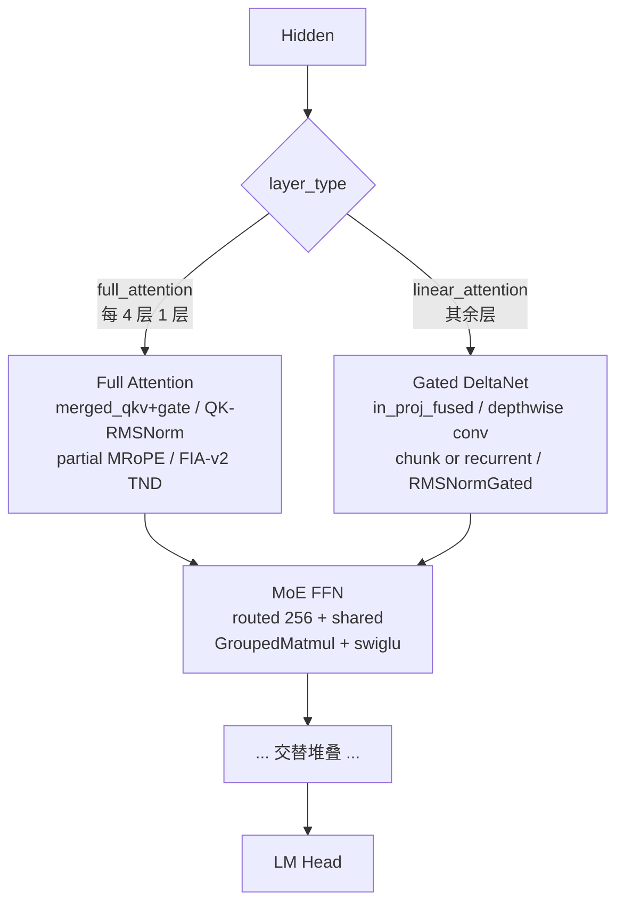

# Qwen3.5-MoE

## Summary

Qwen3.5-MoE 是 Qwen3.5 系列中的混合专家模型，结构上**同时包含 full attention、linear attention（Gated DeltaNet）和 MoE 三类 block**，是 [qwen3-next](qwen3_next.md) 混合注意力思路的延续与放大。cann-recipes-infer 基于 transformers 的 Qwen3.5-MoE 结构完成文本侧推理适配（HF `model_type = "qwen3_5_moe_text"`，多模态外层另有 vision config），跑在 Atlas A3 上，由仓库自研 executor（[cann-executor](../frameworks/cann_executor.md)）驱动多卡推理。

与 Qwen3-Next 的关键差异在于 **Prefill 阶段的 Gated DeltaNet 走 `torch_npu.npu_chunk_gated_delta_rule` 这一 torch_npu 原生融合算子，而非 Qwen3-Next 的 PyPTO ChunkGDN**（见 [pypto](../frameworks/pypto.md)）；Decode 阶段两者都用 `npu_recurrent_gated_delta_rule`（[recurrent-gated-delta-rule](../kernels/recurrent_gated_delta_rule.md)）。相对经典的 [qwen3-moe](qwen3_moe.md)（纯 Softmax Attention + 无 shared expert MoE），Qwen3.5-MoE 多了 linear attention 层、shared expert 与显著更多的专家。

### Highlights

- **三类 block 混合**：`layer_types` 按 `full_attention_interval=4` 交替排布——每 4 层中 1 层 full attention（默认）、3 层 linear attention（Gated DeltaNet）。
- **full attention**：`merged_qkv_proj` 一次 Matmul 同时输出 Q/K/V 与 attention gate；Q/K 做 QK-RMSNorm；partial RoPE（仅 `head_dim` 的一部分应用 MRoPE，`partial_rotary_factor=0.25`）；FlashAttention 走 `npu_fused_infer_attention_score_v2`（TND + block KV，见 [fused-infer-attention-score](../kernels/fused_infer_attention_score.md)）。
- **linear attention**：`in_proj_fused` 一次投影同时产出 Q/K/V、Z 门控、B/A 递推参数；depthwise conv；Prefill chunk / Decode recurrent 两路 GDN；`RMSNormGated` 输出归一化。见 [gated-deltanet](../modules/gated_deltanet.md)。
- **MoE**：256 量级 routed expert + shared expert，top-k=8（默认）；`GroupedMatmul` + `npu_swiglu`；EP 走 Double-Routing（[double-routing](../techniques/double_routing.md)），纯 EP Decode 可切到 `dispatch_v2`/`combine_v2` 融合路径。
- **六路独立 TP 配置 + 派生 EP**：`attn_tp / moe_tp / embed_tp / lmhead_tp / dense_tp / o_proj_tp` 各自独立可配，`moe_ep_size = world_size // moe_tp_size` 为派生量。
- **图模式（仅 TP）**：Decode 整图编译降低 host bound。

## Architecture And Serving Traits

- **层排布**：`Qwen3_5MoeTextConfig` 默认 `num_hidden_layers=40`、`full_attention_interval=4`；`layer_types[i] = full_attention if (i+1)%4==0 else linear_attention`。
- **full attention 规格**：`num_attention_heads=16`、`num_key_value_heads=2`（GQA）、`head_dim=256`、`partial_rotary_factor=0.25`（旋转维度 = `head_dim*0.25` = 64），位置编码为 MRoPE。`mrope_section` 在 modeling 代码中取 `config.rope_parameters.get("mrope_section", [11,11,10])`（`modeling_qwen3_5_moe.py:288`），`[11,11,10]` 是**代码 fallback 默认值**，真实权重的 `rope_parameters` 可覆盖（具体取值待核实）。
- **linear attention 规格**：`linear_num_key_heads=16`、`linear_num_value_heads=32`、`linear_key/value_head_dim=128`、`linear_conv_kernel_dim=4`。`attn_tp_size` 需整除 `linear_num_key_heads` 与 `linear_num_value_heads`。
- **MoE 规格**：`num_experts=256`、`num_experts_per_tok=8`、`moe_intermediate_size=512`、含 `shared_expert`。
- **gate 来源**：full attention 的 gate 与 Q 在 `merged_qkv_proj` 中合并产出（Q 投影宽度为 `head_dim*2`，`torch.chunk` 一半为 query、一半为 gate），attention 输出与 `sigmoid` 门控相乘后再过 `o_proj`。详见 [gated-attention](../modules/gated_attention.md)。

### 三规格部署模板

| 规格 | 激活 | world_size | 并行 | exe_mode | YAML |
| ---- | ---- | ---- | ---- | ---- | ---- |
| Qwen3.5-35B-A3B | A3B | 8 | EP8（`attn_tp=8`、`moe_tp=1`、`moe_ep=8`） | eager | `qwen3_5_35b_ep8.yaml` |
| Qwen3.5-122B-A10B | A10B | 8 | TP8（`attn_tp=8`、`moe_tp=8`、`moe_ep=1`） | ge_graph | `qwen3_5_122b_tp8.yaml` |
| Qwen3.5-397B-A17B | A17B | 16 | TP16（`attn_tp=16`、`moe_tp=16`、`moe_ep=1`） | ge_graph | `qwen3_5_397b_tp16.yaml` |

> 三份 YAML 均 `batch_size` 受严格约束（注释 `Strict constraint: Batch=1`，35B/122B 配 4、397B 配 1，源未解释差异 —— gap）。图模式仅在 TP 规格（122B/397B）默认开启。

## Known Optimizations

Qwen3.5-MoE 的优化覆盖融合算子、TP/EP 并行、图模式、计算逻辑、矩阵融合五个维度。

### 融合算子

- **RoPE 融合**：full attention 用 MRoPE，因只对 head 的一部分应用旋转，代码先把 Q/K 拆为旋转部分 `q_rot`（前 64 维）与透传部分 `q_pass`，仅对旋转部分调 `torch_npu.npu_rotary_mul(..., rotary_mode='half')`，再与透传部分 `cat`。Prefill/Decode 通用。
- **FlashAttention（FIA v2）**：Q/K/V 组织为 **TND layout**，写入 **block 化 KV cache** 后通过 `block_table`/`block_size`/实际序列长度传入 `npu_fused_infer_attention_score_v2`。Prefill 用 `sparse_mode=3` + attention mask 表达因果掩码；Decode 先写当前 token K/V 再用 `actual_seq_kvlen` 控制可见 cache 范围。图模式 Decode 走 `torchair.ops.*` 路径，eager 走 `torch.ops.npu.*`。见 [fused-infer-attention-score](../kernels/fused_infer_attention_score.md)。
- **ChunkGDR（Prefill GDN 融合）**：`Qwen3_5MoeGatedDeltaNet` 在 Prefill 且 `torch_npu` 支持时调用 **`torch_npu.npu_chunk_gated_delta_rule`**（torch_npu 原生算子，**区别于 Qwen3-Next 的 PyPTO ChunkGDN**），接收 TND 的 Q/K/V、beta 门控、initial_state、actual_seq_lengths、decay 参数 g，一次性完成 chunk 内 L2 归一化、decay cumsum/指数、下三角求解（替代逐行循环更新）、块间递推状态更新，输出 `core_attn_out` 与 `last_recurrent_state`。该算子为近期合入，文档建议用 CANN 9.1.0 保证精度（见下方矛盾标记）。
- **RMSNorm 融合**：`Qwen3_5MoeRMSNorm` 用 `torch_npu.npu_rms_norm`；带残差场景用 `torch_npu.npu_add_rms_norm` 融合残差相加 + RMSNorm；GDN 输出段 `Qwen3_5MoeRMSNormGated` 用 `npu_rms_norm` 后与门控分支相乘。通用优化。
- **Matmul AllReduce 融合**：TP 场景下 RowParallel 输出投影（full attention `o_proj`、linear attention `out_proj`、dense MLP `down_proj`）的 Matmul + all_reduce 用 **`torch_npu.npu_mm_all_reduce_base`** 融合。仅在 `enable_mm_all_reduce_base` 开启、Prefill、TP 切分数 >1 且输入已按 TP 切分、线性层无 bias / 非量化路径、能取到 HCCL group name 时启用；否则回退普通 Matmul + `dist.all_reduce`。主要面向 A3 等通信收益明显的部署。
- **MoE dispatch/combine 融合**：纯 EP Decode（`enable_decode_moe_dispatch_combine_v2` 开 + Decode + `moe_ep_size>1` + `moe_tp_size==1`）下，用 `torch_npu.npu_moe_distribute_dispatch_v2` / `npu_moe_distribute_combine_v2` 替代手写重排 + `all_to_all` + finalize routing，适合小 batch 低时延 Decode。见 [moe-dispatch-combine-v2](../techniques/moe_dispatch_combine_v2.md)。

### TP 和 EP 并行

`parallel_config` 提供**六路独立 TP 配置 + 派生 EP**：`attn_tp_size` 控制 full + linear attention 的 head 切分、`moe_tp_size` 控制专家内 FFN 矩阵切分，`embed_tp_size`、`lmhead_tp_size`、`dense_tp_size`、`o_proj_tp_size` 分别独立配置 Embedding / LM Head / dense MLP / o_proj。专家并行规模 `moe_ep_size = world_size // moe_tp_size` 为派生量，随 `moe_tp_size` 反向变化（`moe_tp_size==world_size` 时 `moe_ep_size=1`，无 EP 分发）。

- **Attention TP**：full attention 按 head 切——`num_heads_per_rank = num_heads // attn_tp_size`、`num_key_value_heads_per_rank = max(num_key_value_heads // attn_tp_size, 1)`；linear attention 切 `linear_num_key_heads` / `linear_num_value_heads`（要求被 `attn_tp_size` 整除）。详见 [tensor-parallel](../parallelism/tensor_parallel.md)。
- **MoE TP**：`gate_proj`/`up_proj` 列切、`down_proj` 行切；`gate_proj`+`up_proj` 加载后合并为 `w13_weight`；`moe_tp_size>1` 时专家输出经 `moe_tp_group` all_reduce。`moe_tp_size == world_size` 时 `moe_ep_size=1`，无 EP 分发。
- **MoE EP**：每卡只加载 `experts_per_rank = num_experts // moe_ep_size` 个本地专家，普通 EP 路径走 **Double-Routing**（`init_routing_v2` 本卡排序 → AllToAll+ReduceSum 推 splits → AllToAll 分发 token → `re_routing` 按本地专家排序 → GroupedMatmul → `torch.index_select` 恢复本卡顺序 → 反向 AllToAll → `finalize_routing` 恢复原序 + 加权）。该流程与 [double-routing](../techniques/double_routing.md) 同源，但 Qwen3.5 链路中恢复本卡顺序用 `torch.index_select`、**仅 1 次 `finalize_routing`**，与 DeepSeek-R1 版"2 次 init + 2 次 finalize"略有差异，不必逐字套用 R1 的 8 步。纯 EP Decode 可替换为 dispatch_v2/combine_v2 融合路径（见上）。

### 图模式（仅 TP）

Decode 单 token 增量推理算子粒度小，NPU 上易 host bound。结合 `torch_npu` 的 TorchAir 图模式（[torchair](../frameworks/torchair.md)）：Prefill 仍走普通 `model.forward` 初始化 KV cache 与 linear attention 状态；Decode 进入单 token 后若 `exe_mode == "ge_graph"` 则调编译后的 `model_compiled`。图编译在 warm-up 触发（先跑一次 Prefill 初始化，再用单 token 输入触发 Decode 图编译）。`npugraph_ex` 模式源标注"暂未验证"。`enable_cache_compile` 可缓存编译图减少后续启动等待。详见 [npu-graph-mode](../techniques/npu_graph_mode.md)。

> 源明示**图模式仅支持 TP 并行配置** —— 因此 EP8 的 35B 规格默认 eager，TP 的 122B/397B 默认 ge_graph。

### 计算逻辑优化 — GDN solve_triangular

linear attention Prefill 的 chunk 计算需构造块内递推关系，原始实现用 `for` 循环逐行更新下三角注意力矩阵。`torch_chunk_gated_delta_rule` 增加 `torch.linalg.solve_triangular` 路径，把逐行循环改为三角矩阵求解（`solve_triangular(I - attn, attn, upper=False)`）。由 `enable_gdn_solve_triangular` 控制，仅在用 PyTorch chunk GDN 路径（即未走 `npu_chunk_gated_delta_rule` 融合算子）时生效；对 35B 2p 场景降低 Prefill GDN 块内递推开销。

### 矩阵融合 — GDN 输入投影融合

原始 GDN 输入侧的 `in_proj_qkv` / `in_proj_z` / `in_proj_b` / `in_proj_a` 是多次独立线性层。本样例合并为 **`in_proj_fused`**（一次 `MergedColumnParallelLinear`，`Qwen3_5MoeGatedDeltaNetFusedInProj`），同时算 Q/K/V、Z 门控、B/A 分支，再按维度 `torch.split([key_dim*2+value_dim, value_dim, num_v_heads, num_v_heads], dim=-1)`。除减少 Matmul 次数外，使 `mixed_qkv`/`z`/`b`/`a` 走同一套 TP 切分、量化、输出 dtype 路径，避免多路独立投影在量化/并行场景下 dtype 不一致。`mixed_qkv` 进 depthwise conv + GDN 核心，`z` 作 RMSNormGated 门控输入，`b`/`a` 生成递推参数。详见 [gated-deltanet](../modules/gated_deltanet.md)。

## Quantization

源文档与 README 未给出 Qwen3.5-MoE 的量化方案（Matmul AllReduce 融合明示"非量化路径"才启用）—— gap。

## Benchmark

仓库**仅提供 MMLU 精度评测脚本**（`benchmark/run_mmlu_benchmark.py`，含 thinking 模式关闭说明、`HCCL_OP_EXPANSION_MODE=AIV` 可能引入不确定计算的提醒），**未提供端到端时延 benchmark 数据** —— gap。

> ⚠️ 矛盾标记（CANN 版本，ambiguity）：README「环境准备」声明支持 `CANN 9.0.0`，但软件包下载链接指向 `8.3.RC1.alpha002`，而优化文档的 ChunkGDR 小节又建议使用 `CANN 9.1.0` 以保证 `npu_chunk_gated_delta_rule` 精度。三处版本不一致，源未统一说明，保留全部待验证。

## Relationship To Qwen3-Next / Qwen3-MoE

| 维度 | Qwen3.5-MoE | [qwen3-next](qwen3_next.md) | [qwen3-moe](qwen3_moe.md) |
| ---- | ---- | ---- | ---- |
| 架构 | full + linear（GDN）+ MoE | Gated Attention + GDN + MoE | 经典 Softmax Attention + MoE |
| shared expert | 有 | 有 | 无 |
| Prefill GDN | **torch_npu 原生 `npu_chunk_gated_delta_rule`** | PyPTO ChunkGDN | 无 GDN |
| Decode GDN | `npu_recurrent_gated_delta_rule` | `npu_recurrent_gated_delta_rule` | 无 GDN |
| 框架 | 自研 executor | SGLang | 自研 executor / SGLang 双路径 |
| 部署 | 35B-EP8 / 122B-TP8 / 397B-TP16 | 大 EP + CP（长序列） | 235B（16TP/128EP 等） |

Qwen3.5-MoE 与 Qwen3-Next/Qwen3-MoE 在 [gated-deltanet](../modules/gated_deltanet.md) / [gated-attention](../modules/gated_attention.md) 模块、[recurrent-gated-delta-rule](../kernels/recurrent_gated_delta_rule.md) kernel、[double-routing](../techniques/double_routing.md) 路由技术上共享概念角色；但 Prefill ChunkGDN 路径采用 torch_npu 原生 `npu_chunk_gated_delta_rule`，**不复用** Qwen3-Next 的 PyPTO 实现（见 [pypto](../frameworks/pypto.md) 的对比说明）。

## Open Items

- HF 权重公开性：README 给出 `huggingface.co/Qwen/Qwen3.5-35B-A3B` 下载链接，但其公开可获取性当前无法核实 —— 仅记录不背书（unverified）。
- 图模式中 `npugraph_ex` 路径源标注"暂未验证"。
- 三规格 `batch_size` 严格约束差异（4 vs 1）与 `Batch=1` 注释含义源未明示。
- 端到端时延、量化方案数据缺失（gap）。

## Evidence

- [cann-recipes-infer](https://gitcode.com/cann/cann-recipes-infer/tree/2c45117d781ab9ab88dcb89a28ae30f5d2450399) — [`docs/models/qwen3_5/qwen3_5_moe_optimization.md`](https://gitcode.com/cann/cann-recipes-infer/blob/2c45117d781ab9ab88dcb89a28ae30f5d2450399/docs/models/qwen3_5/qwen3_5_moe_optimization.md)（融合算子 / TP-EP 并行 / 图模式 / 计算逻辑 / 矩阵融合 五大维度）；提交 `feat: support qwen3.5`（MR!402，分支 chy_new "support qwen3_5"）。
- [cann-recipes-infer](https://gitcode.com/cann/cann-recipes-infer/tree/2c45117d781ab9ab88dcb89a28ae30f5d2450399) — [`models/qwen3_5/README.md`](https://gitcode.com/cann/cann-recipes-infer/blob/2c45117d781ab9ab88dcb89a28ae30f5d2450399/models/qwen3_5/README.md)（环境准备、三规格 YAML、MMLU 评测）；提交 `docs: update project and Qwen3.5 model README`（MR!480 "docs: update Qwen3.5 README"）。
- [cann-recipes-infer](https://gitcode.com/cann/cann-recipes-infer/tree/2c45117d781ab9ab88dcb89a28ae30f5d2450399) — [`models/qwen3_5/models/modeling_qwen3_5_moe.py`](https://gitcode.com/cann/cann-recipes-infer/blob/2c45117d781ab9ab88dcb89a28ae30f5d2450399/models/qwen3_5/models/modeling_qwen3_5_moe.py)（`Qwen3_5MoeAttention.merged_qkv_proj`+gate / `Qwen3_5MoeGatedDeltaNet.in_proj_fused` / `_forward_prefill_with_fused_kernel` 调 `npu_chunk_gated_delta_rule` / `_forward_decode` 调 `npu_recurrent_gated_delta_rule` / `qwen3_5_prefill_mm_all_reduce`）、[`configuration_qwen3_5_moe.py`](https://gitcode.com/cann/cann-recipes-infer/blob/2c45117d781ab9ab88dcb89a28ae30f5d2450399/models/qwen3_5/models/configuration_qwen3_5_moe.py)（层排布 / head / expert 规格）、`config/qwen3_5_{35b_ep8,122b_tp8,397b_tp16}.yaml`、`benchmark/run_mmlu_benchmark.py`。
- 优化文档配 4 张示意图（attention_tp / attention_calcu / moe_tp / moe_ep），分别图示 Attention TP head 切分、Attention 计算分解、MoE TP 切分、MoE EP 分发。

## Links

- [qwen3-next](qwen3_next.md)
- [qwen3-moe](qwen3_moe.md)
- [gated-attention](../modules/gated_attention.md)
- [gated-deltanet](../modules/gated_deltanet.md)
- [recurrent-gated-delta-rule](../kernels/recurrent_gated_delta_rule.md)
- [fused-infer-attention-score](../kernels/fused_infer_attention_score.md)
- [double-routing](../techniques/double_routing.md)
- [moe-dispatch-combine-v2](../techniques/moe_dispatch_combine_v2.md)
- [pypto](../frameworks/pypto.md)
- [cann-executor](../frameworks/cann_executor.md)
- [torchair](../frameworks/torchair.md)
- [npu-graph-mode](../techniques/npu_graph_mode.md)
- [tensor-parallel](../parallelism/tensor_parallel.md)
- [expert-parallel](../parallelism/expert_parallel.md)
- [atlas-a3](../platforms/atlas_a3.md)