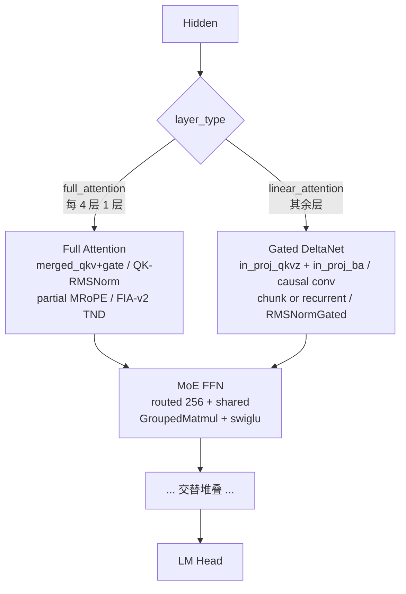

# Qwen3.5-MoE

## Summary

Qwen3.5-MoE文本模型交替使用Full Attention与Gated DeltaNet，并结合含shared expert的MoE。Full Attention的MRoPE、门控与GDN递推状态属于不同状态机制。

与Qwen3-Next共享部分机制，不代表Prefill实现或部署框架相同；各实现分支的验收由Guide维护。平台配置、开关和验收步骤见[模型部署流程](../../guides/models/qwen3_5_moe_deployment.md)，此处只保留模型机制。

## Architecture And Serving Traits

- **层排布**：`Qwen3_5MoeTextConfig` 默认 `num_hidden_layers=40`、`full_attention_interval=4`；`layer_types[i] = full_attention if (i+1)%4==0 else linear_attention`。
- **full attention 规格**：`num_attention_heads=16`、`num_key_value_heads=2`（GQA）、`head_dim=256`、`partial_rotary_factor=0.25`（旋转维度 = `head_dim*0.25` = 64），位置编码为 MRoPE。`mrope_section` 在 modeling 代码中取 `config.rope_parameters.get("mrope_section", [11,11,10])`（`modeling_qwen3_5_moe.py:288`），`[11,11,10]` 是**代码 fallback 默认值**，真实权重的 `rope_parameters` 可覆盖（具体取值待核实）。
- **linear attention 规格**：`linear_num_key_heads=16`、`linear_num_value_heads=32`、`linear_key/value_head_dim=128`、`linear_conv_kernel_dim=4`。`attn_tp_size` 需整除 `linear_num_key_heads` 与 `linear_num_value_heads`。
- **MoE 规格**：`num_experts=256`、`num_experts_per_tok=8`、`moe_intermediate_size=512`、含 `shared_expert`。
- **gate 来源**：full attention 的 gate 与 Q 在 `merged_qkv_proj` 中合并产出（Q 投影宽度为 `head_dim*2`，`torch.chunk` 一半为 query、一半为 gate），attention 输出与 `sigmoid` 门控相乘后再过 `o_proj`。详见 [gated-attention](../modules/gated_attention.md)。

## 当前状态、并行与量化

FullAttention使用统一Page cache，Prefill直接计算有效K/V后写cache；Decode先写入再用block_table，FIA v2 TND、sparse_mode3与实际长度/掩码。GDN的conv/ssm通过MambaCacheEntry声明，由block_table[Mamba][:,0]选请求状态槽，不能按batch序号直接覆盖。

GDN输入现在分in_proj_qkvz和in_proj_ba两组投影，不再是旧in_proj_fused。Prefill使用原生chunk GDR，旧PyTorch chunk/solve_triangular回退已删除；950用融合causal_conv1d，其他路径保留卷积适配。Decode对Q/K先F.normalize、beta先sigmoid、g在外部构造，再调用原生recurrent GDR，不能称这些步骤都被该API融合。

当前只允许next_n=0，不支持此模型MTP。MoE只允许纯TP或纯EP，混合EP×TP会报错；纯EP Prefill用DoubleRouting，Decode用MC2，旧enable_decode_moe_dispatch_combine_v2不再是切换开关。

950新增原生FP8权重和BF16/FP16加载后在线MXFP8，A3量化会拒绝；950 MXFP8+GE也明确拒绝。在线转换按目标层/忽略列表和K维32对齐筛选，记录实际转换计数，不把开关等同全网量化。

Prefill token分片要求attn_tp>1、moe_tp1、EP==attn_tp、shared_tp1且关闭mm_all_reduce_base；不足整除时补独立dummy段并维护metadata，输出按原请求cu长度取末token。该路径先AllGather再attention/GDN，不能称GDN跨rank独立递推的CP。

## Relationship To Qwen3-Next / Qwen3-MoE

| 维度 | Qwen3.5-MoE | [qwen3-next](qwen3_next.md) | [qwen3-moe](qwen3_moe.md) |
| ---- | ---- | ---- | ---- |
| 架构 | full + linear（GDN）+ MoE | Gated Attention + GDN + MoE | 经典 Softmax Attention + MoE |
| shared expert | 有 | 有 | 无 |
| Prefill GDN | **torch_npu 原生 `npu_chunk_gated_delta_rule`** | PyPTO ChunkGDN | 无 GDN |
| Decode GDN | `npu_recurrent_gated_delta_rule` | `npu_recurrent_gated_delta_rule` | 无 GDN |
| 框架 | 自研 executor | SGLang | 自研 executor / SGLang 双路径 |
| 部署 | 35B-EP8 / 122B-TP8 / 397B-TP16，另950 MXFP8 TP4 | 大 EP + CP（长序列） | 235B（16TP/128EP 等） |

Qwen3.5-MoE 与 Qwen3-Next/Qwen3-MoE 在 [gated-deltanet](../modules/gated_deltanet.md) / [gated-attention](../modules/gated_attention.md) 模块、[recurrent-gated-delta-rule](../kernels/recurrent_gated_delta_rule.md) kernel、[double-routing](../techniques/double_routing.md) 路由技术上共享概念角色；但 Prefill ChunkGDN 路径采用 torch_npu 原生 `npu_chunk_gated_delta_rule`，**不复用** Qwen3-Next 的 PyPTO 实现（见 [pypto](../frameworks/pypto.md) 的对比说明）。

## Open Items

当前README已更新平台/环境和量化方案；部分优化文档仍保留旧融合投影与A3通算融合建议，按当前实现和Guide核对。

## 部署与证据入口

- [模型部署与验收流程](../../guides/models/qwen3_5_moe_deployment.md)：配置、开关、失效条件与回退入口。

## Evidence

- [README.md](../../../../../cann-recipes-raw/cann-recipes-infer/944d2d3ece86f7df33dbb0cb155c72ca619a9c66/models/qwen3_5/README.md)（primary）
- [modeling_qwen3_5_moe.py](../../../../../cann-recipes-raw/cann-recipes-infer/944d2d3ece86f7df33dbb0cb155c72ca619a9c66/models/qwen3_5/models/modeling_qwen3_5_moe.py)（implementation）
- [qwen3_5_moe_optimization.md](../../../../../cann-recipes-raw/cann-recipes-infer/944d2d3ece86f7df33dbb0cb155c72ca619a9c66/docs/models/qwen3_5/qwen3_5_moe_optimization.md)（supporting）
- [qwen3_5_35b_mxfp8_tp4.yaml](../../../../../cann-recipes-raw/cann-recipes-infer/944d2d3ece86f7df33dbb0cb155c72ca619a9c66/models/qwen3_5/config/mxfp8/qwen3_5_35b_mxfp8_tp4.yaml)（example）

## Links

- [qwen3-next](qwen3_next.md)
- [qwen3-moe](qwen3_moe.md)
- [gated-attention](../modules/gated_attention.md)
- [gated-deltanet](../modules/gated_deltanet.md)
- [recurrent-gated-delta-rule](../kernels/recurrent_gated_delta_rule.md)
- [fused-infer-attention-score](../kernels/fused_infer_attention_score.md)
- [double-routing](../techniques/double_routing.md)
- [moe-dispatch-combine-v2](../techniques/moe_dispatch_combine_v2.md)
- [pypto](../frameworks/pypto.md)
- [cann-executor](../frameworks/cann_executor.md)
- [torchair](../frameworks/torchair.md)
- [npu-graph-mode](../techniques/npu_graph_mode.md)
- [tensor-parallel](../parallelism/tensor_parallel.md)
- [expert-parallel](../parallelism/expert_parallel.md)
- [atlas-a3](../platforms/atlas_a3.md)
