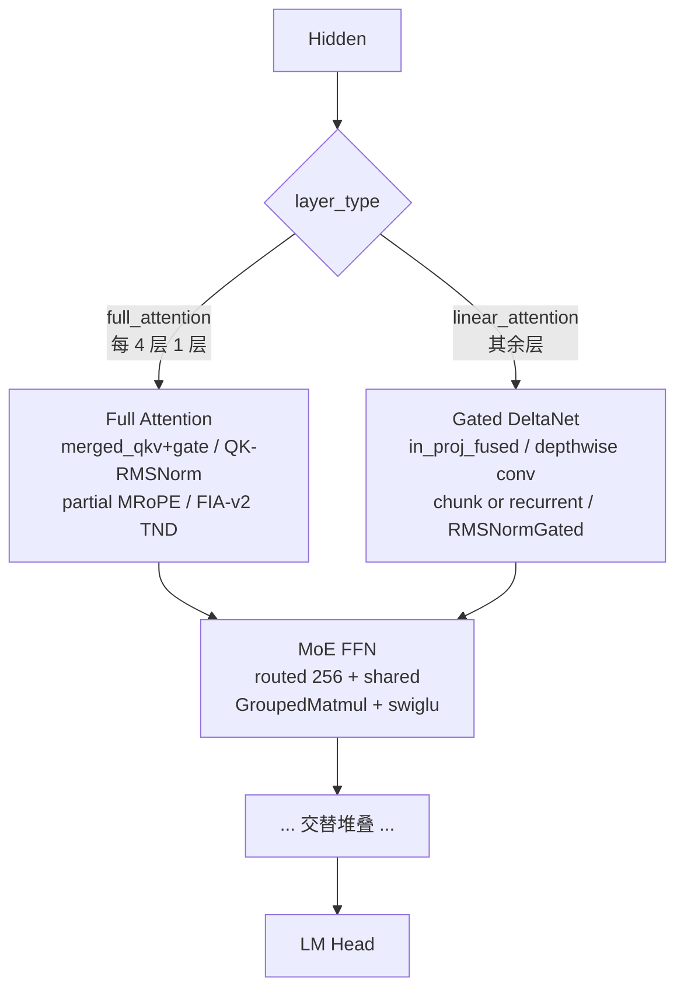

# Qwen3.5-MoE

## Summary

Qwen3.5-MoE文本模型交替使用Full Attention与Gated DeltaNet，并结合含shared expert的MoE。Full Attention的MRoPE、门控与GDN递推状态属于不同状态机制。

与Qwen3-Next共享部分机制，不代表Prefill实现或部署框架相同；各实现分支的验收由Guide维护。平台配置、开关和验收步骤见[模型部署流程](../../guides/models/qwen3_5_moe_deployment.md)，此处只保留模型机制。

## Architecture And Serving Traits

- **层排布**：`Qwen3_5MoeTextConfig` 默认 `num_hidden_layers=40`、`full_attention_interval=4`；`layer_types[i] = full_attention if (i+1)%4==0 else linear_attention`。
- **full attention 规格**：`num_attention_heads=16`、`num_key_value_heads=2`（GQA）、`head_dim=256`、`partial_rotary_factor=0.25`（旋转维度 = `head_dim*0.25` = 64），位置编码为 MRoPE。`mrope_section` 在 modeling 代码中取 `config.rope_parameters.get("mrope_section", [11,11,10])`（`modeling_qwen3_5_moe.py:288`），`[11,11,10]` 是**代码 fallback 默认值**，真实权重的 `rope_parameters` 可覆盖（具体取值待核实）。
- **linear attention 规格**：`linear_num_key_heads=16`、`linear_num_value_heads=32`、`linear_key/value_head_dim=128`、`linear_conv_kernel_dim=4`。`attn_tp_size` 需整除 `linear_num_key_heads` 与 `linear_num_value_heads`。
- **MoE 规格**：`num_experts=256`、`num_experts_per_tok=8`、`moe_intermediate_size=512`、含 `shared_expert`。
- **gate 来源**：full attention 的 gate 与 Q 在 `merged_qkv_proj` 中合并产出（Q 投影宽度为 `head_dim*2`，`torch.chunk` 一半为 query、一半为 gate），attention 输出与 `sigmoid` 门控相乘后再过 `o_proj`。详见 [gated-attention](../modules/gated_attention.md)。

## Quantization

固定来源未给该模型完整量化方案；不能从某个Linear支持量化推导整网已验收。

## Relationship To Qwen3-Next / Qwen3-MoE

| 维度 | Qwen3.5-MoE | [qwen3-next](qwen3_next.md) | [qwen3-moe](qwen3_moe.md) |
| ---- | ---- | ---- | ---- |
| 架构 | full + linear（GDN）+ MoE | Gated Attention + GDN + MoE | 经典 Softmax Attention + MoE |
| shared expert | 有 | 有 | 无 |
| Prefill GDN | **torch_npu 原生 `npu_chunk_gated_delta_rule`** | PyPTO ChunkGDN | 无 GDN |
| Decode GDN | `npu_recurrent_gated_delta_rule` | `npu_recurrent_gated_delta_rule` | 无 GDN |
| 框架 | 自研 executor | SGLang | 自研 executor / SGLang 双路径 |
| 部署 | 35B-EP8 / 122B-TP8 / 397B-TP16 | 大 EP + CP（长序列） | 235B（16TP/128EP 等） |

Qwen3.5-MoE 与 Qwen3-Next/Qwen3-MoE 在 [gated-deltanet](../modules/gated_deltanet.md) / [gated-attention](../modules/gated_attention.md) 模块、[recurrent-gated-delta-rule](../kernels/recurrent_gated_delta_rule.md) kernel、[double-routing](../techniques/double_routing.md) 路由技术上共享概念角色；但 Prefill ChunkGDN 路径采用 torch_npu 原生 `npu_chunk_gated_delta_rule`，**不复用** Qwen3-Next 的 PyPTO 实现（见 [pypto](../frameworks/pypto.md) 的对比说明）。

## Open Items

版本、batch注释、npugraph_ex验证及权重可获取性缺口见Guide和固定来源；未核验项目不自动转为已支持。

## 部署与证据入口

- [模型部署与验收流程](../../guides/models/qwen3_5_moe_deployment.md)：配置、开关、失效条件与回退入口。

## Evidence

- [cann-recipes-infer](https://gitcode.com/cann/cann-recipes-infer/tree/2c45117d781ab9ab88dcb89a28ae30f5d2450399) — [`docs/models/qwen3_5/qwen3_5_moe_optimization.md`](https://gitcode.com/cann/cann-recipes-infer/blob/2c45117d781ab9ab88dcb89a28ae30f5d2450399/docs/models/qwen3_5/qwen3_5_moe_optimization.md)（融合算子 / TP-EP 并行 / 图模式 / 计算逻辑 / 矩阵融合 五大维度）；提交 `feat: support qwen3.5`（MR!402，分支 chy_new "support qwen3_5"）。
- [cann-recipes-infer](https://gitcode.com/cann/cann-recipes-infer/tree/2c45117d781ab9ab88dcb89a28ae30f5d2450399) — [`models/qwen3_5/README.md`](https://gitcode.com/cann/cann-recipes-infer/blob/2c45117d781ab9ab88dcb89a28ae30f5d2450399/models/qwen3_5/README.md)（环境准备、三规格 YAML、MMLU 评测）；提交 `docs: update project and Qwen3.5 model README`（MR!480 "docs: update Qwen3.5 README"）。
- [cann-recipes-infer](https://gitcode.com/cann/cann-recipes-infer/tree/2c45117d781ab9ab88dcb89a28ae30f5d2450399) — [`models/qwen3_5/models/modeling_qwen3_5_moe.py`](https://gitcode.com/cann/cann-recipes-infer/blob/2c45117d781ab9ab88dcb89a28ae30f5d2450399/models/qwen3_5/models/modeling_qwen3_5_moe.py)（`Qwen3_5MoeAttention.merged_qkv_proj`+gate / `Qwen3_5MoeGatedDeltaNet.in_proj_fused` / `_forward_prefill_with_fused_kernel` 调 `npu_chunk_gated_delta_rule` / `_forward_decode` 调 `npu_recurrent_gated_delta_rule` / `qwen3_5_prefill_mm_all_reduce`）、[`configuration_qwen3_5_moe.py`](https://gitcode.com/cann/cann-recipes-infer/blob/2c45117d781ab9ab88dcb89a28ae30f5d2450399/models/qwen3_5/models/configuration_qwen3_5_moe.py)（层排布 / head / expert 规格）、`config/qwen3_5_{35b_ep8,122b_tp8,397b_tp16}.yaml`、`benchmark/run_mmlu_benchmark.py`。
- 优化文档配 4 张示意图（attention_tp / attention_calcu / moe_tp / moe_ep），分别图示 Attention TP head 切分、Attention 计算分解、MoE TP 切分、MoE EP 分发。

## Links

- [qwen3-next](qwen3_next.md)
- [qwen3-moe](qwen3_moe.md)
- [gated-attention](../modules/gated_attention.md)
- [gated-deltanet](../modules/gated_deltanet.md)
- [recurrent-gated-delta-rule](../kernels/recurrent_gated_delta_rule.md)
- [fused-infer-attention-score](../kernels/fused_infer_attention_score.md)
- [double-routing](../techniques/double_routing.md)
- [moe-dispatch-combine-v2](../techniques/moe_dispatch_combine_v2.md)
- [pypto](../frameworks/pypto.md)
- [cann-executor](../frameworks/cann_executor.md)
- [torchair](../frameworks/torchair.md)
- [npu-graph-mode](../techniques/npu_graph_mode.md)
- [tensor-parallel](../parallelism/tensor_parallel.md)
- [expert-parallel](../parallelism/expert_parallel.md)
- [atlas-a3](../platforms/atlas_a3.md)
