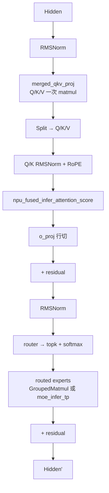

# Qwen3-MoE

## Summary

Qwen3-MoE包括235B-A22B和30B-A3B规格，采用标准GQA Softmax Attention、QK Norm与纯路由专家FFN，没有shared expert、MLA或GDN。

自研执行器与SGLang是不同部署实现，不能把它们的配置、权重或时延混作同一条验证路径。平台配置、开关和验收步骤见[模型部署流程](../../guides/models/qwen3_moe_deployment.md)，此处只保留模型机制。

## Architecture And Serving Traits

- **经典 Softmax Attention**：GQA，单个 Attention Head 计算 **O(S²)**。Qwen3-235B-A22B 头数参数须由具体权重 config 决定，不能以 configuration_qwen3_moe.py 的默认值代替。
- **MoE**：**无 shared expert**（与 DeepSeek-R1 / Kimi-K2 / Qwen3-Next 不同）、纯 routed experts。
- **与 Qwen3-Next / Qwen3.5-MoE 的对比**：Qwen3-Next 与 [qwen3-5-moe](qwen3_5_moe.md) 都是混合注意力（full/Gated Attention + GDN）+ MoE（含 shared expert）；Qwen3-MoE 是经典 Attention + MoE（无 shared expert、无 linear attention），**不共享代码路径**。见 [qwen3-next](qwen3_next.md)。
- **与 Qwen Dense（非 MoE）的关系**：[qwen-dense](qwen_dense.md)（Qwen2/Qwen3-8B 等）共享 `merged_qkv_proj` 建模血缘（QK-Norm 为 Qwen3 共有：Qwen3-8B dense 与本页 Qwen3-MoE 均启用，Qwen2.5 dense 无），但 FFN 为单一稠密 MLP（`gate_up_proj` + 普通 Matmul + BF16手写SiLU·mul或W8A8融合MLP），而非本页的 MoE 专家（`w13_weight` + `GroupedMatmul` + `npu_swiglu`）；两者各有独立建模文件。

## 当前 packed、量化与 Prefill 分支

当前统一模型采用packed token及1D position_ids，Prefill用累计q/kv长度直接计算有效K/V，随后更新Page cache；Decode使用cache。FP8 KV分支额外维护FP32 K/V scale cache，FIA以quant_mode4读缓存；不能等同BF16或其他模型的C8布局。

prefill_opt精确条件为attn_tp_size==moe_ep_size、gmm_quant_mode=w4a8mxfloat4且mm_quant_mode=w8a8mxfloat8，单有并行度相等不够。对应Prefill在RMSNorm后量化/AllGather数据与scale，QKV和FA后先AlltoAll重组head输出，再由ReplicatedLinear o_proj计算。文档文字把o_proj放在AlltoAll前，此处按实际代码顺序。MoE gate读FP32归一化输出、专家读BF16，接MX量化AllGather路由与ReduceScatter；其他量化档不自动进入此路径。

Hadamard只在enable_hadamard且Attention mm_quant_mode=w4a4mxfloat4时生效，需匹配每层变换文件；W4A8或HiF8即使填写开关也不进入该分支。量化精度和配置见[当前指南](../../guides/models/qwen3_moe_deployment.md)。

## 架构图（stock HF 基线）

下图是 Qwen3-MoE 的 **stock HuggingFace 架构基线**（部署前先验，源自 HF `config.json` + `modeling_qwen3_moe.py`，架构类 `Qwen3MoeForCausalLM`、`model_type=qwen3_moe`），与本页其余的 NPU 部署优化（`merged_qkv_proj` / FIA / TP·EP·DP 切分 / 图模式）互补——上面的「Architecture And Serving Traits」描述的是部署后算子融合视角，本节是未做任何部署改写的原始网络拓扑。固定来源没有归档 Qwen3-235B-A22B 的权重 config；本节仅表示结构关系，不提供该检查点的确定维度，也不保留无法复核的历史核验声明。

具体层数、hidden、Q/KV 头数、专家维度必须读取所用权重的 config.json。仓内 configuration_qwen3_moe.py 是通用配置类默认值，不能替代 235B-A22B 检查点。可由固定建模代码确认 GQA、无 shared expert 与 routed MoE 的结构；本卡不据未归档配置提供内存或并行规模的定量推导。

## 部署与证据入口

- [模型部署与验收流程](../../guides/models/qwen3_moe_deployment.md)：配置、开关、失效条件与回退入口。
- [Qwen3-MoE A3 两条实现的来源时延观测](../../optimizations/benchmark_observations/qwen3_moe_a3_source_benchmark.md)：固定来源自报，未经本仓独立复测。

## Evidence

- [README.md](../../../../../cann-recipes-raw/cann-recipes-infer/944d2d3ece86f7df33dbb0cb155c72ca619a9c66/models/qwen3_moe/README.md)（primary）
- [modeling_qwen3_moe.py](../../../../../cann-recipes-raw/cann-recipes-infer/944d2d3ece86f7df33dbb0cb155c72ca619a9c66/models/qwen3_moe/models/modeling_qwen3_moe.py)（implementation）
- [qwen3_moe_optimization.md](../../../../../cann-recipes-raw/cann-recipes-infer/944d2d3ece86f7df33dbb0cb155c72ca619a9c66/docs/models/qwen3_moe/qwen3_moe_optimization.md)（supporting）

## Links

- [qwen3-next](qwen3_next.md)
- [qwen3-5-moe](qwen3_5_moe.md)
- [qwen-dense](qwen_dense.md)
- [hy3-preview](hy3_preview.md)（仓内将本页列为其参考实现：同 GQA+MoE+per-head QK Norm；Hy3-preview 相对本页多 shared expert + sigmoid router，QK Norm 为两者共性非差异）
- [atlas-a3](../platforms/atlas_a3.md)
- [sglang](../frameworks/sglang.md)
- [ascendc](../frameworks/ascendc.md)
- [torchair](../frameworks/torchair.md)
- [fused-infer-attention-score](../kernels/fused_infer_attention_score.md)
- [tensor-parallel](../parallelism/tensor_parallel.md)
- [expert-parallel](../parallelism/expert_parallel.md)
- [data-parallel](../parallelism/data_parallel.md)
- [moe-dispatch-combine-v2](../techniques/moe_dispatch_combine_v2.md)
- [superkernel](../techniques/superkernel.md)
- [mtp-speculative-decoding](../techniques/mtp_speculative_decoding.md)
- [w8a8c8](../quantization/w8a8c8.md)
- [qwen3-rl](../../../training/guides/recipes/qwen3_rl.md)（跨域·训练：Qwen3-235B-A22B RL 后训练）
