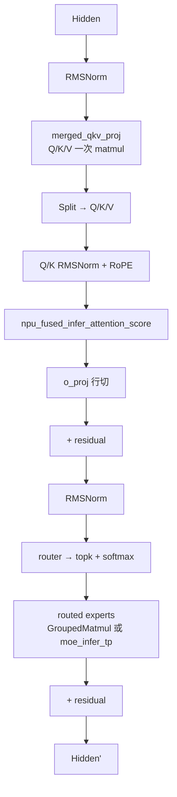
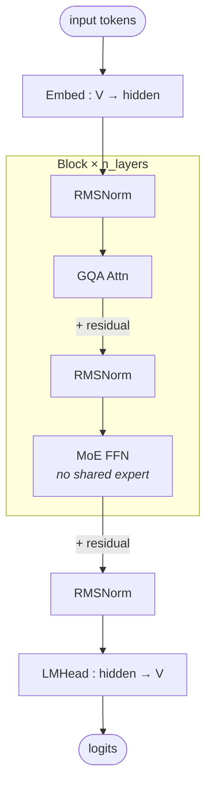

# Qwen3-MoE

## Summary

Qwen3-MoE 是阿里千问 2025 年开源的 MoE 大语言模型，包括 **Qwen3-235B-A22B** 与 Qwen3-30B-A3B 两个版本。结构相对直接——标准 Softmax Attention + MoE FFN（无 shared expert、无 MLA、非 linear attention），是经典的 Dense Attention + Routed-Only MoE 架构。

cann-recipes-infer 在 Atlas A3 上基于 NPU 对 Qwen3-MoE 进行低时延推理优化实践，并提供 **两条并行实现路径**：

- **自研 executor 路径** (`models/qwen3_moe/`)：基于 HuggingFace transformers `modeling_qwen3_moe.py` 适配 Qwen3-235B-A22B，配套 `qwen3_235b_{16tp,128ep,1tp_16ep,attn4tp8dp}.yaml` 四份部署模板；`Qwen3MoeSparseMoeBlock.forward` 按 `moe_tp_size`/`is_prefill` 三分流：TP 路径走 `moe_infer_tp`，EP 路径 prefill 走 `moe_infer_double_routing`、decode 走 `moe_infer_dispatch_combine`。Decode **8 卡部署，BF16 场景下单 batch 推理时延 < 20 ms**。
- **SGLang 路径** (`models/qwen3-moe-sglang/`)：基于 SGLang v0.5.7 开源框架的 `qwen3_moe.py` 适配，提供 9 个 stage patch 覆盖基础修改、eplb 专家均衡、NPU profiler、GE 图模式、MTP1/MTP2 GE 图、LM Head 共享、GQA FIA PD 分离 bug 修复、SuperKernel 使能。Atlas A3 32 卡 W8A8 Benchmark：GBS=256，dp=16/tp=4/ep=64，max_prompt=5120，**纯模型时延 30 ms**。

两条路径均可在 Atlas A3 上部署 Qwen3-235B-A22B，目标场景不同——自研 executor 主打单 batch 极低时延（<20ms），SGLang 路径主打在线服务化 + PD 分离 + MTP。

### Highlights

- **Attention TP**：QKV 按头切分 + `o_proj` 按行切分，`merged_qkv_proj` 一次 matmul + `npu_fused_infer_attention_score` 融合
- **MoE TP / EP 双策略**：TP 策略走 `gate_proj`/`up_proj` 列切 + `down_proj` 行切 + `npu_swiglu`；EP 策略走 `GroupedMatmul` + `moe_init_routing` / `moe_compute_expert_tokens` / `moe_finalize_routing`
- **图模式 + 缓存**：`ge_graph` + `tng.inference.cache_compile`，首轮启动时延显著降低
- **SGLang 路径独有**：MTP1/MTP2 + eplb + SuperKernel + W8A8（`drop_offset` 后）
- **AIV 集合通信**：`HCCL_OP_EXPANSION_MODE=AIV` 利用 Vector Core 加速小通信量

## Architecture And Serving Traits



- **经典 Softmax Attention**：GQA，单个 Attention Head 计算 **O(S²)**。Qwen3-235B-A22B 头数参数由 HF 配置决定（见 `configuration_qwen3_moe.py`）。
- **MoE**：**无 shared expert**（与 DeepSeek-R1 / Kimi-K2 / Qwen3-Next 不同）、纯 routed experts。
- **与 Qwen3-Next / Qwen3.5-MoE 的对比**：Qwen3-Next 与 [qwen3-5-moe](qwen3_5_moe.md) 都是混合注意力（full/Gated Attention + GDN）+ MoE（含 shared expert）；Qwen3-MoE 是经典 Attention + MoE（无 shared expert、无 linear attention），**不共享代码路径**。见 [qwen3-next](qwen3_next.md)。
- **与 Qwen Dense（非 MoE）的关系**：[qwen-dense](qwen_dense.md)（Qwen2/Qwen3-8B 等）共享 `merged_qkv_proj` 建模血缘（QK-Norm 为 Qwen3 共有：Qwen3-8B dense 与本页 Qwen3-MoE 均启用，Qwen2.5 dense 无），但 FFN 为单一稠密 MLP（`gate_up_proj` + 普通 Matmul + 手写 SiLU·mul），而非本页的 MoE 专家（`w13_weight` + `GroupedMatmul` + `npu_swiglu`）；两者各有独立建模文件。

### 自研 executor 路径支持的规格

| 配置文件 | world_size | 并行策略 | 备注 | | ---- | ---- | ---- | ---- | | `qwen3_235b_16tp.yaml` | 16 (1 机 16 卡) | `attn_tp=16`、`moe_tp=16` | 纯 TP 路径，`moe_infer_tp` 走 `npu_swiglu` | | `qwen3_235b_1tp_16ep.yaml` | 16 | `attn_tp=1`（DP16）、`moe_tp=1`（EP16） | DP Attention + EP MoE | | `qwen3_235b_128ep.yaml` | 128 | `attn_tp=1`、`moe_tp=1`（EP128） | 大 EP，`ge_graph`，benchmark 主用 | | `qwen3_235b_attn4tp8dp.yaml` | 32 | `attn_tp=4`（DP8）、`moe_tp=1`（EP32） | 混合 DP/TP Attention，eager 调试 |

> `attn_tp_size` 必须整除 `num_heads`；`num_key_value_heads_per_rank = max(num_key_value_heads // attn_tp_size, 1)` 确保 GQA 场景每卡至少 1 个 KV head。

### SGLang 路径 Benchmark 规格

| 基础模型 | 机器型号 | GBS | dp_size | tp_size | ep_size | max_prompt_length | max_response_length | 纯模型时延（ms） | | ---- | ---- | ---- | ---- | ---- | ---- | ---- | ---- | ---- | | Qwen3-235B-A22B | Atlas A3 32 卡 | 256 | 16 | 4 | 64 | 5120 | 500 | **30** |

> 使能优化点 `--enable-superkernel` + `--perfect-eplb` + `--enable-cache-compile`；W8A8 量化（`msmodelslim` + `drop_offset.py`）。

## Known Optimizations

优化点出处见 Evidence 中的 `qwen3_moe_optimization.md`；自研 executor 实现见 `Qwen3MoeSparseMoeBlock`（`modeling_qwen3_moe.py`）。

### 低时延场景 Tensor Parallel (TP) 优化

#### Attention TP 切分策略

对 Attention 的张量切分策略可以分为**对 QKV 头的切分**和**对线性层的切分**。

在对 QKV 头切分时，attention 的多头计算机制可以方便进行张量切分，每个头先独立计算，再将结果 concat 起来。假设模型的 attention 层需要对 `num_heads` 个 query 按照切分数量 `attn_tp_size` 进行切分，要求 `num_heads` 必须能被 `attn_tp_size` 整除，每张卡放置 query 头个数为 `num_heads_per_rank = num_heads // attn_tp_size`；key 和 value 头数相等，且可能小于等于 query 头个数（在 MQA 和 GQA 的场景下会小于）。为了确保每张卡至少放置一个 key 和 value 头，每张卡放置的 key 或 value 头数计算方法为 `num_key_value_heads_per_rank = max(num_key_value_heads // attn_tp_size, 1)`。

QKV 头在多卡上的排布情况如下图所示：


*来源：[`docs/models/qwen3-moe/figures/attention_tp.png`](https://gitcode.com/cann/cann-recipes-infer/blob/2f82d10467e6fe8dae81c97a2cdac78d733a6703/docs/models/qwen3-moe/figures/attention_tp.png)（cann-recipes-infer @ 2f82d10）*

在对线性层 `o_proj` 进行切分时，**按照行切分**即可。

#### Attention 计算分解

该优化策略先将 **Q、K、V 的线性层计算合并为一次 Matmul 计算**（图中 `merged_qkv_proj`），提升计算性能。将 `merged_qkv_proj` 的输出结果按 Q、K、V 拆分后，对 Q 和 K 进行归一化操作并使用旋转位置编码，再计算 attention（图中 `Fused_infer_attention_score`），最后通过 `o_proj` 层输出。


*来源：[`docs/models/qwen3-moe/figures/attention_calcu.png`](https://gitcode.com/cann/cann-recipes-infer/blob/2f82d10467e6fe8dae81c97a2cdac78d733a6703/docs/models/qwen3-moe/figures/attention_calcu.png)（cann-recipes-infer @ 2f82d10）*

#### MoE TP 切分策略

假设 MoE 层切分数量为 `moe_tp_size`，专家个数为 `expert_num`。对 MoE 层进行张量切分，每个专家相当于一个 mlp 层，切分方法与 mlp 的张量切分方法相似。具体做法是：

- 对 `gate_proj` 与 `up_proj` 进行**列切分**；
- 对 `down_proj` 进行**行切分**；
- 同时对 `gate_proj` 与 `up_proj` 线性层采用**合并计算**，得到 `w13_weight`。

#### MoE 计算分解

每个专家层存在 `gate_proj`、`up_proj` 与 `down_proj` 三个 matmul 运算，具体运算为 `x = down(SiLU(gate(x))*up(x))`。本优化将张量切分后的 `gate_proj` 和 `up_proj` 进行 concat 操作，再使能 [`torch_npu.npu_swiglu`](https://www.hiascend.com/document/detail/zh/Pytorch/710/apiref/torchnpuCustomsapi/context/%EF%BC%88beta%EF%BC%89torch_npu-npu_swiglu.md) 融合算子接口优化，该算子能完成以下两步计算：

- 将输入的 x 沿最后一维切分为两块，即 `x = torch.chunk(x, 2, -1)`；
- 计算并返回 `SiLU(x[0]) * x[1]`。

本优化通过将 `gate_proj` 与 `up_proj` 合并计算，提升整体计算效率。


*来源：[`docs/models/qwen3-moe/figures/moe_opt.png`](https://gitcode.com/cann/cann-recipes-infer/blob/2f82d10467e6fe8dae81c97a2cdac78d733a6703/docs/models/qwen3-moe/figures/moe_opt.png)（cann-recipes-infer @ 2f82d10）*

### 使能融合算子

#### GMM 使能和 Routing 优化

在 MoE 模块中，如果通过 for 循环处理每个专家，单独计算 `expert_num` 个前馈神经网络（FFN），容易导致计算效率较低。CANN 提供了 `GroupedMatmul` 算子，可以同时计算多个专家，从而提高计算和搬运效率。具体实现可参考 `Qwen3MoeSparseMoeBlock.forward` 按 `moe_tp_size`/`is_prefill` 分流到的三条路径：TP 路径 `moe_infer_tp`、EP prefill 路径 `moe_infer_double_routing`、EP decode 路径 `moe_infer_dispatch_combine`。[^opt-name]

[^opt-name]: 上游文档 `qwen3_moe_optimization.md` 原文写的是 `moe_infer_tp` 和 `moe_infer_fusion`，但 `modeling_qwen3_moe.py @2f82d10` 中 `Qwen3MoeSparseMoeBlock` 并无 `moe_infer_fusion` 方法——EP 路径已拆为 `moe_infer_double_routing`（prefill）与 `moe_infer_dispatch_combine`（decode）。

- **快速选择专家**：使用 [`torch_npu.npu_moe_gating_top_k_softmax`](https://www.hiascend.com/document/detail/zh/Pytorch/710/apiref/torchnpuCustomsapi/context/torch_npu-npu_moe_gating_top_k_softmax.md) 融合算子，代替原来先 topk 再 softmax 多算子操作，可以更快速地计算出 token 和专家的分数。
- **高效排序和 token 路由**：
 - [`torch_npu.npu_moe_init_routing`](https://www.hiascend.com/document/detail/zh/Pytorch/710/apiref/torchnpuCustomsapi/context/torch_npu-npu_moe_init_routing.md) —— 获取专家的排序；
 - [`torch_npu.npu_moe_compute_expert_tokens`](https://www.hiascend.com/document/detail/zh/Pytorch/710/apiref/torchnpuCustomsapi/context/torch_npu-npu_moe_compute_expert_tokens.md) —— 获取每个专家需要计算的 token 数；
 - [`torch_npu.npu_moe_finalize_routing`](https://www.hiascend.com/document/detail/zh/Pytorch/710/apiref/torchnpuCustomsapi/context/torch_npu-npu_moe_finalize_routing.md) —— 将专家计算完成后的 token 重新排布并加权求和，获得最终输出。
- **高性能专家计算**：[`torch_npu.npu_grouped_matmul`](https://www.hiascend.com/document/detail/zh/Pytorch/710/apiref/torchnpuCustomsapi/context/torch_npu-npu_grouped_matmul.md) —— 实现多个专家的矩阵乘计算。

> 纯 EP 场景（`moe_ep_size>1` 且 `moe_tp_size==1`）按 prefill/decode 二分流：prefill 走 `Qwen3MoeSparseMoeBlock.moe_infer_double_routing`（`modeling_qwen3_moe.py:307`），decode 才走 `moe_infer_dispatch_combine`（`modeling_qwen3_moe.py:351`，docstring "support ep for decode stage"）。后者使用一体化融合算子 `npu_moe_distribute_dispatch_v2`/`combine_v2`（`:365/:387`），两条 EP 路径的中间专家计算均走 `npu_grouped_matmul`；见 [moe-dispatch-combine-v2](../techniques/moe_dispatch_combine_v2.md)。

#### RmsNorm 算子优化

通过使能 [`torch_npu.npu_rms_norm`](https://www.hiascend.com/document/detail/zh/Pytorch/60RC2/apiref/apilist/ptaoplist_000140.html) 算子，能够提升模型的推理性能。

#### flash attention 融合算子优化

通过使能 [`torch.ops.npu.npu_fused_infer_attention_score`](https://www.hiascend.com/document/detail/zh/Pytorch/710/modthirdparty/torchairuseguide/torchair_00086.html) 推理场景下支持图模式的 FlashAttention 算子，既可以支持全量计算场景，也可支持增量计算场景。见 [fused-infer-attention-score](../kernels/fused_infer_attention_score.md)。

### 使能图模式

使用静态图可以获得更好的推理性能。`Qwen3MoeRunner` 通过覆写 `executor/model_runner.py` 中的 `ModelRunner` 的 `graph_compile` 函数，将模型编译为静态图。

### 使能图编译缓存

在模型推理场景下，使能图编译缓存可以缓存编译后的静态图，避免每次推理都需要编译模型，从而提高推理性能：

```python
if self.enable_cache_compile:
 case_name = "compile_cache/" + os.getenv("CASE_NAME")
 cache_dir = os.path.join(os.path.dirname(os.path.abspath(__file__)), case_name)
 self.model.decode = tng.inference.cache_compile(self.model.decode, cache_dir=cache_dir,
 config=compiler_config, dynamic=True, fullgraph=True, ge_cache=True)
```

缓存默认路径为 `./compile_cache/CASE_NAME`。SGLang 路径同样支持，见 `--enable-cache-compile`。

### 集合通信使能 AIV 展开

利用 Device 的 Vector Core 计算单元来加速通信操作的执行，可参考 [HCCL_OP_EXPANSION_MODE 环境变量](https://www.hiascend.com/document/detail/zh/CANNCommunityEdition/83RC1alpha002/maintenref/envvar/envref_07_0096.html)：

```shell
export HCCL_OP_EXPANSION_MODE=AIV
```

### SGLang 路径独有优化（patches/）

| patch | 作用 | | ---- | ---- | | `0001-feat-basic-modification-for-qwen3-moe.diff` | deepep 模块替换、atb 算子替换、Qwen3MoE MTP 模型适配、MTP 场景下 GQA attention 分支适配、dp+tp 混合并行场景 bug 修复、w8a8 场景 bug 修复、matmul 类算子使能 NZ | | `0002-feat-support-qwen3-moe-forced-eplb.diff` | 专家强制均衡（`--perfect-eplb`） | | `0003-feat-npu-profiler.diff` | NPU profiler | | `0004-feat-npu-support-main-model-ge-graph.diff` | 主模型 ge 图模式（`NPUGraphRunner`） | | `0005-feat-mtp1-support-ge-graph.diff` | MTP1 第一个投的 ge 图模式（`EAGLEDraftExtendNpuGraphRunner`） | | `0006-feat-mtp2-support-ge-graph.diff` | MTP2 其他投的 ge 图模式（`EAGLEDraftNpuGraphRunner`） | | `0007-feat-modify-mtp-lm-head-load-method.diff` | EAGLE 场景下 MTP 权重判断共享 lm_head | | `0008-fix-GQA-FIA-pd-disaggregation-bug.diff` | PD 分离场景 FIA 分支 kv items len 精度 bug | | `0009-feat-support-superkernel.diff` | [superkernel](../techniques/superkernel.md) 使能 |

见 [sglang](../frameworks/sglang.md)、[mtp-speculative-decoding](../techniques/mtp_speculative_decoding.md)。

## Benchmark

- **自研 executor 路径**（BF16，8 卡部署，单 batch）：**< 20 ms**（源文档概述声明，具体 YAML 未提供 benchmark 表）
- **SGLang 路径**（W8A8，Atlas A3 32 卡，GBS=256，dp=16/tp=4/ep=64）：**30 ms** 纯模型时延

## 架构图（stock HF 基线）

下图是 Qwen3-MoE 的 **stock HuggingFace 架构基线**（部署前先验，源自 HF `config.json` + `modeling_qwen3_moe.py`，架构类 `Qwen3MoeForCausalLM`、`model_type=qwen3_moe`），与本页其余的 NPU 部署优化（`merged_qkv_proj` / FIA / TP·EP·DP 切分 / 图模式）互补——上面的「Architecture And Serving Traits」描述的是部署后算子融合视角，本节是未做任何部署改写的原始网络拓扑。参数取自 `Qwen/Qwen3-235B-A22B/config.json`（verified 2026-05-14）。



精简关键参数表（Qwen3-235B-A22B 规格，仅保留对部署有意义的行）：

| Module | Param | Value (235B-A22B) |
|--------|-------|-------------------|
| —   | n_layers         | 94     |
| —   | hidden           | 4096   |
| GQA | n_q_heads        | 64     |
| GQA | n_kv_heads       | 4      |
| GQA | head_dim         | 128    |
| MoE | n_routed_experts | 128    |
| MoE | n_shared_experts | 0      |
| MoE | top_k            | 8      |
| MoE | moe_intermediate | 1536   |

> `n_routed_experts=128`（top-8）取自 `Qwen/Qwen3-235B-A22B/config.json`（verified 2026-05-14）。Qwen3-235B-A22B 单 token 激活参数 ≈ 22B（128 个 routed expert 中 top-8，加上非 MoE 的 attention / norm / embed 权重）。Attention 为标准 GQA（非 MLA），KV 按 per-kv-head 全粒度缓存。**no shared expert** 与本页正文「无 shared expert」口径一致，区别于 [deepseek-r1](deepseek_r1.md) / [qwen3-5-moe](qwen3_5_moe.md) 等含 shared expert 的 MoE。

## Evidence

- [cann-recipes-infer](https://gitcode.com/cann/cann-recipes-infer/tree/2c45117d781ab9ab88dcb89a28ae30f5d2450399) — [`docs/models/qwen3-moe/qwen3_moe_optimization.md`](https://gitcode.com/cann/cann-recipes-infer/blob/2f82d10467e6fe8dae81c97a2cdac78d733a6703/docs/models/qwen3-moe/qwen3_moe_optimization.md)（概述 / Attention TP 切分与计算分解 / MoE TP 切分与计算分解 / 融合算子 / 图模式 / 缓存 / AIV 五大章节）
- [cann-recipes-infer](https://gitcode.com/cann/cann-recipes-infer/tree/2c45117d781ab9ab88dcb89a28ae30f5d2450399) — [`models/qwen3_moe/README.md`](https://gitcode.com/cann/cann-recipes-infer/blob/2f82d10467e6fe8dae81c97a2cdac78d733a6703/models/qwen3_moe/README.md) + `models/qwen3_moe/config/*.yaml`（自研 executor 四份部署模板）、`models/qwen3_moe/models/modeling_qwen3_moe.py`（`Qwen3MoeSparseMoeBlock` 三条路径：`moe_infer_tp` / `moe_infer_double_routing`(prefill) / `moe_infer_dispatch_combine`(decode)）
- [cann-recipes-infer](https://gitcode.com/cann/cann-recipes-infer/tree/2c45117d781ab9ab88dcb89a28ae30f5d2450399) — [`models/qwen3-moe-sglang/README.md`](https://gitcode.com/cann/cann-recipes-infer/blob/2f82d10467e6fe8dae81c97a2cdac78d733a6703/models/qwen3-moe-sglang/README.md)（SGLang v0.5.7 容器镜像、W8A8 msmodelslim 量化、9 个 patch 说明、Benchmark 30 ms）、`models/qwen3-moe-sglang/patches/*.diff`、`models/qwen3-moe-sglang/infer_{prefill,decode,router,""}.sh`、`models/qwen3-moe-sglang/utils/`

## Links

- [qwen3-next](qwen3_next.md)
- [qwen3-5-moe](qwen3_5_moe.md)
- [qwen-dense](qwen_dense.md)
- [hy3-preview](hy3_preview.md)（仓内将本页列为其参考实现：同 GQA+MoE+per-head QK Norm；Hy3-preview 相对本页多 shared expert + sigmoid router，QK Norm 为两者共性非差异）
- [atlas-a3](../platforms/atlas_a3.md)
- [sglang](../frameworks/sglang.md)
- [ascendc](../frameworks/ascendc.md)
- [torchair](../frameworks/torchair.md)
- [fused-infer-attention-score](../kernels/fused_infer_attention_score.md)
- [tensor-parallel](../parallelism/tensor_parallel.md)
- [expert-parallel](../parallelism/expert_parallel.md)
- [data-parallel](../parallelism/data_parallel.md)
- [moe-dispatch-combine-v2](../techniques/moe_dispatch_combine_v2.md)
- [superkernel](../techniques/superkernel.md)
- [mtp-speculative-decoding](../techniques/mtp_speculative_decoding.md)
- [w8a8c8](../quantization/w8a8c8.md)
- [qwen3-rl](../../../training/guides/recipes/qwen3_rl.md)（跨域·训练：Qwen3-235B-A22B RL 后训练）
