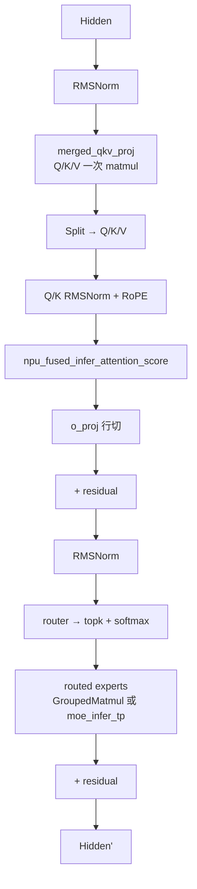

# Qwen3-MoE

## Summary

Qwen3-MoE包括235B-A22B和30B-A3B规格，采用标准GQA Softmax Attention、QK Norm与纯路由专家FFN，没有shared expert、MLA或GDN。

自研执行器与SGLang是不同部署实现，不能把它们的配置、权重或时延混作同一条验证路径。平台配置、开关和验收步骤见[模型部署流程](../../guides/models/qwen3_moe_deployment.md)，此处只保留模型机制。

## Architecture And Serving Traits

- **经典 Softmax Attention**：GQA，单个 Attention Head 计算 **O(S²)**。Qwen3-235B-A22B 头数参数由 HF 配置决定（见 `configuration_qwen3_moe.py`）。
- **MoE**：**无 shared expert**（与 DeepSeek-R1 / Kimi-K2 / Qwen3-Next 不同）、纯 routed experts。
- **与 Qwen3-Next / Qwen3.5-MoE 的对比**：Qwen3-Next 与 [qwen3-5-moe](qwen3_5_moe.md) 都是混合注意力（full/Gated Attention + GDN）+ MoE（含 shared expert）；Qwen3-MoE 是经典 Attention + MoE（无 shared expert、无 linear attention），**不共享代码路径**。见 [qwen3-next](qwen3_next.md)。
- **与 Qwen Dense（非 MoE）的关系**：[qwen-dense](qwen_dense.md)（Qwen2/Qwen3-8B 等）共享 `merged_qkv_proj` 建模血缘（QK-Norm 为 Qwen3 共有：Qwen3-8B dense 与本页 Qwen3-MoE 均启用，Qwen2.5 dense 无），但 FFN 为单一稠密 MLP（`gate_up_proj` + 普通 Matmul + 手写 SiLU·mul），而非本页的 MoE 专家（`w13_weight` + `GroupedMatmul` + `npu_swiglu`）；两者各有独立建模文件。

## 架构图（stock HF 基线）

下图是 Qwen3-MoE 的 **stock HuggingFace 架构基线**（部署前先验，源自 HF `config.json` + `modeling_qwen3_moe.py`，架构类 `Qwen3MoeForCausalLM`、`model_type=qwen3_moe`），与本页其余的 NPU 部署优化（`merged_qkv_proj` / FIA / TP·EP·DP 切分 / 图模式）互补——上面的「Architecture And Serving Traits」描述的是部署后算子融合视角，本节是未做任何部署改写的原始网络拓扑。参数取自 `Qwen/Qwen3-235B-A22B/config.json`（verified 2026-05-14）。

精简关键参数表（Qwen3-235B-A22B 规格，仅保留对部署有意义的行）：

| Module | Param | Value (235B-A22B) |
|--------|-------|-------------------|
| —   | n_layers         | 94     |
| —   | hidden           | 4096   |
| GQA | n_q_heads        | 64     |
| GQA | n_kv_heads       | 4      |
| GQA | head_dim         | 128    |
| MoE | n_routed_experts | 128    |
| MoE | n_shared_experts | 0      |
| MoE | top_k            | 8      |
| MoE | moe_intermediate | 1536   |

> `n_routed_experts=128`（top-8）取自 `Qwen/Qwen3-235B-A22B/config.json`（verified 2026-05-14）。Qwen3-235B-A22B 单 token 激活参数 ≈ 22B（128 个 routed expert 中 top-8，加上非 MoE 的 attention / norm / embed 权重）。Attention 为标准 GQA（非 MLA），KV 按 per-kv-head 全粒度缓存。**no shared expert** 与本页正文「无 shared expert」口径一致，区别于 [deepseek-r1](deepseek_r1.md) / [qwen3-5-moe](qwen3_5_moe.md) 等含 shared expert 的 MoE。

## 部署与证据入口

- [模型部署与验收流程](../../guides/models/qwen3_moe_deployment.md)：配置、开关、失效条件与回退入口。
- [Qwen3-MoE A3 两条实现的来源时延观测](../../optimizations/benchmark_observations/qwen3_moe_a3_source_benchmark.md)：固定来源自报，未经本仓独立复测。

## Evidence

- [cann-recipes-infer](https://gitcode.com/cann/cann-recipes-infer/tree/2c45117d781ab9ab88dcb89a28ae30f5d2450399) — [`docs/models/qwen3-moe/qwen3_moe_optimization.md`](https://gitcode.com/cann/cann-recipes-infer/blob/2f82d10467e6fe8dae81c97a2cdac78d733a6703/docs/models/qwen3-moe/qwen3_moe_optimization.md)（概述 / Attention TP 切分与计算分解 / MoE TP 切分与计算分解 / 融合算子 / 图模式 / 缓存 / AIV 五大章节）
- [cann-recipes-infer](https://gitcode.com/cann/cann-recipes-infer/tree/2c45117d781ab9ab88dcb89a28ae30f5d2450399) — [`models/qwen3_moe/README.md`](https://gitcode.com/cann/cann-recipes-infer/blob/2f82d10467e6fe8dae81c97a2cdac78d733a6703/models/qwen3_moe/README.md) + `models/qwen3_moe/config/*.yaml`（自研 executor 四份部署模板）、`models/qwen3_moe/models/modeling_qwen3_moe.py`（`Qwen3MoeSparseMoeBlock` 三条路径：`moe_infer_tp` / `moe_infer_double_routing`(prefill) / `moe_infer_dispatch_combine`(decode)）
- [cann-recipes-infer](https://gitcode.com/cann/cann-recipes-infer/tree/2c45117d781ab9ab88dcb89a28ae30f5d2450399) — [`models/qwen3-moe-sglang/README.md`](https://gitcode.com/cann/cann-recipes-infer/blob/2f82d10467e6fe8dae81c97a2cdac78d733a6703/models/qwen3-moe-sglang/README.md)（SGLang v0.5.7 容器镜像、W8A8 msmodelslim 量化、9 个 patch 说明、Benchmark 30 ms）、`models/qwen3-moe-sglang/patches/*.diff`、`models/qwen3-moe-sglang/infer_{prefill,decode,router,""}.sh`、`models/qwen3-moe-sglang/utils/`

## Links

- [qwen3-next](qwen3_next.md)
- [qwen3-5-moe](qwen3_5_moe.md)
- [qwen-dense](qwen_dense.md)
- [hy3-preview](hy3_preview.md)（仓内将本页列为其参考实现：同 GQA+MoE+per-head QK Norm；Hy3-preview 相对本页多 shared expert + sigmoid router，QK Norm 为两者共性非差异）
- [atlas-a3](../platforms/atlas_a3.md)
- [sglang](../frameworks/sglang.md)
- [ascendc](../frameworks/ascendc.md)
- [torchair](../frameworks/torchair.md)
- [fused-infer-attention-score](../kernels/fused_infer_attention_score.md)
- [tensor-parallel](../parallelism/tensor_parallel.md)
- [expert-parallel](../parallelism/expert_parallel.md)
- [data-parallel](../parallelism/data_parallel.md)
- [moe-dispatch-combine-v2](../techniques/moe_dispatch_combine_v2.md)
- [superkernel](../techniques/superkernel.md)
- [mtp-speculative-decoding](../techniques/mtp_speculative_decoding.md)
- [w8a8c8](../quantization/w8a8c8.md)
- [qwen3-rl](../../../training/guides/recipes/qwen3_rl.md)（跨域·训练：Qwen3-235B-A22B RL 后训练）
