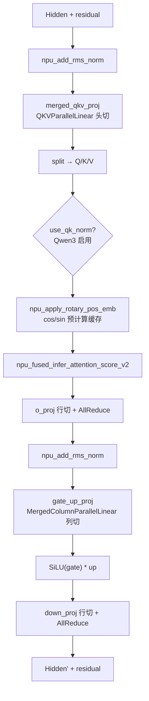
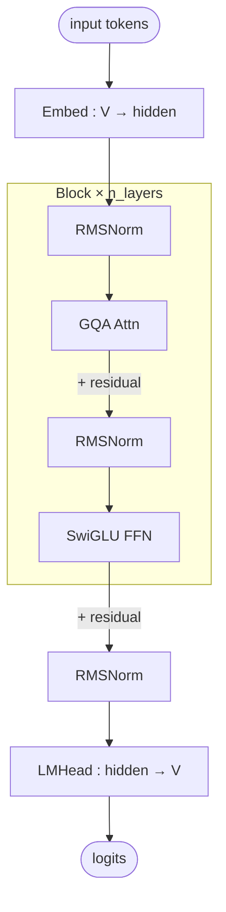

# Qwen Dense (Qwen2 / Qwen3 非 MoE)

## Summary

Qwen Dense为Qwen2/Qwen3非MoE模型的统一结构入口：GQA Softmax Attention与单一稠密MLP，没有路由专家或GDN。

| 变体 | model_name | QK-Norm | attention_bias |
| --- | --- | --- | --- |
| Qwen3-8B | qwen3_8b | 有 | False |
| Qwen2.5-7B-Instruct | qwen25_7b_instruct | 无 | True |

平台配置、开关和验收步骤见[模型部署流程](../../guides/models/qwen_dense_deployment.md)，此处只保留模型机制。

## Architecture And Serving Traits

- **经典稠密结构**：GQA Softmax Attention + 稠密 MLP（SwiGLU 风格），无 MoE、无 shared expert、非 linear attention。
- **目标平台**：源 README 与优化文档均声明 Atlas A2/A3（BF16）；A2 为上游文字声明，本 wiki 平台页仅 [atlas-a3](../platforms/atlas_a3.md)（A2 无独立页）。
- **BF16 MLP 激活实现**：`modeling_qwen.py:163-167` 取 `gate_up_proj` 输出按中间维一分为二，执行手写 `act_fn(gate) * up`（ACT2FN）；区别于 [qwen3-moe](qwen3_moe.md) 专家 MLP 走 `npu_swiglu` 融合算子（优化文档「计算分解」述「分别执行 SiLU 激活和 element-wise 乘法」，无 swiglu 融合）。

## 当前 W8A8 执行路径

Qwen3-8B现在支持compressed-tensors W8A8 INT8：权重per-channel、激活per-token，覆盖merged_qkv_proj/o_proj和gate_up_proj/down_proj。仅mm_quant_mode=w8a8int8进入专用MLP：gate_up输出INT32及token scale，npu_dequant_swiglu_quant融合反量化/SwiGLU/再量化，再由down_proj消费INT8和scale。其他模式保持普通ACT2FN路径，TP归约在两条路径输出后统一执行。

权重加载后对应weight scale与down smooth scale按FP32处理；CacheEntry各自携带block_size，ModelCacheInfo不再携带公共block_size。量化MLP仍是稠密网络，不能归为MoE。

## 架构图（stock HF 基线）

下图只表示来源中 Qwen2/Qwen3 Dense 共有的 GQA + 稠密 MLP、pre-norm 和残差拓扑。固定来源主要覆盖 Qwen3-8B / Qwen2.5-7B；没有归档 Qwen3-32B 的检查点配置，因此不提供其确定维度或据此计算缓存比例。具体参数须读取选定权重 config.json。

GQA 的 Query/KV 头数与共享比例随检查点变化；TP 切分须核对具体头数及每卡至少一个 KV 头的实现约束，不能沿用其他尺寸的标量规格。

## 部署与证据入口

- [模型部署与验收流程](../../guides/models/qwen_dense_deployment.md)：配置、开关、失效条件与回退入口。

## Evidence

- [README.md](../../../../../cann-recipes-raw/cann-recipes-infer/944d2d3ece86f7df33dbb0cb155c72ca619a9c66/models/qwen/README.md)（primary）
- [modeling_qwen.py](../../../../../cann-recipes-raw/cann-recipes-infer/944d2d3ece86f7df33dbb0cb155c72ca619a9c66/models/qwen/models/modeling_qwen.py)（implementation）
- [qwen_dense_optimization.md](../../../../../cann-recipes-raw/cann-recipes-infer/944d2d3ece86f7df33dbb0cb155c72ca619a9c66/docs/models/qwen/qwen_dense_optimization.md)（supporting）

## Links

- [qwen3-moe](qwen3_moe.md)
- [atlas-a3](../platforms/atlas_a3.md)
- [tensor-parallel](../parallelism/tensor_parallel.md)
- [fused-infer-attention-score](../kernels/fused_infer_attention_score.md)
- [inference-config](../techniques/inference_config.md)
- [npu-graph-mode](../techniques/npu_graph_mode.md)
- [w8a8c8](../quantization/w8a8c8.md)（Qwen-dense 是其一条 per-token·per-channel W8A8 应用）
- [cann-executor](../frameworks/cann_executor.md)
- [kv-cache-manager](../frameworks/kv_cache_manager.md)
- [qwen2.5-rl](../../../training/guides/recipes/qwen2_5_rl.md)（跨域·训练：Qwen2.5 RL 入门实践）
- [qwen3-sft](../../../training/guides/recipes/qwen3_sft.md)（跨域·训练：Qwen3-1.7B SFT 训练样例）
- [qwen3-tool-agent-rl](../../../training/guides/recipes/qwen3_tool_agent_rl.md)（跨域·训练：Qwen3-4B-Instruct-2507 数学工具 Agent RL，verl-retool SFT+RL）
- [qwen3-code-toolcall-rl](../../../training/guides/recipes/qwen3_code_toolcall_rl.md)（跨域·训练：Qwen3-1.7B 多轮工具调用 Code RL + ScaleBox）
- [qwen2-code-rl-scalebox](../../../training/guides/recipes/qwen2_code_rl_scalebox.md)（跨域·训练：DeepSeek-R1-Distill-1.5B / Qwen3-4B Code RL + ScaleBox 沙盒）
