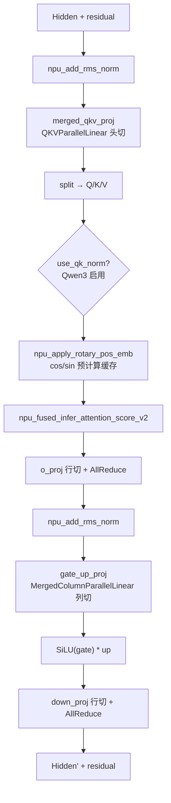
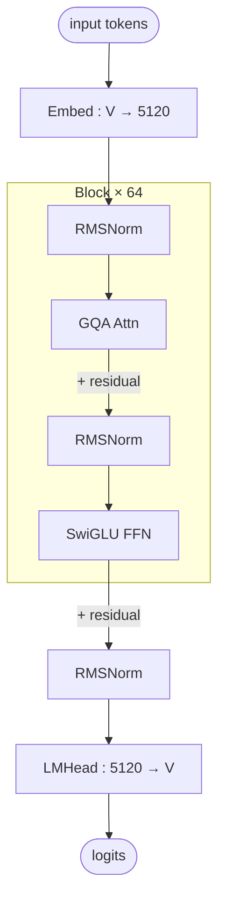

# Qwen Dense (Qwen2 / Qwen3 非 MoE)

## Summary

Qwen Dense 指 Qwen2 / Qwen3 系列中的**稠密（非 MoE）大语言模型**，cann-recipes-infer 用一套统一建模代码（`models/qwen/models/modeling_qwen.py` 内 `QwenForCausalLM`）适配多个变体，跑在 Atlas A2/A3 上，BF16 推理，由仓库自研 executor（[cann-executor](../frameworks/cann_executor.md) 新执行器路径）驱动单卡或多卡 TP 部署。

统一建模通过 HuggingFace `config.json` 自动识别变体（`configuration_qwen.py` 的 `Qwen2Config` / `Qwen3Config`），支持在线权重切分（无需离线预处理）、可选多卡 TP、Packed Sequence（TND 格式，Prefill/Decode 均打包）、Page Attention 块式 KV Cache 管理。

两个已适配变体的关键结构差异：

| 变体 | `model_name` | QK-Norm | attention_bias |
|---|---|---|---|
| Qwen3-8B | `qwen3_8b` | 启用 | `False` |
| Qwen2.5-7B-Instruct | `qwen25_7b_instruct` | 无 | `True` |

> QK-Norm 由 `config.use_qk_norm` 控制（`modeling_qwen.py:223` `getattr(config, "use_qk_norm", False)`）：Qwen3 启用、Qwen2 无此步骤。`attention_bias` 由 `config.attention_bias` 控制（`:213`），Qwen2 为 `True`、Qwen3 为 `False`。

### Highlights

- **统一建模 + 自动识别变体**：单份 `modeling_qwen.py` 覆盖 Qwen2/Qwen3 稠密结构，`use_qk_norm` / `attention_bias` 按 config 分支
- **Attention TP**：QKV 按头切分 + `o_proj` 行切；`merged_qkv_proj`（`QKVParallelLinear`）一次 Matmul 出 Q/K/V
- **MLP TP**：`gate_up_proj`（`MergedColumnParallelLinear`）合并 gate/up 为一次 Matmul，降 kernel launch；`down_proj` 行切
- **残差融合**：`npu_add_rms_norm` 把残差 add + RMSNorm 合并为一次 kernel，residual 在层间显式传递
- **融合算子**：`npu_rms_norm` / `npu_apply_rotary_pos_emb`（cos/sin 预计算缓存）/ FlashAttention `npu_fused_infer_attention_score_v2`（全量 + 增量）

## Architecture And Serving Traits

- **经典稠密结构**：GQA Softmax Attention + 稠密 MLP（SwiGLU 风格），无 MoE、无 shared expert、非 linear attention。
- **目标平台**：源 README 与优化文档均声明 Atlas A2/A3（BF16）；A2 为上游文字声明，本 wiki 平台页仅 [atlas-a3](../platforms/atlas_a3.md)（A2 无独立页）。
- **MLP 激活实现**：`modeling_qwen.py:163-167` 取 `gate_up_proj` 输出按中间维一分为二，执行手写 `act_fn(gate) * up`（ACT2FN）；区别于 [qwen3-moe](qwen3_moe.md) 专家 MLP 走 `npu_swiglu` 融合算子（优化文档「计算分解」述「分别执行 SiLU 激活和 element-wise 乘法」，无 swiglu 融合）。

## Qwen-Dense 特有的 TP 切分点

TP 行/列切、AllReduce 通算融合等通用机制见 [tensor-parallel](../parallelism/tensor_parallel.md)，此处只摘 Qwen Dense 的具体落点：

- **Attention**：QKV 按头切（`num_heads_per_rank = num_heads // attn_tp_size`，要求 `num_heads % attn_tp_size == 0`；GQA 下 `num_key_value_heads_per_rank = max(num_key_value_heads // attn_tp_size, 1)` 保每卡≥1 个 KV 头），`o_proj` 行切。`merged_qkv_proj` 把 Q/K/V 三个投影合为一次 Matmul（权重映射 `("merged_qkv_proj", "q_proj"/"k_proj"/"v_proj")`）。
- **MLP**：`gate_proj` / `up_proj` 列切并合为 `gate_up_proj` 一次 Matmul（权重映射 `("gate_up_proj", "gate_proj", 0)` / `("gate_up_proj", "up_proj", 1)`），`down_proj` 行切。合并的核心收益是减少 kernel launch 次数。
- **与 MoE 兄弟的区别**：[qwen3-moe](qwen3_moe.md) 的 MLP 是 MoE 专家（`gate_proj`/`up_proj` 合为 `w13_weight`、走 `GroupedMatmul`），Qwen Dense 是单一稠密 MLP（`gate_up_proj`、走普通 Matmul + 手写 SiLU·mul）。两者共享 `merged_qkv_proj` 建模血缘（QK-Norm 仅 Qwen3 变体启用——Qwen3-8B dense 与 Qwen3-MoE 有、Qwen2.5 dense 无），但 MLP/MoE 路径不同。

## 融合算子与图模式

- **残差融合**：原始 transformers 每个 DecoderLayer 的残差 add 与 RMSNorm 分开执行；本适配用 `torch_npu.npu_add_rms_norm`（`modeling_qwen.py:74` `y, _, x = npu_add_rms_norm(residual, hidden_states, weight, eps)`）合为一次 kernel，每层两处残差（Attention 前、MLP 前）各省一次独立 add 与读写，residual 作为参数在层间传递。
- **RMSNorm / RoPE**：`npu_rms_norm`（`:61`，替代手写 variance+rsqrt）；`npu_apply_rotary_pos_emb`（`:303`，替代 `rotate_half` + 手动乘加），cos/sin 预计算并缓存避免每次 forward 动态计算。
- **FlashAttention**：`npu_fused_infer_attention_score_v2`（`:338`），同时支持全量（Prefill）与增量（Decode）计算，详见 [fused-infer-attention-score](../kernels/fused_infer_attention_score.md)。
- **图模式**：优化文档述经 `executor/model_runner.py` 的 `ModelRunner.graph_compile`（`:249`）将模型编译为静态图；自研新执行器路径的图编译入口为 `executor/core/model_worker/model_worker.py:compile_model`（`:303`）→ `executor/utils/graph_utils.py:compile_model_forward`，二者随执行器入口而定（详见 [npu-graph-mode](../techniques/npu_graph_mode.md)）；config 默认 `exe_mode: "ge_graph"`，README「已验证特性」表列 `ge_graph` 与 `npugraph_ex`（含 `static_kernel`）均已验证。
- **集合通信 AIV 展开**：同一优化文档（46485bef 修订）「集合通信使能AIV展开」述可设 `HCCL_OP_EXPANSION_MODE=AIV`，用 Device 的 Vector Core（AIV）展开并加速通信算子执行（如 TP `o_proj` / `down_proj` 行切后的 AllReduce）；属部署级环境变量旋钮，与 [tensor-parallel](../parallelism/tensor_parallel.md) 的 AllReduce 通算融合互补。

> 上述 torch_npu 融合算子的引用为 torch_npu 官方文档接口；公式/字段/类名见 `modeling_qwen.py`。

## 新执行器部署配置

`models/qwen/config/` 提供 4 份 YAML（`qwen3_8b_{1,2}tp.yaml`、`qwen25_7b_instruct_{1,2}tp.yaml`），属新执行器路径（`InferenceConfig` 体系，无 `kvp_size` / `runner_settings`）：

- `model_config.exe_mode: "ge_graph"`、`with_ckpt: True`；可选 `enable_cache_compile` / `enable_static_kernel`（后者仅 `npugraph_ex`）。
- `data_config.input_truncated_len: 4096`（最大输入序列长度，超长 prompt 截断）。
- `parallel_config`：`world_size` / `attn_tp_size` / `moe_tp_size` / `embed_tp_size` / `lmhead_tp_size`（1tp 全 1；2tp 取 `world_size=2`、`attn_tp_size=2`、`moe_tp_size=2`、`embed_tp_size=1`、`lmhead_tp_size=2`）。注：Dense MLP（`gate_up_proj`/`down_proj`，`modeling_qwen.py:146/155` `tp_size=self.attn_tp_size`）按 `attn_tp_size` 切分，`moe_tp_size` 对稠密模型无实际作用、属配置模板字段。字段语义见 [inference-config](../techniques/inference_config.md)。
- `scheduler_config`：`max_new_tokens: 256`、`batch_size: 1`。
- KV Cache 走框架级 Page Attention 块式管理（[kv-cache-manager](../frameworks/kv_cache_manager.md)）。

## W8A8 INT8 量化

Qwen3-8B 支持 W8A8 INT8 量化（其余主体为 BF16 路径）；它是 [w8a8c8](../quantization/w8a8c8.md) 的一条 **per-token·per-channel** 应用落点。

- **量化粒度**：权重采用 **per-channel 静态量化**，激活采用 **per-token 动态量化**；量化范围覆盖 Attention 的 `merged_qkv_proj` / `o_proj` 与 MLP 的 `gate_up_proj` / `down_proj`，共 **4 个 Linear 层**。
- **融合路径（MLP）**：启用量化后 MLP 计算切换至专用融合算子路径——`gate_up_proj` 输出 **int32 张量 + per-token scale**，作为 `torch_npu.npu_dequant_swiglu_quant` 的输入，由该算子**一次性完成 反量化 + SwiGLU 激活 + 再量化**；输出的 **int8 张量与对应 scale** 由 `down_proj` 直接接收并执行后续矩阵乘运算。
- **机理**：该实现使 `ge_graph` 静态图模式下命中现有融合算子实现，避免因 `AddRmsNormDynamicQuant` 等组合算子尚未提供而触发的回退路径（图模式见 [npu-graph-mode](../techniques/npu_graph_mode.md)）。
- **配置语义**：量化逻辑由 `mm_quant_mode` 字段控制——仅当字段值为 `w8a8int8` 时启用 W8A8 量化路径，否则保持原 BF16 推理路径不变；量化权重以 **compressed-tensors 格式**加载。

> torch_npu 融合算子（`npu_dequant_swiglu_quant`）的引用为官方文档接口；粒度/字段名/算子名见优化文档「W8A8 INT8 量化」小节。

## 架构图（stock HF 基线）

下图为 **Qwen3-32B dense** 的 stock HuggingFace 架构（部署前基线，源自 HF `config.json` + `Qwen3ForCausalLM` modeling），与上述 NPU 部署优化（融合算子 / TP 切分 / 图模式）互补——它描述未经 NPU 改造的原始拓扑，可作为对照部署落点的「参照系」。

> Qwen3-8B / Qwen2.5-7B dense 为主体；下图与参数表是 **Qwen3-32B 同族 stock 基线**（同为 `Qwen3ForCausalLM`、GQA + SwiGLU pre-norm 结构），拓扑共享但标量规格不同——表中数字仅代表 Qwen3-32B，**不是** 8B/7B 变体的数值。各尺寸需查各自 config。

精简关键参数（仅保留对部署有意义的行，取自 `Qwen/Qwen3-32B/config.json`，**Qwen3-32B 规格**）：

| Module | Param | Value (Qwen3-32B) |
|--------|-------|-------------------|
| — | n_layers | 64 |
| — | hidden | 5120 |
| — | vocab | 151936 |
| GQA | n_q_heads | 64 |
| GQA | n_kv_heads | 8 |
| GQA | head_dim | 128 |
| FFN | intermediate_size | 25600 |
| — | rope_theta | 1,000,000 |
| — | tie_word_embeddings | false |

GQA 下 64 个 query 头共享 8 个 KV 头（每 KV 头 8 query），KV-cache 占用降至 vanilla MHA 的 1/8，对应 [tensor-parallel](../parallelism/tensor_parallel.md) 中 GQA 每卡保 ≥1 个 KV 头的切分约束；该原始拓扑经 [fused-infer-attention-score](../kernels/fused_infer_attention_score.md) 等融合算子改造后部署。stock config 无 sliding window（全层全量注意力）、`tie_word_embeddings=false`（Embed 与 LMHead 权重独立）。

> 架构图与参数为 stock HF 拓扑（部署无关）。溯源：`Qwen/Qwen3-32B/config.json`（`architectures=Qwen3ForCausalLM`、`model_type=qwen3`）；HF 无专用 dense 架构图，拓扑取标准 pre-norm transformer 模式。

## Evidence

- [cann-recipes-infer](https://gitcode.com/cann/cann-recipes-infer/tree/2c45117d781ab9ab88dcb89a28ae30f5d2450399) — [`docs/models/qwen/qwen_dense_optimization.md`](https://gitcode.com/cann/cann-recipes-infer/blob/2c45117d781ab9ab88dcb89a28ae30f5d2450399/docs/models/qwen/qwen_dense_optimization.md)（概述 / Attention TP / MLP TP / 残差融合 / 融合算子 / 图模式 6 章节；57 行）
- [cann-recipes-infer](https://gitcode.com/cann/cann-recipes-infer/tree/2c45117d781ab9ab88dcb89a28ae30f5d2450399) — [`docs/models/qwen/qwen_dense_optimization.md` §「W8A8 INT8 量化」](https://gitcode.com/cann/cann-recipes-infer/blob/46485bef9bb6bf061e4c356942bfea395e75865a/docs/models/qwen/qwen_dense_optimization.md)（per-channel 权重静态 + per-token 激活动态、4 Linear、`npu_dequant_swiglu_quant` 融合反量化+SwiGLU+再量化、`AddRmsNormDynamicQuant` 回退规避、`mm_quant_mode==w8a8int8`、compressed-tensors 加载）
- [cann-recipes-infer](https://gitcode.com/cann/cann-recipes-infer/tree/2c45117d781ab9ab88dcb89a28ae30f5d2450399) — [`models/qwen/README.md`](https://gitcode.com/cann/cann-recipes-infer/blob/2c45117d781ab9ab88dcb89a28ae30f5d2450399/models/qwen/README.md)（统一 Qwen2/Qwen3 Dense 适配、两变体表、已验证特性表、CANN 8.5.0 / torch_npu 2.8.0）+ [`models/qwen/config/*.yaml`](https://gitcode.com/cann/cann-recipes-infer/blob/2c45117d781ab9ab88dcb89a28ae30f5d2450399/models/qwen/config/qwen3_8b_1tp.yaml)（4 份部署模板）
- [cann-recipes-infer](https://gitcode.com/cann/cann-recipes-infer/tree/2c45117d781ab9ab88dcb89a28ae30f5d2450399) — [`models/qwen/models/modeling_qwen.py`](https://gitcode.com/cann/cann-recipes-infer/blob/2c45117d781ab9ab88dcb89a28ae30f5d2450399/models/qwen/models/modeling_qwen.py)（`use_qk_norm`@223/294、`attention_bias`@213、`merged_qkv_proj`/`QKVParallelLinear`@208、`gate_up_proj`/`MergedColumnParallelLinear`@142、gate/up split@164-166、`npu_add_rms_norm`@74、`npu_rms_norm`@61、`npu_apply_rotary_pos_emb`@303、`npu_fused_infer_attention_score_v2`@338）；`executor/core/support_models.py:51-57`（`qwen3_8b` / `qwen25_7b_instruct` 注册）
- 引入提交 [`2b36c61`](https://gitcode.com/cann/cann-recipes-infer/commit/2b36c61e7f026a6f10183c2cacba625761b76f30) "[feat] infer supports qwen3_8b"（MR !317；含 docs/optimization + README + config + modeling_qwen.py 650 行）

## Links

- [qwen3-moe](qwen3_moe.md)
- [atlas-a3](../platforms/atlas_a3.md)
- [tensor-parallel](../parallelism/tensor_parallel.md)
- [fused-infer-attention-score](../kernels/fused_infer_attention_score.md)
- [inference-config](../techniques/inference_config.md)
- [npu-graph-mode](../techniques/npu_graph_mode.md)
- [w8a8c8](../quantization/w8a8c8.md)（Qwen-dense 是其一条 per-token·per-channel W8A8 应用）
- [cann-executor](../frameworks/cann_executor.md)
- [kv-cache-manager](../frameworks/kv_cache_manager.md)
- [qwen2.5-rl](../../../training/guides/recipes/qwen2_5_rl.md)（跨域·训练：Qwen2.5 RL 入门实践）
- [qwen3-sft](../../../training/guides/recipes/qwen3_sft.md)（跨域·训练：Qwen3-1.7B SFT 训练样例）
- [qwen3-tool-agent-rl](../../../training/guides/recipes/qwen3_tool_agent_rl.md)（跨域·训练：Qwen3-4B-Instruct-2507 数学工具 Agent RL，verl-retool SFT+RL）
- [qwen3-code-toolcall-rl](../../../training/guides/recipes/qwen3_code_toolcall_rl.md)（跨域·训练：Qwen3-1.7B 多轮工具调用 Code RL + ScaleBox）
- [qwen2-code-rl-scalebox](../../../training/guides/recipes/qwen2_code_rl_scalebox.md)（跨域·训练：DeepSeek-R1-Distill-1.5B / Qwen3-4B Code RL + ScaleBox 沙盒）
