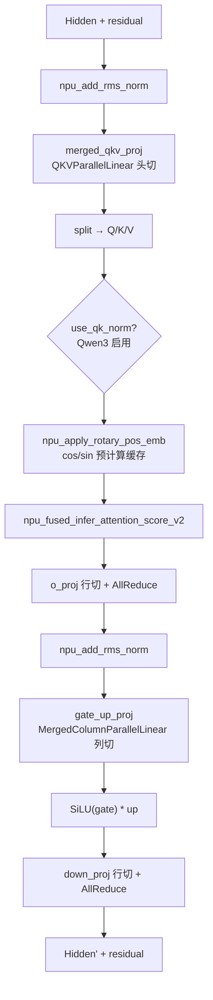

# Qwen Dense (Qwen2 / Qwen3 非 MoE)

## Summary

Qwen Dense为Qwen2/Qwen3非MoE模型的统一结构入口：GQA Softmax Attention与单一稠密MLP，没有路由专家或GDN。

| 变体 | model_name | QK-Norm | attention_bias |
| --- | --- | --- | --- |
| Qwen3-8B | qwen3_8b | 有 | False |
| Qwen2.5-7B-Instruct | qwen25_7b_instruct | 无 | True |

平台配置、开关和验收步骤见[模型部署流程](../../guides/models/qwen_dense_deployment.md)，此处只保留模型机制。

## Architecture And Serving Traits

- **经典稠密结构**：GQA Softmax Attention + 稠密 MLP（SwiGLU 风格），无 MoE、无 shared expert、非 linear attention。
- **目标平台**：源 README 与优化文档均声明 Atlas A2/A3（BF16）；A2 为上游文字声明，本 wiki 平台页仅 [atlas-a3](../platforms/atlas_a3.md)（A2 无独立页）。
- **MLP 激活实现**：`modeling_qwen.py:163-167` 取 `gate_up_proj` 输出按中间维一分为二，执行手写 `act_fn(gate) * up`（ACT2FN）；区别于 [qwen3-moe](qwen3_moe.md) 专家 MLP 走 `npu_swiglu` 融合算子（优化文档「计算分解」述「分别执行 SiLU 激活和 element-wise 乘法」，无 swiglu 融合）。

## 架构图（stock HF 基线）

下图为 **Qwen3-32B dense** 的 stock HuggingFace 架构（部署前基线，源自 HF `config.json` + `Qwen3ForCausalLM` modeling），与上述 NPU 部署优化（融合算子 / TP 切分 / 图模式）互补——它描述未经 NPU 改造的原始拓扑，可作为对照部署落点的「参照系」。

> Qwen3-8B / Qwen2.5-7B dense 为主体；下图与参数表是 **Qwen3-32B 同族 stock 基线**（同为 `Qwen3ForCausalLM`、GQA + SwiGLU pre-norm 结构），拓扑共享但标量规格不同——表中数字仅代表 Qwen3-32B，**不是** 8B/7B 变体的数值。各尺寸需查各自 config。

精简关键参数（仅保留对部署有意义的行，取自 `Qwen/Qwen3-32B/config.json`，**Qwen3-32B 规格**）：

| Module | Param | Value (Qwen3-32B) |
|--------|-------|-------------------|
| — | n_layers | 64 |
| — | hidden | 5120 |
| — | vocab | 151936 |
| GQA | n_q_heads | 64 |
| GQA | n_kv_heads | 8 |
| GQA | head_dim | 128 |
| FFN | intermediate_size | 25600 |
| — | rope_theta | 1,000,000 |
| — | tie_word_embeddings | false |

GQA 下 64 个 query 头共享 8 个 KV 头（每 KV 头 8 query），KV-cache 占用降至 vanilla MHA 的 1/8，对应 [tensor-parallel](../parallelism/tensor_parallel.md) 中 GQA 每卡保 ≥1 个 KV 头的切分约束；该原始拓扑经 [fused-infer-attention-score](../kernels/fused_infer_attention_score.md) 等融合算子改造后部署。stock config 无 sliding window（全层全量注意力）、`tie_word_embeddings=false`（Embed 与 LMHead 权重独立）。

> 架构图与参数为 stock HF 拓扑（部署无关）。溯源：`Qwen/Qwen3-32B/config.json`（`architectures=Qwen3ForCausalLM`、`model_type=qwen3`）；HF 无专用 dense 架构图，拓扑取标准 pre-norm transformer 模式。

## 部署与证据入口

- [模型部署与验收流程](../../guides/models/qwen_dense_deployment.md)：配置、开关、失效条件与回退入口。

## Evidence

- [cann-recipes-infer](https://gitcode.com/cann/cann-recipes-infer/tree/2c45117d781ab9ab88dcb89a28ae30f5d2450399) — [`docs/models/qwen/qwen_dense_optimization.md`](https://gitcode.com/cann/cann-recipes-infer/blob/2c45117d781ab9ab88dcb89a28ae30f5d2450399/docs/models/qwen/qwen_dense_optimization.md)（概述 / Attention TP / MLP TP / 残差融合 / 融合算子 / 图模式 6 章节；57 行）
- [cann-recipes-infer](https://gitcode.com/cann/cann-recipes-infer/tree/2c45117d781ab9ab88dcb89a28ae30f5d2450399) — [`docs/models/qwen/qwen_dense_optimization.md` §「W8A8 INT8 量化」](https://gitcode.com/cann/cann-recipes-infer/blob/46485bef9bb6bf061e4c356942bfea395e75865a/docs/models/qwen/qwen_dense_optimization.md)（per-channel 权重静态 + per-token 激活动态、4 Linear、`npu_dequant_swiglu_quant` 融合反量化+SwiGLU+再量化、`AddRmsNormDynamicQuant` 回退规避、`mm_quant_mode==w8a8int8`、compressed-tensors 加载）
- [cann-recipes-infer](https://gitcode.com/cann/cann-recipes-infer/tree/2c45117d781ab9ab88dcb89a28ae30f5d2450399) — [`models/qwen/README.md`](https://gitcode.com/cann/cann-recipes-infer/blob/2c45117d781ab9ab88dcb89a28ae30f5d2450399/models/qwen/README.md)（统一 Qwen2/Qwen3 Dense 适配、两变体表、已验证特性表、CANN 8.5.0 / torch_npu 2.8.0）+ [`models/qwen/config/*.yaml`](https://gitcode.com/cann/cann-recipes-infer/blob/2c45117d781ab9ab88dcb89a28ae30f5d2450399/models/qwen/config/qwen3_8b_1tp.yaml)（4 份部署模板）
- [cann-recipes-infer](https://gitcode.com/cann/cann-recipes-infer/tree/2c45117d781ab9ab88dcb89a28ae30f5d2450399) — [`models/qwen/models/modeling_qwen.py`](https://gitcode.com/cann/cann-recipes-infer/blob/2c45117d781ab9ab88dcb89a28ae30f5d2450399/models/qwen/models/modeling_qwen.py)（`use_qk_norm`@223/294、`attention_bias`@213、`merged_qkv_proj`/`QKVParallelLinear`@208、`gate_up_proj`/`MergedColumnParallelLinear`@142、gate/up split@164-166、`npu_add_rms_norm`@74、`npu_rms_norm`@61、`npu_apply_rotary_pos_emb`@303、`npu_fused_infer_attention_score_v2`@338）；`executor/core/support_models.py:51-57`（`qwen3_8b` / `qwen25_7b_instruct` 注册）
- 引入提交 [`2b36c61`](https://gitcode.com/cann/cann-recipes-infer/commit/2b36c61e7f026a6f10183c2cacba625761b76f30) "[feat] infer supports qwen3_8b"（MR !317；含 docs/optimization + README + config + modeling_qwen.py 650 行）

## Links

- [qwen3-moe](qwen3_moe.md)
- [atlas-a3](../platforms/atlas_a3.md)
- [tensor-parallel](../parallelism/tensor_parallel.md)
- [fused-infer-attention-score](../kernels/fused_infer_attention_score.md)
- [inference-config](../techniques/inference_config.md)
- [npu-graph-mode](../techniques/npu_graph_mode.md)
- [w8a8c8](../quantization/w8a8c8.md)（Qwen-dense 是其一条 per-token·per-channel W8A8 应用）
- [cann-executor](../frameworks/cann_executor.md)
- [kv-cache-manager](../frameworks/kv_cache_manager.md)
- [qwen2.5-rl](../../../training/guides/recipes/qwen2_5_rl.md)（跨域·训练：Qwen2.5 RL 入门实践）
- [qwen3-sft](../../../training/guides/recipes/qwen3_sft.md)（跨域·训练：Qwen3-1.7B SFT 训练样例）
- [qwen3-tool-agent-rl](../../../training/guides/recipes/qwen3_tool_agent_rl.md)（跨域·训练：Qwen3-4B-Instruct-2507 数学工具 Agent RL，verl-retool SFT+RL）
- [qwen3-code-toolcall-rl](../../../training/guides/recipes/qwen3_code_toolcall_rl.md)（跨域·训练：Qwen3-1.7B 多轮工具调用 Code RL + ScaleBox）
- [qwen2-code-rl-scalebox](../../../training/guides/recipes/qwen2_code_rl_scalebox.md)（跨域·训练：DeepSeek-R1-Distill-1.5B / Qwen3-4B Code RL + ScaleBox 沙盒）
