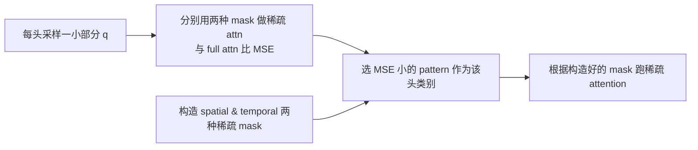

# Blockwise Sparse Attention (TopK / SVG)

## Summary

**Blockwise Sparse Attention** 是一种 Attention 组件变体：按 [block_Q, block_K] 粒度选择部分块计算并跳过其余块；TopK predictor 按估计分数取 TopK，SVG 则以采样输出 MSE 选择 spatial/temporal 模式，从而把超长序列 DiT 的 Attention 计算量显著降低。与普通 [sparse-flash-attention](sparse_flash_attention.md)（按 Token TopK 的稀疏）并列，是 Attention 算法族下的"块级稀疏"分支。cann-recipes-infer 在 `module/blockwise_sparse/` 下实现 **TopK** 与 **SVG** 两种 predictor，底层算子依赖 [blitz_sparse_attention](https://gitcode.com/cann/ops-transformer/blob/ca41b0b5eb9dbf6eb94a58aa20fe379681c1d751/experimental/attention/blitz_sparse_attention/README.md)（需按参考文档自行编译）。

定位：这是 **Attention 算法/组件的变体**（不是正交的通用优化技术），放在 modules 目录下；与 [sparse-flash-attention](sparse_flash_attention.md)、[gated-attention](gated_attention.md)、[mla](mla.md) 并列。

## Mechanism

### TopK

分两个阶段：

1. **Offline profiling**：使用 Cumulative Attention Score Coverage (CAC) 作为保真度指标：

 $$
 CAC = \frac{\sum_{(i,j) \in \text{Top-K}} \text{Softmax}\left(\frac{QK^{T}}{\sqrt{d_{k}}}\right)_{ij}}{\sum_{i,j} \text{Softmax}\left(\frac{QK^{T}}{\sqrt{d_{k}}}\right)_{ij}}
 $$

 离线对每 step / layer / head 扫描不同稀疏度，找到满足目标 CAC 的最大稀疏度并落盘。代码位于 [`module/blockwise_sparse/offline_profiling/`](https://gitcode.com/cann/cann-recipes-infer/tree/944d2d3ece86f7df33dbb0cb155c72ca619a9c66/module/blockwise_sparse/offline_profiling)。示例命令：

 ```bash
 python offline_profiling_hyvideo.py \
 --qk_dir_path /path/to/qk_dir \
 --target_dir_path /path/to/target_dir \
 --global_layer_num 60 --head_num 24 \
 --target_coverage 0.66 \
 --step_start 0 --step_end 50
 ```

2. **Online 推理**：将 q、k 按行分块并池化，估算注意力分数；对每行按离线稀疏度取 TopK 块，构造稀疏 mask 与 sabi tensor 喂入 blitz_sparse_attention。

### SVG (Sparse Video Generation)




*来源：[`docs/models/hunyuan-video/figures/svg.png`](../../../../../cann-recipes-raw/cann-recipes-infer/944d2d3ece86f7df33dbb0cb155c72ca619a9c66/docs/models/hunyuan-video/figures/svg.png)（cann-recipes-infer @ 944d2d3；原图来源 [ICML 2025 svg](https://icml.cc/virtual/2025/poster/43743)）*

## Variants

| Variant | 预测来源 | 稀疏粒度 | 适用阶段 |
|---------|---------|----------|----------|
| TopK | 离线 profiling QK 统计分布 + 在线池化估算 | `[block_Q, block_K]` 块级 | 整个 step 区间可选 |
| SVG | 在线按头采样 MSE 选 spatial/temporal 模式 | 块级，两种固定模式 | `sparse_time_step` 区间内 |

## 与序列并行的协同

当前支持单卡、[Ulysses](../parallelism/ulysses.md)及[Ring](../parallelism/ring_attention.md)。旧Ring拒绝检查已移除。TopK Ring保留本地Q、聚合全局KV，首帧Q用dense结果回填；overlap异步聚合KV与本地稀疏计算重叠，随后用LSE合并本地/远端结果。SVG同步采样MSE后统一pattern，再按全局坐标构造本地sabi；SVG overlap当前回退普通Ring SVG，不表示已实现稀疏搬算重叠。

- **Head 负载均衡（仅 TopK 路径）**：Ulysses 在 Attention 处切 head（`num_heads / ulysses_degree`）。块稀疏下各 head 的稀疏 mask 不同、实际计算量不均，故 `ulysses_degree > 1` 时调 `TopKPredictor.apply_head_reorder_for_load_balance(ulysses_degree)`（`sparse_method.py:593`）对 head 重排——按每 (step, layer) 的 head 计算量（`1 - sparsity`）降序贪心装箱到各 Ulysses rank，使各 rank 分到的稀疏计算量尽量均衡（具体重排算法详见 `sparse_method.py`）。该调用经 `sample_video.py` 的 `hasattr` 守卫触发——**仅 `TopKPredictor`（及 `HunyuanVideoTopKAdapter`）实现该方法；`SVGPredictor` 路径未实现、守卫下跳过不重排**。
- **SP 执行入口**：`parallel_sparse_attention`（`models/hunyuan-video/hyvideo/modules/attention.py:275`）在 Ulysses 下复用 SP 通信，按 `joint_q_local_bnsd` 等切分构造完整稀疏 attention 输入，内部走 `forward_ulysses_sparse`。
- **模型专用 predictor 适配器**：`HunyuanVideoTopKAdapter` / `HunyuanVideoSVGAdapter`（`sparse_method.py:1011 / 1263`，继承 `TopKPredictor` / `SVGPredictor`）承载 HunyuanVideo 双流/单流 DiT block 的稀疏接入（`hyvideo/sparse/sparse_block.py` 的 `sparse_double_block_forward` / `sparse_single_block_forward`），并携带 HyVideo 专属参数（`sink_frame_len`、`img_token_len`）。
- **与 Dit-Cache 互斥**：使能 sparse 会覆盖 block forward，与 [dit-cache](../techniques/dit_cache.md) 互斥（sparse YAML 固定 `dit_cache.method: NoCache`）。

来源的稀疏与负载均衡测量统一见[HunyuanVideo 稀疏观测草稿](../../optimizations/benchmark_observations/hunyuan_video_sparse_source_observations.md)；平台未绑定的测量不继承本机制的范围。

## 集成边界

块稀疏依赖模型专用的布局、predictor、算子以及并行切分；配置名称和允许的组合随版本变化。当前使用统一YAML顶层sparse.method/params，旧独立sparse_config.yaml已移除。Ring TopK overlap要求稀疏算子返回匹配LSE；更新CANN后需重建对应算子。启动、算子准备、配置及回退统一见[HunyuanVideo Guide](../../guides/models/hunyuan_video_deployment.md)，缓存与稀疏的 forward 替换冲突仍须按对应版本核对。

## Evidence

- [hunyuan_video_optimization.md](../../../../../cann-recipes-raw/cann-recipes-infer/944d2d3ece86f7df33dbb0cb155c72ca619a9c66/docs/models/hunyuan-video/hunyuan_video_optimization.md)（primary）
- [sparse_method.py](../../../../../cann-recipes-raw/cann-recipes-infer/944d2d3ece86f7df33dbb0cb155c72ca619a9c66/module/blockwise_sparse/sparse_method.py)（implementation）
- [sample_video.py](../../../../../cann-recipes-raw/cann-recipes-infer/944d2d3ece86f7df33dbb0cb155c72ca619a9c66/models/hunyuan-video/sample_video.py)（constraint）

## Links

- [dit](dit.md)
- [sparse-flash-attention](sparse_flash_attention.md)
- [hunyuan-video](../models/hunyuan_video.md)
- [dit-cache](../techniques/dit_cache.md)
- [mm-inference-launch](../frameworks/mm_inference_launch.md)
- [ulysses](../parallelism/ulysses.md)
- [ring-attention](../parallelism/ring_attention.md)
