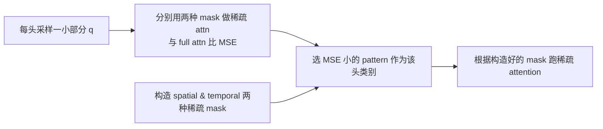

# Blockwise Sparse Attention (TopK / SVG)

## Summary

**Blockwise Sparse Attention** 是一种 Attention 组件变体：按 `[block_Q, block_K]` 粒度估计块的重要程度，只计算 TopK 重要块、跳过其余块，从而把超长序列 DiT 的 Attention 计算量显著降低。与普通 [sparse-flash-attention](sparse_flash_attention.md)（按 Token TopK 的稀疏）并列，是 Attention 算法族下的"块级稀疏"分支。cann-recipes-infer 在 `module/blockwise_sparse/` 下实现 **TopK** 与 **SVG** 两种 predictor，底层算子依赖 [blitz_sparse_attention](https://gitcode.com/cann/ops-transformer/blob/ca41b0b5eb9dbf6eb94a58aa20fe379681c1d751/experimental/attention/blitz_sparse_attention/README.md)（需按参考文档自行编译）。

定位：这是 **Attention 算法/组件的变体**（不是正交的通用优化技术），放在 modules 目录下；与 [sparse-flash-attention](sparse_flash_attention.md)、[gated-attention](gated_attention.md)、[mla](mla.md) 并列。

## Mechanism

### TopK

分两个阶段：

1. **Offline profiling**：使用 Cumulative Attention Score Coverage (CAC) 作为保真度指标：

 $$
 CAC = \frac{\sum_{(i,j) \in \text{Top-K}} \text{Softmax}\left(\frac{QK^{T}}{\sqrt{d_{k}}}\right)_{ij}}{\sum_{i,j} \text{Softmax}\left(\frac{QK^{T}}{\sqrt{d_{k}}}\right)_{ij}}
 $$

 离线对每 step / layer / head 扫描不同稀疏度，找到满足目标 CAC 的最大稀疏度并落盘。代码位于 [`module/blockwise_sparse/offline_profiling/`](https://gitcode.com/cann/cann-recipes-infer/tree/2f82d10467e6fe8dae81c97a2cdac78d733a6703/module/blockwise_sparse/offline_profiling)。示例命令：

 ```bash
 python offline_profiling_hyvideo.py \
 --qk_dir_path /path/to/qk_dir \
 --target_dir_path /path/to/target_dir \
 --global_layer_num 60 --head_num 24 \
 --target_coverage 0.66 \
 --step_start 15 --step_end 50
 ```

2. **Online 推理**：将 q、k 按行分块并池化，估算注意力分数；对每行按离线稀疏度取 TopK 块，构造稀疏 mask 与 sabi tensor 喂入 blitz_sparse_attention。

### SVG (Sparse Video Generation)




*来源：[`docs/models/hunyuan-video/figures/svg.png`](https://gitcode.com/cann/cann-recipes-infer/blob/2f82d10467e6fe8dae81c97a2cdac78d733a6703/docs/models/hunyuan-video/figures/svg.png)（cann-recipes-infer @ 2f82d10；原图来源 [ICML 2025 svg](https://icml.cc/virtual/2025/poster/43743)）*

## Variants

| Variant | 预测来源 | 稀疏粒度 | 适用阶段 |
|---------|---------|----------|----------| | TopK | 离线 profiling QK 统计分布 + 在线池化估算 | `[block_Q, block_K]` 块级 | 整个 step 区间可选 |
| SVG | 在线按头采样 MSE 选 spatial/temporal 模式 | 块级，两种固定模式 | `sparse_time_step` 区间内 |

## 与序列并行的协同

块稀疏只与单卡或 [ulysses](../parallelism/ulysses.md) 序列并行协同，**不与 [ring-attention](../parallelism/ring_attention.md) 组合**：HunyuanVideo `sample_video.py` 在 `sparse_method != "no_sparse"` 且 `ring_degree > 1` 时抛 `ValueError("Sparse attention does not support ring_degree > 1 in the current runtime.")`（"current runtime" 限制）。

- **Head 负载均衡（仅 TopK 路径）**：Ulysses 在 Attention 处切 head（`num_heads / ulysses_degree`）。块稀疏下各 head 的稀疏 mask 不同、实际计算量不均，故 `ulysses_degree > 1` 时调 `TopKPredictor.apply_head_reorder_for_load_balance(ulysses_degree)`（`sparse_method.py:593`）对 head 重排——按每 (step, layer) 的 head 计算量（`1 - sparsity`）降序贪心装箱到各 Ulysses rank，使各 rank 分到的稀疏计算量尽量均衡（具体重排算法详见 `sparse_method.py`）。该调用经 `sample_video.py` 的 `hasattr` 守卫触发——**仅 `TopKPredictor`（及 `HunyuanVideoTopKAdapter`）实现该方法；`SVGPredictor` 路径未实现、守卫下跳过不重排**。
- **SP 执行入口**：`parallel_sparse_attention`（`models/hunyuan-video/hyvideo/modules/attention.py:275`）在 Ulysses 下复用 SP 通信，按 `joint_q_local_bnsd` 等切分构造完整稀疏 attention 输入，内部走 `forward_ulysses_sparse`。
- **模型专用 predictor 适配器**：`HunyuanVideoTopKAdapter` / `HunyuanVideoSVGAdapter`（`sparse_method.py:1011 / 1263`，继承 `TopKPredictor` / `SVGPredictor`）承载 HunyuanVideo 双流/单流 DiT block 的稀疏接入（`hyvideo/sparse/sparse_block.py` 的 `sparse_double_block_forward` / `sparse_single_block_forward`），并携带 HyVideo 专属参数（`sink_frame_len`、`img_token_len`）。
- **与 Dit-Cache 互斥**：使能 sparse 会覆盖 block forward，与 [dit-cache](../techniques/dit_cache.md) 互斥（sparse YAML 固定 `dit_cache.method: NoCache`）。

> 源文档 `Ulysses + TopK/SVG 联合优化`（@2c45117）的稀疏-vs-稠密加速比：异构稀疏相较稠密计算单卡 1.66x（3587s→2160s）、八卡 1.39x–1.45x（稠密 464s → 异构稀疏 335s，负载均衡后 321s），四卡 1.57x–1.60x。其中 head 负载均衡是次级增量——四卡 head 已较均衡（仅 ~12 s 增益），八卡并行度提升后 head 计算不均更突出（~14 s，~4.2%）。

## Performance Characteristics

- **适用载荷**：DiT 超长序列 Attention（HunyuanVideo 5s 720p ≈ 119k tokens，FA 占 DiT 81%）。
- **依赖算子**：blitz_sparse_attention（外部 ops-transformer 仓库编译）。
- **配置**：@2c45117 起在启动 YAML 顶层增加 `sparse:` 段使能（无该段或 `method: no_sparse` 即关闭），`sparse:` 段内联了原独立 [`sparse_config.yaml`](https://gitcode.com/cann/cann-recipes-infer/blob/2f82d10467e6fe8dae81c97a2cdac78d733a6703/models/hunyuan-video/hyvideo/sparse/sparse_config.yaml)（@2f82d10 为独立文件形式）的全部字段；`config/single_sparse.yaml` 为单卡 SVG 参考、`config/sp8_sparse.yaml` 为 8 卡 Ulysses + SVG 参考（均 `720*1280*129` 规格）。

```yaml
sparse:
 method: "SVG"                      # [no_sparse, TopK, SVG]；no_sparse 即关闭稀疏
 block_size_Q: 128                  # q/k 分块大小
 block_size_K: 512
 model: "HunyuanVideo"
 params:
 TopK:                              # only used when method == TopK
 sparse_time_step: "10-49"        # 应用稀疏的 step 区间
 sparsity_files_path: "./sparsity/720x1280x129/v3"  # 离线 profiling 产物路径
 CAC_threshold: 0.66              # CAC 阈值
 SVG:                              # only used when method == SVG
 sparse_time_step: "14-49"
 sparsity: 0.8                    # 稀疏度
 sample_mse_max_row: 5000         # 采样长度
 context_length: 256              # context 长度
```

通过 `python sample_video.py --sparse_method TopK/SVG` 使能。

### Constraints

- 依赖外部 blitz_sparse_attention 算子编译：

 ```bash
 git clone https://gitcode.com/cann/ops-transformer.git
 cd ops-transformer
 bash build.sh --make_clean --experimental -j96 --pkg --soc=ascend910_93 --ops=blitz_sparse_attention # --soc：A2=ascend910b，A3=ascend910_93
 ./build/cann-ops-transformer-custom_linux-"$(uname -i)".run
 ```

- TopK 需要离线 profiling 保存 QK，profile 时长与样本数线性相关
- SVG 仅支持 `sparse_time_step` 内使能，早期 step 变化剧烈不适合稀疏
- 稀疏度设置过高会显著影响画质（ambiguity：源未给出端到端质量指标对比）
- **端到端 speedup（@2c45117 块稀疏性能表，相对 baseline E2E 3577.19s / DiT 3459.52s）**：TopK 76% 稀疏 → 1.82x E2E / 1.88x DiT（E2E 1963.52s）；SVG 80% 稀疏 → 1.65x E2E / 1.70x DiT（E2E 2167.55s）

## Evidence

- [cann-recipes-infer](https://gitcode.com/cann/cann-recipes-infer/tree/2c45117d781ab9ab88dcb89a28ae30f5d2450399) — [`docs/models/hunyuan-video/hunyuan_video_optimization.md`](https://gitcode.com/cann/cann-recipes-infer/blob/2f82d10467e6fe8dae81c97a2cdac78d733a6703/docs/models/hunyuan-video/hunyuan_video_optimization.md) 块稀疏 Attention 章节
- [cann-recipes-infer](https://gitcode.com/cann/cann-recipes-infer/tree/2c45117d781ab9ab88dcb89a28ae30f5d2450399) — [`module/blockwise_sparse/sparse_method.py`](https://gitcode.com/cann/cann-recipes-infer/blob/2f82d10467e6fe8dae81c97a2cdac78d733a6703/module/blockwise_sparse/sparse_method.py) 与 [`module/blockwise_sparse/offline_profiling/`](https://gitcode.com/cann/cann-recipes-infer/tree/2f82d10467e6fe8dae81c97a2cdac78d733a6703/module/blockwise_sparse/offline_profiling)
- 块稀疏 × SP 协同（@2c45117，MR!353 / MR!369）：[`sparse_method.py#L593`](https://gitcode.com/cann/cann-recipes-infer/blob/2c45117d781ab9ab88dcb89a28ae30f5d2450399/module/blockwise_sparse/sparse_method.py)（`apply_head_reorder_for_load_balance`）、`#L1011`/`#L1263`（`HunyuanVideoTopKAdapter` / `HunyuanVideoSVGAdapter`）、[`sample_video.py#L116-L126`](https://gitcode.com/cann/cann-recipes-infer/blob/2c45117d781ab9ab88dcb89a28ae30f5d2450399/models/hunyuan-video/sample_video.py)（ring_degree ValueError）、[`hyvideo/modules/attention.py#L275`](https://gitcode.com/cann/cann-recipes-infer/blob/2c45117d781ab9ab88dcb89a28ae30f5d2450399/models/hunyuan-video/hyvideo/modules/attention.py)（`parallel_sparse_attention`）、[`hyvideo/sparse/sparse_block.py`](https://gitcode.com/cann/cann-recipes-infer/blob/2c45117d781ab9ab88dcb89a28ae30f5d2450399/models/hunyuan-video/hyvideo/sparse/sparse_block.py)、[`docs/.../hunyuan_video_optimization.md`](https://gitcode.com/cann/cann-recipes-infer/blob/2c45117d781ab9ab88dcb89a28ae30f5d2450399/docs/models/hunyuan-video/hunyuan_video_optimization.md) `Ulysses + TopK/SVG 联合优化`

## Links

- [dit](dit.md)
- [sparse-flash-attention](sparse_flash_attention.md)
- [hunyuan-video](../models/hunyuan_video.md)
- [dit-cache](../techniques/dit_cache.md)
- [mm-inference-launch](../frameworks/mm_inference_launch.md)
- [ulysses](../parallelism/ulysses.md)
- [ring-attention](../parallelism/ring_attention.md)