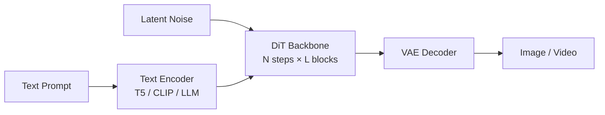

# Diffusion Transformer (DiT)

## Summary

DiT（Diffusion Transformer）是目前主流的多模态扩散生成模型主干：把 U-Net 替换为 Transformer，把 latent（图像/视频 VAE 编码后）当作 token 序列，通过**多步去噪（sampling steps）** 从随机噪声还原语义信号。cann-recipes-infer 中的 HunyuanVideo、HunyuanImage-3.0、Wan2.2-I2V、Sana-Video 均属于此范式：文本 encoder（T5/CLIP/LLM）把 prompt 编码为 condition，DiT 在每一步 time step 内基于 (noisy_latent, t, cond) 预测噪声；CFG 用一组 conditional/unconditional 预测做 guidance，再经 VAE decoder 还原出像素域的图像/视频。

DiT 在昇腾 NPU 上的性能热点显著区别于 LLM：Attention 序列极长（HunyuanVideo 720p 5s ≈ 119k tokens，**attention 占模型端到端 81%、DiT 占模型端到端 95%**），VAE/CFG 占比也不可忽略。因此 DiT 推理优化栈既复用 LLM 的融合算子（FA / RMSNorm / RoPE），也引入一批视频生成专属优化：序列并行（Ulysses / Ring）、步间缓存（FBCache / TeaCache / TaylorSeer）、块稀疏 Attention、VAE patch 并行、CFG 并行等。

## Mechanism

### 推理一轮迭代结构

- **Text Encoder**：一次性编码 prompt 为条件特征（CFG 场景下分别对 cond / uncond 编码）
- **DiT Backbone**：在 `num_steps`（如 50）次 time step 上迭代，每一步对 latent 全量做 L 个 Transformer block；每个 block 常见形态是 `AdaLN-Modulate → Attention → Modulate → MLP`
- **CFG**：每一步预测 `noise_pred_cond`、`noise_pred_uncond` 两次，然后 `noise_pred = noise_pred_uncond + w·(noise_pred_cond - noise_pred_uncond)`
- **VAE Decoder**：DiT 迭代完成后，将 latent 送入 VAE 解码为像素域输出；视频场景 VAE 同时做时序维度重建

### Block 形态（以 HunyuanVideo 为例）

- **Double-stream block**：图像/视频 token 与文本 token 各自走独立 QKV 投影与 MLP，在 attention 前按 `cu_seqlens` 拼成一段 `[img, text]` 序列联合做 FA，attention 后再按原位拆回
- **Single-stream block**：拼接后共享 QKV + MLP，适合后段精细化建模
- **AdaLN modulation**：每个 block 的 LN 输出按 time step embedding 产生 `scale/shift/gate`，融合到 norm 后的输入上（多个 DiT 模型允许把 3 个固定 gemma/beta 的 LN 与 modulate 融成 `npu_layer_norm_eval`，见 Wan2.2-I2V）

## Variants

| 模型 | Backbone | Text Encoder | 特殊结构 |
| ---- | -------- | ------------ | -------- |
| HunyuanVideo | DiT + Double/Single block | LLM + CLIP | 3D full attention，S≈119k |
| HunyuanImage-3.0 | DiT + MoE | LLM（自带 Hunyuan） | attention+MoE 双重 TP，MoE Double-Routing |
| Wan2.2-I2V | DiT + Image2Video 条件 | T5/CLIP | CFG 串行 + cond/uncond 分别 TeaCache |
| Sana-Video | Linear-Attn DiT（SANA 系） | Gemma/轻量 LLM | 1×1 conv2d / 时序 conv 为主 |

## Performance Characteristics

- **Attention 主导**：长序列 DiT 中 FA 是首要瓶颈，融合算子（FIA / FA_v2）+ 序列并行是标配
- **多步迭代天然可缓存**：时间步之间输出变化平滑 → Step-level Cache（FBCache / TeaCache / TaylorSeer）可直接跳过若干 step
- **VAE 与 DiT 并非同构**：VAE 以 3D/2D 卷积为主，需要 patch 并行而不是 sequence 并行；VAE 并行优化单独一类（见 [vae-patch-parallel](../parallelism/vae_patch_parallel.md)）
- **CFG 每步两份样本**：天然可拆到两张卡同时算（[cfg-parallel](../parallelism/cfg_parallel.md)）

## Evidence

- [cann-recipes-infer](https://gitcode.com/cann/cann-recipes-infer/tree/2c45117d781ab9ab88dcb89a28ae30f5d2450399) — [`docs/models/hunyuan-video/hunyuan_video_optimization.md`](https://gitcode.com/cann/cann-recipes-infer/blob/2f82d10467e6fe8dae81c97a2cdac78d733a6703/docs/models/hunyuan-video/hunyuan_video_optimization.md)（DiT 占 95%，Attention 占 81%）
- [cann-recipes-infer](https://gitcode.com/cann/cann-recipes-infer/tree/2c45117d781ab9ab88dcb89a28ae30f5d2450399) — [`docs/models/hunyuan-image-3.0/hunyuan_image_3_optimization.md`](https://gitcode.com/cann/cann-recipes-infer/blob/2f82d10467e6fe8dae81c97a2cdac78d733a6703/docs/models/hunyuan-image-3.0/hunyuan_image_3_optimization.md)（DiT + MoE 变体）
- [cann-recipes-infer](https://gitcode.com/cann/cann-recipes-infer/tree/2c45117d781ab9ab88dcb89a28ae30f5d2450399) — [`docs/models/wan2.2-i2v/wan2.2-i2v_optimization.md`](https://gitcode.com/cann/cann-recipes-infer/blob/2f82d10467e6fe8dae81c97a2cdac78d733a6703/docs/models/wan2.2-i2v/wan2.2-i2v_optimization.md)
- [cann-recipes-infer](https://gitcode.com/cann/cann-recipes-infer/tree/2c45117d781ab9ab88dcb89a28ae30f5d2450399) — [`docs/models/sana-video/SANA-Video_optimization.md`](https://gitcode.com/cann/cann-recipes-infer/blob/2f82d10467e6fe8dae81c97a2cdac78d733a6703/docs/models/sana-video/SANA-Video_optimization.md)

## Links

- [vae](vae.md)
- [ulysses](../parallelism/ulysses.md)
- [ring-attention](../parallelism/ring_attention.md)
- [cfg-parallel](../parallelism/cfg_parallel.md)
- [vae-patch-parallel](../parallelism/vae_patch_parallel.md)
- [dit-cache](../techniques/dit_cache.md)
- [blockwise-sparse-attention](blockwise_sparse_attention.md)
- [hunyuan-video](../models/hunyuan_video.md)
- [hunyuan-image-3](../models/hunyuan_image_3.md)
- [wan2.2-i2v](../models/wan2_2_i2v.md)
- [sana-video](../models/sana_video.md)
- [hunyuan3d](../../../spatial/concepts/models/hunyuan3d.md)（跨域·空间智能：Hunyuan3D shapegen 的 DiT 去噪主干）
- 跨域·具身：[agibot-arm-world-model](../../../embodied/concepts/world_models/agibot_arm_world_model.md)、[cosmos-transfer2.5](../../../embodied/concepts/world_models/cosmos_transfer2_5.md)、[cosmos-predict2.5](../../../embodied/concepts/world_models/cosmos_predict2_5.md)、[isaac-gr00t](../../../embodied/concepts/manipulation/isaac_gr00t.md)（世界模型 / 双系统 VLA 的 DiT 去噪主干）
- [mindspeed-mm](../../../training/concepts/frameworks/mindspeed_mm.md)（跨域·训练：MindSpeed-MM 多模态训练套件用 DiT 做视频/图像生成训练）
- [multimodal-dit-vae-train](../../../training/concepts/modules/multimodal_dit_vae_train.md)（训练侧 DiT：扩散去噪训练 + dit_usp/dit_ring_attention 长序列并行）
