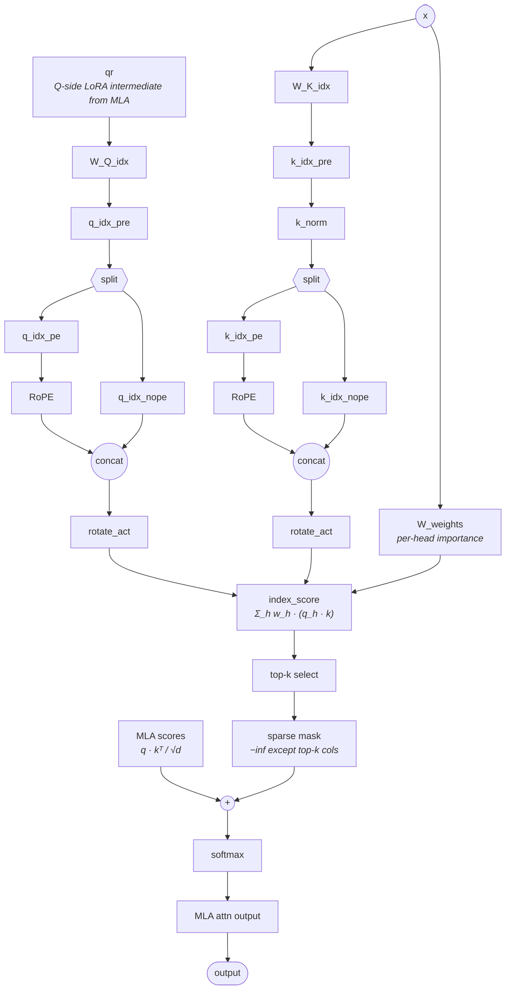

# DSA（DeepSeek Sparse Attention）架构模式

## 概述

DSA（DeepSeek Sparse Attention）是一种**注意力架构模式**，不是单个 kernel，也不是 MLA 的替代品。其本质是 **MLA 的 Q/K/V LoRA 计算图 + 一个并行的学习式 indexer overlay**：indexer 与 MLA 共享同一份输入 `x`（及 MLA Q 侧 LoRA 中间量 `qr`），独立打分后为**每个 query 位置**选出 `index_topk` 个最相关的 key，产出一个加性 `-inf` mask；该 mask 在 **softmax 之前**叠加到 MLA 的注意力分数上，把非 top-k 位置置零。

因此一个声明 `attention_type=dsa` 的模型隐式携带了完整的 MLA 前向图——DSA ⊇ MLA（MLA 是 DSA 的**严格子图**）。MLA 的低秩压缩细节见 [mla](mla.md)，indexer 选 token 的计算公式见 [lightning-indexer](lightning_indexer.md)，稀疏注意力的 kernel 形态见 [sparse-flash-attention](sparse_flash_attention.md)。per-model 数值（`index_n_heads` / `index_head_dim` / `index_topk` 等）放在各模型页的 `Key parameters`。

## 架构图

> 模型无关结构图。已验证适用于 DeepSeek V3.2-Exp（`DeepseekV32ForCausalLM`，`model_type=deepseek_v32`）与 GLM-5（`GlmMoeDsaForCausalLM`，`model_type=glm_moe_dsa`）。任何"注意力类包裹一张 MLA 形状的 Q/K/V 图 + 一个发出 per-query top-k mask 的学习式 indexer"的模型都复用此结构；per-model 变体（旋转技巧、FP8 布局、indexer 头数）写在该模型自己的 Notes。

读图须知（避免误读）：

- 两个 `RoPE` 框是 **indexer 自己的** RoPE（作用于 `q_idx_pe` / `k_idx_pe`），不是 MLA 的 `q_rope` / `k_rope`。**indexer RoPE 布局因模型而异**：V3.2-Exp 用非交错布局（`npu_rotary_mul`，rotate-half），GLM-5 用交错布局（`indexer_rope_interleave=True` → `npu_interleave_rope`）；MLA RoPE 一般为交错布局。详见 Notes。
- `MLA scores` 是从 MLA 路径汇入本图的唯一入边：它是 [mla](mla.md) 中未经 softmax 的 `q · kᵀ / √d`。在 MLA 单图里 softmax 是融合的；在 DSA 里 softmax 被拆开，以便在中间叠加 indexer 的加性 mask。

## 与 MLA / SFA / LI 的关系（四者边界）

| 概念 | 角色 | 粒度 | 与 DSA 的关系 |
| --- | --- | --- | --- |
| **DSA**（本页） | 架构模式 | 注意力子层结构 | 顶层模式 = MLA 子图 + indexer overlay |
| [mla](mla.md) | 低秩压缩注意力 | 网络模块 | DSA 的**严格子图**；DSA 模型主链 dsa，mla 作为底层机制可并链（见下） |
| [lightning-indexer](lightning_indexer.md)（LI） | 选 top-k token 的前置模块 | 网络模块 | DSA 中产出 mask 的 indexer overlay 实例 |
| [sparse-flash-attention](sparse_flash_attention.md)（SFA） | 稀疏注意力路径 | 计算模块 / kernel | DSA 稀疏注意力路径的落地实现（gather top-k KV 后做 FA） |

- **DSA ⊋ MLA，主链 dsa**：结构上 DSA 的注意力块至少有三条并行分支（MLA Q/K/V、indexer Q、indexer K + per-head weights）与三处 concat/merge；[mla](mla.md) 单独只含第一条分支。因此使用 DSA 的模型，其注意力**主身份**链到 `[dsa](dsa.md)`（做 kernel fan-out 规划时以 dsa 为准，避免只看 mla 数错分支）；`[mla](mla.md)` 作为 DSA 的底层机制（严格子图）可一并链接，二者不互斥（V3.2-Exp / GLM-5 页即同时链 dsa 与 mla）。
- **LI vs SFA 是 DSA 的两段**：LI 负责"选哪些 token"（产 top-k index / 加性 mask），SFA 负责"在选中的稀疏子集上算注意力"。cann-recipes-infer 把这条链路在算子层进一步表达为 LightningIndexer + IndexerProlog + SparseFlashAttention，乃至融成单 kernel（见 [deepseek-indexer-attention](../kernels/deepseek_indexer_attention.md)）。
- **架构图 vs 算子页**：此结构图是 stock HF 架构先验（部署无关）。Atlas A3 上的算子级落地——离散 gather、FP8/C8 量化、MegaKernel 融合——见 [sparse-flash-attention](../kernels/sparse_flash_attention.md) 与 [deepseek-indexer-attention](../kernels/deepseek_indexer_attention.md)。

## 已验证实例

| 模型 | 注意力类 / indexer 类 | model_type | 备注 |
| --- | --- | --- | --- |
| DeepSeek V3.2-Exp | `MLA` 内 `self.indexer = Indexer(args)` | `deepseek_v32` | `MLA.forward` 算完 Q/KV 后调用 indexer，把 `topk_indices` 散射成加性 `-inf` mask 累加进注意力分数再 softmax |
| GLM-5 | `GlmMoeDsaAttention` 内 `GlmMoeDsaIndexer` | `glm_moe_dsa` | indexer top-k 索引同样构成 softmax 前的加性 `-inf` mask；stock HF 口径下 indexer 跑 bf16/fp32、无 Hadamard / FP8（注：cann-recipes-infer 的 NPU `GlmMoeDsaIndexer` 与 V3.2 同构，含 `apply_hadamard` + Int8/FP8 量化路径，由 `li_cache_quant_mode` 门控、默认 `unquant`，见下 Notes） |
| DeepSeek-V4 | SAS / LI 谱系（CSA 层挂 Indexer） | `deepseek_v4` | V4 注意力主体改用 MQA/Shared-KV 而非 MLA，DSA 思想下沉到压缩 Cache 上的稀疏选择；详见 [deepseek-v4](../models/deepseek_v4.md) |

per-model 数值（`index_n_heads`、`index_head_dim`、`index_topk` 及任何 per-model 变体）放在 [deepseek-v3.2-exp](../models/deepseek_v3_2_exp.md)、[glm-5](../models/glm_5.md)、[deepseek-v4](../models/deepseek_v4.md) 各自的参数小节。

> ⚠️ DeepSeek-V4 的注意力主体已是 MQA/Shared-KV（**非** MLA），此处列为 DSA 实例指「稀疏 indexer 选 token」的**模式思想延续**，而非严格的 MLA ⊕ indexer 结构复用；详见 [deepseek-v4](../models/deepseek_v4.md) 的矛盾标记。V3.2-Exp 与 GLM-5 才是严格的 MLA ⊕ indexer 实例。

## Notes

- **indexer ⊆ MLA（实现层面）**：indexer 是注意力类的成员模块（`self.indexer = Indexer(args)`），不是 MLA 的兄弟块。`MLA.forward` 先算 Q/KV，再调 `self.indexer(x, qr, ...)`，把返回的 `topk_indices` 散射成加性 `-inf` mask，累加进原始注意力分数，**之后**才 softmax；MLA 的 KVCache（`c_KV + k_rope`）不变。
- **indexer RoPE 布局是 per-model 差异（kernel 陷阱）**：indexer 对自己 `q_idx_pe / k_idx_pe` 的 RoPE 布局随模型不同——DeepSeek-V3.2-Exp 用**非交错**（`indexer.py` 调 `npu_rotary_mul`，rotate-half），GLM-5 用**交错**（`indexer_rope_interleave=True`，`indexer.py` 调 `npu_interleave_rope`）；MLA（见 [mla](mla.md)）一般用交错布局。kernel 实现必须按 per-model config 的 `indexer_rope_interleave` 分支，不能跨模型、也不能跨 indexer/MLA 两路盲目复用同一个 RoPE kernel。
- **prefill MHA / decode MQA 吸收**：上图同时覆盖 prefill 与 decode，下游唯一差异是哪种 MLA 模式消费被 mask 的分数——prefill 走 MHA 吸收（逐头 K/V 全量物化），decode 走 MQA 吸收（按需从 `c_KV` 重建逐头 K/V）。indexer 路径两阶段完全一致。
- **`index_topk` 截断退化为全注意力**：若运行上下文长度 `< index_topk`，实现会截断到运行长度（`min(index_topk, end_pos)`）。因此短序列下 DSA 优雅退化为全注意力。
- **per-model 部署特化不属于 DSA 模式本身**：V3.2-Exp 的 indexer Q/K 在打分前加 Hadamard `rotate_activation` 并量化到 FP8、indexer K-cache 以 FP8 存储另带 FP32 scale cache；stock HF 的 GLM-5 `GlmMoeDsaIndexer` 三者都没有。这些是 V3.2-Exp 的部署特化，写在该模型页 Notes，不属于 DSA 模式本身。（注一：此处 FP8 是 stock HF `inference/model.py` 口径；cann-recipes-infer 的 V3.2-Exp **NPU 部署实际以 Int8 / C8 + FP16 scale** 落地 indexer Q/K 与 Cache，见 [deepseek-v3.2-exp](../models/deepseek_v3_2_exp.md) 量化段与 [lightning-indexer](lightning_indexer.md)。注二：GLM-5 的"无 Hadamard/无量化"同样只是 stock HF 口径——cann-recipes-infer 的 NPU `GlmMoeDsaIndexer`（`models/glm-5/models/indexer.py`）与 V3.2 同构，持 `self.hadamard_matrix = nn.Parameter(get_had_pow2(128))` 与 `apply_hadamard` / `apply_hadamard_quant`，`li_cache_quant_mode=='int8'` 走 `npu_dynamic_quant`、`'float8'` 走 `npu_dynamic_block_quant(dst_type=torch.float8_e4m3fn)`，`forward` 在 `li_cache_quant_mode != 'unquant'` 时对 q/k 调 `apply_hadamard_quant`，默认 `unquant`。即 GLM-5 的 NPU indexer 同样具备 Hadamard 旋转 + Int8/FP8 量化，仅 quant_mode 默认关闭。）

## Source basis

拓扑取自 `deepseek-ai/DeepSeek-V3.2-Exp/inference/model.py` 的 stock HF 架构（verified 2026-05-15）：`MLA` 类实例化 `self.indexer = Indexer(args)` 并通过 `scatter_` → `+= index_mask` 把 indexer 的 `topk_indices` 折进注意力 mask；`Indexer` 类含 `wq_b` / `wk` / `weights_proj` / `k_norm` 投影、`*_pe` 半区上的 RoPE、`rotate_activation`、FP8 量化与 K-cache、`index_score.topk(...)`。GLM-5 一侧的等价结构（`GlmMoeDsaAttention` / `GlmMoeDsaIndexer`，top-k → 加性 `-inf` mask）对照 `transformers/main` 的 `modeling_glm_moe_dsa.py`（verified 2026-05-15）。本节为 stock HF 架构先验，部署无关；Atlas A3 上的算子/性能落地经 [cann-recipes-infer](https://gitcode.com/cann/cann-recipes-infer/tree/2c45117d781ab9ab88dcb89a28ae30f5d2450399) 与各 kernel 页交叉印证。

## Links

- [mla](mla.md)
- [lightning-indexer](lightning_indexer.md)
- [sparse-flash-attention](sparse_flash_attention.md)
- [sparse-flash-attention](../kernels/sparse_flash_attention.md)
- [deepseek-indexer-attention](../kernels/deepseek_indexer_attention.md)
- [deepseek-v3.2-exp](../models/deepseek_v3_2_exp.md)
- [glm-5](../models/glm_5.md)
- [deepseek-v4](../models/deepseek_v4.md)
- [deepseek-v32-pretrain](../../../training/guides/recipes/deepseek_v32_pretrain.md)（跨域·训练：DSA 模型预训练实践（反向 SLIG/SFAG））
- [custom-cp-dsa](../../../training/concepts/parallelism/custom_cp_dsa.md)（跨域·训练：DSA 长序列自定义 CP）
- [smla](../../../training/concepts/kernels/smla.md)（跨域·训练：V4 SMLA 是 DSA 谱系的训练融合算子）

<!-- cannbot:related:start -->
## 相关

- [DeepSeek-V3.2-Exp](../models/deepseek_v3_2_exp.md)（`related`）：“DeepSeek-V3.2-Exp 是 DeepSeek 2026 年发布的实验性长序列模型，在 DeepSeek-V3.1 基础上引入 **DeepSeek Sparse Attention (DSA)** —— 由 **Lightning Indexer (LI)** 与 **Sparse Flash Attention (SFA)** 两个核心模块组成 —— 通过"选前 TopK 个相关 token 再计算注意力"将长序列 Attention 从 O(S²) 降至 O(S·TopK)。DSA 的引入保留了完整 MLA KVCache，同时新增 Indexer Key Cache；MoE/MLA 主干继续沿用 V3.1 的结构。”与“｜ DeepSeek V3.2-Exp ｜ `MLA` 内 `self.indexer = Indexer(args)` ｜ `deepseek_v32` ｜ `MLA.forward` 算完 Q/KV 后调用 indexer，把 `topk_indices` 散射成加性 `-inf` mask 累加进注意力分数再 softmax ｜”提供双方正文证据。模型卡给出 DSA 的组成和复杂度收益，DSA 卡补齐 V3.2-Exp 中 indexer 产出 top-k mask 并在 softmax 前叠加的结构合同。
- [GLM-5](../models/glm_5.md)（`related`）：“GLM-5 的注意力是 `GlmMoeDsaAttention`（`modeling_glm.py:661`），即 V3.2-Exp 同款 DSA（MLA + Lightning Indexer），算子机理见 ［dsa］(../modules/dsa.md)、［mla］(../modules/mla.md)、［lightning-indexer］(../modules/lightning_indexer.md)。”与“DSA（DeepSeek Sparse Attention）是一种**注意力架构模式**，不是单个 kernel，也不是 MLA 的替代品。”提供双方正文证据。模型卡把 GlmMoeDsaAttention 明确实现为 MLA 加 Lightning Indexer 的 DSA，DSA 卡则界定该架构模式而非单一 kernel；两者连接模型实例与架构合同。
- [MLA/SFA decode 前处理融合算子（MLAPO）的两条硬前置：W8A8-only + 非 SFA-CP，否则 per-layer 静默回退](../../optimizations/experience/rules/mlapo_fused_preprocess_w8a8_non_cp_gate.md)（`related`）：“**场景**：你在给一个 MLA / SFA（Sparse Flash Attention，DSA 结构）注意力的 decode 路径做前处理加速，想把 decode 前那一串小算子——`fused_qkv_a_proj` matmul → split → `q_a_layernorm` → `exec_kv` → q 上投影与 K up-proj → `rope`——融成**一个** NPU 前处理算子（MLAPO），以吃掉 kernel launch 与中间张量搬运开销，并避免 q_down 的重复计算。”与“其本质是 **MLA 的 Q/K/V LoRA 计算图 + 一个并行的学习式 indexer overlay**：indexer 与 MLA 共享同一份输入 `x`（及 MLA Q 侧 LoRA 中间量 `qr`），独立打分后为**每个 query 位置**选出 `index_topk` 个最相关的 key，产出一个加性 `-inf` mask；该 mask 在 **softmax 之前**叠加到 MLA 的注意力分数上，把非 top-k 位置置零。”提供双方正文证据。优化卡作用于 DSA decode 中 MLA/SFA 前处理小算子链，架构卡说明 MLA 与 indexer 的共享输入和 mask 关系；结合后才能判断 MLAPO 门控影响的确切子图。
- [SFA/DSA 稀疏注意力叠加 Context Parallel：跨 CP 组重建完整 KV 的 all_gather 路径](../../guides/experience/interventions/sfa_dsa_cp_cross_group_kv_allgather.md)（`related`）：当你要在 Ascend NPU 上把 **稀疏注意力（［SFA］(../../../concepts/kernels/sparse_flash_attention.md) / ［DSA］(../../../concepts/modules/dsa.md)）** 与 **［context parallel］(../../../concepts/parallelism/context_parallel.md)（PCP/DCP，序列维分片）** 叠加时，会遇到一个结构性冲突：；DSA（DeepSeek Sparse Attention）是一种**注意力架构模式**，不是单个 kernel，也不是 MLA 的替代品。其本质是 **MLA 的 Q/K/V LoRA 计算图 + 一个并行的学习式 indexer overlay**：indexer 与 MLA 共享同一份输入 `x`（及 MLA Q 侧 LoRA 中间量 `qr`），独立打分后为**每个 query 位置**选出 `index_topk` 个最相关的 key，产出一个加性 `-inf` mask；该 mask 在 **softmax 之前**叠加到 MLA 的注意力分数上，把非 top-k 位置置零。指南处理的结构性冲突来自 DSA indexer 必须在跨 CP 完整 KV 范围上产生正确 top-k 选择。
- [SMLA（Sparse Flash MLA，DeepSeek-V4 稀疏 MLA 融合算子）](../../../training/concepts/kernels/smla.md)（`related`）：“ - ［smla］(../../../training/concepts/kernels/smla.md)（跨域·训练：V4 SMLA 是 DSA 谱系的训练融合算子）”把架构谱系明确下接到训练实现，而“`npu_smla` 是 ［torchtitan］(../frameworks/torchtitan.md)-npu 面向 **DeepSeek-V4 稀疏 MLA（Sparse Flash MLA）** 注意力路径的 NPU 融合算子 ModelConverter。”给出该实现的替换入口；联合阅读可从 DSA 架构边界定位 V4 的训练融合落点。
<!-- cannbot:related:end -->
