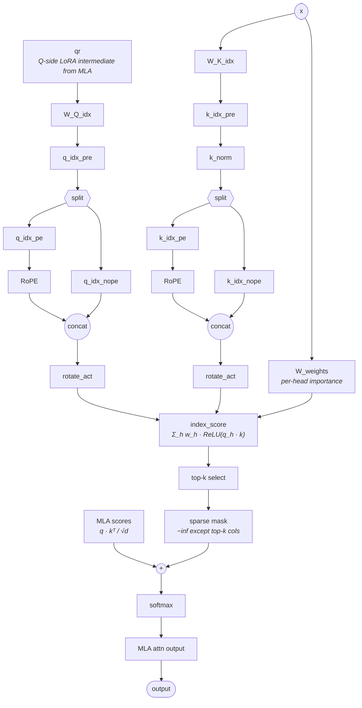

# DSA（DeepSeek Sparse Attention）架构模式

## 概述

DSA（DeepSeek Sparse Attention）是一种**注意力架构模式**，不是单个 kernel，也不是 MLA 的替代品。其本质是 **MLA 的 Q/K/V LoRA 计算图 + 一个并行的学习式 indexer overlay**：indexer 与 MLA 共享同一份输入 `x`（及 MLA Q 侧 LoRA 中间量 `qr`），独立打分后为**每个 query 位置**选出 `index_topk` 个最相关的 key，产出一个加性 `-inf` mask；该 mask 在 **softmax 之前**叠加到 MLA 的注意力分数上，把非 top-k 位置置零。

因此一个声明 `attention_type=dsa` 的模型隐式携带了完整的 MLA 前向图——DSA ⊇ MLA（MLA 是 DSA 的**严格子图**）。MLA 的低秩压缩细节见 [mla](mla.md)，indexer 选 token 的计算公式见 [lightning-indexer](lightning_indexer.md)，稀疏注意力的 kernel 形态见 [sparse-flash-attention](sparse_flash_attention.md)。per-model 数值（`index_n_heads` / `index_head_dim` / `index_topk` 等）放在各模型页的 `Key parameters`。

## 架构图

> 模型无关结构图。以下结构用于 DeepSeek V3.2-Exp（`DeepseekV32ForCausalLM`，`model_type=deepseek_v32`）与 GLM-5（`GlmMoeDsaForCausalLM`，`model_type=glm_moe_dsa`）。任何"注意力类包裹一张 MLA 形状的 Q/K/V 图 + 一个发出 per-query top-k mask 的学习式 indexer"的模型都复用此结构；per-model 变体（旋转技巧、FP8 布局、indexer 头数）写在该模型自己的 Notes。

读图须知（避免误读）：

- 两个 `RoPE` 框是 **indexer 自己的** RoPE（作用于 `q_idx_pe` / `k_idx_pe`），不是 MLA 的 `q_rope` / `k_rope`。**indexer RoPE 布局因模型而异**：V3.2-Exp 用非交错布局（`npu_rotary_mul`，rotate-half），GLM-5 用交错布局（`indexer_rope_interleave=True` → `npu_interleave_rope`）；MLA RoPE 一般为交错布局。详见 Notes。
- `MLA scores` 是从 MLA 路径汇入本图的唯一入边：它是 [mla](mla.md) 中未经 softmax 的 `q · kᵀ / √d`。在 MLA 单图里 softmax 是融合的；在 DSA 里 softmax 被拆开，以便在中间叠加 indexer 的加性 mask。

## 与 MLA / SFA / LI 的关系（四者边界）

| 概念 | 角色 | 粒度 | 与 DSA 的关系 |
| --- | --- | --- | --- |
| **DSA**（本页） | 架构模式 | 注意力子层结构 | 顶层模式 = MLA 子图 + indexer overlay |
| [mla](mla.md) | 低秩压缩注意力 | 网络模块 | DSA 的**严格子图**；DSA 模型主链 dsa，mla 作为底层机制可并链（见下） |
| [lightning-indexer](lightning_indexer.md)（LI） | 选 top-k token 的前置模块 | 网络模块 | DSA 中产出 mask 的 indexer overlay 实例 |
| [sparse-flash-attention](sparse_flash_attention.md)（SFA） | 稀疏注意力路径 | 计算模块 / kernel | DSA 稀疏注意力路径的落地实现（gather top-k KV 后做 FA） |

- **DSA ⊋ MLA，主链 dsa**：结构上 DSA 的注意力块至少有三条并行分支（MLA Q/K/V、indexer Q、indexer K + per-head weights）与三处 concat/merge；[mla](mla.md) 单独只含第一条分支。因此使用 DSA 的模型，其注意力**主身份**链到 `[dsa](dsa.md)`（做 kernel fan-out 规划时以 dsa 为准，避免只看 mla 数错分支）；`[mla](mla.md)` 作为 DSA 的底层机制（严格子图）可一并链接，二者不互斥（V3.2-Exp / GLM-5 页即同时链 dsa 与 mla）。
- **LI vs SFA 是 DSA 的两段**：LI 负责"选哪些 token"（产 top-k index / 加性 mask），SFA 负责"在选中的稀疏子集上算注意力"。cann-recipes-infer 把这条链路在算子层进一步表达为 LightningIndexer + IndexerProlog + SparseFlashAttention，乃至融成单 kernel（见 [deepseek-indexer-attention](../kernels/deepseek_indexer_attention.md)）。
- **架构图 vs 算子页**：此结构图是 stock HF 架构先验（部署无关）。Atlas A3 上的算子级落地——离散 gather、FP8/C8 量化、MegaKernel 融合——见 [sparse-flash-attention](../kernels/sparse_flash_attention.md) 与 [deepseek-indexer-attention](../kernels/deepseek_indexer_attention.md)。

## 当前来源实例

| 模型 | 注意力类 / indexer 类 | model_type | 备注 |
| --- | --- | --- | --- |
| DeepSeek V3.2-Exp | `MLA` 内 `self.indexer = Indexer(args)` | `deepseek_v32` | `MLA.forward` 算完 Q/KV 后调用 indexer，把 `topk_indices` 散射成加性 `-inf` mask 累加进注意力分数再 softmax |
| GLM-5 | `GlmMoeDsaAttention` 内 `GlmMoeDsaIndexer` | `glm_moe_dsa` | indexer top-k 索引同样构成 softmax 前的加性 `-inf` mask；当前NPU分支支持Int8/FP8量化，见下文条件 |
| DeepSeek-V4 | SAS / LI 谱系（CSA 层挂 Indexer） | `deepseek_v4` | V4 注意力主体改用 MQA/Shared-KV 而非 MLA，DSA 思想下沉到压缩 Cache 上的稀疏选择；详见 [deepseek-v4](../models/deepseek_v4.md) |

per-model 数值（`index_n_heads`、`index_head_dim`、`index_topk` 及任何 per-model 变体）放在 [deepseek-v3.2-exp](../models/deepseek_v3_2_exp.md)、[glm-5](../models/glm_5.md)、[deepseek-v4](../models/deepseek_v4.md) 各自的参数小节。

> ⚠️ DeepSeek-V4 的注意力主体已是 MQA/Shared-KV（**非** MLA），此处列为 DSA 实例指「稀疏 indexer 选 token」的**模式思想延续**，而非严格的 MLA ⊕ indexer 结构复用；详见 [deepseek-v4](../models/deepseek_v4.md) 的矛盾标记。V3.2-Exp 与 GLM-5 才是严格的 MLA ⊕ indexer 实例。

## 当前实现与配置边界

V3.2 与 GLM-5 的模型代码通过 LI 的 TopK 索引直接调用稀疏注意力，教学图中的加性 mask 是等价算法表达，不表示 NPU 实现会物化完整 N×N mask。Naive/Absorb 是计算流选择；V3.2 Prefill 同样使用 Absorb+SFA。

Indexer RoPE 是模型专属约定：V3.2 用非交错 npu_rotary_mul，GLM-5 使用交错 npu_interleave_rope。GLM-5 当前 apply_hadamard_quant 同时支持 Int8 与 FP8，不能继续写“没有 float8 分支”；950 浮点量化会设置 FP8 LI cache，A3整数模式为Int8。V4的HiF8路径又不执行Hadamard。

这里的 MLA⊕Indexer 结构限定 V3.2/GLM-5；V4 的 CSA 在压缩 Shared-KV 上稀疏选择，注意力主体不含 MLA 的 KV 升维机制。参数、dtype 和 TopK 以当前加载 config 及[模型页](../models/deepseek_v3_2_exp.md)为准；源码核对不等于硬件精度验证。

## Links

- [mla](mla.md)
- [lightning-indexer](lightning_indexer.md)
- [sparse-flash-attention](sparse_flash_attention.md)
- [sparse-flash-attention](../kernels/sparse_flash_attention.md)
- [deepseek-indexer-attention](../kernels/deepseek_indexer_attention.md)
- [deepseek-v3.2-exp](../models/deepseek_v3_2_exp.md)
- [glm-5](../models/glm_5.md)
- [deepseek-v4](../models/deepseek_v4.md)
- [deepseek-v32-pretrain](../../../training/guides/recipes/deepseek_v32_pretrain.md)（跨域·训练：DSA 模型预训练实践（反向 SLIG/SFAG））
- [custom-cp-dsa](../../../training/concepts/parallelism/custom_cp_dsa.md)（跨域·训练：DSA 长序列自定义 CP）
- [smla](../../../training/concepts/kernels/smla.md)（跨域·训练：V4 SMLA 是 DSA 谱系的训练融合算子）
