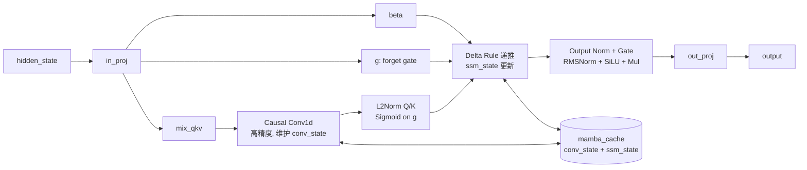

# Gated DeltaNet (GDN)

## Summary

承担线性复杂度上下文聚合的线性注意力模块，基于 Mamba/DeltaNet 风格的递推状态更新加门控机制。在混合注意力模型（[qwen3-next](../models/qwen3_next.md)、[qwen3-5-moe](../models/qwen3_5_moe.md)）中与 [gated-attention](gated_attention.md) / full attention 交替堆叠。相对标准 Attention，GDN 在长序列下显著降低计算与显存复杂度，但引入 Conv1d 和状态递推，不适合沿 Sequence 的并行切分。

各模型的 GDN 在概念角色上一致（线性复杂度的线性注意力，DeltaNet 风格 gated 递推 + Conv1d），但在以下三处存在**显式差异**：

- **输入投影**：Qwen3-Next 用独立 `in_proj`；Qwen3.5-MoE 把 `in_proj_qkv`/`in_proj_z`/`in_proj_b`/`in_proj_a` 合并为单个 `in_proj_fused`，投影维度与拆分方式不同（见下方 Variants 与 [qwen3-5-moe](../models/qwen3_5_moe.md) 矩阵融合）。
- **Prefill kernel 选择**：Qwen3-Next 走 PyPTO ChunkGDN；Qwen3.5-MoE 走 torch_npu 原生 `torch_npu.npu_chunk_gated_delta_rule`（另有 PyTorch `solve_triangular` 回退路径）。
- **输出 Norm 变体**：Qwen3-Next 用 AscendC `mambav2_rmsnormgated` 融合算子；Qwen3.5-MoE 用 `Qwen3_5MoeRMSNormGated`（`torch_npu.npu_rms_norm` + 门控相乘）。

详见下方 Variants。

## Mechanism

- **输入投影**：hidden state 经 in_proj 得到 `mix_qkv`（Q/K/V 混合）、`g`（forget gate）、`beta`（更新门控）。Qwen3.5-MoE 将原本独立的 `in_proj_qkv`/`in_proj_z`/`in_proj_b`/`in_proj_a` 合并为单个 `in_proj_fused`（一次 `MergedColumnParallelLinear`），同时产出 Q/K/V、Z 门控、B/A 递推参数，再按维度 split，减少 Matmul 次数并统一 TP/量化/dtype 路径（见 [qwen3-5-moe](../models/qwen3_5_moe.md) 矩阵融合）。
- **Causal Conv1d**：在 Sequence 维度做短窗卷积（`kernel_size` 典型值 4）。维护 `conv_state` 作为跨步历史。Decode/MTP 下通过 `torch_causal_conv1d_update_npu` 融合更新 `conv_state`。
- **Gating**：对 Q/K 做 L2 归一化、对 gate 做 Sigmoid。
- **Delta Rule 状态更新**：维护 SSM 状态矩阵 `ssm_state`，按 DeltaNet 规则递推：
 - `state ← state · diag(g) + beta · (k ⊗ v - k · state · k · v)` 之类的 gated delta 更新；
 - 输出 `out = q · state`。
- **状态缓存**：`mamba_cache` 由 `mamba_cache_indices` 索引，每个请求独占一槽；MTP 下 `num_accepted_tokens` 决定实际写回的 state 步数。
- **输出**：经 `RMSNorm + SiLU + Mul` 门控归一化（mambav2_rmsnormgated），再经 out_proj 输出。

## Variants

- **Prefill 路径（Chunk GDN）**：长序列沿 chunk 做分块并行递推。
 - **Qwen3-Next**：基于 PyPTO 实现的 ChunkGDN 融合 kernel（[pypto](../frameworks/pypto.md)）。
 - **Qwen3.5-MoE**：走 **torch_npu 原生算子 `torch_npu.npu_chunk_gated_delta_rule`**（非 PyPTO），接收 TND 的 Q/K/V、beta、initial_state、actual_seq_lengths、decay 参数 g，一次性完成 chunk 内 L2 归一化、decay cumsum/指数、下三角求解与块间递推，输出 `core_attn_out` + `last_recurrent_state`。
- **Decode/MTP 路径（Recurrent GDN）**：单步或少量 draft token 的递推，由 AscendC 融合算子 [recurrent-gated-delta-rule](../kernels/recurrent_gated_delta_rule.md) 一次性完成 Sigmoid+L2Norm+Attn+State 更新。Qwen3-Next 与 Qwen3.5-MoE 的 Decode GDN **共用**该算子。
- **PyTorch chunk 路径 + solve_triangular（Qwen3.5-MoE）**：未走融合算子时，原始 `torch_chunk_gated_delta_rule` 用 `for` 循环逐行更新下三角注意力矩阵；Qwen3.5-MoE 增加 `torch.linalg.solve_triangular(I - attn, attn, upper=False)` 路径替代逐行循环，由 `enable_gdn_solve_triangular` 控制，降低 Prefill GDN 块内递推开销（35B 2p 场景）。
- **输出 Norm+Gate**：Qwen3-Next 由 AscendC 融合算子 [mambav2-rmsnormgated](../kernels/mambav2_rmsnormgated.md) 融合 RMSNorm、SiLU、Mul，环境变量 `USE_CUSTOM_NORM_KERNEL=true` 使能；Qwen3.5-MoE 由 `Qwen3_5MoeRMSNormGated`（`torch_npu.npu_rms_norm` + 门控相乘，以 Z 分支作门控输入）完成。
- **W8A8 量化**：Qwen3-Next 除 Conv1d 外的 Linear 层启用 Per-Channel W8 + Per-Token A8，Conv1d 保持高精度；Qwen3.5-MoE 量化方案源未给出（gap）。

## Performance Characteristics

- 线性复杂度 O(S·d²)，适合长序列；GDN 沿 Sequence 的 Conv1d 不适合 CP 切分。启用 CP（prefill 阶段 Gated Attention 走 CP+TP 混合并行）时，GDN 不参与序列切分，而是回退到完整 TP 组：`use_full_tp = get_context_model_parallel_world_size() > 1`，此时 `tp_world_size = get_tensor_model_parallel_world_size()` 而非 attention 的 CP 子组 size，GDN 仍走纯 TP。CP 的序列切分 / AllGather / ZigZag 负载均衡仅作用于 Gated Attention 路径，见 [qwen3-next](../models/qwen3_next.md)。
- TP 切 num_kv_head 方向，上限由 num_kv_head 数决定（源仅定性说明上限为 num_kv_head，未给出具体数值；gap）。进一步并行需要引入 linear-attention 层的序列并行（源 Future Plan，2f82d10 尚未实现）。
- Decode 热点：`conv_state`/`ssm_state` 读写和多个小算子的 Launch 开销；融合后 Launch 数降低、UB 复用。
- MTP 下需保证 `num_accepted_tokens` 正确驱动 state 的回退/前进，否则下一轮状态错。

## Evidence

- [cann-recipes-infer](https://gitcode.com/cann/cann-recipes-infer/tree/2c45117d781ab9ab88dcb89a28ae30f5d2450399) — [`docs/models/qwen3-next/qwen3_next_optimization.md`](https://gitcode.com/cann/cann-recipes-infer/blob/2f82d10467e6fe8dae81c97a2cdac78d733a6703/docs/models/qwen3-next/qwen3_next_optimization.md) 融合 Kernel / 并行策略章节；`models/qwen3-next/patches/stage3/0001-feat-GDN-adaption-and-support-MTP.patch`（`fused_recurrent_gated_delta_rule_update_npu`、`torch_causal_conv1d_update_npu`、`prepare_gdn_inputs`）；`models/qwen3-next/patches/stage5/0001-feat-support-GDN-and-rmsnormgated-fusion-ops.patch`；`models/qwen3-next/ops/gated_delta_net/*`。
- [cann-recipes-infer](https://gitcode.com/cann/cann-recipes-infer/tree/2c45117d781ab9ab88dcb89a28ae30f5d2450399) — [`docs/models/qwen3_5/qwen3_5_moe_optimization.md`](https://gitcode.com/cann/cann-recipes-infer/blob/2c45117d781ab9ab88dcb89a28ae30f5d2450399/docs/models/qwen3_5/qwen3_5_moe_optimization.md)（ChunkGDR / 矩阵融合 / GDN 三角求解章节）、[`models/qwen3_5/models/modeling_qwen3_5_moe.py`](https://gitcode.com/cann/cann-recipes-infer/blob/2c45117d781ab9ab88dcb89a28ae30f5d2450399/models/qwen3_5/models/modeling_qwen3_5_moe.py)（`Qwen3_5MoeGatedDeltaNetFusedInProj`、`torch_chunk_gated_delta_rule` 的 `solve_triangular` 分支、`Qwen3_5MoeRMSNormGated`）。MR!402（分支 chy_new "support qwen3_5"）。

## Links

- [qwen3-next](../models/qwen3_next.md)
- [qwen3-5-moe](../models/qwen3_5_moe.md)
- [gated-attention](gated_attention.md)
- [recurrent-gated-delta-rule](../kernels/recurrent_gated_delta_rule.md)
- [mambav2-rmsnormgated](../kernels/mambav2_rmsnormgated.md)
- [tensor-parallel](../parallelism/tensor_parallel.md)
- [ascendc](../frameworks/ascendc.md)
- [pypto](../frameworks/pypto.md)
- [mtp-speculative-decoding](../techniques/mtp_speculative_decoding.md)
- [deltanet-pretrain](../../../training/guides/recipes/deltanet_pretrain.md)（跨域·训练：训练侧 DeltaNet(Delta Rule)样例,推理侧为 Gated DeltaNet）
- [gdn-chunk-kernels](../../../training/concepts/kernels/gdn_chunk_kernels.md)（跨域·训练：GDN chunk-parallel 训练算子族，Prefill ChunkGDN 语义在 MindSpeed Triton 上的前/反向实现）
- [gated-deltanet-train](../../../training/concepts/modules/gated_deltanet_train.md)（训练侧 GDN 部署：chunk/Flash 后端 + GDN 上下文并行）