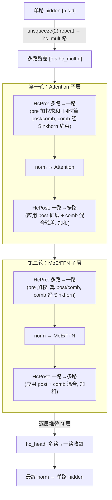

# mHC (Manifold-Constrained Hyper-Connections)

## Summary

**mHC（Manifold-Constrained Hyper-Connections）** 是对传统残差连接（single residual stream）的扩展（论文 arXiv 2512.24880），由 [deepseek-v4](../models/deepseek_v4.md) 引入，是 V4 每个 Layer 中与 Attention、MoE 并列的三种模块之一。其核心思想：把 Transformer 在层间传递的 `hidden_state` 从**单路残差**扩展为 **多路残差（multi-path residual streams，路数 = `hc_mult`）**，并用三类可学习映射（Pre / Post / Res(comb)）在多路与单路之间转换；其中 Res(comb) 映射矩阵经 **Sinkhorn-Knopp 迭代**约束（论文称为"流形约束"），逼近行/列归一的双随机形态，稳定多路残差的混合。

mHC 的结构语义与计算公式：多路残差如何替代单残差、三映射各自作用、Sinkhorn-Knopp 如何约束混合矩阵。mHC 由 **`HcPre` / `HcPost` 两个融合算子**承载（`HcPre` 提供 Native / AscendC / PyPTO 三版，`HcPost` 提供 Native / AscendC 两版）；这两个算子的 A3 分离架构 CV 流水、Decode 切 K / Prefill 分 token 双模板、Tiling、性能 us 表属算子实现层面，见 [mhc-hcpre-hcpost](../kernels/mhc_hcpre_hcpost.md)。

## 多路残差结构（Multi-path Residual Streams）

传统残差：每层 `h' = h + f(norm(h))`，残差为单路。mHC 把残差扩展为 `hc_mult` 路（Native 参考实现签名默认 `hc_mult = 4`；实际生产取权重 `config`，仓内无硬编码全局默认，详见下文待验证注记）：

- **进入网络**：在第一层之前把单路 hidden 复制为多路 —— 代码 `hidden_states.unsqueeze(2).repeat(1, 1, hc_mult, 1)`，张量形状由 `[b, s, d]` 变为 `[b, s, hc_mult, d]`（`DeepseekV3Model.forward` / MTP 层同样在进层前做此扩展）。
- **每个子层（Attention 与 MoE 各一次）**：多路残差先经 **Pre Mapping** 融合回**一路**送入 `norm → Attention/MoE` 计算（保持 Attention/MoE 计算过程本身不变），子层输出经 **Post Mapping** 扩展回多路，与经 **Res(comb) Mapping** 融合后的多路残差**加和**，得到本子层的多路 mHC 输出。
- **离开网络**：所有层结束后，用 `hc_head` 把多路 hidden 收敛回**一路**（`HcPre` 风格的 Pre 融合，但只输出 `y`），再做最终 `norm`。

代码 `DeepseekV3DecoderLayer.forward` 内一个 Layer 调用两轮 `hc_pre → 子层 → hc_post`：第一轮 `hc_attn_fn/scale/base` 配 Attention，第二轮 `hc_ffn_fn/scale/base` 配 MoE/FFN。结构示意（只画残差流走向，不含算子 Tiling/流水细节）：



## 三类映射与计算公式

映射系数由一个可学习的混合权重 `hc_fn`（`[mix_hc, hc_mult·d]`）作用于（RMSNorm 后的）多路 hidden 产生，`mix_hc = (hc_mult + 2) · hc_mult`。把产物 `mixes` 沿最后一维切成三段 `[hc_mult, hc_mult, hc_mult·hc_mult]`，分别对应 **Pre / Post / Res(comb)**（代码 `mhc.py:hc_split_sinkhorn_torch`，`mixes.split([hc_mult, hc_mult, hc_mult*hc_mult], -1)`）。

### HcPre — Pre Mapping（多路 → 一路）

`HcPre` 融合范围：RMSNorm 归一 → `mixes = linear(x, hc_fn) · rsqrt` → 三段切分与系数计算 → 用 Pre 系数把多路加权求和为一路；同时**输出 Post 与 comb 系数**供后续 `HcPost` 使用。代码 `mhc.py:hc_pre_native`：

```text
rsqrt   = rsqrt(mean(x², dim=d) + norm_eps)         # RMSNorm 形式（无 weight 项）
mixes   = linear(x_flat, hc_fn) · rsqrt
pre     = sigmoid(pre_seg · hc_scale[0] + hc_base[:hc_mult]) + hc_eps        # 形状 [b, s, hc_mult]
y       = sum(pre.unsqueeze(-1) · x, dim=multipath)  # 多路残差按 pre 权重融合回一路 [b, s, d]
```

`HcPre` 把上述全过程融合为单算子，中间过程对脚本不可感知；接口产出 `(y, post, comb)`。

### HcPost — Post + Res(comb) Mapping（一路输出 → 多路 + 残差融合）

`HcPost` 接收子层输出 `x`（一路）、原多路 `residual`，以及 `HcPre` 透传的 `post`、`comb` 系数，融合产出多路 mHC 输出。代码 `mhc.py:hc_post_native`：

```text
y = post.unsqueeze(-1) · x.unsqueeze(-2)            # Post：把子层一路输出扩展回 hc_mult 路
  + sum(comb.unsqueeze(-1) · residual.unsqueeze(-2), dim=multipath)  # Res(comb)：多路残差经 comb 混合
```

其中 Post 系数 `post = 2 · sigmoid(post_seg · hc_scale[1] + hc_base[hc_mult:2·hc_mult])`（`[b, s, hc_mult]`，含 `×2` 缩放）。`HcPost` 融合的价值在于消除小算子下的内存墙（中间结果不出核内 buffer，减少 HBM 访存）。

### Res(comb) Mapping 与 Sinkhorn-Knopp 流形约束

`comb`（混合矩阵 `[b, s, hc_mult, hc_mult]`）描述"哪一路残差以多大权重贡献给输出的哪一路"，是 mHC"流形约束"的所在。**注意计算位置**：`comb`（连同 Sinkhorn 约束）实际在 **HcPre 内**算出 —— `hc_pre_native` 调 `hc_split_sinkhorn_torch` 一并产出 `(y, post, comb)` 并透传；**HcPost 仅消费入参 `comb`** 做混合，不重新计算。本节列在 HcPost 下是因 `comb` 在 HcPost 被"应用"，约束逻辑归属 HcPre。代码 `mhc.py:hc_split_sinkhorn_torch` 的约束过程：

```text
comb = comb_seg · hc_scale[2] + hc_base[2·hc_mult:].view(hc_mult, hc_mult)
comb = softmax(comb, dim=-1) + hc_eps               # 先按最后一维 softmax
comb = comb / (col_sum + hc_eps)                    # 首次：列归一
for _ in range(hc_sinkhorn_iters - 1):              # 迭代：行归一 → 列归一 交替
    comb = comb / (row_sum + hc_eps)
    comb = comb / (col_sum + hc_eps)
```

这是经典的 **Sinkhorn-Knopp 迭代**：交替对行、列做归一，使矩阵逼近**双随机矩阵（doubly-stochastic，行和与列和均趋近 1）**。双随机矩阵构成的流形即论文"manifold-constrained"约束的对象 —— 把多路残差混合限制在该流形上，避免某一路无限放大/坍缩，稳定多路残差传播。迭代次数由 `hc_sinkhorn_iters`（权重配置）决定。

> 待验证（doc / 论文细节，guide 未展开，标 gap）：`hc_mult`、`hc_sinkhorn_iters` 等的具体取值由权重侧 `config.json` 提供，仓内 `configuration_deepseek.py` 未硬编码默认值（mhc.py 函数签名给出形参默认 `hc_mult=4` / `sinkhorn_iters=20` 仅为 Native 参考实现的默认，实际运行取权重 config）。Sinkhorn-Knopp 收敛性、双随机近似误差等论文层面的理论细节，guide 与代码均未展开。

> 算法细节（guide 将 comb 称 "Res Mapping 特征融合"，未逐步展开 Sinkhorn）：`mhc.py:hc_split_sinkhorn_torch`(L44-51) —— 首步 `comb.softmax(-1)`（沿 -1 轴即**行归一**，以 softmax 形式表达）+eps → 列归一(-2) → `iters-1` 轮行(-1)→列(-2)交替。即每轮行列各一次、与标准 Sinkhorn「先行后列」一致（softmax(-1) 就是首轮的行归一，**并非"第一步仅列归一"**）。PyPTO（`hc_pre_pypto.py:51-57`）与 TileLang（`hc_split_sinkhorn_kernel.py:104-109`）首步显式 `exp(x − row_max) / row_sum`（数值稳定 softmax，行归一）后列归一，三路数学等价、顺序相同。

## 与 Attention / MoE 的协作

mHC 不改变 [mla](mla.md) 系（V4 实为 MQA/Shared-KV）或 MoE 子层内部的计算 —— 子层只看到 `HcPre` 融合出的**单路**输入、向外吐**单路**输出，多路残差的扩展/混合完全由 mHC 的 `HcPre`/`HcPost` 在子层外围承担。因此 mHC 可视为一个正交于注意力/FFN 选型的"残差增强层"：它作用于**层间残差流**，与在注意力输出后做元素级门控调制的模块（如 Qwen 系的门控注意力，作用于**注意力输出**）属不同层面。V4 每个 Layer 的三模块组成（mHC / Attention / MoE）与并行/量化部署见 [deepseek-v4](../models/deepseek_v4.md)。

## Evidence

- **结构语义源**：[cann-recipes-infer](https://gitcode.com/cann/cann-recipes-infer/tree/2c45117d781ab9ab88dcb89a28ae30f5d2450399) — [`docs/models/deepseek-v4/deepseek_v4_inference_guide.md`](https://gitcode.com/cann/cann-recipes-infer/blob/2c45117d781ab9ab88dcb89a28ae30f5d2450399/docs/models/deepseek-v4/deepseek_v4_inference_guide.md)（L67-74 mHC 结构语义：多路扩展 / Pre·Post·Res Mapping / 与 Attention·MoE 协作；论文归属 arXiv 2512.24880）—— 结构语义出处，frontmatter `source` 指此
- **算子实现 + 命名/论文出处源**：[cann-recipes-infer](https://gitcode.com/cann/cann-recipes-infer/tree/2c45117d781ab9ab88dcb89a28ae30f5d2450399) — [`docs/models/deepseek-v4/deepseek_v4_mHC_guide.md`](https://gitcode.com/cann/cann-recipes-infer/blob/2c45117d781ab9ab88dcb89a28ae30f5d2450399/docs/models/deepseek-v4/deepseek_v4_mHC_guide.md)（`HcPre`/`HcPost` 融合范围与价值、Tiling/流水/性能；mHC 命名与论文出处；157 行算子实现文档，性能段见 [mhc-hcpre-hcpost](../kernels/mhc_hcpre_hcpost.md)）
- **代码源**：[cann-recipes-infer](https://gitcode.com/cann/cann-recipes-infer/tree/2c45117d781ab9ab88dcb89a28ae30f5d2450399) — [`models/deepseek-v4/models/modules/op_impls/mhc.py`](https://gitcode.com/cann/cann-recipes-infer/blob/2c45117d781ab9ab88dcb89a28ae30f5d2450399/models/deepseek-v4/models/modules/op_impls/mhc.py)（`hc_split_sinkhorn_torch` 三段切分 `[hc_mult, hc_mult, hc_mult²]`；`pre=sigmoid(·scale[0]+base)+eps`、`post=2·sigmoid(·scale[1]+base)`；comb `softmax → 列归一 → iters-1 轮行列交替归一` 的 Sinkhorn-Knopp；`hc_pre_native` RMSNorm+linear+`y=sum(pre·x)`；`hc_post_native` `y=post·x + sum(comb·residual)`；`hc_pre` 三注册键 native/ascendc/pypto_a3，`hc_post` native/ascendc）
- [cann-recipes-infer](https://gitcode.com/cann/cann-recipes-infer/tree/2c45117d781ab9ab88dcb89a28ae30f5d2450399) — [`models/deepseek-v4/models/modeling_deepseek.py`](https://gitcode.com/cann/cann-recipes-infer/blob/2c45117d781ab9ab88dcb89a28ae30f5d2450399/models/deepseek-v4/models/modeling_deepseek.py)（`mix_hc=(2+hc_mult)·hc_mult`、`hc_dim=hc_mult·hidden_size`；`DeepseekV3DecoderLayer.forward` 两轮 `hc_pre→子层→hc_post`（attn 用 `hc_attn_*`、ffn 用 `hc_ffn_*`）；进网络 `unsqueeze(2).repeat(1,1,hc_mult,1)` 扩展多路；`hc_head` 收敛回单路；`hc_*` 参数 fp32 `nn.Parameter`）
- 论文：[Manifold-Constrained Hyper-Connections (Xie et al., 2026)](https://arxiv.org/abs/2512.24880) —— mHC 命名与流形约束理论来源
- 溯源（diff `2f82d10..2c45117`）：`5df82b1` support deepseek v4（MR `!366` merge publish into master，diaoyingyu）—— mHC guide 与 `mhc.py` 随 V4 0day 发布一并引入。

## Links

- [deepseek-v4](../models/deepseek_v4.md)
- [mla](mla.md)
- [mhc-hcpre-hcpost](../kernels/mhc_hcpre_hcpost.md)（HcPre/HcPost 算子级实现：CV 流水 / Tiling / 性能）
- [tilelang](../frameworks/tilelang.md)（V4 mHC 算子 hc_split_sinkhorn.py 由 TileLang Developer 模式实现）
- [mhc-train](../../../training/concepts/kernels/mhc_train.md)（跨域·训练：MindSpeed-LLM 的 mHC 训练正反向 Triton 算子，pre/post/comb 系数与本页同义）