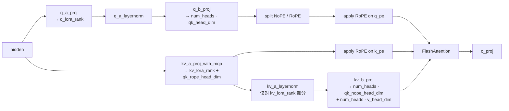

# MLA (Multi-head Latent Attention)

## Summary

DeepSeek-V3 系列（DeepSeek-R1、Kimi-K2）使用的低秩压缩注意力机制。通过将 Q 和 KV 分别投影到低维隐空间（`q_lora_rank`、`kv_lora_rank`）再上投到 full rank，实现 KVCache 体积的显著压缩；RoPE 仅作用于一个较小的 `qk_rope_head_dim` 通道，与 NoPE 通道拼接。相较标准 MHA，MLA 在同样上下文长度下 KVCache 占用显著更小，推理时通过融合算子 [mla-prolog](../kernels/mla_prolog.md) 将 Q/K/V Linear + LayerNorm + RoPE + KVCache 写入整体合并，进一步降低下发开销。

## Mechanism

### 关键张量维度（DeepSeek-R1）

- `q_lora_rank`：Q 侧低秩维度；
- `kv_lora_rank`（512）：KV 侧低秩隐维；
- `qk_nope_head_dim`（128）：无位置编码的 q/k 通道；
- `qk_rope_head_dim`（64）：带 RoPE 的 q/k 通道；
- `v_head_dim`（128）：V 通道。

Attention head 的 head_dim = `qk_nope_head_dim + qk_rope_head_dim`，V 的 head_dim 独立为 `v_head_dim`。RoPE 仅在 RoPE 通道执行。KV-Cache 存储 `nope_cache`（`kv_lora_rank`）+ `rope_cache`（`qk_rope_head_dim`）两部分。

### KVCache 布局

- Prefill / Decode 均走 Paged Attention（YAML `enable_pa: True`，`pa_block_size: 128`）。
- `cache_mode="PA_NZ"` 表示 Paged 存储 + NZ 亲和布局。
- `ASCEND_USE_C8` / `kv_cache_quant_mode=1` 启用 KV Per-Tensor Int8 量化，布局在每 16 元素 tile 上与 BF16 因 factor=2 关系重新 view，见 [w8a8c8](../quantization/w8a8c8.md)。

### 与融合算子配合

三条 forward 路径用的 attention 算子并不统一：非融合 `forward_page_attention_normal` 路径用 `npu_fused_infer_attention_score`（v1），KV cache 写入用 `npu_kv_rmsnorm_rope_cache_v2`（`cache_mode="PA_NZ"`）；`forward_page_attention_absorb` 路径用 `npu_fused_infer_attention_score_v2`，KV cache 同样用 `npu_kv_rmsnorm_rope_cache_v2`；推理主路径（`enable_mla_prolog: True`）`forward_page_attention_mla_prolog` 前置用 `npu_mla_prolog_v3`、attention 用 `npu_fused_infer_attention_score_v2`。见 [mla-prolog](../kernels/mla_prolog.md)、[fused-infer-attention-score](../kernels/fused_infer_attention_score.md)（`models/deepseek_r1/models/modeling_deepseek.py:L1186`）。

## Variants

- **标准 MHA / GQA / MQA**：MLA 不同于它们只在 head 数上动手脚，**MLA 在 KV 维度上做低秩分解**，更有利于 KVCache 压缩。
- **BF16 / W8A8 / W8A8C8 三种量化**：通过 `weight_quant_mode`、`kv_cache_quant_mode`、`query_quant_mode` 组合表达。
- **NTD 布局（Prefill）**：输入不定长场景下以 `[num_head, token, head_dim]` 访问 FA，相对 TND 提升 15% FlashAttention 计算效率（带宽访问亦更亲和，但源仅作定性描述、未给带宽数字），并且配合权重拆分与 FA 独立 NoPE/RoPE 输入，消除 split/concat/transpose 开销。详见 [deepseek-r1](../models/deepseek_r1.md) 的"TND/NTD 格式支持"。

## Performance Characteristics

- KVCache 显著小于等价 MHA（kv_lora_rank + qk_rope_head_dim 远小于 num_heads · head_dim）。
- Decode 下主要 bound 在 HBM 带宽 + host 下发，适合搭配 [torchair](../frameworks/torchair.md) 图模式、[superkernel](../techniques/superkernel.md)、MTP。
- Prefill 下 O(S²) 激活内存仍是 bottleneck，长序列场景需配合 [sp-tp-sp](../parallelism/sp_tp_sp.md) 或 Chunk MoE 处理 OOM。
- 由于 up/down proj 与 RoPE 均较细碎，融合算子相对非融合路径有明显收益（具体数字 source 未给出）。

## MindSpeed 训练侧 MLA

推理侧 MLA 的主路径围绕 decode KV-cache 展开——[mla-prolog](../kernels/mla_prolog.md) 把 Q/KV 投影 + RoPE + KV 写入吸收进一颗融合算子，attention 在低秩潜空间内 absorb。训练没有 decode cache、走全序列前向 + 反向，MindSpeed-LLM 的 `CustomMLASelfAttention`（继承 Megatron `SelfAttention`）默认路径 `mla_naive_attention` 因此**不做 KV absorption**：单颗 `linear_qkv`（`LinearNoTP`，不切 TP，区别于推理侧拆开的 `q_a_proj` / `kv_a_proj_with_mqa`）把 hidden 压成 `[q_compressed | kv_compressed | k_pos_emb]`（维度 `q_lora_rank | kv_lora_rank | qk_pos_emb_head_dim`），经 `q_layernorm` / `kv_layernorm`（RMSNorm 形态 `PTNorm`）后由 `linear_q_up_proj` / `linear_kv_up_proj` 升回 full rank，再 split 出 `q_no_pe`/`q_pos_emb` 与 `k_no_pe`/`value`；RoPE 只作用在 `q_pos_emb` / `k_pos_emb` 的 `qk_pos_emb_head_dim` 通道，nope 段直拼后进 FlashAttention（`MlaDotProductAttention` / TE 版 `MlaTEDotProductAttention`）。`q_head_dim != v_head_dim` 时默认把 `value` pad 到 `q_head_dim` 再进 FA，`--mla-fa-without-pad` 消掉这次 pad 省激活。

`--enable-mla-absorb` 给训练补一条与推理同形的 absorb 路径 `mla_absorb_attention`，但仅在稀疏注意力下生效（需 `--use-sparse-flash-attn` + `--mla-mm-split`）：把 `W_UK`（`linear_kv_nope.weight`）吸收进 q（`einsum('sbhq,hqr->sbhr')`），直接用 `kv_layernorm` 后的 `compressed_kv_norm` 当 `k_lat` / `v_lat` 在 `kv_lora_rank` 潜空间内算 attention（MHA→MQA），出口再把 `W_UV`（`linear_v.weight`）吸收进 `linear_proj`（`W_O`）。训练侧 absorb 服务于压激活显存，而非省 decode KV-cache。

与并行的配合：down-proj `linear_qkv` 复制不切 TP，up-proj 走 `ColumnParallelLinear`、`linear_proj` 走 `RowParallelLinear`；SP 下对 `k_pos_emb`（absorb 路径还含 `compressed_kv_norm`）做 `gather_from_sequence_parallel_region`；CP 走 Ulysses / Hybrid 时在 all-to-all 前 `repeat_interleave` KV 以支撑 GQA+Ulysses；`--mla-up-proj-tp-overlap`（需 mla-mm-split + SP）把 up-proj 的 TP 通信与计算重叠；MoE fb-overlap 且 TP>1 时在 MLA 前向内挂 async all-to-all hook。`--mla-mm-split` 把两颗 up-proj 大矩阵乘各拆成两颗（q→`linear_qk_nope` / `linear_qk_rope`，kv→`linear_kv_nope` / `linear_v`），消 split 与转连续开销，但降矩阵乘效率、TP 多时增通信，宜在无 TP / 低 TP 通信场景用。

显存与重计算手段叠在同一前向上：`checkpoint_core_attention` 选择性重算 core attention；`--mla-zero-memory` 用 `CheckpointWithoutOutput` 把整段 MLA 包成丢输出 + 反向重算；`--recompute-mla-up-proj` 单独重算 up-proj（需 mla-up-proj-tp-overlap，与 mla-zero-memory 互斥）；`--mla-swap-core-attn-out` 经 `TensorSwapManager` 把 `core_attn_out` 异步换出 Host（需 dualpipev + moe-fb-overlap）。

这些都经 MindSpeed features_manager 建模成训练特性（特性接入机制见 [mindspeed](../../../training/concepts/frameworks/mindspeed.md)）：ms-core 的 `MLAFeature` 注册 `--multi-head-latent-attention` 与 `--qk-rope-head-dim` / `--qk-nope-head-dim`（映射到 megatron 的 `qk_pos_emb_head_dim` / `qk_head_dim`）并 patch `MultiLatentAttention.__init__`；ms-llm 的 `MLAFeature` 注册上述全部 `--mla-*` / `--enable-mla-absorb` / `--use-sparse-flash-attn` 开关与互斥校验；`DSAIndexerFeature`（`--enable-dsa-indexer`，需 MLA + FlashAttention）在 MLA 内挂 Lightning Indexer top-k 选择 + KL indexer loss，是 [lightning-indexer](../kernels/lightning_indexer.md) / [dsa](dsa.md) 的训练侧对应（反向梯度 + KL Loss 融合见 [slig](../../../training/concepts/kernels/slig.md)）；`G2Feature` 提供 g2 位置编码 + triton SFA 的 MLA 变体。DeepSeek-V3.2 这条谱系的训练实践见 [deepseek-v32-pretrain](../../../training/guides/recipes/deepseek_v32_pretrain.md)。

## Evidence

- [cann-recipes-infer](https://gitcode.com/cann/cann-recipes-infer/tree/2c45117d781ab9ab88dcb89a28ae30f5d2450399) — [`docs/models/deepseek-r1/deepseek_r1_decode_optimization.md`](https://gitcode.com/cann/cann-recipes-infer/blob/2f82d10467e6fe8dae81c97a2cdac78d733a6703/docs/models/deepseek-r1/deepseek_r1_decode_optimization.md) MLA 低秩压缩优化章节；`docs/models/deepseek-r1/deepseek_r1_prefill_optimization.md` TND/NTD 章节；`models/deepseek_r1/models/modeling_deepseek.py`（`DeepseekV3Attention.forward_page_attention_mla_prolog`、`forward_page_attention_absorb`、`forward_page_attention_normal`）；`models/deepseek_r1/models/configuration_deepseek.py`（维度定义）。
- [mindspeed-llm](https://gitcode.com/Ascend/MindSpeed-LLM) — [`mindspeed_llm/tasks/models/transformer/multi_latent_attention.py`](https://gitcode.com/Ascend/MindSpeed-LLM/blob/183e02c21011c2e423a599633cf2d55929ba9ea3/mindspeed_llm/tasks/models/transformer/multi_latent_attention.py)（`CustomMLASelfAttention.forward` / `mla_naive_attention` / `mla_absorb_attention` / `_checkpointed_attention_forward`）；[`mindspeed_llm/features_manager/transformer/multi_latent_attention/mla_feature.py`](https://gitcode.com/Ascend/MindSpeed-LLM/blob/183e02c21011c2e423a599633cf2d55929ba9ea3/mindspeed_llm/features_manager/transformer/multi_latent_attention/mla_feature.py)（`MLAFeature` 的 `--mla-*` 开关与互斥校验）；[`.../dsa_indexer_feature.py`](https://gitcode.com/Ascend/MindSpeed-LLM/blob/183e02c21011c2e423a599633cf2d55929ba9ea3/mindspeed_llm/features_manager/transformer/multi_latent_attention/dsa_indexer_feature.py)（`DSAIndexerFeature`）；[`.../g2_feature.py`](https://gitcode.com/Ascend/MindSpeed-LLM/blob/183e02c21011c2e423a599633cf2d55929ba9ea3/mindspeed_llm/features_manager/transformer/multi_latent_attention/g2_feature.py)（`G2Feature`）；[`docs/zh/pytorch/features/mcore/multi-latent-attention.md`](https://gitcode.com/Ascend/MindSpeed-LLM/blob/183e02c21011c2e423a599633cf2d55929ba9ea3/docs/zh/pytorch/features/mcore/multi-latent-attention.md)（`--multi-latent-attention` / `--mla-fa-without-pad` / `--mla-mm-split` / `--enable-mla-absorb` 特性说明）。
- [mindspeed](https://gitcode.com/ascend/MindSpeed) — [`mindspeed/features_manager/transformer/multi_head_latent_attention/mla_feature.py`](https://gitcode.com/Ascend/MindSpeed/blob/1432cb092818b870c31b61db0eb6d3378b7fbdad/mindspeed/features_manager/transformer/multi_head_latent_attention/mla_feature.py)（`MLAFeature` 注册 `--multi-head-latent-attention`、`qk-nope/rope-head-dim` 维度映射、patch `MultiLatentAttention.__init__` / `DotProductAttention.__init__`）；[`docs/zh/features/multi-head-latent-attention.md`](https://gitcode.com/Ascend/MindSpeed/blob/1432cb092818b870c31b61db0eb6d3378b7fbdad/docs/zh/features/multi-head-latent-attention.md)。
- 论文：[DeepSeek-V2](https://arxiv.org/pdf/2405.04434) 低秩 KV 压缩章节。

## Links

- [deepseek-r1](../models/deepseek_r1.md)
- [deepseek-v4](../models/deepseek_v4.md)（对比：V4 attention 主体改用 MQA/Shared-KV 而非 MLA）
- [mhc](mhc.md)（V4 在注意力/MoE 子层外围叠加的多路残差结构）
- [mla-prolog](../kernels/mla_prolog.md)
- [fused-infer-attention-score](../kernels/fused_infer_attention_score.md)
- [sparse-attn-sharedkv](../kernels/sparse_attn_sharedkv.md)（V4 SAS 用 MQA/Shared-KV，与 MLA 低秩 KV 对比）
- [w8a8c8](../quantization/w8a8c8.md)
- [sp-tp-sp](../parallelism/sp_tp_sp.md)
- [mtp-speculative-decoding](../techniques/mtp_speculative_decoding.md)
- [kv-cache-manager](../frameworks/kv_cache_manager.md)
- [longcat-flash-lite](../models/longcat_flash_lite.md)（LongCat-Flash 减配验证模型，`LongcatFlashMLA` 用 MLA 压缩缓存 + Paged Attention，Prefill 非 absorb / Decode absorb）
- [dsa](dsa.md)（DSA 架构模式：MLA 是其严格子图，DSA 模型主链 dsa）
- [mindspeed](../../../training/concepts/frameworks/mindspeed.md)（跨域·训练：MindSpeed / MindSpeed-LLM 训练侧 MLA 的 `CustomMLASelfAttention` 实现与 features_manager 注册）
- [deepseek-v32-pretrain](../../../training/guides/recipes/deepseek_v32_pretrain.md)（跨域·训练：MLA 谱系 DeepSeek-V3.2 预训练）
- [smla](../../../training/concepts/kernels/smla.md)（跨域·训练：V4 稀疏 MLA 训练融合算子 npu_smla）
- [deepseek-v32-mtp-train](../../../training/concepts/modules/deepseek_v32_mtp_train.md)（跨域·训练：MTP 训练复用 MLA 主干）

<!-- cannbot:related:start -->
## 相关

- [FIA 的 MLA 无量化路径硬约束 group_num ∈ {2 的幂}（否则 561002 / CheckFeatureMlaNoQuantShape 失败）](../../runbooks/compilation/fia_mla_noquant_group_num_power_of_two.md)（`related`）：在昇腾上跑 ［MLA］(../../concepts/modules/mla.md) 结构模型（query/key head_dim=512），调 ［FIA］(../../concepts/kernels/fused_infer_attention_score.md) 算子 `aclnnFusedInferAttentionScoreV3` 失败，error code **561002**，算子自陈的诊断直接列出支持集与观测值：；DeepSeek-V3 系列（DeepSeek-R1、Kimi-K2）使用的低秩压缩注意力机制。前者定位 MLA 结构在 FIA tiling 的 group_num 失败，后者解释低秩 KV、NoPE/RoPE 通道与 head 维度来源，可用于核对触发形态。
- [MLA 访存 / 显存优化：优先权重吸收（absorb）+ latent-KV 缓存；稀疏 / 长序列 prefill 选 Absorb+Sparse](../../optimizations/experience/rules/mla_weight_absorption_latent_kv.md)（`related`）：“在昇腾上做 ［mla］(../../../concepts/modules/mla.md) 架构注意力，尤其是**稀疏 / 长序列、访存主导**的场景（KV 搬运是瓶颈、单卡 KV 显存吃紧）。”；“通过将 Q 和 KV 分别投影到低维隐空间（`q_lora_rank`、`kv_lora_rank`）再上投到 full rank，实现 KVCache 体积的显著压缩；RoPE 仅作用于一个较小的 `qk_rope_head_dim` 通道，与 NoPE 通道拼接。”。概念卡提供优化规则所依赖的低秩 KV 结构合同。
- [npu_fused_infer_attention_score (v1 / v2)](../kernels/fused_infer_attention_score.md)（`related`）：“DeepSeek-V3 系列（DeepSeek-R1、Kimi-K2）使用的低秩压缩注意力机制。通过将 Q 和 KV 分别投影到低维隐空间（`q_lora_rank`、`kv_lora_rank`）再上投到 full rank，实现 KVCache 体积的显著压缩；RoPE 仅作用于一个较小的 `qk_rope_head_dim` 通道，与 NoPE 通道拼接。相较标准 MHA，MLA 在同样上下文长度下 KVCache 占用显著更小，推理时通过融合算子 ［mla-prolog］(../kernels/mla_prolog.md) 将 Q/K/V Linear + LayerNorm + RoPE + KVCache 写入整体合并，进一步降低下发开销。”定义 MLA 低秩 Q/KV 与缓存语义；“昇腾推理侧的通用 FlashAttention 融合算子（简称 **FIA**），覆盖 Softmax-Attention 的主体计算：`softmax(QKᵀ/√d)·V`，支持 Paged KVCache、Block-Table、分离的 NoPE/RoPE Query/Key 输入、以及 Query / Key / Value 三端的动态 Int8 反量化（dequant_scale_*）。在 DeepSeek-R1 decode 路径中作为 ［mla-prolog］(mla_prolog.md) 之后的主 FA 算子。”说明 FIA 在 mla-prolog 之后消费分离的 NoPE/RoPE 与量化 scale。该边支撑从 MLA 前置输出接到主 attention 的参数接线。
- [npu_mla_prolog (v2 / v3)](../kernels/mla_prolog.md)（`related`）：“DeepSeek-V3 系列（DeepSeek-R1、Kimi-K2）使用的低秩压缩注意力机制。通过将 Q 和 KV 分别投影到低维隐空间（`q_lora_rank`、`kv_lora_rank`）再上投到 full rank，实现 KVCache 体积的显著压缩；RoPE 仅作用于一个较小的 `qk_rope_head_dim` 通道，与 NoPE 通道拼接。相较标准 MHA，MLA 在同样上下文长度下 KVCache 占用显著更小，推理时通过融合算子 ［mla-prolog］(../kernels/mla_prolog.md) 将 Q/K/V Linear + LayerNorm + RoPE + KVCache 写入整体合并，进一步降低下发开销。”指出 MLA 的投影、RoPE 与缓存写入由 prolog 融合；“DeepSeek-V3 / R1 / Kimi-K2 **MLA 前置计算的端到端融合算子**：在一个 kernel 内完成 Q 两级投影（q_a_proj → RMSNorm → q_b_proj）、KV 两级投影（kv_a_proj_with_mqa → RMSNorm → kv_b_proj 的 K 分量）、RoPE 施加、以及按 `cache_index` 将 K/V 写入 Paged NZ KVCache。替代原生的多个 Linear + RMSNorm + rotary 子图，显著降低 Decode 阶段的 host 下发和 kernel 间 gap。”展开这一 kernel 的输入处理和副作用。两端闭合 MLA 结构到 decode 前置算子的实现与验证链。
<!-- cannbot:related:end -->
